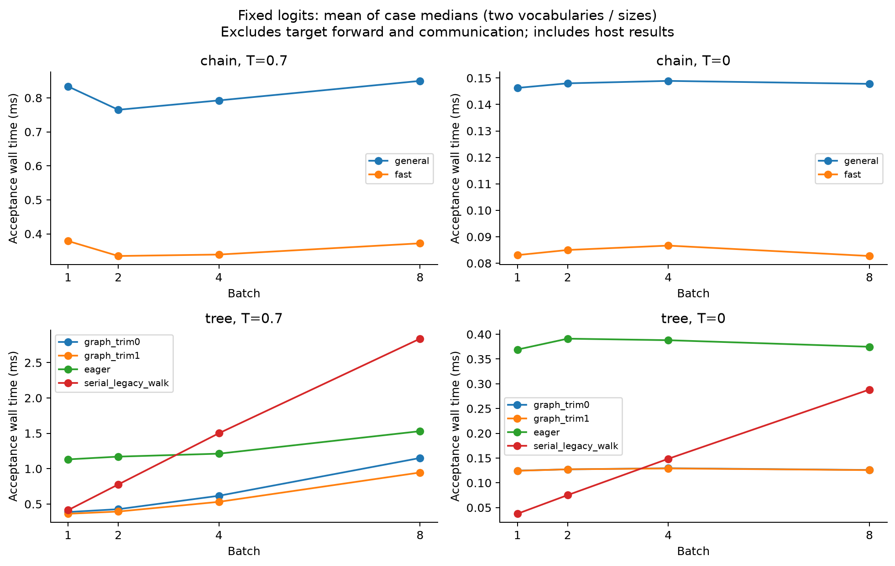
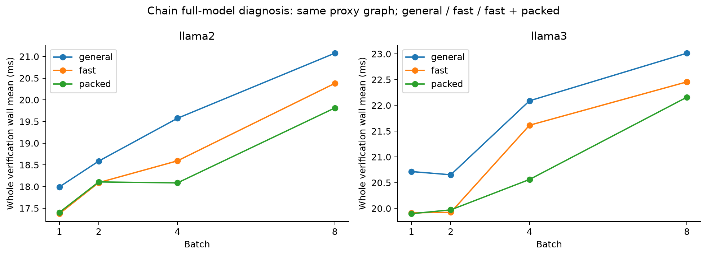
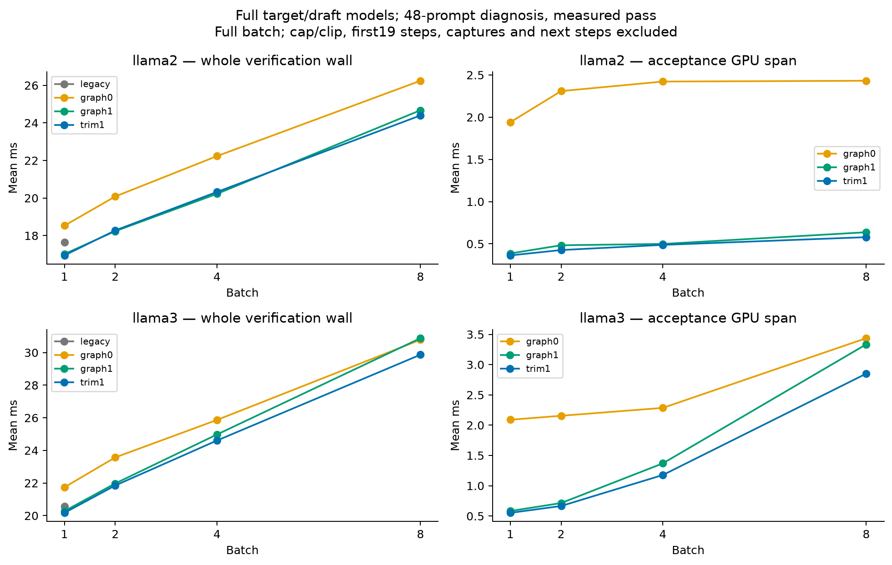
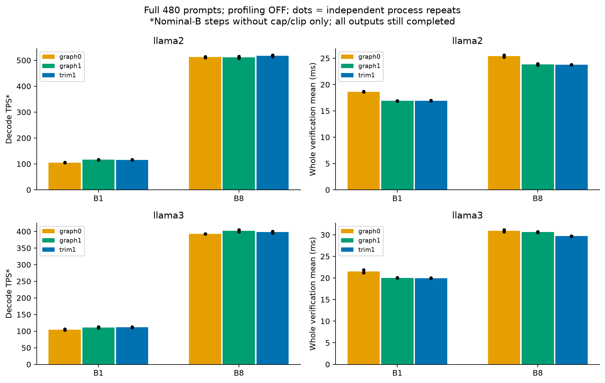
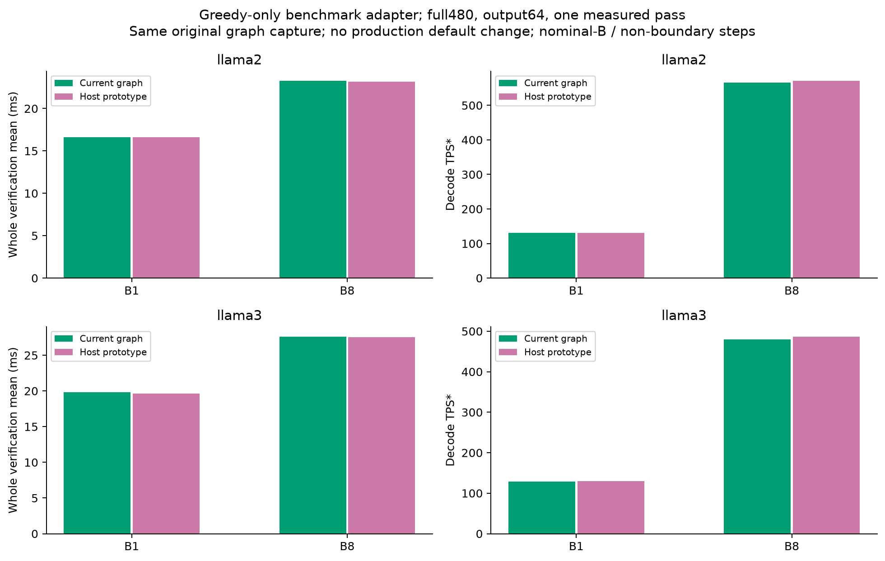
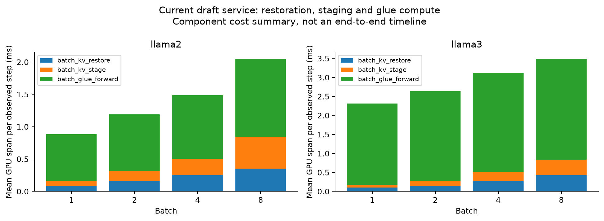

# Round6: 승인 항목 반영 및 verification/KV 검증

상태: 계획한 verification 모델 실험 완료 — tree profile 26/26, chain profile 24/24, full480 T.7 24/24, greedy prototype 16/16. 분석 시작 기준 commit `2fe4596`, branch `feat/duet-mlsys-coverage`.

## 검토 결론과 승인 범위

- 승인 반영: 실제 온도 후보 점수, G>M 정확성 수정, resident/prefill B 상한, 동일 int64 payload wire. 원래 있던 구현을 논문 브랜치에 이번에 병합한 것은 아니다.
- 새 집계: cap/clip 발생 batch-step과 실제 활성 요청 수가 nominal B 미만인 step을 제외. TPS의 token/time, AL, hit는 같은 step 모집단이다. 나머지 요청은 끝까지 생성한다. 원시 TPS와 제외 수를 함께 보관한다.
- Verification과 KV 관련 변경의 **채택 승인은 아직 사용자 검토 대상**이다. 이번에는 진단용 계측 및 benchmark를 추가했고 새로운 KV promotion 정책이나 자동 경로 선택을 도입하지 않았다.
- 고정 입력에서 chain fast 검증은 모든 측정 조건에서 빨랐다. Tree graph는 unified eager 대비 빨랐지만 T0 B1/B2에서는 기존 순차 greedy walk가 더 빨랐다. 단일 구현의 보편적 우위를 주장하지 않는다.
- 공통 prefix/preemption 수정은 예전에 제거한 draft KV promotion과 별개다. 논문 기준 `a82f7d2`에도 tree accepted-path stage/restore가 있다. B>1은 이를 요청 ID 기준으로 확장한 것이다.

## 집계 정의

$S=\{s: B_s=B,\ \neg\mathrm{cap}_s,\ \neg\mathrm{clip}_s\}$, $\mathrm{TPS}^{*}=\sum_{s\in S}\mathrm{emitted}_s/\sum_{s\in S}\mathrm{seconds}_s$.

AL은 recovery를 포함한 요청별 accepted length, hit는 요청별 cache hit이며 S에 포함된 모든 요청 event를 사용한다. 제외 조건의 합집합으로 처리해 cap과 partial-B가 겹쳐도 두 번 빼지 않는다. EOS로 suffix가 잘린 경우도 clip으로 제외한다. EOS 자체가 무조건 제외 사유인 것은 아니다.

`summary.performance`가 이 기준의 주 성능이다. 기존 `decode_tps`, `end_to_end_tps`, `boundary_excluded_*`는 재현을 위해 그대로 남겼다. TPS*는 prefill과 tail을 포함하는 전체 serving throughput과 다르다. Full480 표는 첫480 pass 이후 두 번째480 pass만 사용하고, 전체 raw 파일에는 두 pass 모두 있다.

## 고정 실험 설정

| 항목 | 값 |
|---|---|
| 모델 | dense LayerSkip-Llama2-7B + AMD-Llama-135m; dense LayerSkip-Llama3-8B + Qwama-0.5B-Instruct |
| GPU / TP | RTX4090 24GiB ×2 per run, target TP1 / draft1. Profile PIX2,3와4,5; B1 full L2 NODE0,1 / L3 PIX6,7. 동일 모델의 각 비교 내에서는 같은 pair 사용 |
| Algorithm | K1=4, K2=2; exit L2=21/L3=16; P1/P2 G=M=8/4; C=3; P1 roots2, draft/proxy fanout2/1 |
| Root / tree | residual, topm, overlap mix0, q_path, actual T=.7. 정책 개선 효과와 실행 최적화를 혼합하지 않음 |
| Execution | TREE_EXEC1, FUSED0, BULK0, PARALLEL_INSERT0, proxy stream0, packed tree0. graph0=accept graph OFF/trim0; graph1=ON/trim0; trim1=ON/trim1 |
| Profile | 고정48 입력, B1/2/4/8, 출력96, warm pass8100/측정8101. B1에만 legacy 경로 추가 |
| Full | 저장된6개 group ×80 = 전체480 입력, B1/B8, 출력128, 입력 상한512, 독립 process2회. 각 회에서480 warm+480 measured. 두 번째 반복은 arm 순서 역전 |
| Correctness | 기존 GPU regression300개, 새 집계 unit test3개. Micro chain32/tree64 조건; tree trim0/1 acceptance ladder 확률·residual bitwise 비교 |

Legacy B1과 unified B1은 별도 실행기다. 여기의 legacy는 현재 branch에 남아 있는 기존 B1 경로로, 승인된 온도·공통 수정 등이 포함된다. `a82f7d2` checkout 전체와의 전후 재실행은 아니다. graph0→graph1은 같은 알고리즘이지만 RNG 소비 방식이 달라 생성 출력이 동일한 paired counterfactual이 아니다. 고정 logits micro와 반복 full 측정을 함께 본다. 원 논문의70B/Blackwell TP2 재현 실험은 아니다.

이번 설정은 verification 변경의 영향을 분리하기 위한 고정 대조다. Round5의 개선 root/위치/tree 정책을 다시 튜닝한 최선의 DUET 설정이나 SSD 대비 성능 수치로 해석하지 않는다. SSD를 새로 실행한 비교도 아니다.

## Chain/tree acceptance 고정 입력 측정

BF16 synthetic logits, 단위 ms. 각 조건5회×20호출, 순서 교차, GPU 동기화 후 wall time. 최종 CPU 결과 전송 포함, target forward/통신 제외. 아래는 vocab32k/128256, 노드4/8, tree C1/3 조건별 median의 평균이다. 실제 workload의 shape 가중 평균은 아니다.

| 종류 | T | B | 기준 | 최적화 | ms 전→후 | 변화 |
|---|---:|---:|---|---|---:|---:|
| chain | 0.7 | 1 | general | fast | 0.834→0.379 | -54.6% |
| chain | 0.7 | 2 | general | fast | 0.765→0.335 | -56.2% |
| chain | 0.7 | 4 | general | fast | 0.792→0.339 | -57.2% |
| chain | 0.7 | 8 | general | fast | 0.850→0.372 | -56.2% |
| chain | 0 | 1 | general | fast | 0.146→0.083 | -43.2% |
| chain | 0 | 2 | general | fast | 0.148→0.085 | -42.6% |
| chain | 0 | 4 | general | fast | 0.149→0.087 | -41.8% |
| chain | 0 | 8 | general | fast | 0.148→0.083 | -44.0% |
| tree | 0.7 | 1 | eager | graph_trim1 | 1.132→0.363 | -67.9% |
| tree | 0.7 | 2 | eager | graph_trim1 | 1.170→0.394 | -66.3% |
| tree | 0.7 | 4 | eager | graph_trim1 | 1.212→0.531 | -56.2% |
| tree | 0.7 | 8 | eager | graph_trim1 | 1.530→0.946 | -38.2% |
| tree | 0 | 1 | eager | graph_trim1 | 0.369→0.124 | -66.3% |
| tree | 0 | 2 | eager | graph_trim1 | 0.391→0.127 | -67.5% |
| tree | 0 | 4 | eager | graph_trim1 | 0.388→0.129 | -66.7% |
| tree | 0 | 8 | eager | graph_trim1 | 0.375→0.126 | -66.5% |

Greedy tree의 serial legacy walk는 B1 약0.038ms/B2 약0.075ms로 graph 약0.124/0.127ms보다 빠르다. 따라서 tree graph가 기존 B1 모든 경로보다 빠르다고 쓰면 안 된다. T0는 draft 점수 기반 확률적 p/q 검증이 아닌 target argmax 경로 검증이다.

## Full-model verification 진단

48개 입력의 계측 실행. 같은 full-B/cap 제외 기준에 더해 첫19 step, graph capture step 및 다음 step을 제외한 steady 진단이다. 이 추가 제거는 아래 진단 표에만 적용하며 full TPS*에는 적용하지 않는다. Verification은 기존 `target_verify_times`의 host wall 범위(입력 준비·target 실행·accept 결과 CPU 전달·KV commit dispatch 포함, draft 대기 제외). Acceptance 및 KV 열은 CUDA event span으로, 서로 다른 timing scope다.

| Model | B | 경로 | n | Verify wall mean ms | Accept span mean ms | Restore | Stage | Glue forward |
|---|---:|---|---:|---:|---:|---:|---:|---:|
| llama2 | 1 | graph0 | 1928 | 18.530 | 1.940 | 0.085 | 0.076 | 0.728 |
| llama2 | 1 | graph1 | 1999 | 17.019 | 0.386 | 0.102 | 0.090 | 0.795 |
| llama2 | 1 | legacy | 2068 | 17.634 | — | — | — | — |
| llama2 | 1 | trim1 | 1999 | 16.946 | 0.363 | 0.084 | 0.074 | 0.724 |
| llama2 | 2 | graph0 | 947 | 20.084 | 2.309 | 0.144 | 0.144 | 0.839 |
| llama2 | 2 | graph1 | 929 | 18.238 | 0.483 | 0.154 | 0.148 | 0.855 |
| llama2 | 2 | trim1 | 929 | 18.278 | 0.426 | 0.155 | 0.160 | 0.878 |
| llama2 | 4 | graph0 | 428 | 22.233 | 2.422 | 0.216 | 0.237 | 0.957 |
| llama2 | 4 | graph1 | 441 | 20.224 | 0.499 | 0.227 | 0.237 | 0.954 |
| llama2 | 4 | trim1 | 441 | 20.325 | 0.488 | 0.250 | 0.258 | 0.980 |
| llama2 | 8 | graph0 | 164 | 26.244 | 2.431 | 0.369 | 0.510 | 1.200 |
| llama2 | 8 | graph1 | 181 | 24.674 | 0.637 | 0.470 | 0.568 | 1.342 |
| llama2 | 8 | trim1 | 181 | 24.397 | 0.579 | 0.353 | 0.490 | 1.206 |
| llama3 | 1 | graph0 | 1436 | 21.742 | 2.089 | 0.098 | 0.072 | 2.146 |
| llama3 | 1 | graph1 | 1551 | 20.277 | 0.582 | 0.107 | 0.081 | 2.200 |
| llama3 | 1 | legacy | 1361 | 20.556 | — | — | — | — |
| llama3 | 1 | trim1 | 1551 | 20.171 | 0.552 | 0.100 | 0.079 | 2.136 |
| llama3 | 2 | graph0 | 753 | 23.572 | 2.155 | 0.144 | 0.118 | 2.468 |
| llama3 | 2 | graph1 | 737 | 21.976 | 0.714 | 0.164 | 0.143 | 2.439 |
| llama3 | 2 | trim1 | 737 | 21.852 | 0.665 | 0.145 | 0.122 | 2.376 |
| llama3 | 4 | graph0 | 312 | 25.869 | 2.285 | 0.266 | 0.240 | 2.603 |
| llama3 | 4 | graph1 | 289 | 24.977 | 1.369 | 0.277 | 0.261 | 2.617 |
| llama3 | 4 | trim1 | 289 | 24.608 | 1.177 | 0.263 | 0.236 | 2.623 |
| llama3 | 8 | graph0 | 122 | 30.785 | 3.436 | 0.380 | 0.370 | 2.652 |
| llama3 | 8 | graph1 | 110 | 30.881 | 3.335 | 0.436 | 0.453 | 2.658 |
| llama3 | 8 | trim1 | 110 | 29.870 | 2.851 | 0.427 | 0.407 | 2.656 |

**기존 논문 B1 경로와의 직접 비교**: 아래는 같은48개 입력 설정에서 legacy B1과 unified+trim을 대조한 전체 verification 시간이다. 이후 full480 표의 graph0 기준 개선율과 구분한다. 이48입력 결과를 원 논문70B의 전체 데이터 TPS 개선율로 옮겨 쓰지 않는다.

| Model | Legacy B1 ms | Unified+trim B1 ms | 감소율 |
|---|---:|---:|---:|
| llama2 | 17.634 | 16.946 | 3.90% |
| llama3 | 20.556 | 20.171 | 1.87% |

### Chain full-model 후속 대조

같은 두 모델과 K4/2·exit21/16·T.7, tree OFF. General(packed OFF/fast OFF), fast(packed OFF/fast ON), packed(packed ON/fast ON). 48입력, 첫pass8300/측정8301, 출력96, 시작 draft seed73. 모든 arm에서 proxy graph는 켜서 acceptance/packing 변경을 분리한다. 이 표도 steady profile latency이며 full480 TPS가 아니다.

| Model | B | 경로 | n | Verify wall mean ms | Chain accept span ms |
|---|---:|---|---:|---:|---:|
| llama2 | 1 | fast | 2001 | 17.375 | 0.791 |
| llama2 | 1 | general | 2001 | 17.992 | 1.401 |
| llama2 | 1 | packed | 2001 | 17.405 | 0.798 |
| llama2 | 2 | fast | 1094 | 18.092 | 0.852 |
| llama2 | 2 | general | 1094 | 18.588 | 1.463 |
| llama2 | 2 | packed | 1085 | 18.108 | 0.848 |
| llama2 | 4 | fast | 457 | 18.593 | 0.769 |
| llama2 | 4 | general | 457 | 19.574 | 1.596 |
| llama2 | 4 | packed | 486 | 18.085 | 0.725 |
| llama2 | 8 | fast | 208 | 20.379 | 0.836 |
| llama2 | 8 | general | 208 | 21.075 | 1.497 |
| llama2 | 8 | packed | 197 | 19.812 | 0.877 |
| llama3 | 1 | fast | 1515 | 19.914 | 0.748 |
| llama3 | 1 | general | 1515 | 20.715 | 1.511 |
| llama3 | 1 | packed | 1515 | 19.897 | 0.748 |
| llama3 | 2 | fast | 808 | 19.924 | 0.727 |
| llama3 | 2 | general | 808 | 20.653 | 1.436 |
| llama3 | 2 | packed | 808 | 19.972 | 0.801 |
| llama3 | 4 | fast | 270 | 21.614 | 0.883 |
| llama3 | 4 | general | 270 | 22.089 | 1.463 |
| llama3 | 4 | packed | 273 | 20.561 | 0.758 |
| llama3 | 8 | fast | 110 | 22.456 | 0.894 |
| llama3 | 8 | general | 110 | 23.013 | 1.512 |
| llama3 | 8 | packed | 114 | 22.159 | 0.883 |

| Model | B | General→fast verify ms | 감소율 | Fast→packed verify ms | 추가 감소율 |
|---|---:|---:|---:|---:|---:|
| llama2 | 1 | 17.992→17.375 | +3.43% | 17.375→17.405 | -0.17% |
| llama2 | 2 | 18.588→18.092 | +2.67% | 18.092→18.108 | -0.09% |
| llama2 | 4 | 19.574→18.593 | +5.01% | 18.593→18.085 | +2.73% |
| llama2 | 8 | 21.075→20.379 | +3.30% | 20.379→19.812 | +2.78% |
| llama3 | 1 | 20.715→19.914 | +3.87% | 19.914→19.897 | +0.08% |
| llama3 | 2 | 20.653→19.924 | +3.53% | 19.924→19.972 | -0.24% |
| llama3 | 4 | 22.089→21.614 | +2.15% | 21.614→20.561 | +4.87% |
| llama3 | 8 | 23.013→22.456 | +2.42% | 22.456→22.159 | +1.32% |

Packed는 짧은 proposal의 padding을 줄이는 추가 경로이며 fast acceptance와 별도다. B1에서는 기존 dense 경로를 사용하므로 packed arm과 fast arm 차이는 packing 효과가 아니다. Query 절감보다 입력 준비·graph bucket 비용이 클 수 있어 B2 이상도 측정 결과를 확인한다.

General→fast의 측정 pass 출력은 8/8 model/B 대조에서 모두 같았다. Warm pass까지 포함한 검사는 AUDIT.json의 chain_fast_output_controls에 있다. Fast→packed는 계산 shape가 바뀌며 여러 B>1 조건에서 생성 경로도 달랐다. Packed의 시간 차이를 완전히 같은 token 궤적의 연산 차이로 해석하지 않는다.

Legacy의 빈 칸은 비용0이 아니라 해당 batched label이 없다는 뜻이다. Legacy `tree_kv_restore` 등은 MODEL_RESULTS.json의 전체 label 통계를 본다. 상세 host dispatch와 CUDA span을 모두 보관한다.

## Full480: 프로파일링 OFF

각 셀은 독립 process 반복들의 평균 [최소, 최대]. 반복2개로 유의성을 확정하지 않는다. AL/hit/TPS*는 같은 full-B/non-boundary step들만 반영한다. Raw TPS는 tail과 terminal step을 포함한다.

| Model | B | 경로 | 반복 | AL* | Hit* % | TPS* [min,max] | Raw TPS | Verify ms [min,max] | 제외 step % |
|---|---:|---|---:|---:|---:|---:|---:|---:|---:|
| llama2 | 1 | graph0 | 2 | 2.109 | 80.43 | 105.35 [104.21,106.50] | 105.34 | 18.647 [18.612,18.681] | 1.52 |
| llama2 | 1 | graph1 | 2 | 2.122 | 80.40 | 116.38 [115.67,117.08] | 116.38 | 16.901 [16.872,16.929] | 1.53 |
| llama2 | 1 | trim1 | 2 | 2.122 | 80.40 | 116.05 [115.85,116.26] | 116.05 | 16.931 [16.905,16.956] | 1.53 |
| llama2 | 8 | graph0 | 2 | 2.120 | 80.29 | 512.24 [510.29,514.19] | 495.35 | 25.406 [25.253,25.559] | 12.64 |
| llama2 | 8 | graph1 | 2 | 2.119 | 80.39 | 511.67 [508.31,515.03] | 500.12 | 23.838 [23.718,23.957] | 12.64 |
| llama2 | 8 | trim1 | 2 | 2.119 | 80.39 | 517.16 [515.02,519.30] | 504.69 | 23.758 [23.753,23.763] | 12.64 |
| llama3 | 1 | graph0 | 2 | 2.485 | 69.33 | 104.71 [103.08,106.33] | 104.30 | 21.522 [21.208,21.835] | 2.22 |
| llama3 | 1 | graph1 | 2 | 2.469 | 69.18 | 111.08 [109.82,112.34] | 110.57 | 20.035 [19.973,20.096] | 2.20 |
| llama3 | 1 | trim1 | 2 | 2.469 | 69.18 | 111.44 [110.53,112.34] | 110.93 | 19.963 [19.941,19.984] | 2.20 |
| llama3 | 8 | graph0 | 2 | 2.478 | 68.52 | 392.98 [392.82,393.14] | 373.16 | 30.935 [30.728,31.142] | 18.05 |
| llama3 | 8 | graph1 | 2 | 2.481 | 68.42 | 402.16 [399.44,404.88] | 388.13 | 30.624 [30.560,30.687] | 18.17 |
| llama3 | 8 | trim1 | 2 | 2.481 | 68.42 | 397.87 [395.71,400.04] | 383.67 | 29.670 [29.630,29.710] | 18.17 |

| Model | B | 비교 (graph0 기준) | 반복 | Verify 평균 변화 | TPS* 평균 변화 [반복 범위] |
|---|---:|---|---:|---:|---:|
| llama2 | 1 | graph1 | 2 | -9.36% | +10.47% [+9.93,+11.00] |
| llama2 | 1 | trim1 | 2 | -9.20% | +10.17% [+9.16,+11.17] |
| llama2 | 8 | graph1 | 2 | -6.17% | -0.11% [-1.14,+0.93] |
| llama2 | 8 | trim1 | 2 | -6.48% | +0.96% [+0.93,+0.99] |
| llama3 | 1 | graph1 | 2 | -6.89% | +6.09% [+5.65,+6.54] |
| llama3 | 1 | trim1 | 2 | -7.23% | +6.44% [+5.65,+7.23] |
| llama3 | 8 | graph1 | 2 | -1.00% | +2.34% [+1.69,+2.99] |
| llama3 | 8 | trim1 | 2 | -4.08% | +1.25% [+0.73,+1.76] |

변화율은 각 반복 내 같은 seed/GPU pair 대조의 변화율을 구한 뒤 평균했다. Graph의 효과와 trim의 추가 효과는 분리해야 하며, graph1↔trim1의 출력 일치 및 상대 변화는 COMPARISONS.json의 trim_controls에 기록한다.

### TPS가 verification 시간만 따라가지 않는 이유

같은 B를 유지하는 포함 step에서는 $TPS^*=B\times AL^*/\overline{t}_{step}$이다. 아래의 나머지 시간은 step wall minus verification wall이며 draft 응답 대기, scheduler, 후처리 등을 포함한다. 특정 원인 하나로 전부 해석하지 않는다.

| Run | Step mean ms | Verification mean ms | 나머지 mean ms |
|---|---:|---:|---:|
| llama2_b1_graph0_full_r0 | 20.138 | 18.681 | 1.456 |
| llama2_b1_graph0_full_r1 | 19.900 | 18.612 | 1.288 |
| llama2_b1_graph1_full_r0 | 18.304 | 16.929 | 1.375 |
| llama2_b1_graph1_full_r1 | 18.162 | 16.872 | 1.290 |
| llama2_b1_trim1_full_r0 | 18.276 | 16.905 | 1.371 |
| llama2_b1_trim1_full_r1 | 18.291 | 16.956 | 1.335 |
| llama2_b8_graph0_full_r0 | 33.243 | 25.559 | 7.684 |
| llama2_b8_graph0_full_r1 | 32.974 | 25.253 | 7.721 |
| llama2_b8_graph1_full_r0 | 33.472 | 23.957 | 9.515 |
| llama2_b8_graph1_full_r1 | 32.788 | 23.718 | 9.070 |
| llama2_b8_trim1_full_r0 | 32.764 | 23.753 | 9.011 |
| llama2_b8_trim1_full_r1 | 32.788 | 23.763 | 9.026 |
| llama3_b1_graph0_full_r0 | 24.159 | 21.835 | 2.323 |
| llama3_b1_graph0_full_r1 | 23.324 | 21.208 | 2.116 |
| llama3_b1_graph1_full_r0 | 22.370 | 20.096 | 2.274 |
| llama3_b1_graph1_full_r1 | 22.085 | 19.973 | 2.112 |
| llama3_b1_trim1_full_r0 | 22.225 | 19.984 | 2.240 |
| llama3_b1_trim1_full_r1 | 22.086 | 19.941 | 2.145 |
| llama3_b8_graph0_full_r0 | 50.917 | 31.142 | 19.776 |
| llama3_b8_graph0_full_r1 | 49.970 | 30.728 | 19.242 |
| llama3_b8_graph1_full_r0 | 49.378 | 30.687 | 18.691 |
| llama3_b8_graph1_full_r1 | 49.330 | 30.560 | 18.770 |
| llama3_b8_trim1_full_r0 | 49.975 | 29.710 | 20.265 |
| llama3_b8_trim1_full_r1 | 49.796 | 29.630 | 20.166 |

L2 B8의 첫 반복에서는 graph0→graph1에서 verification25.559→23.957ms, 나머지7.684→9.515ms로 움직였다. 전체 step33.243→33.472ms와 AL2.137→2.127이 함께 반영되어 TPS514.19→508.31이었다. Profile에서도 draft P1/P2가 긴 구성임을 확인한다. 다른 생성 궤적과 반복 변동이 있으므로 이 차이만으로 graph가 TPS를 인과적으로 악화시킨다고 확정하지 않는다.

| Profile | Draft P1 mean ms | Draft P2 mean ms | Target spec wait mean ms |
|---|---:|---:|---:|
| llama2_b8_graph0_profile | 20.159 | 9.153 | 7.441 |
| llama2_b8_graph1_profile | 21.059 | 9.933 | 11.403 |
| llama2_b8_trim1_profile | 20.269 | 9.106 | 8.973 |
| llama3_b8_graph0_profile | 27.948 | 13.069 | 18.762 |
| llama3_b8_graph1_profile | 28.045 | 13.163 | 18.686 |
| llama3_b8_trim1_profile | 28.014 | 13.132 | 19.534 |

## Greedy tree: 추가 실험용 개선

32개 fixed-input 조건에서 target의 모든 문맥별 argmax ID를 한 번에 CPU로 옮기고, 이미 CPU에 있는 각 요청의 parent/token 정보로 greedy 경로를 따라갔다. Graph/reference와 path·recovery·terminal이 모두 일치했다. 생산 기본 경로에는 반영하지 않았다.

실제 모델 대조는 benchmark adapter로만 적용한다. `mlsys_review_greedy_hook.py`가 현재 verifier에 CPU metadata 저장 한 줄을 넣고 greedy replay만 바꾼다. 원래 graph capture는 양쪽 모두 수행하므로 warmup/예약 메모리는 유지한다. T>0 구현은 그대로이며 probability-based 예산 계산도 바꾸지 않는다. Adapter0/1을 동일 모델·GPU pair·K4/2·exit21/16·C3·T0·출력64·seed8400/8401·draft74에서 비교한다.48입력 profile과 full480 두 pass(뒤 pass 측정)를 각각 실행한다. 새로운 production 선택 기준이나 파라미터를 추가한 결과가 아니다.

| Model | B | Scope | Host | AL* | Hit* % | TPS* | Verify wall mean ms |
|---|---:|---|---:|---:|---:|---:|---:|
| llama2 | 1 | full | 0 | 2.325 | 84.21 | 130.60 | 16.613 |
| llama2 | 1 | profile | 0 | 2.445 | 85.67 | 133.38 | 16.851 |
| llama2 | 1 | full | 1 | 2.325 | 84.21 | 130.64 | 16.591 |
| llama2 | 1 | profile | 1 | 2.445 | 85.67 | 135.26 | 16.701 |
| llama2 | 8 | full | 0 | 2.282 | 84.34 | 565.96 | 23.246 |
| llama2 | 8 | profile | 0 | 2.409 | 85.29 | 591.97 | 24.385 |
| llama2 | 8 | full | 1 | 2.282 | 84.34 | 570.47 | 23.139 |
| llama2 | 8 | profile | 1 | 2.409 | 85.29 | 590.09 | 24.360 |
| llama3 | 1 | full | 0 | 2.811 | 74.76 | 128.71 | 19.823 |
| llama3 | 1 | profile | 0 | 2.935 | 75.31 | 133.58 | 19.821 |
| llama3 | 1 | full | 1 | 2.811 | 74.76 | 130.15 | 19.646 |
| llama3 | 1 | profile | 1 | 2.935 | 75.31 | 132.22 | 19.930 |
| llama3 | 8 | full | 0 | 2.816 | 74.94 | 480.16 | 27.607 |
| llama3 | 8 | profile | 0 | 2.947 | 75.21 | 500.39 | 27.974 |
| llama3 | 8 | full | 1 | 2.816 | 74.94 | 486.72 | 27.551 |
| llama3 | 8 | profile | 1 | 2.947 | 75.21 | 495.50 | 27.962 |

Profile 행의 TPS는 계측 overhead가 포함되므로 full 행과 직접 비교하지 않는다. Full-model output equality와 상대 latency/TPS는 GREEDY_COMPARISONS.json에 보관한다. 이 대조는 T0, B1/B8, 두 dense 모델과 명시된 길이 범위의 근거다. Micro에서 batch별 graph→host는 B1 .137→.037ms, B2 .139→.038ms, B4 .141→.039ms, B8 .133→.041ms였다. 미시적인 약0.1ms 단축을 큰 TPS 향상으로 과장하지 않는다.

T0의 proposal/verification은 argmax다. 기존 `root_policy.probabilities`는 T0에서도 예산 순위 계산에 필요한 soft score를 유지하며, 이 실험은 그 규칙을 바꾸지 않는다. T>0에서 실제 온도로 확률을 계산하는 승인 항목과, greedy의 보조 점수 정의는 구분한다.

| Model | B | Scope | Warm/측정 출력 동일 | AL/hit/집계 동일 | Verify 변화 | TPS* 변화 |
|---|---:|---|---|---|---:|---:|
| llama2 | 1 | profile | [True, True] | True | -0.89% | +1.41% |
| llama2 | 1 | full | [True, True] | True | -0.13% | +0.03% |
| llama2 | 8 | profile | [True, True] | True | -0.10% | -0.32% |
| llama2 | 8 | full | [True, True] | True | -0.46% | +0.80% |
| llama3 | 1 | profile | [True, True] | True | +0.55% | -1.01% |
| llama3 | 1 | full | [True, True] | True | -0.89% | +1.12% |
| llama3 | 8 | profile | [True, True] | True | -0.05% | -0.98% |
| llama3 | 8 | full | [True, True] | True | -0.21% | +1.37% |

Full480에서 관측한 TPS 변화 범위는 +0.03–+1.37%다. Model/B별 독립 process 대조1회이므로 이 작은 차이의 통계적 우위를 확정하지 않는다. Micro에서의 큰 상대 개선율만으로 기본 구현 교체를 정당화하지 않으며, 실험용 후보로 남긴다.

## KV: 무엇을 비교했고 무엇을 바꾸지 않았는가

1. **공통 KV/요청 상태 수정**: SGL paged prefix prefill에서 실제 page table/요청별 길이를 읽기, 완전히 cached된 block-aligned prompt에서 마지막 query1개 유지, preemption 후 원래 출력 경계/남은 예산 유지, 완성된 block의 정확한 page에 hash 기록. 논리 주소를 바로 읽도록 하는 수정이며 전체 KV를 연속 공간으로 재조립하는 정책이 아니다.
2. **기존 tree stage/restore**: target 검증 후 수락된 경로를 canonical prefix 위치에 반영하고, draft glue 결과를 저장했다가 다음 요청의 수락 경로에 맞춰 복원한다. Paper base `a82f7d2`의 `draft_runner.py`에도 `_tree_staged_kv`와 `tree_kv_restore`가 있다. B>1은 요청별 snapshot과 현재 page table을 사용한다.
3. **제거된 KV promotion**: draft 후보 KV를 재사용해 confirmed-chain glue 전체 forward를 gather+tip1 forward로 대체하려던 별도 최적화. 과거20입력/out256 실험에서 Tdraft44.63→45.25ms, TPS76.06→76.49였고 비용 이득이 없어 제거했다. 당시 원래 build 시점 page table을 보존해야 했던 함정도 기록돼 있다. 이번에 되살리지 않았다.

**Glue의 대상도 구분해야 한다.** 현재 tree serving의 glue는 확정된 과거 prefix 뒤에 `[recovery + 현재 응답 tree 노드]`를 ancestor mask로 한 번 계산한다. Target이 그 tree를 검증하는 동안 다음 후보를 준비해야 하므로, 아직 확정되지 않은 여러 outcome context가 필요하다. 다음 요청에서 이전 tree의 수락 경로가 확정되면 그 경로만 canonical prefix로 복원한다. 과거 chain glue를 gather+tip1로 대체한 실험과 현재 branching-tree glue의 전체 대체는 같은 작업이 아니다.

과거 근거: [KV promotion 설계](../../../ssd/docs/duet/11-kv-promo-design.md), [당시 결과](../../../ssd/experiments/proxy_async_overlap/kv_promo/RESULTS.md).

### 현재 stage/restore/glue 비용

전체 verification과 draft glue는 서로 다른 GPU/phase 구간이다. 위 비용을 단순 합산해 end-to-end TPS 증가량으로 바꾸지 않는다.

### 유지된 KV 복사 vs confirmed-chain 재계산 진단

실제 draft 모델, B1/2/4/8, context127/511, C1N8/C3N8/C3N16, 연속/불연속 물리 page. 조건별15회 순서 교차. 각 treatment 직전 원 KV 복원은 timing 밖이다. Snapshot clone+accepted path scatter+tip1 forward와 confirmed-chain one-forward를 비교한다. 이는 단일 유효 tree KV를 이미 보유하고 그중 한 경로를 택한 낙관적 micro이다. 실제 tree glue의 모든 outcome별 fork logits 및 아직 KV가 없는 leaf 계산을 대체하는 serving A/B가 아니며, cache 전체 보존/통신 비용도 없다.

| Draft / dtype | B | C | cases | copy ms | copy+tip ms | chain glue ms | max TV | argmax 불일치 cases |
|---|---:|---:|---:|---:|---:|---:|---:|---:|
| AMD FP16 | 1 | 1 | 4 | 0.059 | 0.660 | 0.674 | 0.00152 | 0 |
| AMD FP16 | 1 | 3 | 8 | 0.059 | 0.659 | 0.654 | 0.00208 | 0 |
| AMD FP16 | 2 | 1 | 4 | 0.060 | 0.741 | 0.812 | 0.00143 | 0 |
| AMD FP16 | 2 | 3 | 8 | 0.059 | 0.736 | 0.688 | 0.00171 | 0 |
| AMD FP16 | 4 | 1 | 4 | 0.058 | 0.797 | 0.901 | 0.00116 | 0 |
| AMD FP16 | 4 | 3 | 8 | 0.069 | 0.825 | 0.822 | 0.00178 | 0 |
| AMD FP16 | 8 | 1 | 4 | 0.084 | 1.013 | 1.353 | 0.00211 | 0 |
| AMD FP16 | 8 | 3 | 8 | 0.071 | 0.959 | 1.028 | 0.00190 | 0 |
| Qwama BF16 | 1 | 1 | 4 | 0.056 | 1.713 | 2.390 | 0.00779 | 0 |
| Qwama BF16 | 1 | 3 | 8 | 0.055 | 1.682 | 2.027 | 0.01228 | 2 |
| Qwama BF16 | 2 | 1 | 4 | 0.058 | 1.877 | 2.463 | 0.01185 | 0 |
| Qwama BF16 | 2 | 3 | 8 | 0.059 | 1.875 | 2.074 | 0.01497 | 0 |
| Qwama BF16 | 4 | 1 | 4 | 0.072 | 1.945 | 2.612 | 0.01249 | 0 |
| Qwama BF16 | 4 | 3 | 8 | 0.067 | 1.922 | 2.432 | 0.01511 | 0 |
| Qwama BF16 | 8 | 1 | 4 | 0.068 | 1.992 | 2.850 | 0.01803 | 0 |
| Qwama BF16 | 8 | 3 | 8 | 0.072 | 2.004 | 2.601 | 0.02903 | 4 |
| Qwama FP16 진단 | 1 | 1 | 4 | 0.049 | 1.691 | 2.308 | 0.00077 | 0 |
| Qwama FP16 진단 | 1 | 3 | 8 | 0.053 | 1.681 | 1.975 | 0.00152 | 2 |
| Qwama FP16 진단 | 2 | 1 | 4 | 0.055 | 1.841 | 2.328 | 0.00167 | 0 |
| Qwama FP16 진단 | 2 | 3 | 8 | 0.057 | 1.842 | 2.010 | 0.00136 | 0 |
| Qwama FP16 진단 | 4 | 1 | 4 | 0.056 | 1.840 | 2.382 | 0.00128 | 0 |
| Qwama FP16 진단 | 4 | 3 | 8 | 0.057 | 1.841 | 2.337 | 0.00166 | 0 |
| Qwama FP16 진단 | 8 | 1 | 4 | 0.057 | 1.907 | 2.599 | 0.00230 | 0 |
| Qwama FP16 진단 | 8 | 3 | 8 | 0.057 | 1.899 | 2.401 | 0.00351 | 0 |

수치 진단: AMD48조건에서는 argmax 불일치0, 최대TV0.00211. Qwama BF16은6/48조건에서 하나 이상의 argmax 차이, 최대TV0.02903; FP16 진단은2/48, 최대TV0.00351. 이들은 합성 입력의 case 수이며 실제 데이터에서의 오류율 추정이 아니다.

Qwama BF16 분기형 tree(C3)의 KV는 **같은 query 폭으로 재계산한 경로 KV와 bitwise 일치**했다. 더 짧은 glue나 tip-only 계산에서는 shape-dependent 수치 차이가 있다. 이를 구조적 page 복원 오류와 구분할 근거는 있지만, 모든 shape/dtype에서 greedy 출력이 동일하다는 보장은 아니다. 진단의 TV1%는 문제 조사 trigger였고 losslessness 허용 오차가 아니다. `complete_diagnostic`를 정확성 통과로 읽지 않는다.

**여기서 비교한 것은 draft 모델의 KV/logits다.** Draft의 수치 차이나 argmax 차이만으로 target losslessness가 깨지는 것은 아니다. Draft proposal은 달라져도, 실제 생성에 사용한 q를 verifier에 정확히 전달하고 target의 조건부 p를 올바른 문맥에서 계산하면 SD의 분포 보존 조건은 유지된다. 이번 probe가 보장하지 않는 것은 복사/재계산의 bitwise 동일성 및 새 promotion serving 전체의 q·KV lifetime 계약이다. Target prefix cache가 다른 요청의 문맥을 읽는 오류와 구분해야 한다.

### Prefix reuse full-model 측정

별도 AR 모델에서 첫8개 입력의 token열을 반복해 길이512/768/800으로 구성하고 B1/B8, greedy8출력, cold/cached 순서 교차3회. Cold는 완료된 요청의 hash lookup만 비우며, 두 arm 모두 수정된 정상 구현이다. 측정은 반복 prompt에 대한 prefill latency이고 일반 workload의 hit율/TPS가 아니다.

| Model | B | Prompt | Cold prefill ms | Cached prefill ms | Cached token count range | Output equality |
|---|---:|---:|---:|---:|---|---|
| llama2 | 1 | 512 | 46.401 | 20.489 | 511–511 | 3/3 repeats |
| llama2 | 1 | 768 | 69.944 | 20.567 | 767–767 | 3/3 repeats |
| llama2 | 1 | 800 | 77.849 | 23.381 | 768–768 | 3/3 repeats |
| llama2 | 8 | 512 | 364.445 | 19.822 | 511–511 | 3/3 repeats |
| llama2 | 8 | 768 | 558.817 | 21.193 | 767–767 | 3/3 repeats |
| llama2 | 8 | 800 | 588.625 | 30.632 | 768–768 | 3/3 repeats |
| llama3 | 1 | 512 | 50.302 | 19.016 | 511–511 | 3/3 repeats |
| llama3 | 1 | 768 | 75.046 | 18.786 | 767–767 | 3/3 repeats |
| llama3 | 1 | 800 | 83.721 | 20.656 | 768–768 | 3/3 repeats |
| llama3 | 8 | 512 | 376.972 | 20.187 | 511–511 | 3/3 repeats |
| llama3 | 8 | 768 | 566.035 | 20.492 | 767–767 | 3/3 repeats |
| llama3 | 8 | 800 | 592.096 | 29.593 | 768–768 | 3/3 repeats |

## 검토 시 구분할 한계 / 남은 승인

- Verification: 고정-logits acceptance 단축과 전체 model verification/TPS 효과를 구분한다. B1 legacy→unified의 효과를 graph OFF→ON 비교로 대체하지 않는다. T0의 작은 batch는 경로 선택 개선 여지가 남는다. 이번에는 그 선택 정책을 자동 도입하지 않았다.
- KV: 공통 정확성 수정과 KV promotion 채택은 별도다. 새 promotion의 전체 serving 성능·lifetime·수치 계약이 검증됐다고 주장하지 않는다. 기존 correct stage/restore를 제거한 “빠른” 경로도 만들지 않았다.
- 데이터 범위: B2/B4는48입력 진단과 fixed-input micro; full480은 B1/B8이다. 주 비교 온도는 T=.7이며, T0의 추가 host prototype은 별도 절의 출력64·profile/full480 대조 범위다. 출력128, target7B/8B, TP1 결과를70B/TP2나 긴 문맥 전체에 일반화하지 않는다.
- 승인된 집계는 조건부 비교다. 제외율이 큰 설정을 raw serving TPS보다 좋아 보이게 발표하지 않도록 원시 TPS와 제외 수를 같이 확인한다.
- 결과 재현: `python archive_results.py --restore`(다른 서버), `python analyze.py`, `python compare.py`, `python compare_greedy.py`, `python make_figures.py`, `python make_report.py`, `python audit_results.py --require-complete`. 모델 실행 인자/환경은 각 plan.json과 raw 결과에 기록. [계획](PLAN.md), [실패 기록](FAILURES.md), [전체 모델 수치](MODEL_RESULTS.json), [micro 수치](MICRO.json), [KV 수치](KV_RESULTS.json).

## 다른 서버에서 검토·재실행

1. 채택 여부는 상위 MERGE_REVIEW.md 26절에서 확인한다. 이 결과를 가져오는 것과 논문 branch에 추론 코드를 병합하는 것은 별도다.
2. `archive_results.py --restore`는 gzip 원본을 SHA256 검사 후 복원한다. 기존 raw가 다르면 덮어쓰지 않고 중단한다. 실패 실행도 보존한다.
3. 같은 디렉터리에서 위 분석 명령들을 순서대로 실행한다. AUDIT.json은 매 pass의 실제 반환 token 합, 집계 모집단, B 상한, 두 pass 출력 대조, 외부 GPU 프로세스 유무를 검사한다.
4. 모델 실행을 다시 할 때는 plan의 target/draft/prompts/profile 경로를 새 서버에 맞게 바꾼 사본을 사용한다. 원 plan과 원 raw를 덮어쓰지 않는다. 기존 `ssd/bench/mlsys_campaign.py --plan PLAN --directory NEW_DIR --gpus I,J --port PORT`로 실행한다. 각 모델의 비교 arm은 같은 GPU pair에서 순차 실행해야 한다.
5. 원래 실행한 tree profile, B1/B8 full, chain profile, greedy prototype은 아래 plan에 있다. Full에는 repeat0/1의 역순 실행과 warm/측정 두 seed가 포함된다. Greedy model 대조는 benchmark module을 import해 해당 process의 replay만 대체하며 생산 소스 파일을 바꾸지 않는다.

| Suite | Plan | 원 GPU pair L2 / L3 |
|---|---|---|
| Tree profile | `{model}_profile_plan.json` (실행 사본은 각 campaign의 plan.json) | 2,3 / 4,5 |
| Tree full B1 | `{model}_b1_full_plan.json` | 0,1 / 6,7 |
| Tree full B8 | `{model}_b8_full_plan.json` | 2,3 / 4,5 |
| Chain profile | `{model}_chain_profile_plan.json` | 2,3 / 4,5 |
| Greedy prototype | `{model}_greedy_review_plan.json` | 2,3 / 4,5 |

MODEL_MANIFEST.json은 config/tokenizer의 SHA256과 weight shard의 크기·해결된 경로를 기록한다. 큰 weight 파일 전체의 SHA256을 계산한 manifest는 아니다. Raw 결과에는 실행 당시 Python 소스 SHA256도 있다. 기본 추론 파일은 측정 도중 바꾸지 않았으며, greedy host1의 메모리 내 adapter는 별도 실행 변경으로 표시했다.

새 성능은 `summary.performance`에서 읽는다. 과거 `decode_tps`를 같은 뜻으로 바꾸거나 과거 그림 수치를 덮어쓰지 않는다. 오래된 AR raw에 actual B 정보가 없으면 정확한 tail 제외를 추정하지 않고 재실행해야 한다.
