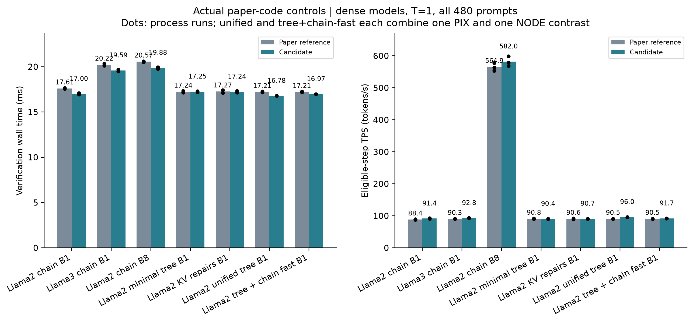
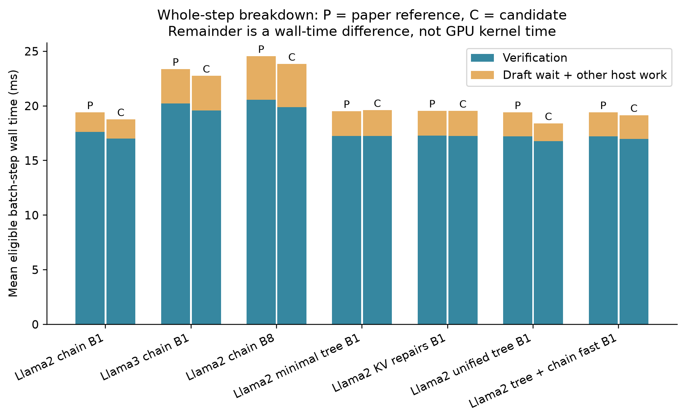
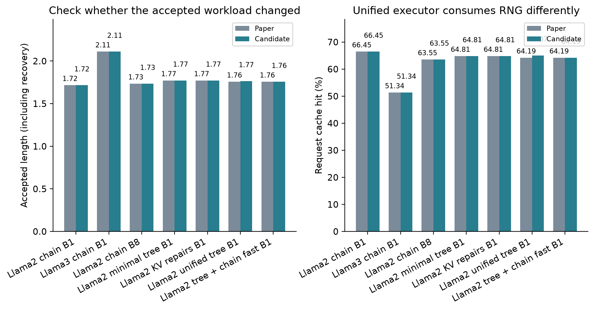
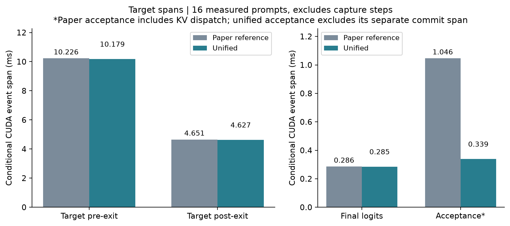
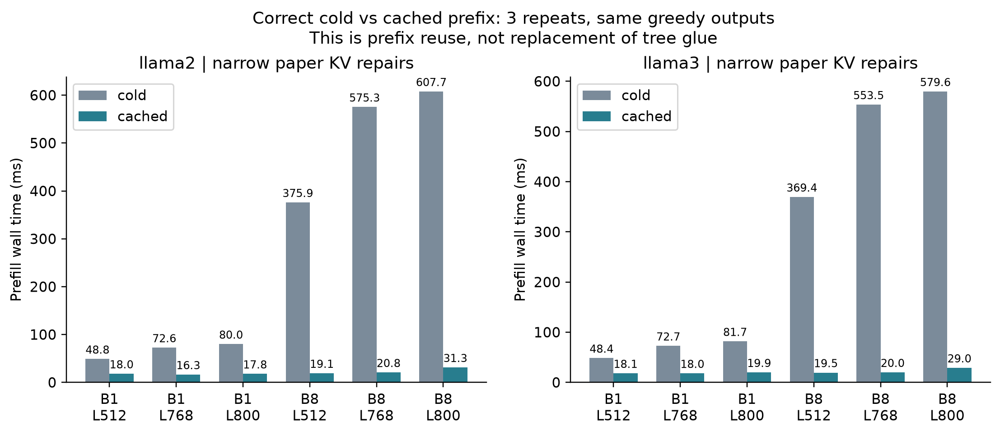

# Round7 — 원 논문 코드 기준 latency 검증과 선별 이식

이번 검토의 기준은 원 논문 commit `a82f7d2`의 실제 실행이다. Round6의
`graph OFF`는 현재 unified 실행기의 옵션이었으므로, 그 개선율을 원 논문
코드 대비 개선율로 설명한 것은 부정확했다. 이번에는 두 기준을 분리했다.

**선별 이식 원칙**

| 항목 | 판정 | 이유 / 이식 범위 |
|---|---|---|
| 양의 온도 chain fast | 이식 추천, 사용자 채택 검토 대상 | 원본과 같은 출력·AL·hit를 유지하며 전체 verification latency 감소. `01_chain_fast.patch`만 가져올 수 있음 |
| 최소 B1 tree graph 후보 | 이식하지 않는 것을 추천 | 두 full480 대조에서 verification 변화 방향이 뒤집히고 TPS도 개선되지 않음. `02`는 재현용 후보로만 보관 |
| 현재 unified tree 실행기 전체 | 실제 이득 확인, 최소 수정과 분리해 채택 검토 | 원 논문 B1 대비 PIX verification−2.26%/TPS+5.47%, NODE−2.75%/+6.66%. RNG·AL·통신/실행 경로도 달라진 묶음 비교. `02`와 다른 구현 |
| 공통 KV 정확성 수정 | 정확성 수정으로 이식 추천, 속도 향상 기여로 주장하지 않음 | 원본 결함4개 재현→수정 후 통과. 일반 decode latency 차이는 반복마다 방향이 달라 실질적 개선이라고 볼 수 없음. `03_kv_correctness.patch` |
| Packed chain/tree, 새 KV promotion | 이번 최소 이식에서 제외 | 별도 실행 경로/자료구조 변경. Chain fast의 효과와 분리해야 하며, 이번 실험은 이를 필요조건으로 사용하지 않음 |

01은 CPU에 이미 있는 온도 정보로 확률 검증 경로를 선택하고, 필요 없는
greedy 계산·GPU 조건 확인·여러 번의 결과 복사를 줄인다. Target forward나
draft/root/tree 정책을 바꾸지 않는다. SSD와 DUET가 공유하는 코드이므로
향후 baseline에도 동일하게 적용해야 한다. DUET만의 알고리즘 기여로 세면
안 된다. T=0·mixed-temperature·non-JIT 경로는 이 패치에서 원본을 유지한다.

02의 graph는 원본의 방문 순서와 난수 사용을 유지하려고 각 노드의 조건부
residual 후보를 미리 계산한다. 원본은 실제 방문한 경로만 계산한다.
Graph replay 자체가 빨라도 추가 후보 계산, metadata 준비·전송, CPU walk가
남는다. 이 비용 구조가 있어 micro의 일부 이득을 전체 tree verification의
이득으로 바로 옮길 수 없다. 실제 full480에서 얻은 결론은 **이 후보의
전체 latency 개선이 재현되지 않았다**는 것이며, 모든 tree graph가
불가능하다는 뜻은 아니다.

현재 unified 실행기 전체는 원본 대비 이득이 관측됐다. 다만 이것을
`02`의 성능으로 설명하거나 graph 하나의 단독 효과라고 부르면 안 된다.
Full480에서 phase를 나눠 보면 miss chain 검증은 약0.97–1.08ms 감소했고,
P1 hit는 거의 같았으며 P2 hit는 약0.11–0.25ms 감소했다. Target forward
전체를 다시 최적화한 효과라기보다 acceptance·요청 준비 등 실행 경로의
차이가 큰 것으로 해석한다. 정확한 비용 귀속은 상세 profile을 함께 본다.
01만 적용한 tree workload 대조가 어느 이득까지 더 작은 변경으로 얻을
수 있는지 보여준다. B>1 tree 기능이 필요하면 unified 실행기를 검토하되,
기존 B1만의 최소 이식을 원하면01과03부터 개별 검토하는 것이 합리적이다.

**최소 패치의 실제 tree workload 결과도 확인했다.** 01만 물리적으로
적용한 원본 tree 코드는 두 GPU 연결 조건에서 모든 출력·AL·hit를 유지했고,
verification 평균17.210→16.969ms(−1.40%), TPS+1.35%였다. Miss chain
구간에서0.59–0.70ms 줄고, P1/P2 hit 구간 변화는 약±0.05ms 이하였다.
원본 miss 비중이 약36%이므로 `0.36 × 0.65ms ≈ 0.23ms`가 전체 step의
verification 절감량으로 예상되며, 관측된 약0.24ms와 맞는다. 이 때문에
chain만 쓰는 workload의 약3.4%와 tree workload의 약1.4%를 구분한다.
이 두 후보는 원본 대조군을 공유한 후속 확인이므로 새로운 동일-topology
독립 반복2회로 세지 않는다.

03은 prefix KV의 page table과 마지막 query, preemption 출력 경계,
완료 block hash를 바로잡는다. 기존 확정 경로의 tree glue/stage/restore를
그대로 사용한다. Prefix 재사용의 prefill 이득과 tree glue 교체의 이득은
별개다. Paged attention 수정의 직접 대상은 SGL prefill backend이며,
기존 Blackwell FlashInfer의 `run_paged` 분기는 이미 따로 있었다.
이번 결함 재현이 과거 논문 run 전체의 출력 오류를 뜻하지는 않는다.

**원 논문 branch에 자동 반영하지 않았다.** 01/02/03을 별도 review checkout에
물리적으로 적용해 integration 검사를 했으며, 실제 채택은 이 보고서의
결과와 patch diff를 검토한 뒤 결정한다. 이미 승인한 실제 온도·G>M·집계·
Scheduler B·wire 변경은 이번 verification/KV 성능 판정과 분리한다.

**이 서버에서 확정할 수 없는 범위**

- 원 논문70B/Blackwell TP2에서의 개선 폭. 같은 최소 patch와 대조 도구로
  해당 장비에서 확인해야 한다. 다른 모델·통신·backend의 효과 크기를
  RTX4090 dense7B/8B 수치로 대신하지 않는다.
- 원본이 지원하지 않았던 B>1 dynamic tree의 원 논문 대비 latency 감소율.
  Round6의 B>1 graph OFF→ON은 새 기능 안에서의 최적화 검증이다.
- 원본 B1 tree 직접 대조는 Llama2 pair다. Llama3의 큰 vocabulary tree는
  원본 wire의 token 범위 제한 때문에 모델 호환 수정이 먼저 필요하다.
  Llama3 tree의 현재 branch 내 근거는 Round6에 있으며, 이를 이번 원본
  checkout과의 직접 대조로 표현하지 않는다. Llama3 chain은 직접 대조했다.
- 전체 서비스의 continuous batching·긴 출력·자연 prefix hit율에서의 TPS.
  이번에는 기존 요청을 B개씩 묶은 고정 decode 대조이며 저장된480입력,
  입력512/출력96 범위를 모두 처리했다. Cap/clip 또는 partial-B step은
  사용자의 집계 기준에 따라 성능 표에서만 제외했다.


## 비교 기준과 완료 범위

- 논문 분기 기준 `a82f7d24fb36827a9a81a3567f344dccb71f193e`를 별도 clean checkout에서 실행했다. Systems 소스는 `df8ac6e`다.
- Round6 graph OFF는 현재 unified 실행기의 acceptance graph OFF였다. 이번 기준군은 원 논문 실행기이며, 두 비교의 개선율을 혼용하지 않는다.
- 표준 모델 실행 54건의 결과·전체 입력 완료·실제 반환 토큰·최대 B·동일 집계 모집단을 감사했다. 별도 prefix 모델2개와 준비 smoke 결과도 보존했다.
- Full은 저장된6개 group×80=480개 입력 전체다. 원본 각 benchmark 데이터셋 전체 또는 새 held-out 데이터라는 뜻은 아니다.
- Chain32조건/512개의 같은 RNG 출력 대조, tree36조건/864개 같은 coin 출력 대조, KV 원본4개 실패→좁은 수정4개 통과를 확인했다.
- 원 논문70B/Blackwell TP2 환경을 재현한 것은 아니다. 이 서버의 full-weight7B/8B와 RTX4090에서 측정한 코드 효과다.

## 고정 설정

| 항목 | 설정 |
|---|---|
| 모델 | LayerSkip-Llama2-7B + AMD135m FP16; LayerSkip-Llama3-8B + Qwama0.5B BF16 |
| GPU | 각 A/B 비교별 동일 pair. Tree2,3 PIX; Llama2 chain4,5 PIX; KV/chain B8은6,7 PIX; Llama3 chain0,1 NODE. Unified 및 tree+chain fast는 R0=2,3 PIX/R1=0,1 NODE. Target TP1/draft1 |
| Sampling | T=1. 원 코드의 proxy T=1도 실제 온도와 같아 온도 정책을 바꾼 효과가 섞이지 않음 |
| Draft | K1=4/K2=2, exit Llama2=21/Llama3=16, draft/proxy fanout2/1 |
| Tree | P1/P2 G=M=8/4, C=3, P1 roots2, dynamic allocation, q_path, 원래 residual/topm/mix0 |
| Input/output | 입력 최대512, 출력 최대96, EOS 존중. Full 앞16입력 warm;48입력 진단 앞8입력 warm |
| Repeats | Full chain Llama2 B1/B8은3회, 나머지 full 대조2개. 주 대조는 독립 process/seed와 A→B/B→A. 후속 tree+chain fast는 앞선 원본 control을 재사용 |
| B | 원 scheduler를 수정하지 않고 B개씩 묶어 입력. 모든 요청은 완료하고 partial-B tail은 성능 집계에서만 제외 |

공통 benchmark adapter는 SHM/종료 격리, AMD dtype 호환, prefix lookup 비활성화(잘못된 과거 cached 출력과 성능을 비교하지 않기 위함), 실제 출력 집계다. Decode KV/tree glue는 유지한다. [ADAPTERS](ADAPTERS.md)에 모두 명시했다. 이 비교를 원 논문의 역사적 TPS 재현이나 최선의 root/tree 설정 탐색으로 해석하지 않는다.

## 전체480 입력 — verification과 TPS

Verification은 target forward를 포함하는 기존 verifier의 host wall 범위다. Step 시간은 scheduling/draft wait/verification/postprocess를 포함한다. TPS*는 실제 B가 nominal B이고 cap/clip이 없는 batch-step의 반환 token/시간이다. AL/hit도 같은 모집단이며 prefill·tail을 포함한 전체 serving TPS와 다르다.

| 비교 | 반복 | Verify ms: 원본→후보 | Verify 변화 | TPS*: 원본→후보 | TPS 변화 | 모든 출력 일치 |
|---|---:|---:|---:|---:|---:|---|
| Llama2 chain B1 | 3 | 17.605 → 16.995 | -3.46% | 88.42 → 91.44 | +3.42% | 예 |
| Llama3 chain B1 | 2 | 20.219 → 19.588 | -3.12% | 90.28 → 92.77 | +2.76% | 예 |
| Llama2 chain B8 | 3 | 20.569 → 19.882 | -3.34% | 564.93 → 581.97 | +3.01% | 예 |
| Llama2 최소 tree graph B1 | 2 | 17.242 → 17.247 | +0.03% | 90.79 → 90.40 | -0.43% | 예 |
| Llama2 KV 정확성 수정 B1 | 2 | 17.266 → 17.236 | -0.17% | 90.61 → 90.69 | +0.10% | 예 |
| Llama2 unified tree B1 | 2 | 17.210 → 16.779 | -2.50% | 90.47 → 95.96 | +6.07% | 아니오: RNG/실행 경로 차이 |
| Llama2 원본 tree + chain fast B1 | 2 | 17.210 → 16.969 | -1.40% | 90.47 → 91.70 | +1.35% | 예 |

평균 변화율은 각 동일-seed 대조의 변화율을 평균했다. 다음 범위는 process 반복의 관측 최솟값/최댓값이며 통계적 신뢰구간이 아니다. 작은 차이를 보편적인 우위로 해석하지 않는다. Unified 및 tree+chain fast는 PIX/NODE 각각1회 대조의 기술적 평균이며 같은 topology의 반복 평균이 아니다. 두 후보는 같은 원본 대조군을 공유한다. Tree+chain fast는 원본 tree executor를 유지하고 cache-miss chain 검증에만01을 적용한 후속 확인이다.

| 비교 | Verify 변화 범위 | TPS 변화 범위 |
|---|---:|---:|
| Llama2 chain B1 | -3.65 ~ -3.22% | +2.91 ~ +3.75% |
| Llama3 chain B1 | -3.14 ~ -3.10% | +2.75 ~ +2.78% |
| Llama2 chain B8 | -3.63 ~ -3.18% | +2.71 ~ +3.56% |
| Llama2 최소 tree graph B1 | -0.25 ~ +0.31% | -0.74 ~ -0.12% |
| Llama2 KV 정확성 수정 B1 | -0.55 ~ +0.22% | -0.76 ~ +0.96% |
| Llama2 unified tree B1 | -2.75 ~ -2.26% | +5.47 ~ +6.66% |
| Llama2 원본 tree + chain fast B1 | -1.62 ~ -1.18% | +1.12 ~ +1.58% |

GPU 연결별 직접 대조:

| 후보 / GPU pair | Verify 원본→후보 | 변화 | TPS 원본→후보 | 변화 |
|---|---:|---:|---:|---:|
| tree_chain_b1 / 2,3 PIX | 17.170 → 16.968 ms | -1.18% | 90.86 → 91.87 | +1.12% |
| tree_chain_b1 / 0,1 NODE | 17.250 → 16.970 ms | -1.62% | 90.09 → 91.52 | +1.58% |
| unified_b1 / 2,3 PIX | 17.170 → 16.783 ms | -2.26% | 90.86 → 95.82 | +5.47% |
| unified_b1 / 0,1 NODE | 17.250 → 16.776 ms | -2.75% | 90.09 → 96.10 | +6.66% |

[전체 그림 PDF](figs/ALL_FIGURES.pdf) · 각 그림의 개별 PNG/PDF는 figs/에 있다.





## AL·cache hit·제외율

| 비교 | AL 원본→후보 | Hit 원본→후보 |
|---|---:|---:|
| Llama2 chain B1 | 1.7162 → 1.7162 | 66.45% → 66.45% |
| Llama3 chain B1 | 2.1104 → 2.1104 | 51.34% → 51.34% |
| Llama2 chain B8 | 1.7341 → 1.7341 | 63.55% → 63.55% |
| Llama2 최소 tree graph B1 | 1.7720 → 1.7720 | 64.81% → 64.81% |
| Llama2 KV 정확성 수정 B1 | 1.7720 → 1.7720 | 64.81% → 64.81% |
| Llama2 unified tree B1 | 1.7563 → 1.7659 | 64.19% → 65.07% |
| Llama2 원본 tree + chain fast B1 | 1.7563 → 1.7563 | 64.19% → 64.19% |

| 비교 | 집계 포함 step 원본→후보 | 참고 raw decode TPS 원본→후보 |
|---|---:|---:|
| Llama2 chain B1 | 98.35% → 98.35% | 88.46 → 91.48 |
| Llama3 chain B1 | 97.69% → 97.69% | 89.98 → 92.46 |
| Llama2 chain B8 | 33.08% → 33.08% | 433.55 → 446.42 |
| Llama2 최소 tree graph B1 | 98.28% → 98.28% | 90.68 → 90.28 |
| Llama2 KV 정확성 수정 B1 | 98.28% → 98.28% | 90.50 → 90.58 |
| Llama2 unified tree B1 | 98.32% → 98.33% | 90.40 → 95.97 |
| Llama2 원본 tree + chain fast B1 | 98.32% → 98.32% | 90.40 → 91.62 |



모든 실행의 포함/전체 step 수와 실제 출력 수는 [ANALYSIS.json](ANALYSIS.json)의 rows.summary에 있다. B8은 고정8개 요청 group 안에서 한 요청이 먼저 끝나면 이후 partial-B step을 제외한다. 실제 continuous serving의 요청 교체 정책 성능을 측정한 것이 아니다.

## B>1 tree와 기존 Round6 결과의 해석

원 논문 실행기는 B>1 dynamic tree를 지원하지 않았다. 따라서 아래는 현재 실행기 안에서의 최적화 검증이며, 이번 원 논문 checkout 전후 비교에 합치지 않는다. Round6의 T=.7, 출력128 및 continuous input 설정도 이번 T=1/출력96/fixed-group 설정과 다르다.

| 현재 unified 실행기 B8 | Graph OFF → graph+trim ON: verification 변화 | TPS* 변화 |
|---|---:|---:|
| Llama2 | −6.48% | +0.96% |
| Llama3 | −4.08% | +1.25% |

출처: [Round6 full480 결과](../round6/REPORT.md). 두 process 반복 평균이다. Faster verification이 줄인 시간이 추가 draft 대기로 일부 상쇄될 수 있으므로 graph kernel 개선율을 TPS 개선율로 쓰지 않는다. B1 기존 논문 이식과 B>1 기능 도입의 의사결정도 분리한다.

## 사후 원인 분석

[STRATIFIED.json](STRATIFIED.json)은 phase(source0/1/2), 실제 proposal 길이, prefix 길이128-token bin별로 비교한다. Unified의 RNG 차이 때문에 AL/shape 분포가 달라진 영향을 진단하기 위해 공통 bin에서 pooled-weight 표준화 값을 별도로 계산했다. 공통 지지영역 비율도 기록하며 원래 전체-population 표를 대체하지 않는다.

같은 phase와 proposal/context 길이 구간을 대조한 full480의 상세 값은 다음과 같다. Source0=miss chain,1=P1 hit,2=P2 hit다. 두 GPU 연결 조건의 phase별 평균을 요약하며, unified는 같은 토큰 문맥의 counterfactual은 아니다.

| 후보 | Phase | Verify ms 원본→후보 | 차이 ms |
|---|---|---:|---:|
| unified_b1 | Miss chain | 17.607 → 16.582 | -1.025 |
| unified_b1 | P1 hit | 17.091 → 17.111 | +0.020 |
| unified_b1 | P2 hit | 16.926 → 16.749 | -0.177 |
| tree_chain_b1 | Miss chain | 17.607 → 16.962 | -0.645 |
| tree_chain_b1 | P1 hit | 17.091 → 17.068 | -0.022 |
| tree_chain_b1 | P2 hit | 16.926 → 16.915 | -0.011 |

상세 profile은 [PROFILE_BREAKDOWN.json](PROFILE_BREAKDOWN.json)에 있다. 4개 warm prompt 뒤16개 측정 prompt에서 nominal B/cap/clip 기준을 적용하고 capture step과 다음 step을 제외했다. Label이 발생한 step의 조건부 평균이며, CUDA event span에는 CPU launch 간격이 포함될 수 있다. 서로 겹치는 span들을 더해서 전체 wall time으로 해석하지 않는다.

그림의 원본 acceptance span에는 KV commit dispatch가 포함되고, unified acceptance 뒤에는 별도 commit span이 있다. 따라서 두 acceptance 막대의 차이를 동일 범위의 순수 kernel 단축량으로 쓰지 않는다. 전체 verification 비교는 위의 host wall 표를 따른다.




## KV: 정확성 수정과 glue 대체는 별개

| 항목 | 원본에서 재현된 문제 | 이식하는 수정 |
|---|---|---|
| Paged prefix | 불연속 page를 단순 flatten하여 다른 위치의 KV를 읽음 | 실제 page table/요청별 KV 길이로 attention |
| 완전 cached prompt | query 길이0으로 다음 logits를 계산할 수 없음 | 마지막 query1개 유지 |
| Preemption | re-prefill 후 이미 만든 출력과 남은 출력 예산의 기준이 바뀜 | 최초 prompt 경계 보존 |
| 완료 block hash | 실제 완료 block 대신 마지막 할당 page에 hash 기록 | block_index로 page 및 이전 block 선택 |

위 수정은 전체 KV 재배열/defragmentation이나 draft tree glue를 없애는 KV promotion이 아니다. 원 논문의 tree stage/restore/accepted-path commit은 유지한다. 잘못된 출력이 나오는 cached 원본을 빠른 기준군으로 삼지 않았다.



Prefix 실험은 좁은 KV 패치를 적용한 원 논문 engine에서 cold/cached를 비교한다. 두 모델의 B1/B8×길이512/768/800×3회, 각18조건에서 greedy 출력이 일치해야 최종 보고서를 생성한다. 반복 prompt를 인위적으로 만든 진단이며 자연 workload의 prefix hit율이나 DUET root hit율이 아니다.

## 이식·인수인계

- [PATCHES.md](PATCHES.md):01 chain fast,02 opt-in tree 후보,03 KV 정확성 수정. 최종 판정에 따라 필요한 파일만 적용한다.
- [REPRODUCE.md](REPRODUCE.md): 다른 서버에서 자료 복원·선별 patch 검토·GPU 재대조 순서와 유지할 조건.
- [PORT_INTEGRATION.json](PORT_INTEGRATION.json): 별도 checkout에 물리적으로 patch를 적용한 chain/tree smoke의 원본 대비 출력 대조.
- [FAILURES.md](FAILURES.md), [DISK_INTERRUPTION.json](DISK_INTERRUPTION.json): dtype 초기화 실패 및 디스크 부족으로 중단·재시작한 전체 실행. 실패 부분을 결과에 섞지 않았다.
- [ENVIRONMENT.json](ENVIRONMENT.json): 패키지, GPU UUID/topology, 외부에서 가져온 함수의 source SHA. 각 raw에는 원본 source/adapter SHA, 입력, seed, 설정을 보존했다.
- [RUN_INDEX.csv](RUN_INDEX.csv): 실행별 모델/B/온도/GPU/원본 commit, latency·AL·hit·TPS·포함률. 정확한 model kwargs와 seed는 ANALYSIS.json 및 raw 결과에 있다.
- [ARCHIVE_MANIFEST.json](ARCHIVE_MANIFEST.json): 원시 결과·log·telemetry·상세 profile의 gzip과 SHA256. 원 논문 브랜치에 자동 merge하지 않았다.

재분석:

```bash
python results/mlsys_coverage/round7/archive.py --restore
python results/mlsys_coverage/round7/analyze.py
python results/mlsys_coverage/round7/stratify.py
python results/mlsys_coverage/round7/profile_analysis.py
python results/mlsys_coverage/round7/make_figures.py
python results/mlsys_coverage/round7/make_report.py
```
