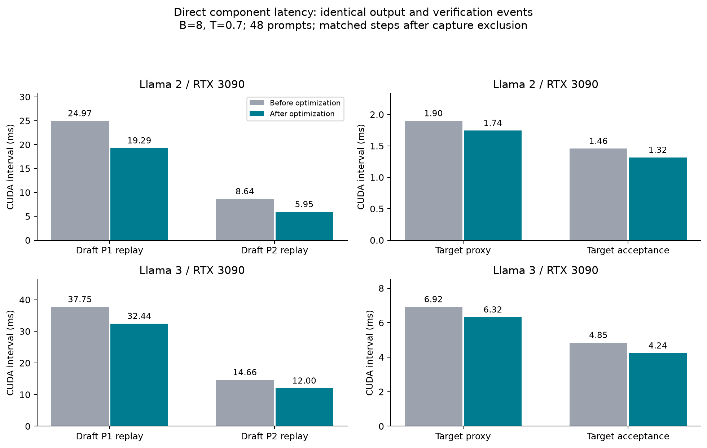
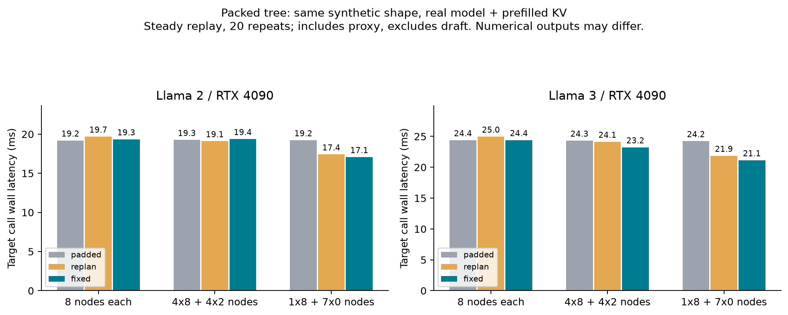
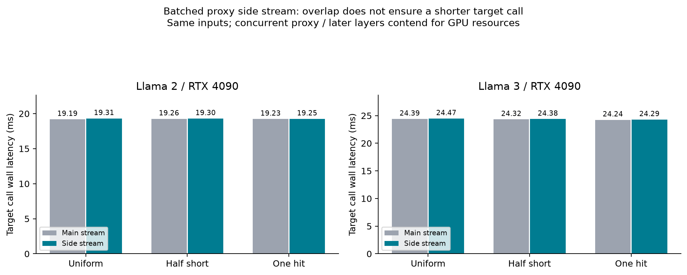
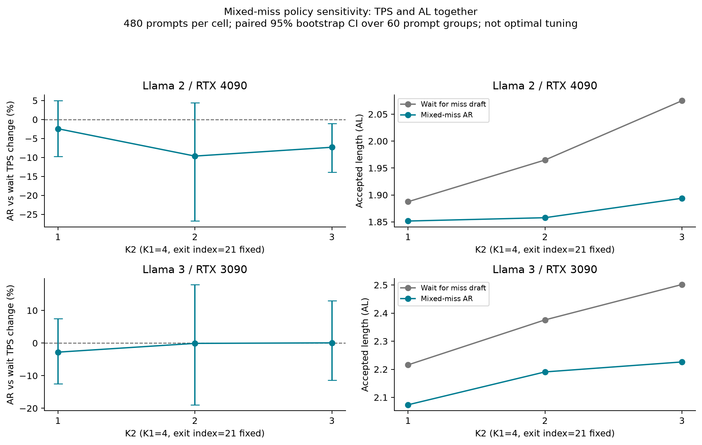
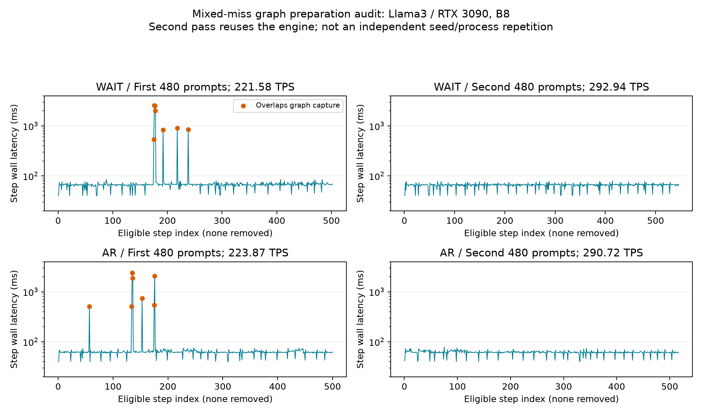
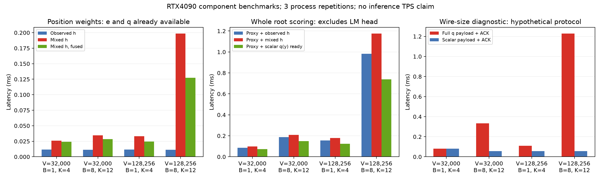
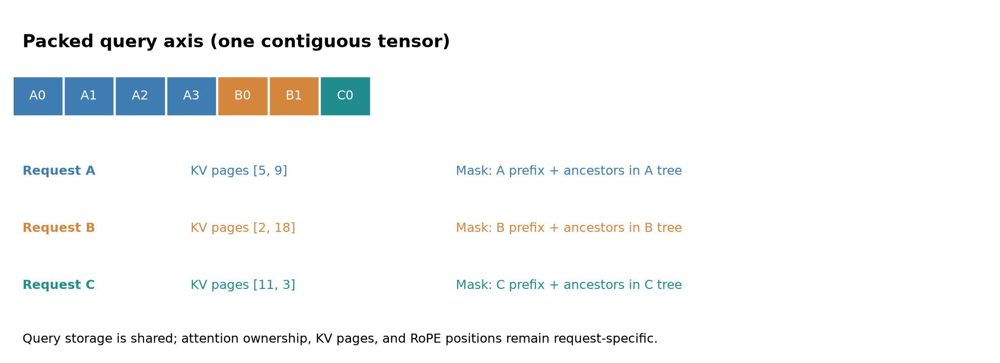
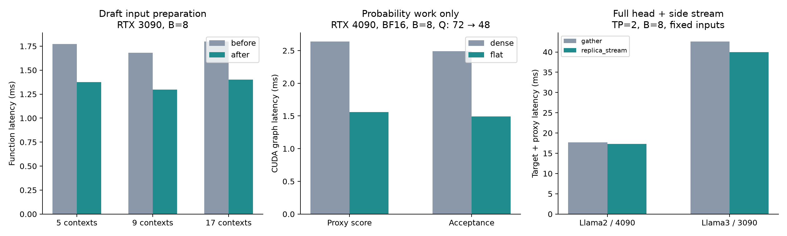

# MLSys-ver0.1 논문 브랜치 변경·공통 수정 리뷰

**이후 배포·검증 기준은 [MLSys-ver0.2 반영·인수인계](../mlsys_ver02/REPORT.md)다. 아래 상태·archive는 각 기록 시점의 증거로 보존한다.**

**ver0.1 최종 검증은 [커밋 전 독립 리뷰 재검토](#precommit-review)를 함께 확인한다.**

**최신 상태는 [배포·현재 반영·남은 항목](#current-port-status)을 기준으로 한다.** 원격 `MLSys-ver0.1`은 공통 수정까지인 `f12d0f1`이고, 새 모델·B>1 tree와 10월14일 후속 최적화는 작업 트리에 반영됐지만 아직 미커밋/미푸시다. 아래 과거 단계의 표를 현재의 이식 상태나 최신 코드의 재측정 값으로 인용하지 않는다.

<a id="current-port-status"></a>

## 배포·현재 반영·남은 항목 — 2026-10-14 상태 확인

이번 정리는 `git ls-remote`로 원격 branch ref를 직접 확인하고 local HEAD·작업 트리·이식 기록을 대조했다. 문서만 갱신했으며 새 runtime 수정·실험·commit·push는 하지 않았다.

| 브랜치 | 원격 commit | 역할과 실제 배포 범위 |
|---|---|---|
| `feat/duet-p2tree-g0` | `a82f7d24fb36827a9a81a3567f344dccb71f193e` | 원본 논문 기준. 아래 변경을 이 브랜치에 merge하지 않았음 |
| `feat/duet-mlsys-coverage` | `1d9ace6ccfb774132ef0149426436dee676f8a03` | 이전 광범위 실험 브랜치. 새 모델/B>1/packed/mixed-miss/연구 점수의 코드와 기록이 섞여 있음. 이 브랜치에 있다는 것이 ver0.1 채택을 뜻하지 않음 |
| `MLSys-ver0.1` | `f12d0f1da6a2e4a26e9cb11ddcca54c189736d19` | 선택 이식 대상. 아래 A까지만 commit·push됨. B는 이 브랜치의 local 작업 트리에만 있음 |

### A. MLSys-ver0.1에 이미 commit·push된 내용

| 항목 | 반영 내용 | 성격/범위 |
|---|---|---|
| Chain 수락 간소화 | 불필요한 greedy 준비·GPU 조건 readback·작은 결과의 반복 전송 제거 | 실행 비용 감소. Tree miss의 chain 검증에도 해당 |
| 기존 B1 tree 수락 간소화 | 파싱한 CPU topology·온도 재사용, 불필요 tensor 준비 제거 | 간소화 CPU 경로를 채택. B1 GPU tree 수락기로 교체한 것이 아님 |
| 온도별 sampler·T=0 tree | T>0/T0에 필요한 계산만 수행. Greedy tree 생성·target argmax 검증 | 기능 지원 + 불필요 계산 제거 |
| 독립 리뷰의 세 수정 | Ragged greedy recovery 위치, eager T0 fallback, P1/P2 온도 확인 동기화 | 정확성 + 공통 비용 정리 |
| 후보 점수 온도 P01 | T=1 고정 대신 실제 target/draft 온도 사용. T0의 soft ranking 유지 | 사용자 승인 정책 변경. 성능 향상 주장 아님 |
| G>M 선택 P02 | 점수 재정렬 대신 생성 순서 prefix 유지, parent/sibling/q-reference 보존 | Proposal 정확성 수정. 논문14→12 설정의 성능 재검증은 별도 |
| 반환 토큰·성능 집계 P03/P04 | 실제 반환 토큰 집계. Cap/clip·부분 batch step의 분자·분모·AL·hit 함께 제외, raw 보존 | SD/SSD/DUET 공통 집계 정의 |
| Scheduler B P05 | Prefill 포함 동시 resident request 수를 B 이하로 제한 | 종료 직전 B 미달 요청은 처리하되 성능에서 제외 |
| Token 통신 P06 | Token ID 32bit로 확장, 후보당 int64 크기는 유지 | 큰 vocabulary의 통신 지원. 이것만으로 새 모델 native 지원이 완성되는 것은 아님 |
| KV·요청 상태 K01–K04 | Cached prefill page, 완전 cached prompt, preemption 출력 경계/예산, block hash 수정 | 기존 예외 상태의 정확성 수정. Prefix 기능 신설/glue 대체/latency 개선 주장 아님 |
| 당시 증거와 인수인계 | 원본 논문 A/B·회귀·breakdown·raw archive·집계 정의 | `be61186` → `3d51664` → `c1f96c1` → `e4b080e`; 문서·증거 HEAD `f12d0f1` |

### B. 채택하여 작업 트리에 반영했지만 아직 commit·push하지 않은 내용

| 항목 | 현재 내용 | 검증/채택 근거 |
|---|---|---|
| 새 모델 정식 지원 | LayerSkip-Llama2-7B/AMD-135m, LayerSkip-Llama3-8B/Qwama-0.5B. Dtype·token-ID mapping·attention workspace 호환 | Native 모델 실행, T0/T>0, SSD smoke. 두 pair의 파라미터 최적/SSD 최종 우위와는 별도 |
| B>1 tree 전체 실행 경로 | 요청별 cache/예산/KV를 유지한 묶음 P1/P2, target tree attention, 수락·KV commit, shrink/refill | 요청 간 격리/확률 법칙/실모델 회귀. 기존 B1 기본 경로 유지 |
| B>1 tree 기존 비용 최적화 | Mask/fanout/slot 연산 결합, graph/workspace 재사용, draft metadata 일괄 전송 | 동일 입력/event의 P1/P2 직접 latency 감소. 상세는 extensions 절 |
| Proxy·수락의 불필요 계산 제거 | 마지막에 버릴 residual/정규화와 T>0에서 쓰지 않는 greedy 준비 생략 | 별도 제거 대조와 난수·분포 검사 |
| Draft 입력 준비 추가 간소화 | 작은 CPU torch tensor 반복 생성 대신 배열 준비·일괄 입력 갱신 | 3090 B8 약0.39–0.41ms/호출 감소 |
| Proxy·수락 계산만 packed | Target attention/GEMM 유지. 유효 context만 모아 vocabulary 계산, uniform/tail은 기존 경로 | BF16 B8 N4/C2 직접 처리2.561→1.878ms. 전체 target query packed와 구별 |
| CUDA graph 사전 준비 | 설정한 page/Q/batch 범위를 serving 전에 준비, 큰 버퍼 공유, RNG 보존 | 전체 평가·긴 문맥/비정렬 상한 검사에서 decode 중 신규 준비0건. Startup/메모리 비용 별도 |
| 계측·설정·보고서 | 준비 step 제외, B>1 any-miss/실제 JIT 통계, 시간창 기반 근방 탐색, h_bar 비용 측정 | 실험 도구/결과. 새 root/위치 알고리즘이나 완성된 자동 tuner를 적용한 것은 아님 |

두 모델 모두 full dense로 확인했고, 주요 통합 검증은 B8·480문항×2다. Llama2/4090 verify는22.365→21.718ms였다. 반면 Llama3/4090/C2는 전체 verify 개선이 확정되지 않고 TPS도−0.68%였다. 따라서 B를 모든 조건의 전체 TPS 개선으로 묶어 표현하지 않는다. 이번 채택 기준은 변경한 구간의 직접 비용과 정확성이다.

이 표의 앞부분은 이전 승인 extension 이식(`extensions/PORT.json`)이고, 뒤의 추가 간소화/확률 packed/prewarm은 후속 최적화다. 이전 `tree_followup_20261014/ADOPTED_RUNTIME.patch`에는 검토 전의 TP2 replica 자동ON까지 들어 있으므로 역사적 증거로 보존한다. **커밋 전 검토 후 최종 이식에는 `precommit_review_20261014/APPROVED_EXTENSION.patch` → `FOLLOWUP_RUNTIME.patch`를 사용한다.** 후속 patch만 `f12d0f1`에 적용하면 extension 전체가 이식되는 것은 아니다. 전체 source와 hash는 각 manifest에 보존한다.

### C. 기본 미채택·보류 항목

| 항목 | 현재 판단 |
|---|---|
| Target attention 전체 packed tree | 구현·검증 후보는 있음. 모델/shape별 latency 차이와 logits 수치 차이로 기본 미채택. B의 확률 계산 packed는 채택 |
| Packed chain | 이전 coverage 브랜치에 구현·실험 기록 있음. 현재 ver0.1 기본 이식 대상에서 제외. Tree 우선 방침에 따라 독립 chain 확장은 후순위이며, 이미 push된 chain 수락 간소화와 다른 항목 |
| Mixed-miss AR | Tree 적용·긴 K2·전체480×2까지 검증했지만 확실한 TPS 이득 없음. 기본은 miss JIT 유지. 자동 miss-count threshold 채택 안 함 |
| TP1 proxy 별도 stream 일괄 활성화 | 검증한 B8 조건에서 확실한 이득 없음. TP2 full-head component 대조와 구별 |
| TP2 replica+stream 자동 기본값 | Component 이득은 있었으나 full480×2에서 verify/TPS 개선 미확정, AL·출력 차이도 확인. 커밋 전 검토에서 자동ON 철회. 기존 명시 replica 설정의 실행 경로는 유지하되 기본은OFF |
| B1 GPU tree 수락기/사전분포+CPU walk | 기존 CPU 간소화보다 일관된 추가 이득을 확인하지 못해 기본 미채택 |
| 실제 sibling 수마다 별도 graph 추가 | 단독 serving 이득 미확정. 기존 C2/C3 parameter 조정과 구별 |
| Miss를 DS/P1형 tree로 변경 | 사용자 요청으로 보류. 기본 miss-chain 정책 유지 |
| 새 KV promotion/tree 전체 재구축 | 이번 KV 정확성 수정 내용이 아니며 채택 대상 아님 |

이 항목들은 모두 '미완성이라 반드시 추가해야 할 기능'이 아니다. 효과가 불확실해 기본값에서 제외한 항목과, 사용자가 후속 검토로 남긴 연구를 구별한다.

### D. 실제로 남은 통합·검증 작업

1. **B의 코드·문서 commit/push:** 현재 로컬에는 있지만 다른 서버에서 원격 `MLSys-ver0.1`을 fetch/checkout하는 것만으로 받을 수 없다. 실험 adapter까지 모두 기본 기능으로 활성화하는 방식으로 배포하지 않는다.
2. **다른 서버의 알고리즘 작업과 통합:** Root 후보 `e(1-q)` 등, 위치 overlap 기반 점수, tree reach/gain/frontier 선정은 현재 production에 미이식이다. 현재는 기존 residual/관측 위치/tree 선정 정책을 유지한다. Root/위치 변경 시 dense `batch_tree_sampling.candidates`와 packed `flat_tree_sampling.candidates`를 함께 갱신해야 한다.
3. **최종 알고리즘에서 parameter 재선정·SSD 비교:** 시간창 측정과 근방 탐색은 실행했고 기준 설정도 남겼다. 알고리즘/장비가 바뀌면 재측정해야 한다. 최신 채택 조합에 대해 SSD도 독립 튜닝한 최종 전체 데이터 비교는 아직 완료하지 않았다. 과거 coverage 비교/이번 SSD smoke로 대신하지 않는다.
4. **원 논문 70B·실제 TP·G>M 재검증:** 특히 P1 G/M14/12의 전체/P1-hit AL, hit, target/draft latency를 확인한다. G>M 정확성 수정은 이미 반영됐지만 원 논문 설정의 성능 영향까지 완료된 것은 아니다.
5. **공통 수정의 과거 −2.08% 반복 원인 확인:** 10월13일 `common/tree_r1`의 동일480입력 before/after 교대 재검증은 아직 별도 미완료다. 최신 B8 최적화의 개선으로 이 이전 대조를 해결했다고 보지 않는다.

이전 [10월13일 이식 상태표](#port-status)는 당시 snapshot으로 보존한다. 이후 단계의 상세 증거는 `extensions/` 및 본문 마지막의 **2026-10-14 tree 후속 최적화** 절에 있다.

<a id="main-server-zero-decode"></a>

## Main 서버 무디코딩 종료 인수인계 검토 — 2026-10-14

**결론: 전달된 후처리 수정 방침은 타당하다. 문맥 보호에 따른 종료는 기존 동작이며, 생성 없이 끝난 요청을 성공적으로 생성한 요청과 구분해 보고해야 한다.** 이번 로컬 검토는 엔진·실험 설정·원시 결과·기존 manifest를 바꾸지 않았다. 아래 원격 결과는 사용자가 전달한 인수인계 기준이며, 원격 `report.py`/`test_report.py`/JSONL/manifest는 이 작업 트리에 없어 직접 재검증한 것으로 표시하지 않는다.

### 직접 확인한 범위

- `a82f7d2` → push된 `f12d0f1` → 현재 작업 트리에서 scheduler의 `_model_length_block_reason` 및 `compute_megaspec_lookahead` 함수 AST가 동일하다. 이 구간에서 새로 만든 문맥 종료 회귀가 아니다. Scheduler 파일의 다른 수정(B 제한·block hash)이 없었다는 뜻은 아니다.
- CPU에서 문맥 경계 4조건을 대조했다. 인수인계가 제시한 draft 임시 KV 예약325칸을 대입하면 `1734+325=2059>2048`이라 보호 종료하며, `1723+325=2048`은 허용한다. 원격 `plan.json`이 없으므로 **325라는 설정값 자체를 원격 설정에서 재산출한 검사는 아니다.** 임시 슬롯은 출력 토큰 예산과 다르다.
- Scheduler는 보호 종료를 `is_prefill=None`으로 반환하고, 엔진은 모델 실행과 decode 시간·토큰·step 집계를 건너뛴다. 따라서 기록된 decode 시간0은 이 경로와 양립한다. 모든 0초 기록을 정상으로 허용할 근거는 아니다.
- 로컬 engine `performance_summary`와 benchmark `summarize`는 빈 모집단에 TPS/AL/hit 등을 `None`으로 반환한다. CPU 대조에서 확인했으며, 이 산술 검사는 종료 사유 검증을 대체하지 않는다.
- 최근 `tp2_full/base`, `tp2_full/auto`, `tp2_final/final_default` 원시 기록은 각각 출력960개, 빈 출력0개, decode step이 없는 measured group0개다. 입력 최대512토큰 조건이므로 main 서버의 1734토큰 사례를 검증한 것은 아니다. 이 세 실행에 한해서 이번 무디코딩 예외에 따른 기존 수치 재집계는 필요하지 않다.

재현: `python3 -B results/mlsys_ver01/main_server_handoff_20261014/audit.py`. 함수 AST·raw SHA256·CPU 경계/빈 집계 결과는 [AUDIT.json](main_server_handoff_20261014/AUDIT.json)에 보존한다. GPU 모델 재실행 및 기존248회 전체 회귀 재실행은 하지 않았다. Runtime/test source는 변경하지 않았고, 기존 source archive는 이 문서 추기 이전 snapshot으로 보존한다.

### 다른 서버에서 받아 유지할 집계 계약

- `context_limit_guard`가 명시되고 출력 수·ID 목록·decode 토큰·검증 횟수·step 기록이 모두 비어 있으며, 종료 길이=입력 길이이고 입력은 상한 이내이며, decode 시간이 유한한 정확한0일 때만 `context_guard_no_decode`로 분류한다. 다른 이유의0, 음수, NaN/무한대, 출력·검증과 모순되는0은 오류로 유지한다.
- Raw와 전체 처리 건수는 보존하고 미정의 TPS/AL/hit/step latency는0이 아닌 `None`으로 처리한다. 전체 문항·턴 수, 지표별 유효 문항·턴 수, 제외 UID와 이유를 함께 보고한다.
- Main 서버의 문항 평균은 유효 턴을 문항 내에서 평균한 뒤 문항 간 평균한다. MT-bench 두 턴을 독립 문항으로 세지 않는다. 모든 비교군이 decode한 공통 문항 표를 추가하되 전체 처리·제외 표도 유지한다. 공통 입력에서도 P1/P2-hit 조건부 AL의 유효 분모는 달라질 수 있다.
- **현재 로컬 성능표와 main 서버 TPS는 집계 정의도 다르다.** 로컬 주 TPS는 cap/clip·부분B·graph 준비 step을 함께 제외한 `총 반환 토큰/총 decode 시간`이며, main 서버는 문항별 TPS 평균이다. 같은 모델·장비에서도 두 값을 직접 성능 향상률로 비교하지 않는다. 양쪽 집계 정의와 포함 범위를 명시하고 matched A/B 안에서 비교한다.
- 로컬 benchmark는 `mlsys_tree_followup.py`의 중간 summary에 아직 분모 확인 없는 TPS 나눗셈이 있어 **전체 eligible step이0인 실행**은 최종 안전한 집계 전에 실패할 수 있다. 일부 요청만 무디코딩이고 나머지 유효 step이 있으면 이 문제가 발생하는 것은 아니다. 로컬 raw는 요청별 명시 종료 사유도 저장하지 않으므로, 장문 평가를 도입할 때 종료 사유 기록·엄격 분류·유효 분모·공통 문항 표와 함께 보완해야 한다. 이번 인수인계를 받았다는 이유만으로 모든 로컬 도구에 이미 이식됐다고 표시하지 않는다.

### 전달된 main 서버 상태와 후속 판단

- 전달 내용: `MLSys-ver0.1-test`, engine `f12d0f1`, `results/blackwell_validation/report.py` 집계/검증 수정과 CPU 검사 추가. 기존 manifest 보존 후 실제 분석 파일 해시만 갱신. 다른 서버 경로가 들어 있는 manifest/launcher는 덮어쓰지 않는다.
- `15_full_common_t1/attempt1`: 처리480문항/560턴, TPS 유효479문항/559턴, `317_t0` 1턴 보호 종료. TPS65.8928, AL4.4430은 **전달된 단일 arm 집계**이며 로컬 재산출값이나 개선율이 아니다.
- 전달된 CPU9개 통과·완료15개 재검증·잔여12개는 인수인계 작성 시점의 원격 상태다. 현재27개 완료 여부는 원격 `status.state=complete`와 전체 작업 검증으로 확인해야 하며, 여기서 완료로 처리하지 않는다.
- 생성하지 못한 입력을 명시적으로 제외하는 것은 성능 비교의 투명성을 높이지만 엔진의 장문 지원을 해결하지는 않는다. 공통 문항 교집합도 모든 요청의 생성 보장이나 길이 편향을 없애는 것은 아니다. 문맥 경계에서 tree 예산 축소/안전한 fallback은 별도 엔진 설계·정확성 검증 항목이며, 이번 집계를 통과시키려고 보호 조건/문맥 상한을 바꾸지 않는다.

## 최초 구현 당시 기록 — 아래 결과는 해당 절의 commit 기준

2026-10-13. `feat/duet-p2tree-g0@a82f7d24fb36827a9a81a3567f344dccb71f193e`에서 `MLSys-ver0.1`을 만들었다. 기준 revision은 작업 시작 시 원격 논문 브랜치와도 일치했다. 구현 commit은 `be61186`이다. 작업 폴더는 `/home/chokwans99/PSD-MLSys-ver0.1`이다.

**구현과 계획한 검증을 완료했다.** 실제 논문 원본과 동일한 480개 입력을 비교했을 때, tree TPS는 두 반복에서 각각 **+1.78%, +2.61%**, chain은 **+2.85%** 개선됐다. 각 대조의 출력·AL·cache hit는 같았다. Target forward 시간은 거의 유지됐고, 수락 처리 비용이 감소했다. T0의 AR 출력 차이26건도 실제 logits로 모두 추적했다. 아래 결과는 7B·FP16·RTX4090·B1·G=M 조건이며, 모든 장비와 설정에 대한 무결성 보증은 아니다.

**측정 버전과 후속 수정 구분:** 아래 기존 480개 성능표·그림·원시 archive는 `be61186` runtime의 결과다. 이후 독립 리뷰에서 발견한 T0 일반 경로의 recovery 위치, T0 fallback의 자식 선택, draft 온도 검사 동기화는 별도로 수정·검증했다. 이 후속 수정의 근거는 문서 마지막 절과 `review_followup/`에 구분해 보존한다. 기존 수치를 후속 수정까지 포함한 재측정 결과로 인용하지 않는다.

먼저 [전체 성능·구간 그림 PDF](figs/REVIEW.pdf), 아래 성능표와 구간표를 확인한 뒤 파일별 변경을 검토하면 된다. 수치 원본은 [PERFORMANCE.csv](PERFORMANCE.csv), 전체 파라미터는 [PARAMETERS.json](PARAMETERS.json)이다.

## 최초 verification 변경의 범위 (be61186)

기존 논문 실행기를 유지하면서 chain 간소화, tree CPU 정보 재사용, 온도별 계산 간소화, T=0 tree 지원을 적용했다. Tree의 수락 경로는 **CPU에서 선택하는 한 가지 구현**이다. Target·draft forward와 vocabulary 분포 연산은 GPU에서 실행한다. CPU/GPU 수락 경로 선택 옵션은 없다.

이전에 준비한 verification A+B+C 패치에 해당한다. 새로운 root·위치·tree 선정 정책, GPU tree 수락 graph, B>1 통합 tree 실행기, KV 관리 변경은 포함하지 않는다. G>M proposal 수정, 실제 온도를 이용한 root 후보 점수, 집계·scheduler·wire의 production 이식도 이번 verification 변경과는 별도다. 이번 tree 실험은 G=M으로 수행한다.

## 원본과 달라진 동작

| 변경 | 논문 원본의 처리 | MLSys-ver0.1의 처리 | 검토할 파일 |
|---|---|---|---|
| Chain 확률 검증 간소화 | 양의 온도 요청에도 greedy argmax 준비, GPU 조건 확인, 작은 결과의 여러 번 readback | CPU의 요청 온도로 확률 검증 경로를 결정. JIT proposal의 p/q 검증·residual recovery와 난수 순서는 유지하고 필요한 최종 결과를 묶어서 반환 | `ssd/ssd/utils/verify.py`, `verify_fast.py`, `engine/verifier.py` |
| Tree 정보 재사용 | Target 입력 준비 때 확인한 topology를 수락 때 다시 GPU에서 읽고 파싱. 온도도 GPU scalar에서 읽음 | 준비 시 확인한 CPU topology와 float32로 반올림한 요청 온도를 재사용 | `ssd/ssd/engine/verifier.py` |
| 불필요한 온도 tensor 생략 | CPU tree walk와 순수 greedy chain에도 수락용 GPU 온도 tensor 생성 | 해당 경로에서는 생성하지 않음. E0 진단처럼 실제 tensor를 사용하는 경우는 유지 | `ssd/ssd/engine/verifier.py` |
| Sampler 온도별 계산 | T>0에도 사용하지 않는 logits argmax, T=0에도 확률·난수 준비 | 양의 온도는 확률 샘플링만 수행. T=0은 argmax만 수행 | `ssd/ssd/layers/sampler.py`, `config.py`, `engine/model_runner.py`, `engine/llm_engine.py` |
| T=0 tree 생성과 검증 | Legacy tree가 T=0을 차단하거나 chain으로 처리 | Draft 첫 자식은 argmax, 추가 형제는 중복되지 않는 상위 후보. Target argmax와 일치하는 자식으로 이동하고 없으면 그 argmax를 반환 | `ssd/ssd/engine/helpers/p2_tree.py`, `p2_tree_executor.py`, `engine/draft_runner.py`, `verifier.py` |
| T=0 ragged chain recovery | 일반 경로에서 padding을 포함해 recovery 위치를 먼저 선택한 뒤 수락 길이만 실제 proposal 길이로 제한 | 실제 수락 길이를 제한한 **뒤** 그 위치의 target argmax를 recovery로 선택. 초기 이식의 `all_greedy` 경로에 들어 있던 정확성 수정을 후속 리뷰에서 일반 경로에도 적용 | `ssd/ssd/utils/verify.py` |
| 기존 benchmark 자동 연결 | Sampler의 온도 전용 경로를 선택하지 않음 | 기존 `--temp`, `--dtemp`로 capture 전에 자동 결정. 새 CLI 선택지는 없음 | `ssd/bench/bench.py` |

`greedy_only`와 `stochastic_only`는 CUDA graph를 만들기 전에 알려야 하는 내부 온도 계약이다. 기존 benchmark가 자동 설정한다. 일반 Python API에서는 초기화 시 계약을 지정할 수 있고, 계약에 맞지 않는 요청은 거부한다. 아무 계약도 지정하지 않는 API의 기존 호환 경로는 유지한다. 확률 샘플링에 필요한 random-score argmax는 제거 대상이 아니다.

### 확률적 tree에서 유지한 법칙

형제 후보는 순서가 있는 비복원 추출이다. 이전 형제를 제외한 proposal과 이전 거절을 반영한 target residual로 각 자식의 수락 확률을 계산한다. 이번 CPU 경로는 기존 `tree_verify_walk_tensor`를 그대로 사용한다. Tree의 방문 순서와 확률적 의미를 바꾸는 GPU 구현을 이식하지 않았다.

T=0에서는 p/q 수락 검증을 사용하지 않는다. 예산 배분·후보 순위에 사용하는 soft score와 target argmax 검증은 역할이 다르다. T=0의 soft score는 untempered draft 분포를 사용하며, 이를 확률 proposal이라고 간주하지 않는다.

## 실제 모델 대조 조건

| 항목 | 설정 |
|---|---|
| 데이터 | MT-Bench, translation, summarization, QA, math reasoning, RAG에서 저장한 각80개, 총480개 첫 turn 입력 전부. 원 데이터셋 전체나 새로운 holdout은 아님 |
| 모델 | LayerSkip-Llama2-7B + AMD-Llama-135M, full dense FP16 |
| 장비 | RTX4090 8개. 각 speculative job은 target TP1과 draft 1GPU 사용 |
| 주 비교 | B=1, T=1. Tree 2회 독립 process 대조, chain 1회 대조 |
| Greedy | B=1, T=0 tree 전체 480개와 원본 AR 대조. Chain T0 24개 추가 확인 |
| Batch 회귀 | B=4 chain 원본/변경본 24개 확인. B>1 tree 지원 실험은 아님 |
| DUET | Exit=21, K1=4, K2=2, speculate K=6, async fan-out=3, draft fan-out=2 |
| Tree | P1 G=M=8, P2 G=M=4, 형제 capacity=3, 위치별 P1 root=2 |
| 선정 정책 | 원본 residual·위치·tree 정책 유지 |
| 길이 | 입력 최대512, 출력 최대96, EOS 존중, model length=2048 |
| 메모리 | GPU memory utilization=0.45, KV block=256 |
| 전체 입력 워밍업 | 32개 입력 후 seed를 다시 설정하고 480개 측정 |
| 구간 진단 | 별도 24개 균등 선택 입력, 워밍업16개, 상세 프로파일 활성화 |

| 대조 | GPU | CPU affinity | 순서 | Target seed / draft seed |
|---|---|---|---|---|
| Tree 반복0 | 2,3 (PIX) | 8–15,40–47 | 원본 → 변경본 | 10801 / 231 |
| Tree 반복1 | 6,7 (PIX) | 24–31,56–63 | 변경본 → 원본 | 10802 / 232 |
| Chain | 4,5 (PIX) | 16–23,48–55 | 원본 → 변경본 | 10801 / 231 |
| Greedy | 0,1 (NODE) | 0–7,32–39 | Tree → AR | 10801 / 231 |

각 쌍은 같은 GPU·CPU affinity를 사용하며, 네 대조의 CPU 코어는 겹치지 않는다. 실행 전 GPU 점유를 확인하고 실행 중 외부 GPU process와 clock·온도·전력을 기록한다. Tree의 두 반복은 순서를 반대로 하여 순서에 따른 편향을 확인한다.

### 공통 benchmark 보정과 집계

실제 원본 checkout과 새 브랜치 코드를 실행한다. 새 통합 실행기의 graph OFF를 원본으로 대신하지 않는다. 두 방식에 동일한 AMD dtype 호환, 고유 shared-memory/port, 안전한 종료 adapter를 적용한다. Prefix lookup은 동일하게 끄고 decode의 기존 KV/glue 방식을 유지한다. 이 adapter를 verification의 성능 기여로 계산하지 않는다.

두 arm 모두 `PAPER_COLD_PREFIX=1`이다. 따라서 표의 절대 TPS는 prefix 재사용을 포함한 논문 운영 설정의 TPS를 재현한 값이 아니다. 여기서 유효한 비교는 **같은 cold-prefix 조건 안에서의 원본 대 변경본**이며, prefix 활성화 때의 상대 개선율까지 보장하지 않는다.

실제 반환 토큰을 측정한다. 출력 상한에 도달하거나 EOS 등으로 결과가 잘린 step, 활성 요청이 지정 B보다 적은 step은 토큰·시간 양쪽에서 제외한다. AL·hit도 같은 step 집합을 사용한다. AL은 recovery를 포함한 step당 반환 토큰 수다. TPS는 포함된 decode 토큰 합 / decode 시간 합이며 prefill을 포함한 전체 wall TPS와 구분한다.

프로파일 실행의 성능을 주 TPS 결과로 사용하지 않는다. Target exit 이전/이후 forward, 수락 처리, draft glue, P1/P2 graph, P1/P2 전체 구간을 따로 비교한다. CUDA event 구간에는 CPU launch gap이 들어갈 수 있으며, 서로 겹치거나 포함 관계인 구간의 평균·중앙값을 합산하지 않는다.

## 전체 입력에서 확인한 성능

각 행은 480개 입력 전체의 비계측 실행이다. Tree 두 반복은 seed와 GPU 쌍이 다르므로 **같은 반복 안에서** 원본과 변경본을 비교한다.

Tree와 chain도 서로 다른 GPU 쌍을 사용했다. 이 표의 목적은 각 구조에서 원본 대비 변경 효과를 확인하는 것이며, 구조 간 최종 우열을 확정하는 대조는 아니다.

| 구조와 반복 | 버전 | B | AL | Cache hit | Verification ms | TPS |
|---|---|---:|---:|---:|---:|---:|
| Tree 반복0 | 논문 원본 | 1 | 1.7780 | 64.35% | 17.3007 | 90.6187 |
| Tree 반복0 | MLSys-ver0.1 | 1 | 1.7780 | 64.35% | 16.8634 | 92.2345 |
| Tree 반복1 | 논문 원본 | 1 | 1.7776 | 64.26% | 17.2209 | 91.3444 |
| Tree 반복1 | MLSys-ver0.1 | 1 | 1.7776 | 64.26% | 16.7591 | 93.7290 |
| Chain | 논문 원본 | 1 | 1.7057 | 66.38% | 17.5661 | 88.3442 |
| Chain | MLSys-ver0.1 | 1 | 1.7057 | 66.38% | 17.0087 | 90.8610 |

**Tree의 TPS는 +1.78%, +2.61%, chain은 +2.85% 개선됐다.** 각 대조에서 480개 출력, AL, cache hit, 포함된 step 수가 모두 같았다. 이번 개선은 후보 선정 품질이나 더 긴 수락 길이로 얻은 것이 아니라, 같은 결과를 반환하는 실행 비용이 줄어든 결과다.

Verification은 tree 반복0에서0.4372ms, 반복1에서0.4618ms, chain에서0.5574ms 감소했다. 이 수치는 전체 verification 구간의 감소량이며 target 모델 forward 자체의 감소량과 동일시하지 않는다. 아래 구간 진단으로 실제 변화를 구분한다.

| 대조 | TPS 변화 | 입력 단위 paired bootstrap 95% 구간 | Verification 변화 |
|---|---:|---:|---:|
| Tree 반복0 | +1.78% | +1.60% ~ +1.99% | −2.53% |
| Tree 반복1 | +2.61% | +2.44% ~ +2.76% | −2.68% |
| Chain | +2.85% | +2.68% ~ +3.02% | −3.17% |

각 구간은 같은 process 대조 안에서 입력을 쌍으로 재표집한4000회 bootstrap이다. Process를4000번 독립 실행한 신뢰구간이 아니다. Tree는 실제 두 process 대조에서 모두 개선됐고 chain은 한 process 대조이므로, chain의 실행 간 변동까지 같은 강도로 검증했다고 하지 않는다.


## 어느 구간이 빨라졌는가

각 값은 별도24개 입력 프로파일의 유효 구간 중앙값(ms)이다. 앞19 step, cap/clip/tail, capture가 있는 step과 그 다음 step을 동일하게 제외했다. 단독 kernel 실행시간이나 비계측 TPS와 같지 않다.

| 구간 | Tree 반복0 원본 → 변경본 | Tree 반복1 원본 → 변경본 | 해석 |
|---|---:|---:|---|
| Target exit 이전 forward | 10.2339 → 10.2369 | 10.2420 → 10.2410 | 거의 동일 |
| Target exit 이후 forward | 4.6561 → 4.6582 | 4.6592 → 4.6592 | 거의 동일 |
| Tree 수락 경로 처리 | 0.9191 → 0.5802 | 0.8968 → 0.5724 | 약36~37% 감소 |
| Tree 실행 중 miss의 chain 수락 | 1.4600 → 0.7699 | 1.4138 → 0.7670 | Chain 간소화가 tree miss에도 적용 |
| Draft P1 graph replay | 3.8431 → 3.8574 | 3.8984 → 3.9107 | 감소하지 않음 |
| Draft P2 graph replay | 1.6916 → 1.6937 | 1.6937 → 1.6988 | 감소하지 않음 |
| Draft P1 전체 구간 | 5.2344 → 5.1914 | 5.1973 → 5.2422 | 반복별 방향이 다름 |
| Draft P2 전체 구간 | 4.1660 → 3.9922 | 3.9941 → 4.0039 | 일관된 개선으로 판단하지 않음 |

Chain 전용 대조에서도 target pre/post는10.3895→10.3864ms / 4.7268→4.7268ms로 거의 같고, 수락 처리만1.3658→0.7403ms로 감소했다. 고정 GPU tensor를 사용하는 별도 chain 함수 대조도 같은 방향이다. V=32000·B1·T1에서 **chain proposal 길이2**는1.0942→0.5173ms, **길이4**는1.0974→0.5117ms였다. 여기의 길이는 DUET phase 예산 K1/K2와 구분한다.

따라서 이번 묶음의 TPS 개선은 **동일한 모델 계산과 출력에서 수락 처리의 불필요한 작업·동기화를 줄인 효과**로 설명할 수 있다. Draft 모델 forward가 빨라졌다는 근거는 없다. 묶음 대조이므로 각 변경의 독립 TPS 기여를 더해서 주장하지 않는다.


[실제로 관측한 두 GPU timeline](figs/03_timelines.png)도 제공한다. 각 process에서 관측한 대표적인 P2-hit step이다. 이 그림 하나를 고정 tensor replay의 인과 증명으로 사용하지 않는다.

## 추가 기능과 회귀 결과

| 조건 | 버전 | 입력 수 | AL | Cache hit | TPS | 판정 |
|---|---|---:|---:|---:|---:|---|
| B4 chain, T1 | 논문 원본 | 24 | 1.6603 | 66.67% | 294.7446 | 회귀 대조 |
| B4 chain, T1 | MLSys-ver0.1 | 24 | 1.6603 | 66.67% | 310.1797 | 출력24개 모두 같음. 성능 우위 주장용 실험 아님 |
| B1 tree, T0 | MLSys-ver0.1 | 480 | 2.5447 | 86.40% | 136.9019 | Tree T0 실제 실행 완료 |
| B1 AR, T0 | 논문 원본 | 480 | — | — | 65.7473 | Greedy 정확성 대조 기준 |

B4는24개 입력의 단일 회귀 검사다. 관측값의 차이는 기록용으로 남기지만 **B>1의 TPS 개선율 근거로 인용하지 않는다.** 이 검사는 T=1이므로 T0 ragged 일반 경로의 정확성 검사를 대신하지 않는다. T0 AR은 원본 sampler를 사용하는 정확성 기준이다. 이 표를 별도로 최적화한 AR·SSD와의 공정한 최종 경쟁 실험으로 제시하지 않는다. Tree T0의 source별 포함 step은 miss2372, P1 hit7693, P2 hit7380으로 두 phase가 실제로 실행됐다.

### T0에서 AR과 달랐던26개 출력

480개 중454개는 AR과 같고26개는 달랐다. 26개 모두 첫 차이 직전의 **동일 token prefix**에서 실제 AR/tree logits를 저장해 다시 확인했다. 진단 실행은 원래 전체 실행의 토큰열도 모두 재현했다.

- 26개 모두 AR은 자기 target logits의 argmax, tree도 자기 target logits의 argmax를 반환했다.
- AR의 top1–top2 차이는 최대0.015625였고, 두 실행의 vocabulary 전체 최대 logit 차이는0.029296875였다.
- 24건은 tree-hit verification, 2건은 tree 실행 중 miss-chain에서 발생했다.
- 확인한 직접 원인은 FP16의 근접값·동점에서 query shape별 logits가 조금 달라지는 것이었다. 잘못된 자식을 수락하거나 argmax가 아닌 token을 반환한 사례는 없었다.

이로써 target argmax 규칙을 따르는 것은 확인했지만, AR과 비트 단위로 같은 토큰열을 보장한다고 표현하지 않는다. 원시 logits와 진단 결과는 `RAW_RESULTS.tar.gz` 및 [GREEDY_DIAGNOSIS.json](GREEDY_DIAGNOSIS.json)에 있다.

## 정확성 검사와 발견한 문제

- 원본 함수와 고정 입력 대조: chain 384건, tree 288건에서 반환 결과와 RNG 상태 일치. Tree의 terminal sampling 분포도 tensor 값이 일치했다.
- 온도 0.3/0.7/1과 FP16/BF16의 q 분포 12조건, sampler 12조건 대조 통과.
- T0 branching/tie/중복 형제, ragged chain의 실제 길이, 온도 계약, sampler RNG 검사 5개 통과.
- P1 기존 검사 28개 통과.
- P2 기존 검사108개를 GPU에서도 실행해 **skip 없이 모두 통과**했다. P1 검사28개도 GPU가 보이는 환경에서 통과했다.
- GPU chain 고정 tensor 대조: V=32000/128256, B=1/2/4/8, proposal 길이2/4, T=0.7/1의32조건×16 seed, **512개 출력 모두 원본과 일치**했다. 이는 함수 단위 검사이며 큰 vocabulary 모델의 통신·전체 serving 지원까지 검증한 것은 아니다.
- **발견한 실패는 기존 P2 warmup 테스트의 mock 누락이었다.** 가짜 executor에 `total_cells`가 없었고 page bucket의 기대 개수도 이전 값이었다. 수정 전 테스트를 원본 runtime에서도 실행해 동일 실패를 재현했다. Mock에 실제 footprint 30을 지정하고 기대 bucket을1–8로 바로잡았다. Production warmup 함수는 원본과 동일하다. 실패 기록도 보존했다.

고정 입력의 확률 검증 동등성과 end-to-end 토큰열 일치는 구분한다. 비동기 phase의 timing에 따라 hit 경로가 달라질 수 있다. T0도 FP16에서 query shape별 target logits의 미세 차이로 AR과 토큰열이 달라질 수 있으므로, 발생한 첫 차이는 동일 prefix의 실제 logits로 추적한다.

초기 검증의 모델 실행25개(전체480개 실행8개 포함)와 T0 추가 진단2개, 총27개 실행이 정상 종료했다. 각 실행의 GPU 점유 기록에 외부 process 간섭은 없었다. 당시 수행한 범위에서는 테스트 mock 오류 외에 실행 실패나 검증 불일치를 발견하지 못했다. 이후 독립 리뷰가 일반 T0 ragged 및 fallback 경로의 누락을 확인했으며, 아래 후속 검증에서 다룬다. 기존 prefix 재사용·G>M 등 범위 밖의 조건까지 오류가 없다고 주장하는 결과는 아니다.

## 리뷰와 재현

1. `git diff a82f7d2..MLSys-ver0.1 -- ssd/ssd`로 runtime 변경을 확인한다. `engine/verifier.py`와 `utils/verify_fast.py`, `helpers/p2_tree.py` 순서가 이해하기 쉽다.
2. `ssd/bench/bench.py`에서 기존 온도 인자로 sampler를 자동 연결한 부분을 확인한다.
3. `PLAN.json`, `*_plan.json`에서 기준 checkout, 모델·예산·GPU·seed를 확인한다.
4. `ANALYSIS.json`의 전체 입력 결과와 `COMPONENTS.json`의 구간별 결과를 함께 본다. 프로파일 수치를 비계측 TPS와 섞지 않는다.
5. `PAPER_PARITY.json`, 테스트 로그, `GREEDY_DIAGNOSIS.json`으로 정확성 근거를 확인한다.

환경은 기존 `/home/chokwans99/PSD/ssd/.venv/bin/python`을 사용한다. 다른 서버에서는 모델 경로와 baseline checkout 경로, GPU 번호와 CPU affinity를 해당 장비에 맞춘다. Runtime의 CPU/GPU 경로 선택 옵션을 추가할 필요는 없다.

원시 자료는 [RAW_RESULTS.tar.gz](RAW_RESULTS.tar.gz)에 보존한다. [RAW_MANIFEST.json](RAW_MANIFEST.json)에 파일별 SHA256과 전체 archive SHA256을 기록하며, archive를 다시 읽어 원본과 대조했다. 이 폴더에서 `tar -xzf RAW_RESULTS.tar.gz`로 풀고 `analyze.py`, `analyze_components.py`, `make_figures.py`를 실행하면 표와 그림을 재생성할 수 있다. [RUNTIME.patch](RUNTIME.patch)는 논문 원본 기준 runtime과 기존 benchmark 온도 연결 변경만 담고, 결과 archive나 진단 harness는 제외한다. 소스·모델 config·질문 집합 해시는 [SOURCE_MANIFEST.json](SOURCE_MANIFEST.json)을 따른다.

실행 예시는 다음과 같다. 결과가 이미 존재하는 폴더에 덮어쓰지 않도록 새 결과 폴더와 plan 경로를 사용한다.

```bash
python results/mlsys_ver01/run_pair.py \
  --plan results/mlsys_ver01/tree_r0_plan.json \
  --gpus 2,3 --port 30020 \
  --directory results/mlsys_ver01/tree_r0
```

여기서 검증하는 것은 원 논문 **코드 기준의 7B·4090 결과**다. 70B·다른 GPU·TP2·큰 tree에서의 개선율은 그 서버에서 같은 기준으로 재측정해야 한다. Prefix 재사용, G>M 및 B>1 tree까지 이번 결과가 검증한 것으로 확대 해석하지 않는다.

## 독립 리뷰 후속 검토와 수정 — 2026-10-13

독립 리뷰의 세 코드 지적은 유효했다. 해당 경로를 재현하고 runtime 세 파일에 수정했다. 새로운 선택 옵션은 추가하지 않았고, CPU tree 수락 방식도 유지했다. Root 점수 온도·G>M·scheduler·KV 수정은 포함하지 않는다. **주 성능 대조의 T>0·B1·G=M에서는 출력 보존 최적화지만, 브랜치 전체는 T0 지원과 아래 정확성 수정도 포함한다.** 모든 변경을 단순한 비용 절감이라고 묶지 않는다.

### 1. 일반 경로의 T0 recovery 위치

원 논문과 초기 ver0.1의 일반 `verify()`는 greedy mismatch 위치에서 recovery를 먼저 골랐다. 이후 수락 길이를 `valid_k`로 제한해도 recovery 위치는 그대로였다. 실제 proposal 길이가2이고 batch padding 길이가4일 때, padding까지 target argmax와 일치하면 길이4 이후 token을 잘못 선택할 수 있었다. 혼합 온도만의 문제는 아니며, **일반 경로로 실행하는 동질 T0 batch**도 해당한다.

초기 ver0.1의 `all_greedy` 전용 경로는 이미 길이를 제한한 뒤 recovery를 골랐다. 따라서 이 조건에서 원본과 달라질 수 있었으며, 이전 변경 표에서 그 정확성 수정을 빠뜨린 것이 맞다. 이번에는 일반 경로도 최종 `accept_until`에서 recovery를 고르도록 통일했다.

- 재현 입력: 두 행 모두 `[0,1,2,3,4]`, 실제 proposal 길이 `[4,2]`. 각 위치의 target argmax는 차례로1,2,3,4,5.
- 수정 전 recovery: `[5,5]`. 수정 후: **`[5,3]`**. 수락 suffix는 두 버전에서 동일.
- CPU/CUDA에서 동질 T0·혼합 온도, 실제 길이0/2/4, 실제 거절·padding 일치를 확인했다.
- 이전 B4 T1 실험은 이 문제를 검증하지 않았다. B1에서 tensor 폭이 실제 길이와 같은 기존 주 실험으로 이 문제를 확대하지 않는다.

### 2. T0 fallback에서도 첫 자식을 argmax로 선택

Captured executor는 T0 첫 자식을 argmax로 골랐지만, `SSD_TREE_EXEC=0` 또는 executor가 `None`을 반환한 뒤의 arena에는 T0 계약을 전달하지 않았다. CPU reference fallback에도 같은 누락이 있었다. 그 결과 T0에서 soft ranking score를 무작위 비복원 추출에 사용했다.

Target greedy 검증은 여전히 자기 argmax와 일치하는 자식만 수락하므로, 직접적인 오류는 **draft 후보 구성의 설명과 구현 불일치**다. AL/hit가 달라질 수 있으며, target의 잘못된 p/q 검증이라고 해석하지 않는다.

`DraftRunner`에서 GPU arena와 CPU rollout 모두에 기존 `greedy_only` 계약을 전달했다. 첫 자식은 logits argmax, 추가 자식은 서로 다른 상위 후보이며 RNG를 사용하지 않는다. Soft score는 계속 예산/순위 계산에 사용한다. T>0 호출은 기존 샘플링 및 RNG 순서를 유지했다.

- 고정 입력 재현: CPU/CUDA × arena/CPU rollout의 각32회 자식 선택에서 수정 전16회는 첫 자식이 argmax가 아니었고, 수정 후는 **0회**였다. 동점의 첫 인덱스와 RNG 불변도 검사했다. 이 비율은 의도적으로 만든 테스트 입력의 결과이며 실제 workload 발생률이 아니다.
- 양의 온도 fallback64조건에서 자식·topology·raw score·RNG가 수정 전과 같았다.
- 실제 7B T0 실행: executor OFF, executor `None`, CPU fallback을 각각8개 입력으로 검사했다. 각 실행에서 warmup 포함308회 호출·1,540행의 **첫 자식 argmax assertion이 모두 통과**했다. 실행 중 검사로 동기화가 추가되므로 이 세 실행의 TPS는 성능 근거로 사용하지 않는다.

### 3. P1과 P2의 중복 온도 확인 동기화 제거

리뷰가 지적한 P2뿐 아니라 P1 진입 조건에도 CUDA temperature tensor의 `.all()`을 CPU bool로 읽는 동기화가 남아 있었다. 요청 등록 때 `greedy_only`/`stochastic_only` 계약을 이미 확인하므로, 두 경우에는 CPU config만으로 tree 가능 여부를 판단하도록 공통화했다. 계약을 지정하지 않은 일반 API는 기존 tensor 검사를 유지한다.

- P2 dispatch10회 프로파일: `aten::_local_scalar_dense` **10회 → 0회**.
- 유휴 GPU의 dispatch 확인 비용 중앙값: **20.746μs → 0.180μs**. 300호출×9회, 실행 순서 교대.
- 이는 작은 조건 확인의 비용이다. 모델 forward의 개선율이나 전체 TPS 개선율로 환산하지 않는다. P1도 동일 helper를 사용하며, 계약이 있으면 temperature tensor에 접근하지 않는 검사를 통과했다.

실제 7B·T1·B1 tree에서도 수정 전 `4b0d208`과 수정 후를 같은 GPU2/3·CPU affinity·24입력·16 warmup으로 한 차례 대조했다. **출력24개, AL1.788782, cache hit62.576687%, 포함 step1,141개가 동일**했다. 아래는 별도 계측 실행에서 초기19step·cap/clip·capture와 다음 step을 제외한 구간 중앙값이다.

| 구간 | 수정 전 ms | 수정 후 ms | 해석 |
|---|---:|---:|---|
| Target exit 이전 forward | 10.2348 | 10.2308 | 거의 동일 |
| Target exit 이후 forward | 4.6572 | 4.6561 | 거의 동일 |
| Draft P1 graph replay | 3.8513 | 3.8451 | 거의 동일 |
| Draft P2 graph replay | 1.6886 | 1.6855 | 거의 동일 |
| Draft P1 전체 구간 | 5.1543 | 4.7031 | 준비·launch gap을 포함한 관측 감소 |
| Draft P2 전체 구간 | 3.9922 | 3.7930 | 준비·launch gap을 포함한 관측 감소 |
| Target tree walk | 0.5782 | 0.5274 | 이 후속 수정에서 tree walk 구현은 바꾸지 않음 |

Forward 자체는 거의 변하지 않았고 phase 전체 구간 감소가 관측됐다. 다만 **24입력 단일 계측 대조**이며, event span·CPU/GPU scheduling·비동기 overlap이 영향을 준다. 위 전체 구간 감소를 모두 제거한 조건문 한 개의 순수 실행 시간으로 해석하지 않는다. 계측 TPS89.7963→91.4315도 기록용이며 추가 TPS 개선율 주장에 사용하지 않는다. 동기화 제거 자체는 profiler와 동작 검사로 확인했고, 독립적인 반복 비계측 TPS 효과는 아직 확정하지 않았다.

### 4. 측정 범위와 C=3 제약

- Cold prefix를 양쪽에 동일하게 적용한 상대 비교는 유효하다. 절대 TPS가 prefix cache를 사용하는 원 논문 운영 설정의 재현이라는 뜻은 아니다. 본문에 이 범위를 명시했다.
- B4의24입력 단일 회귀검사를 B>1의 성능 우위 근거로 인용하지 않도록 수정했다. Raw 수치는 보존한다.
- `validate_tree_ints(..., sibling_capacity=3)`는 원본부터 있다. 더 확인하면 **`TreeProxyCUDAGraph`의 child buffer도 실제 폭3으로 생성**된다. Config는 C를1–8로 허용해 C>3과 충돌할 수 있다. 검증 한 줄만 config 값으로 바꾸면 GPU pack이 버퍼 범위를 벗어날 수 있어 그렇게 수정하지 않았다. 현재 C=3 실험에는 영향이 없고, C>3을 지원하려면 graph 생성·topology packing·모든 TP rank의 validation을 함께 바꾸고 검증해야 한다. 이는 다음 별도 지원 항목이며 이번에 해결했다고 표시하지 않는다.

### 후속 검증과 이식 자료

- 이번에 실행한 기존177개 + 추가5개, **총182개 검사 통과, skip0**. Suite별 개수는5+5+28+108+35+1이며 `CHECKS.json`과 로그에 기록했다. 추가 검사 내부에서 CPU와 CUDA 조건을 모두 실행했다. 중간 안내의186개는 합산 오류여서 실제 로그 기준으로 정정한다.
- 원 논문 CPU parity: chain384·tree288·sampler12·q분포12 통과.
- 원 논문 GPU chain: V32000/128256·B1/2/4/8·K2/4·T0.7/1, **512개 출력 일치**.
- 새 실제 모델 실행5개 모두 정상 종료. 외부 GPU process 간섭 없음. 수정 전후 비교의 두 runtime은 run JSON의 파일별 source hash로 구분한다.
- 첫 회귀 실행에서 기존 deterministic sampler mock이 새 `allow_greedy=False` 인자를 받지 못했다. T>0 호출에는 새 keyword를 보내지 않고 기존 호출 계약을 유지하도록 정리했으며, 기존 테스트를 바꾸지 않고 통과했다. 최초 실패 로그도 보존한다.

근거는 [CHECKS.json](review_followup/CHECKS.json), [SUMMARY.json](review_followup/SUMMARY.json), [구간 원시 통계](review_followup/COMPONENTS.json), [GPU chain 대조](review_followup/CHAIN_GPU_PARITY.json)에 있다. 새 원시 실행5개의 로그·프로파일·온도 fallback assertion 기록은 [후속 RAW_RESULTS.tar.gz](review_followup/RAW_RESULTS.tar.gz)에 보존하고, [manifest](review_followup/RAW_MANIFEST.json)의 SHA256을 archive 재독출로 확인했다.

다른 서버에서 최신 내용을 이식할 때에는 **[후속 누적 RUNTIME.patch](review_followup/RUNTIME.patch)**를 사용한다. 이는 논문 원본 `a82f7d2` 기준으로 기존 verification 변경과 이번 세 수정을 모두 포함한다. 이전 `RUNTIME.patch`와 중복 적용하지 않는다. 원본 파일만 별도 임시 폴더에 복원하여 patch 적용 후11개 파일이 현재 코드와 같은지 확인했다([PATCH_CHECK.json](review_followup/PATCH_CHECK.json)). 기존 상위 폴더의 `SOURCE_MANIFEST.json`, `VALIDATION.json`, `RUNTIME.patch`는 최초480입력 측정 버전의 증거로 그대로 보존한다.

재현은 `review_followup/check_review.py`, `fallback_plan.json`, `profile_plan.json`, `summarize.py`를 따른다. 구간 측정 전에 profile 출력 디렉터리를 만들고, 모델·baseline checkout 경로와 GPU/CPU 배치를 해당 서버에 맞춘다. 초기 profile 실행의 디렉터리 생성 전 proxy-send 통계 저장 경고는 최종 dump 전에 디렉터리를 만들어 해결했으며, 두 process의 최종 구간 파일·step 대응과 archive를 확인했다. 이 후속 작업에서 원격 push나 논문 브랜치 merge는 수행하지 않았다.

<a id="common-fixes"></a>

## 공통 수정 반영과 검증 결과 — 2026-10-13

논문 원본 `a82f7d2` 기반의 이 브랜치에서, 공통 수정 직전 `3d51664`를 별도 clean checkout으로 보존하고 비교한다. 이번 범위는 실제 요청 온도의 후보 점수 반영, G>M generation-prefix 전송, 실제 반환 token 집계, cap/clip·부분 batch step 제외, prefill의 resident B 제한, 동일 int64 크기의 uint32 token wire, 기존 KV·요청 상태 오류 수정이다. 기존 residual·위치 예산·tree 확장 정책과 CPU tree 수락 기본 경로를 유지한다. 새로운 연구 점수나 통합 B>1 tree 실행기는 포함하지 않는다.

원본과 출력이 같아야 하는 B1·T1·G=M 대조와, 동작이 의도적으로 바뀌는 T≠1·G>M·prefix/preemption 조건을 분리한다. 전체 480입력 실험은 target LayerSkip-Llama2-7B / draft AMD-135m, FP16, GPU pair 내 순차 실행, 입력 최대512·출력96, exit21·K1/K2=4/2·G=M=8/4·C3를 사용한다. Prefix cache OFF는 이전 상대 성능 비교와 동일한 조건이며, KV 정확성은 별도 cache ON 검사로 검증한다. 계획과 원시 기록은 `common/`에 보존한다. 전체 대조는 완료했으며 결과를 아래에 구분해 기록한다.

### 이번 공통 수정의 리뷰 목록

| ID | 논문 원본의 문제/제약 | 이번 처리 | 기존 논문 실험에 영향이 생기는 조건 |
|---|---|---|---|
| P01 후보 점수 온도 | Eager·CUDA graph의 root 점수에서 proxy/draft softmax가 T=1로 고정 | Target T와 draft T를 각 분포에 반영. Capture된 FP32 온도 buffer를 replay 전에 갱신 | T>0이면서 T≠1인 요청에서 root 후보·hit·AL이 달라질 수 있음. T=1은 기존 점수와 같음 |
| P02 G>M | 샘플링 완료 뒤 `raw_q`에 따라 tree를 재선정하면서 기존 q를 계속 verification에 사용 | P1/P2 모두 생성 순서의 앞 M개를 유지. 부모·형제 순서와 q context를 함께 보존. 예전 P1 재정렬 cache 비활성화 | G>M에서 선택되는 tree가 달라짐. G=M의 전송은 유지 |
| P03 반환 토큰 집계 | EOS/출력 상한 뒤로 잘린 accepted token까지 decode token에 포함 가능 | Scheduler가 실제 추가한 token 수를 반환·집계. SD/SSD/DUET 공통 | 잘림이 발생한 step. 종전 집계는 과소가 아니라 과대평가 가능 |
| P04 성능 모집단 | 전체 decode 시간·raw accepted 수에 cap/clip·B 미만 tail이 섞임 | 해당 **batch step 전체**의 token과 시간을 함께 제외. AL/hit도 같은 step의 event로 계산 | 성능표 정의가 달라짐. 생성 자체는 끝까지 실행. 긴 prompt/전체 요청을 삭제하는 방식과 다름 |
| P05 Scheduler B | Prefill 때 resident request 수가 B를 초과할 수 있음 | Running+새로 prefill할 request를 합쳐 B 이하로 제한 | 여러 요청을 한꺼번에 제출할 때. B1 요청을 하나씩 제출했던 주 대조는 동일 |
| P06 Token wire | Packed int64의 token 영역이15bit여서 큰 vocabulary 지원 불가 | Token32bit·score16bit·version bit로 재배치. 위치 wire와 token wire의 개수/자료형은 유지 | 새 vocabulary 지원. 작은 token도 wire encoding은 달라지므로 양단 동시 이식 필요 |
| K01 Cached prefill | 대체 FlashAttention 경로가 비연속 physical page를 flatten하여 잘못된 prefix를 읽음 | Page table과 요청별 KV 길이를 전달 | Cached prefill + 해당 backend. 주 성능 실험의 FlashInfer 경로에 같은 변경을 가한 것이 아님 |
| K02 완전 cached prompt | Block 경계까지 prompt가 모두 cached면 query 길이가0이 됨 | 마지막 query token을 다시 계산해 다음 logits를 만듦 | Block-aligned prompt의 완전 cache hit |
| K03 Preemption | Re-prefill을 위해 `num_prompt_tokens`를 이동하면 이미 생성한 출력과 남은 예산 계산까지 초기화 | 원래 prompt 경계를 별도 불변 필드로 유지. 직렬화·clone도 포함 | KV 부족 등으로 preemption/re-prefill 발생 시 |
| K04 Block hash | 예약된 마지막 page를 현재 완성된 block으로 오인할 수 있음 | 실제 `block_index`의 page와 이전 block hash 사용 | 생성 중 block 경계를 지나고 앞서 예약한 page가 더 있을 때 |

P01은 **사용자가 승인한 후보 점수 정책의 변경**이다. 원본 주석에도 과거 A/B에서 온도 반영 후 AL이 낮아져 T1 점수로 되돌렸다는 기록이 있다. 따라서 이를 target lossless 검증의 필수 오류 수정이나 자동적인 성능 개선으로 표현하지 않는다. Root 후보 점수와 최종 p/q 수락 검증은 별개다. P01은 기존 residual·top-k 내부 정규화·위치 예산 수식을 바꾸지 않는다. T=0은 분포를 0으로 나누지 않고 기존 T1 soft ranking을 쓰며, draft/target greedy 규칙과 분리한다. 드물게 사용하던 raw/top-M proxy 전송 옵션은 T1의 partition만 담고 있어 T≠1 분포를 복원할 수 없다. 이 옵션과 non-unit T 조합은 요청 등록 때 명시적으로 거부하며, 기본 full-vocabulary proxy 경로에서 실제 온도를 지원한다. 조용히 T1 점수로 실행하지 않는다.

P02는 **확률적 정확성을 위한 선택 규칙 수정**이다. 기존 점수를 유지한 채 비용만 줄인 최적화라고 표현하지 않는다. 작은 vocabulary의18개 proposal 상태와 모든 수락/거절 분기를 열거한 결과, target `[0.4,0.3,0.3]`에 대해 기존 score 재정렬은 첫 출력 `[0.4,0.31875,0.28125]`(TV0.01875), 생성 prefix는 target과 정확히 일치했다. 이는 알고리즘 반례이며 실제 LLM의 분포 편향 발생률 측정이 아니다. [PROPOSAL_AUDIT.json](common/PROPOSAL_AUDIT.json)에 유리수 계산·production walk 적분을 함께 보존했다.

K01–K04는 새 prefix 재사용 기능이나 tree KV 재구축 최적화를 추가한 것이 아니다. 기존 기능의 예외 상태를 고쳤으며 glue decode 정책은 유지한다. 이 네 파일은 논문 원본과 직전 `3d51664`가 byte 단위로 같았다([KV_PROVENANCE.json](common/KV_PROVENANCE.json)). 따라서 이번 verification 최적화에서 새로 유입된 오류가 아니다. 반대로 이 예외들이 발생하지 않았던 모든 기존 논문 실행을 잘못된 실험이라고 결론 내릴 근거도 아니다.

### 기능 검증 방식

- 같은 재현 테스트를 clean `3d51664`에 실행해 block hash·preemption·반환 token 수·완전 cached prompt·prefill B 초과·paged attention 실패를 확인하고, 수정본 통과와 대조한다.
- 비연속 page `[5,2]`와 별도의 uncached page7을 같은 prefill에 배치하고 FP16/BF16 GPU attention을 독립 dense reference와 대조한다. 분기 mock만 검사한 것이 아니다.
- 후보 온도는 chain/tree의 실제 CUDA graph를 1→0.7/0.3→0→0.3/1→1로 갱신해 eager 경로와 비교한다. FP16 기본 dtype 환경에서도 온도 buffer는 FP32다. 독립 scalar 분할 reference와는 FP32 반올림·wire 양자화 한 칸을 허용하고, token/위치는 같아야 한다. B4 eager 경로도 행별 reference와 대조한다.
- Token ID0·32767·32768·128255·151935·2^32−1의 wire roundtrip, 이전 version 거부, 전송 byte 수를 검사한다. 큰 vocabulary full model 실행까지 했다는 뜻은 아니다.
- `common/analyze.py`는 엔진이 저장한 `performance`와 benchmark가 sequence 길이를 직접 관찰한 독립 집계를 총2,283개 입력 group에서 대조했다. 포함 token·시간·AL·hit·step 수가 일치해야 한다. 원본 arm에도 같은 외부 필터를 적용하므로, 기존/신규 집계 기준을 섞어 TPS 개선율을 만들지 않는다.
- 기존 수락 함수에 대한 원 논문 parity는 chain384·tree288·sampler12·q분포12 조건에서 출력·recovery 분포·RNG를 함께 검사했다. P01은 root 후보 선택, P02는 G>M proposal 선택을 변경하며, 이 두 조건을 원본과 출력이 같아야 하는 검사에 혼합하지 않는다.

### 480입력 성능 대조 — T=1, G=M

같은 GPU pair 내에서 tree 반복0은 paper→before→after, 반복1은 after→before→paper 순서로 실행했다. Chain은 before→after→paper 순서다. `paper=a82f7d2`, `before=3d51664`, `after=c1f96c1`이다. 이번 full-run warmup은16입력으로 세 arm에 동일하다. 위의 과거 warmup32 실험과 수치를 섞지 않는다.

| 실행 | 버전 | B | AL (recovery 포함) | Cache hit | TPS | 평균 verification ms |
|---|---|---:|---:|---:|---:|---:|
| tree_r0 | paper | 1 | 1.7657 | 64.57% | 90.203 | 17.2770 |
| tree_r0 | before | 1 | 1.7657 | 64.57% | 93.095 | 16.7407 |
| tree_r0 | after | 1 | 1.7657 | 64.57% | 93.017 | 16.7592 |
| tree_r1 | paper | 1 | 1.7732 | 63.75% | 91.363 | 17.2092 |
| tree_r1 | before | 1 | 1.7732 | 63.75% | 93.742 | 16.7674 |
| tree_r1 | after | 1 | 1.7732 | 63.75% | 91.790 | 16.9372 |
| chain | paper | 1 | 1.7210 | 66.14% | 88.900 | 17.6067 |
| chain | before | 1 | 1.7210 | 66.14% | 91.149 | 17.0530 |
| chain | after | 1 | 1.7210 | 66.14% | 91.788 | 16.9906 |

각 대조의480개 출력·AL·cache hit는 모두 같았다. 논문 원본 대비 누적 TPS 차이는 tree +3.12%/+0.47%, chain +3.25%다. 그러나 **이번 공통 수정만의 차이**는 tree −0.08%/−2.08%, chain +0.70%다. 공통 수정 자체의 TPS 향상을 주장하지 않는다. Tree 반복 간 차이가 있으므로 하드웨어 clock만 보고 실행 변동이 없다고 판단하지도 않는다. 추가 ABBA 진단도 아래에 별도로 기록한다.

[성능 그림 PNG](common/figs/TPS.png) · [성능 그림 PDF](common/figs/TPS.pdf) · [기계 판독 표](common/PERFORMANCE.csv) · [전후 대조 및 bootstrap](common/ANALYSIS.json). Bootstrap은 prompt 재표집 구간이며 run-to-run 오차까지 포괄하는 신뢰구간이 아니다.

### Target/draft 구간과 추가 비용

다음은 비계측 TPS와 별도로 실행한24입력 profile의 중앙값이다. 첫19 step·cap/clip·capture 및 다음 step을 공통으로 제외한다. GPU event span에는 launch gap이 포함되고 P1/P2 전체 구간에는 준비 작업이 포함된다. 중첩 구간의 중앙값을 더하지 않는다.

| 구간 ms | 논문 원본 | 공통 수정 직전 | 공통 수정 후 |
|---|---:|---:|---:|
| Target exit 이전 forward | 10.2359 | 10.2339 | 10.2380 |
| Target exit 이후 forward | 4.6582 | 4.6582 | 4.6582 |
| Draft P1 graph replay | 3.8932 | 3.9014 | 3.9045 |
| Draft P2 graph replay | 1.6895 | 1.6927 | 1.6927 |
| Target tree 수락 보행 | 0.8160 | 0.5290 | 0.5396 |
| Target chain 수락 (miss 등) | 1.3011 | 0.6882 | 0.7185 |
| Draft P1 전체 | 5.0684 | 4.7500 | 4.7695 |
| Draft P2 전체 | 3.8184 | 3.7520 | 3.7910 |

Forward 자체는 거의 유지됐다. 원본 대비 수락 보행 감소는 앞서 반영한 verification 최적화의 효과다. 이번 공통 수정으로 forward가 빨라졌다고 표현하지 않는다.

동일 tensor·idle GPU·순서 교대15회로 proxy graph replay를 따로 비교하면 chain143.74→155.62μs(+11.88μs), tree266.25→273.88μs(+7.63μs)다. T1 점수/token/위치는 wire 해독 후 정확히 같았다. 실제 온도를 반영하는 추가 GPU 계산은 작지만 공짜는 아니다. 이 microbenchmark 차이를 전체 TPS 변화의 유일한 원인으로 단정하지 않는다. Wire의 위치+token payload는 N=15에서 양쪽 모두240byte이고 NCCL call site도 그대로다. **NCCL latency가 실측으로 완전히 같다는 뜻은 아니다.**

[구간 그림 PNG](common/figs/COMPONENTS.png) · [PDF](common/figs/COMPONENTS.pdf) · [구간 원시 통계](common/COMPONENTS.json) · [고정 입력 대조](common/MICRO.json).

### KV와 집계 검증의 실제 의미

기존 원본의480입력 tree 반복0에서 raw accepted count는39,856token, 실제 반환한 decode token은39,606token이었다. 차이250token으로, raw numerator를 그대로 사용하면 같은 decode 시간 기준0.631% 높아진다. 이것은 이번 저장 workload에서 재구성한 값이며 과거 논문 표 전체의 오차율이라고 일반화하지 않는다. 주 성능표는 모든 arm에 같은 cap/clip step 제외 규칙을 적용했으므로 이 집계 교정을 TPS 최적화 이득으로 세지 않았다.

반복되는 동일512-token prompt의 실제 모델 검사에서는 tree와 AR 모두 cache ON/OFF 출력8개가 같았다. 평균 prefill은 tree46.83→17.10ms, AR46.06→16.64ms였고 cached query의 prefix는511token이었다. **기존 prefix 재사용이 가능한 조건의 효과**이며, KV 오류 수정만으로 decode가 이만큼 빨라졌다는 뜻은 아니다. Decode TPS는 각각78.27→78.44, 65.02→65.14로 거의 같았고, 짧은 인위적 반복 workload이므로 일반 속도 향상 주장에 쓰지 않는다.

또한8개 요청을 한꺼번에 제출한 B1 tree/B4 chain/B4 AR에서 실제 prefill·decode batch의 최대값이 각각 지정한 B를 넘지 않았고 요청8개를 모두 반환했다. Tail은 생성하되 성능 집계에서 제외했다. [PREFIX_AND_BULK.json](common/PREFIX_AND_BULK.json)에 입력·출력·집계 근거를 보존한다.

### 온도 변경과 추가 교대 대조

T1에서는 P01의 선택 정책이 같으므로, T0.7에서도 직전 버전/변경본을 동일 GPU6/7에서 저장480입력 전부로 대조했다. 다른 파라미터는 그대로 두었다.

| T=0.7, B=1 tree | AL | Cache hit | TPS |
|---|---:|---:|---:|
| 후보 점수 T1 고정 (`3d51664`) | 2.07194 | 78.3698% | 109.9508 |
| 후보 점수에 실제 T 반영 (`c1f96c1`) | 2.06645 | 79.5085% | 110.1563 |

Hit는 **+1.1386%p**, AL은 **−0.00549**, TPS는 **+0.187%**였다. Prompt bootstrap의 TPS 차이95% 구간은 −1.674%~+2.099%로0을 포함하며, 한 쌍의 실행이므로 반복 실행 불확실성까지 검증한 구간은 아니다. **이 설정에서 큰 TPS 개선 또는 저하를 확인한 결과가 아니다.** P2 hit의 AL은1.7774→1.7417로 내려갔다. Cache hit 증가가 전체 AL/TPS 증가를 자동으로 의미하지 않는 사례다.

P01 때문에 후보와 이후 RNG 소비 순서가 달라져480개 중475개 출력이 달랐다. T1의 출력 보존 대조와 구분한다. Root 점수는 prefetch 후보용이며 최종 target p/q 수락 규칙은 그대로다. 함수 parity와 proposal-law 검증으로 확률적 검증 계약을 확인했으며, 이 확률적 두 실행의 token열 일치를 lossless의 정의로 사용하지 않는다.

T1 tree의 큰 반복 간 차이를 확인하기 위해 동일96입력(저장480개에서 균등 선택)을 **before→after→after→before** 순서로 추가 실행했다. TPS는94.56897→94.41374→94.62224→94.61604였고 출력·AL·hit는 모두 같았다. 두 전후 차이는 **−0.164%, +0.0066%**다. 큰 지속적 저하가 이 진단에서 재현되지는 않았지만, 전체480입력의 −2.08% 관측을 삭제하거나 설명 없이 outlier로 버리지 않는다. 당시 다른 독립 GPU pair의 모델 로딩/실험도 병행됐으며 host 자원은 공유한다. 그 변동의 단일 원인을 확정한 결과는 아니다. 원본 GPU clock은 서로 비슷했지만 그것만으로 모든 시스템 변동을 배제할 수 없다.

결론적으로 P02~P05와 K 항목은 기존 정확성/집계 계약을 고치는 이유로 반영한다. P06은 통신 범위 확장이다. P01은 사용자 승인한 실제 온도 정책으로 반영했지만 보편적인 cache hit·AL·TPS 개선 기법으로 주장하지 않는다. 이번 공통 수정 묶음에 대해 새로운 TPS 우위를 주장하지도 않는다. 기존 verification 최적화를 포함한 **누적** 효과와 분리한다.

### 최종 검증 범위와 다른 서버 이식

- 모델 실행34회(480입력 전체 실행11회)가 모두 정상 종료했다. 최종 회귀 검사205개, 실패0·skip0. 별도 원본 CPU parity는 chain384·tree288·sampler12·q분포12 조건 통과. [CHECKS.json](common/CHECKS.json), [PAPER_PARITY.json](common/PAPER_PARITY.json).
- 기능 실행은 T0/T0.7/G>M tree, B4 DUET chain·SSD·동기 SD·AR, prefix ON/OFF, bulk admission을 포함한다. 짧은 기능 실행들의 TPS를 최종 SSD 경쟁 결과로 인용하지 않는다. 별도 SSD parameter 최적화를 이번 작업에서 다시 수행한 것이 아니다.
- 원본/직전/현재 runtime SHA를 commit과 대조한 [SOURCE_AUDIT.json](common/SOURCE_AUDIT.json)을 제공한다. Git working tree에 문서·진단 파일 변경이 있어도 측정 runtime이 해당 commit과 같음을 파일별로 확인한다. 최초 구현 smoke는 commit 전 실행임을 표시하고 이 감사에서 제외한다.
- 전체 성능표와 profile은 `c1f96c1` runtime에서 측정했다. 이후 `e4b080e`의 runtime 차이는 `LLMEngine.log_metrics`의 대표 AL/hit 표시뿐이다. 기존 `METRICS["performance"]` 계산이나 model/draft/verify/step 실행은 바꾸지 않았다. 로그도 같은 모집단을 쓰는 회귀 검사를 추가하고 최종 실제 모델8입력 smoke에서 초기 공통 수정 smoke와 출력·AL·hit가 같음을 확인했다. 기존 raw list·histogram은 사후 분석용으로 보존하며, 대표 성능값은 `performance`를 사용한다.
- [COMMON_ONLY.patch](common/COMMON_ONLY.patch)는 `3d51664`에 이번 공통 수정만 적용할 때 사용한다. [RUNTIME.patch](common/RUNTIME.patch)는 논문 원본 `a82f7d2`에 기존 verification 변경부터 공통 수정까지 누적으로 적용할 때 사용한다. **둘 중 기준에 맞는 하나만 적용한다.** 서로 겹치는 patch를 연속 적용하지 않는다.
- 두 patch를 각각의 원본 파일에 적용한 뒤 현재 runtime과 byte 단위로 일치하는지 검사했다([PATCH_CHECK.json](common/PATCH_CHECK.json)). GPU target/draft 양단에 동일한 v2 wire 코드를 배포한다. 새 임의의 알고리즘 선택 옵션은 추가하지 않았고 CPU tree 수락 기본 경로는 한 가지다.
- 재현 계획은 `common/*_plan.json`, 실행기는 기존 `run_pair.py`다. 동일 pair 내 순차 실행·CPU affinity·온도·G/M·seed를 유지하고 다른 서버의 모델 경로와 장비 번호만 맞춘다. `common/analyze.py`, `components.py`, `make_figures.py`가 표·그림을 생성한다. `common/archive.py`가 원시 실행·실패 재현·profile을 보존하고 archive 재독출 hash를 확인한다.
- 이번 완료 범위는 full dense7B/AMD135M·FP16·4090·TP1, 주 성능 B1·C3·G=M이다. G>M·B4·prefix 등은 명시한 기능 검사 범위다. 70B·TP2·큰 vocabulary의 실제 모델 실행·C>3·B>1 통합 tree 실행기·새 root/위치/tree 연구 정책을 검증 완료했다고 확대하지 않는다. Prefix OFF 주 성능표는 원 논문 운영 설정의 절대 TPS 재현이 아니다.

원시 기록은 [공통 수정 RAW_RESULTS.tar.gz](common/RAW_RESULTS.tar.gz)와 [manifest](common/RAW_MANIFEST.json), 최신 소스 hash는 [SOURCE_MANIFEST.json](common/SOURCE_MANIFEST.json)에 있다. 이전 `RAW_RESULTS.tar.gz` 및 `review_followup/` 자료는 역사적 증거로 그대로 보존했다. `MLSys-ver0.1`에서 검토할 수 있으며 원본 논문 branch에 merge하거나 원격 push하지 않았다.

최종 완료 집계는 [FINAL_VALIDATION.json](common/FINAL_VALIDATION.json)에 있다. 34개 실행에서 외부 GPU process 간섭을 관측하지 않았고, 기록된 GPU 최고 온도는72°C였다. 다른 자체 실험과 host 자원을 공유한 점은 위 성능 해석의 제한으로 남긴다. GPU kernel 오류/모델 실행 실패는 없었으며, 종료 시 기존 NCCL·semaphore 정리 경고가 발생한 로그도 그대로 보존했다. 각 실행 종료 후 GPU worker가 남지 않았는지 controller가 확인했다.

<a id="common-review-followup"></a>

### 공통 수정에 대한 추가 리뷰 대조 — 2026-10-13

외부 리뷰의 “현재 검증 범위에서는 반영 가능”이라는 판단과 세 보완 항목은 대체로 타당하다. 다만 아래와 같이 인과 해석·검증 범위·지표 의미를 정정한다. **이번 대조에서는 runtime을 변경하거나 모델 실험·205개 회귀를 다시 실행하지 않았다.** 기존 raw step/telemetry와 원본 commit을 재분석했다. 재현 코드는 [review_audit.py](common/review_audit.py), 입력 hash와 결과는 [REVIEW_AUDIT.json](common/REVIEW_AUDIT.json)에 있다. 기존 archive·성능표·runtime patch는 그대로 유지한다.

**1. Tree 반복2(`tree_r1`)의 −2.08% 원인은 아직 확정할 수 없다.**

리뷰가 관측한 source별 비슷한 지연은 재현됐다. 같은22,699개 포함 step에서 before→after 평균 차이는 아래와 같다. 출력과 step별 source·accepted length·반환 token 수가 같다.

| Source | 전체 step 증가 ms | Verification 증가 ms | 나머지 구간 증가 ms |
|---|---:|---:|---:|
| Miss | +0.3972 | +0.1930 | +0.2041 |
| P1 hit | +0.4102 | +0.1550 | +0.2552 |
| P2 hit | +0.4019 | +0.1577 | +0.2442 |
| 전체 | +0.4022 | +0.1699 | +0.2323 |

그러나 “코드가 원인이면 특정 source/verification에만 나타나야 한다”는 주장은 성립하지 않는다. 모든 step이 실행하는 공통 코드의 CPU 처리·집계·동기화 비용도 source 전체를 지연시킬 수 있다. 이 표만으로 환경 또는 코드 중 하나를 배제할 수 없다.

리뷰의 target GPU 평균 clock2653.58→2630.36MHz는 대기/저활용 sample까지 포함한 값이다. 동일 telemetry에서 utilization≥50% sample 평균은 **2685.17→2685.66MHz**로 거의 같다. 이 필터도 정확한 decode kernel 구간 정렬은 아니므로 clock 원인을 완전히 배제하지는 않지만, 전체 평균 차이로 느려진 원인을 확정할 수는 없다. 기존96입력 ABBA에서 저하가 재현되지 않은 점은 환경 변동 가능성을 뒷받침하는 보조 증거다.

후속 확인은 동일 GPU4/5·seed10802·480입력·CPU affinity·warmup16을 유지하고, 다른 자체 모델 실험도 멈춘 상태의 **before→after→after→before** 순서가 적절하다. 한 쌍 재실행은 추가 관측이며 인과관계의 확정은 아니다. 새 결과가 잘 나와도 기존 −2.08% 관측을 삭제하지 않는다. 반복해서 차이가 나타나면 공통 변경을 항목별로 분리하고 target/draft P1/P2·verification 외 구간을 측정한다. 이 전체480입력 교대 재검증은 **미실행**이다.

**2. G>M의 AL/TPS 대조는 주요 미완료 검증이다.**

원본 `a82f7d2:ssd/docs/duet/TREE_IMPLEMENTATION.md:74`와 `ssd/experiments/proxy_async_overlap/tree_sweep/p1_p2_tree_full_rerank_3seed_20260812/RESULTS.md`에서 **N1/M1=14/12**를 확인했다. 따라서 현재 G=M의480입력 결과를 논문 G>M 설정의 성능 검증으로 대체할 수 없다. 현재 G>M은 실행 확인·proposal 법칙 검사까지만 완료했다.

70B 재검증에서는 후보 온도 등 다른 정책을 고정하고 기존 score rerank14→12와 생성 prefix14→12를 비교한다. 전체/P1-hit/P2-hit AL, hit, 실제 검증 노드 수, TPS, draft P1 준비·전송과 target verification latency를 함께 기록한다. 올바른 대안인 G=M=12도 비용 대조에 포함할 수 있다. 동일 저장 입력 전체와 여러 seed를 사용하며, 확률적 후보가 달라지는 두 arm의 token열 일치는 요구하지 않는다.

기존 rerank는 proposal 법칙 위반 반례가 있으므로 **과거 결과 변화 원인을 확인하는 진단 arm**이다. 그 arm의 AL이 높더라도 lossless가 보장되는 경쟁 baseline으로 취급하거나 성능을 이유로 해당 오류를 되돌리지 않는다. 수락 길이 보존은 정확성 수정의 전제 조건이 아니다. 새 prefix가 낮은 AL을 보이면 올바른 proposal 법칙을 지키는 범위에서 tree 생성 자체를 개선해야 한다.

**3. P01의 중립적 성능 해석에는 동의하며, 비용과 되돌리는 범위를 명확히 한다.**

T0.7에서 hit+1.1386%p·AL−0.00549·TPS+0.187%라는 관측은 기존 표와 같다. TPS 향상이나 동등성의 통계적 확정을 뜻하지 않는다. 일정한 CPU scalar 온도일 때 buffer 재복사는 생략하지만, replay에 포함된 온도 scaling 계산까지 없어지는 것은 아니다. 별도 microbenchmark에서 tree+7.63μs·chain+11.88μs였으므로 “T1 추가 비용 없음”은 잘못된 표현이다. 또한 이 microbenchmark는 P01 하나만 분리한 ablation이 아니므로 증가분 전부를 온도 scaling만의 비용으로 확정하지 않는다.

현재는 사용자가 승인한 실제 온도 정책을 유지한다. 70B에서 반복 측정한 AL/TPS 손실 등을 근거로 정책을 다시 결정한다면, `ssd/ssd/engine/helpers/proxy_temperature.py`의 **후보 점수 전용** `probabilities` 본문을 `return torch.softmax(logits.float(), dim=-1)`로 바꾸면 eager/graph의 후보 분포를 모두 T1로 되돌릴 수 있다. 프로세스를 재시작해 CUDA graph를 다시 capture해야 한다. 사용하지 않게 되는 buffer 갱신은 별도 비용 정리 대상이다.

이때 draft 토큰 생성의 실제 proposal q, target sampling 및 최종 p/q verification의 온도는 변경하지 않는다. T1/T0 기능·graph/eager 일치·actual-T별 회귀 기대값도 새 후보 정책에 맞춰 검토한다. Legacy raw/top-M 조합의 요청 거부 계약은 helper 변경만으로 자동 해제되지 않는다. **여기에는 되돌리는 절차만 기록했으며 정책 변경이나 새 옵션을 추가하지 않았다.** P02~P06/K 수정까지 묶어 되돌려서는 안 된다.

**4. Filtered 지표는 같은 정의로 비교하되, raw만으로 과거 집계가 완전히 복원되지는 않는다.**

`Final Decode Throughput`/W&B `metrics_decode_throughput`은 cap/clip·부분 batch를 제외한 지표다. `[raw metrics] All decode throughput`은 모든 decode step을 포함하지만, 분자는 이미 P03으로 고친 실제 반환 token이다. 따라서 예전의 “반환되지 않은 accepted token까지 포함한 분자”와도 다르다. 과거·현재를 엄밀히 비교하려면 두 arm의 raw를 동일한 반환 token 및 step 포함 기준으로 재집계해야 한다.

“B1이면 모든 마지막 step을 제외”하는 것은 아니다. **출력 상한에 도달하거나 반환 token이 잘린 step**을 제외한다. EOS가 마지막 반환 token이고 초과 수락이 없으면 해당 종료 step은 남는다. Tree 반복2에서는480개 입력 중 cap step390개가 제외됐고, before/after의 제외 step과 반환 token은 같았다. 실제 반환 token/전체 decode 시간은93.67736→91.72619TPS, filtered는93.74212→91.79041TPS다. 이 대조에서는 두 집계의 상대 차이가 유사하지만, 다른 후보 정책·모델에서는 제외되는 step이 달라질 수 있다. 같은 필터를 적용했다는 사실만으로 모든 A/B의 선택 편향이 자동으로 사라지는 것은 아니므로 전체 decode TPS와 제외율도 함께 보존한다. 이 값들은 prefill까지 포함한 end-to-end serving TPS가 아니다.

**5. 분류와 출처 범위에 대한 작은 정정.** P06은 정확성/집계 수정이라기보다 token wire의 지원 범위 확장이다. “여섯 묶음 중 다섯은 모두 정확성/집계”라는 요약은 이 차이를 생략한다. 또한34개 모델 실행은 완료됐지만, 최초 commit 전 smoke를 제외한 **33개 실행**에 대해 named commit과 runtime hash 일치를 감사했다.205개 회귀 통과와 측정 범위의 기능 정상이라는 결론을70B·논문 G>M 설정의 성능 검증 완료로 확대하지 않는다.

<a id="port-status"></a>

### 실험 브랜치 전체 대비 반영 완료·남은 적용 목록 — 2026-10-13

**이 절은 extension 이식 전의 역사적 snapshot이다.** 아래의 “현재/미이식/남음”은 10월13일 당시를 뜻한다. 최신 적용·push·보류 상태는 문서 앞의 [2026-10-14 상태표](#current-port-status)를 따른다.

기준은 `feat/duet-p2tree-g0@a82f7d2`, 비교할 실험 브랜치는 `feat/duet-mlsys-coverage`, 실제 이식 대상은 **`MLSys-ver0.1`**이다. 이 표에서 “반영”은 이식 대상의 production runtime에 들어갔다는 뜻이다. 원래 논문 branch에 merge했다는 뜻이 아니다. 현재 HEAD는 `f12d0f1`이고 runtime의 마지막 변경은 `e4b080e`다. 이후 리뷰 재분석과 본 목록은 문서/분석 보완이며 runtime 변경은 없다.

출처는 실험 브랜치 `results/mlsys_coverage/MERGE_REVIEW.md`의23·31·32절, Round3/5/9 보고서, 이 브랜치의 실제 파일/commit diff다. 실험 브랜치의 이전 연구 전체와 원시 자료는 별도 `feat/duet-proxy-source-ablation`에도 존재한다. 아래 “남음”에는 코드가 있으나 아직 이식하지 않은 항목과 실험 제안 단계의 항목을 구분했다. **미이식 항목을 모두 자동 채택한다는 계획은 아니다.**

#### A. 반영 완료

| ID | 항목 | 현재 반영 내용 | 검증/해석의 범위 |
|---|---|---|---|
| P01 | 후보 점수의 실제 온도 | Eager/graph에서 target T와 draft T 반영. T0의 soft ranking은 유지 | 승인된 정책 변경. T0.7의 hit 증가·AL 소폭 감소·TPS 중립 관측. 보편적 성능 개선 아님 |
| P02 | G>M proposal 정확성 | P1/P2 생성 순서 prefix와 parent/sibling/q-reference 유지 | 법칙 검사·모델 smoke 완료. 논문14→12의 AL/TPS 대조는 미완료 |
| P03 | 실제 반환 token 집계 | Scheduler가 실제 추가한 수를 SD/SSD/DUET 공통 집계 | 잘린 accepted token에 의한 분자 과대계수 수정 |
| P04 | 동일 성능 모집단 | Cap/clip·부분 B인 batch step 전체의 token/time/AL/hit 제외, raw 보존, 로그/W&B 연결 | 전체 serving TPS와 구분. 과거 로그도 같은 기준으로 재집계 필요 |
| P05 | Scheduler B 상한 | Prefill 이후 resident 요청도 지정 B 이하 | B1 bulk/B4 실행 확인. 남은 요청은 끝까지 처리하고 tail 성능은 제외 |
| P06 | 큰 token ID 통신 | Token32bit/score16bit/version bit, 후보당 int64 크기 유지 | Wire CPU/GPU 경계 검사 완료. 이것만으로 Llama3 전체 지원 완료는 아님 |
| P07 | Chain 수락 간소화 | 불필요한 greedy 준비·GPU 조건 readback·작은 결과의 반복 전송 제거 | 원본 대비 함수/RNG 및 실제 모델 대조. Tree miss가 chain인 경우에도 적용 |
| P08 | Tree CPU 정보 재사용 | 이미 파싱한 topology·FP32 온도 재사용, 불필요한 온도 tensor 제거 | 간소화 CPU 경로 하나 채택. Tree attention/forward는 GPU 유지 |
| P09 | 온도별 sampler 계산 | T>0에서는 불필요한 greedy 계산 제거, T0에서는 argmax만 수행 | 내부 온도 계약은 benchmark가 자동 설정. 새 탐색 parameter 아님 |
| K01–K04 | 기존 KV·요청 상태 오류 | 비연속 prefix page, 완전 cached prompt 마지막 query, preemption 출력 경계/예산, 완료 block hash | 조건별 오류 재현 후 통과. Prefix 기능 신설이나 glue 대체 아님 |
| F01 | 기존 B1 tree의 T0 | Draft 첫 자식 argmax+추가 상위 형제, target argmax 경로 검증 | Full480 greedy 및 차이 logits 추적. FP16 AR과 bitwise 동일성 보장은 아님 |
| R01–R03 | 독립 리뷰의 누락 수정 | Ragged greedy recovery 위치, T0 eager fallback, P1/P2 온도 계약에 따른 host sync 생략 | 기존 회귀에 통합. 현재 전체205개 통과 기록 |
| I01 | 이번 이식의 검증 도구/문서 | 원본 checkout A/B, breakdown, 실제 token 관찰, source/telemetry/archive, 재현 patch | Benchmark adapter가 포함됨. Cold-prefix나 AMD dtype adapter를 production 기능 이식과 혼동하지 않음 |

현재도 **기존 B>1 chain은 있다.** B>1 전체가 미구현이라는 뜻이 아니다. 아래에서 미이식인 것은 추가된 packed chain/mixed-miss 정책과 B>1 tree 전체 실행 경로다. 또한 hit 행의 기존 cache/token/q를 보존하는 M2 수정은 논문 원본에도 있었으며, 새 mixed-miss AR와 구분한다.

#### B. 실험 브랜치에 구현/실험 기록이 있으나 현재 브랜치에는 미이식

| 묶음 | 실제 남은 적용 내용 | 의존성·채택 조건 |
|---|---|---|
| 새 모델 정식 지원 | AMD dtype을 draft 생성 이전에 정렬, Llama3/Qwama tokenizer token-ID mapping 검사, 넓은 P1 attention workspace 호환 | 현재 AMD는 양 arm 공통 benchmark adapter로 실행했다. P06은 반영됐지만 production에서 adapter 없이 두 모델 pair가 동작하는 전체 이식은 남음. SSD에도 공통 호환성 적용 |
| B>1 tree 실행기 | 요청별 cache/epoch/예산, 묶음 glue·P1/P2 draft, 요청별 parent-q와 tree attention, target split/proxy, 수락 경로·KV commit, shrink/refill | 실험 branch의 `batch_tree_*`, `batched_tree_executor.py`에 구현. 현재 파일 없음. B1 실행기를 강제 교체할 필요는 없음 |
| B>1 tree 내부 실행 최적화 | 요청별 예산을 유지한 batched forward, graph 입력/shape bucket 재사용, workspace 공유, mask/fanout 연산 결합, metadata 일괄 전송 | 실행기 이식과 의존성 검토. Graph가 없던 것을 처음 추가한 것으로 설명하지 않음. 부분별 target/draft P1/P2 비교 필요 |
| Packed chain | 서로 다른 proposal 길이를 max 길이에 맞추지 않고 실제 query 합으로 실행 | 기존 chain 간소화와 다른 최적화. 주 구현은 SGL DUET split 경로. Backend별 이득 재검증 |
| Mixed-miss AR | 일부 hit가 있는 B>1 batch에서 hit는 cache 사용, miss는 추가 JIT 대신 target 한 token 생성 | 실험 branch에서도 **chain에만 구현**. AL/대기를 바꾸는 정책. Tree 적용·자동 threshold는 아직 구현 완료 항목 아님 |
| Miss draft 깊이/폭 | 짧은 chain 또는 얕은 tree로 miss 비용 조절 | 실험 branch의 unified tree에 기록 있음. 기존 논문 miss-chain 기본값과 분리해 AL/노출 시간/TPS 비교 |
| Root 후보 점수 개선 | `e(1-q)` 및 허용 vocabulary 전체 정규화 | 현재는 원래 residual/root 정규화를 유지. P01 온도 반영과 별개 알고리즘 변경 |
| 위치 예산 점수 개선 | Observed terminal mass와 overlap terminal mass 혼합. Tree sibling ladder를 따른 reach 계산 | 실험 Round5는0.75/0.25 혼합. 현재 원래 위치 정책 유지. 순수 overlap 등과 독립 ablation 필요 |
| Tree AL 선정 개선 | Reach/gain/frontier 기반 확장·fanout 배분, 고정된 과거 calibration table | 현재 원래 tree 생성 정책 유지. G>M 정확성 수정과 별개. 현재 데이터로 학습을 새로 했다고 표현하지 않음 |
| Ladder 불필요한 계산 제거 | 중복 clone·마지막 형제 이후 불필요한 정규화·버리는 residual 계산 제거 | 연구 점수/통합 실행기 의존성 검토 후 적용 후보. 기존 CPU tree 정보 재사용과 다른 작업 |
| TP1 proxy 계산 별도 stream | Proxy head/후보 계산과 target 후속 layer 겹침 | 실험상 B1 일부 이득, B8 저하. 모든 설정에 기본 적용할 항목 아님. TP2로 그대로 일반화 불가 |
| 새 모델별 preset·SSD 비교 재검증 | Exit/K1/K2/root 수/C/G/M/phase 예산과 SSD의 K/fanout을 각각 선택 | 실험 branch Round5의 tuning·`FINAL_PRESETS.json`·전체480 비교 기록은 있음. 현재 branch/최종 알고리즘/장비에서 검증해 채택한 설정은 아님 |

**새 모델 파라미터 설명 보완:** “아직 최적 파라미터 탐색이 완료되지 않았다”는 말은 **현재 `MLSys-ver0.1`의 채택 설정이 확정되지 않았다**는 의미다. 실험 branch에서는 두 모델의48입력 tuning과 전체480입력 SSD 비교를 이미 수행했다. 다만 새 root·위치·tree 알고리즘 및 통합 실행기를 함께 사용한 결과이므로, 현재의 원본 알고리즘/실행기에 그 preset을 최적값으로 그대로 적용할 수 없다. 이전에 아무 탐색도 하지 않았다는 뜻으로 이해되도록 설명한 점을 정정한다.

#### C. 검토했으나 현재 기본 구현에서 제외하거나 별도 연구로 남긴 것

| 항목 | 현재 판단 |
|---|---|
| B1 GPU tree 수락 경로 | 간소화 CPU 대비 추가 TPS 우위가 확정되지 않아 사용자의 단일 구현 방침에 따라 제외. 적용 누락이 아님. B>1 통합 실행기의 내부 GPU 처리와는 별개 |
| Tree 분포 사전 계산+CPU walk | 전체 TPS 이득이 일관되지 않아 기본 미채택. P08 정보 재사용과 혼동하지 않음 |
| Packed tree query | 실험에서 느려 기본 제외. Packed chain과 결과가 같지 않음 |
| Proxy stream의 일괄 기본 활성화 | B8 저하가 있어 채택하지 않음. 위 B의 조건부 후보로만 보존 |
| 새 KV promotion/전체 tree cache 재구축으로 glue 대체 | 현재 K 수정의 내용이 아니며 이번 이식 대상 아님 |
| Tree mixed-miss AR·자동 fallback threshold | 실험 branch에서도 후속 설계/검증 필요. 이미 완성된 기능을 옮기는 작업으로 표시하지 않음 |
| 자동 parameter calibration, 기존 root/tree 연구 원본 전체 | `feat/duet-proxy-source-ablation`의 별도 연구 자료까지 검토 필요. Systems branch 한 개 이식으로 모두 들어오는 것이 아님 |

#### D. 이미 반영한 코드에 남은 성능 검증과 권장 검토 순서

1. **기존 논문 조건부터:** 원래 모델·장비·TP·길이·확정 파라미터에서 paper/current를 비교한다. 특히 P1 G/M14/12의 전체 및 P1-hit AL·TPS와 draft 준비/target 검증 비용을 확인한다. 현재7B·4090·G=M 고정 대조로 대체하지 않는다.
2. **현재 −2.08% 관측의 반복 확인:** 같은 pair/seed/480입력의 교대 대조와 source/구간별 진단. 현재 원인 미확정이며 새로운 반복은 아직 실행하지 않았다.
3. **새 모델 호환성만 먼저:** 두 pair를 benchmark adapter 없이 실행하고 공통 SSD 경로도 검증한다. 이는 파라미터 최적화 완료와 다른 단계다.
4. **새 알고리즘은 하나씩 채택:** Root → 위치 → tree AL 정책을 개별 비교하고 최종 정책을 동결한다. 실제 온도/G>M 정확성/집계 조건은 유지한다.
5. **B>1 tree와 실행 비용:** 요청별 정확성·shrink/refill·T0/T>0 회귀 후 묶음 forward/graph/fused/bulk를 검증한다. 기존 B1 CPU 수락 경로와 서로 다른 범위다.
6. **최종 조합에서 재튜닝·경쟁 비교:** Target pre/post-exit, draft P1/P2와 준비 완료 시각을 보고 exit/K1/K2/tree 예산을 선택한다. SSD도 독립적으로 튜닝하고 같은 장비/입력/모집단으로 비교한다. Miss 정책·stream 등의 후보는 그 뒤 개별 이득을 확인해 선택한다.

이 순서는 후속 검토 제안이며 미승인 알고리즘을 일괄 반영한다는 결정이 아니다. 이번 갱신에서는 목록과 출처를 대조했으며 새 GPU 실험·runtime 수정·원본 branch merge·push를 수행하지 않았다.

<a id="extension-item-review"></a>

### 미이식 항목의 개별 채택 검토와 알고리즘 대응 — 2026-10-13

사용자는 새 모델·B>1·실행 최적화의 준비 수준, **DS=P1 draft-source phase 방식의 miss tree**, 기존 proxy stream과의 차이, 다른 서버에서 연구 중인 세 선정 알고리즘의 변경 전후를 요청했다. 논문 PDF의3–5페이지(4.2–4.4절), `a82f7d2` source, 실험 branch Round2–5 source/보고서/검사 로그를 대조했다. 아래는 기존 증거에 대한 검토이며 신규 GPU 실행·runtime 이식은 아니다. 다른 서버의 진행 중인 알고리즘을 변경하지 않는다.

#### 1. 여섯 구현 항목의 준비 수준

| 항목 | 확인한 근거 | 현재 판단과 필요한 이식 검증 |
|---|---|---|
| 새 모델 정식 지원 | Full Llama2-7B/AMD135M FP16 및 Llama3-8B/Qwama0.5B BF16 실행, T0/T0.7·B1–16 기능/성능 기록. AMD dtype·token-ID mapping·Qwama workspace 문제를 분리해 수정 | **호환성 코드는 이식할 근거가 충분.** 속도 최적화 완료와 구분한다. 현재 branch에서 benchmark adapter 없이 로딩→P1/P2→종료, 같은 모델의 SSD, tokenizer/dtype/attention workspace를 다시 검사해야 함 |
| B>1 tree 실행기 | Round3의 요청별 cache/ancestor attention/parent-q/accepted-path KV 연결, shrink/refill·생성 후 preemption 검사, 전체280개 회귀. 실제 B1/2/3/4/8/16, T0/.7 실행; 모든 조합이 full480은 아님 | **통합 기능으로 이식 가능한 수준.** Dense/full-vocabulary 두 pair 범위다. EAGLE/raw proxy/exit top-M 등의 미지원 조합을 확대하지 않음. 현재 branch에 이식 후 전체 경로 회귀 필요. Tree가 chain/SSD보다 항상 빠르다는 근거는 아님 |
| B>1 tree 실행 최적화 | Round4의 기본/최적화 각288개 회귀, mask/fanout 정수 동등성, 같은 알고리즘의18개 cell/8,640출력 쌍 일치. Fused/bulk/parallel의 별도 fresh-engine 확인 | **Fused 계산·workspace/graph 재사용을 우선 이식할 근거가 있음.** Bulk는 P1/P2 arena 수명·cache 제공 시점 계약을 함께 보존해야 함. 작은 폭 parallel insertion의 추가 이득은 모델별로 달라 자동 채택하지 않음 |
| Packed chain | B8/T.7/전체480×3개 독립 process 대조. Llama2 평균 대응TPS+2.77%, Llama3+0.13%. Ragged query/page attention과 captured replay reference 검사 | **SGL chain 경로에 조건부 이식 가능.** Blackwell의 FlashInfer 경로로 그대로 적용할 검증은 없음. 사용자의 tree 주 경로에는 직접 이득을 주는 항목이 아님 |
| Mixed-miss AR | 같은 packed chain 대비 Llama2 TPS−0.10%·AL−6.45%, Llama3 TPS+3.81%·AL−10.13%. 전체480×3독립 process. Zero-proposal20,000표본 target 분포 및 greedy 검사 | **기능 구현은 있지만 기본 채택 근거는 제한적.** AL을 바꾸는 정책이며 현재 chain만 지원. All-miss/startup은 JIT 유지. Tree 적용·자동 threshold는 미구현. AL 우선 tree 목표에서는 우선 이식 대상으로 추천하지 않음 |
| 추가 계산 제거(ladder trim) | 동일 입력·설정의 full480 A/B10쌍 모두 output 및 proposal/acceptance event 일치. 세 trim/stream 구성 각각300개 회귀 로그 통과. 불필요 clone·마지막 형제 뒤 draft 정규화·미사용 proxy residual 생략 | **새 ladder 경로에 이식할 근거가 있음.** 정확한 verifier의 최종 correction residual은 반드시 유지. T0에 불필요 greedy 제거/P08 topology 재사용과 별개. 기존 B1 함수에 바로 붙여 같은 이득을 보장하지 않음 |

위 tests는 서로 다른 시점의 중복 회귀도 포함하므로280+288+300을 독립 검사 수로 합산하지 않는다. 이식 후 현재 branch의205개 검사와 새 실행기 검사까지 같은 소스에서 재실행해야 한다. 아직 그렇게 합친 검증은 하지 않았다.

Fused 최적화의 고정 K4/2·원래 q-path tree 조건에서 관측한 warm 전체 decode TPS는 Llama2 B8 484.5→556.2(+14.8%, fusion), Llama3 B8 382.2→456.0(+19.3%, fused+bulk+parallel)이다. 별도 pair/seed의 fresh-engine fused+bulk 대조도 각각+13.3%/+15.6%였다. 이후 Round5의 다른 튜닝 설정에서는 fused+bulk 차이가+1.35%/+3.79% 수준으로 작아졌다. 이미 draft가 숨는지와 shape에 따라 효과가 다르므로14–19%를 이식 보장치로 쓰지 않는다.

Round5 `FOLLOWUP_RESULTS.json`의 저장값을 다시 읽어 implementation2쌍·trim10쌍·stream8쌍의 출력/event 일치 여부를 확인하고 [EXTENSION_REVIEW.json](common/EXTENSION_REVIEW.json)에 source hash와 작은 대조표를 남겼다. Trim의 TPS* 범위는 B1 +0.296~+0.730%, B8 +0.443~+1.347%다. 작은 양의 관측이며 모든 모델/장비의 성능 보장은 아니다. Round2/4/5의 TPS 모집단·길이/정책이 다르므로 서로 다른 표의 절대값을 직접 비교하지 않는다.

#### 2. Miss에서 DS/P1과 같은 tree를 쓰자는 제안

DS를 일반 SD의 오기로 해석한 것은 잘못이었다. 논문4.2절의 DS는 **draft-source=P1**이며, 위치별 draft 후보를 먼저 고르고4.3절의 tree를 생성한다.

- DS/P1은 아직 실제 verification outcome을 모르므로 여러 `(위치, correction token)` root를 준비한다. 후보별 점수에 따라 future cache의 forest 예산을 배분한다.
- Cache miss 후에는 실제 correction token과 prefix가 이미 확정됐다. 따라서 **그 실제 prefix 한 개를 root로 하는 tree**를 만들면 된다. DS의 “여러 reject 위치를 예측해 root를 고르는” 작업은 필요하지 않다.
- P1의 continuation tree 확장 코드는 재사용할 수 있다. 원래 점수라면 단일 root의 시작 가중치를1로 두고 `s(v)=∏path q`로 확장하면 된다. 확장 정책을 바꾸는 경우에도 실제 q·ordered-WOR 형제 순서·ancestor attention·확정 경로 KV를 보존해야 한다.
- DS는 target과 겹쳐 실행하지만 miss tree 생성은 다음 verification이 기다리는 비용이다. 동일한 K1/W를 무조건 쓰기보다 miss 자체의 node/forward 예산을 따로 평가해야 한다. B>1에서는 miss 행의 준비가 hit 행도 기다리게 하는 현상까지 측정한다.

**이 P1 재사용 방식과 기존 miss 실험은 같지 않다.** 구현된 `jit_speculate(branch_width=...)`는 한 부모에서 형제를 뽑은 뒤 첫 형제만 다음 깊이로 이어가는 얕은 구조다. `tree2x2`는2회 forward·4node·최대깊이2이며, 양쪽 자식을 모두 동적으로 확장하는 DS tree가 아니다. 단일 확정 root에 P1과 같은 동적 frontier 선택을 적용한 miss A/B는 아직 없다.

아래는 Round4의 B8/T.7/K4+2/exit21/저장480입력×3 target-seed pass다. AL*는 cap/clip terminal event 제외, TPS는 전체 반환 decode 기준의 후속 pass 값이다. 현재 branch의 모든 지표 정의/설정과 같다는 뜻은 아니다.

| 모델 | Miss chain2(당시 기본) AL*/TPS | Miss chain4 AL*/TPS | 얕은 tree2x2 AL*/TPS |
|---|---:|---:|---:|
| Llama2 | 1.991 / 475.6 | 2.030 / 484.8 | 2.010 / 491.5 |
| Llama3 | 2.382 / 391.3 | 2.469 / 380.7 | 2.409 / 375.3 |

Chain4는 두 모델에서 가장 높은 AL이었다. TPS는 서로 다른 순위다. 깊이1 star3의 AL 상한은2, 깊이2 tree의 상한은3이므로 짧고 넓은 구조는 긴 경로의 이득을 포기한다. 이는 이번 제한된 shallow tree의 결과이며 **DS/P1 동적 tree가 chain보다 나쁘다는 증거가 아니다.** 다음 올바른 비교는 같은 확정 prefix/허용 node 예산의 chain, 기존 shallow tree, 단일-root DS-style dynamic tree다. 고정 prefix replay로 생성·verification 비용을 먼저 분리하고 online에서는 전체 AL·miss 조건부 AL·hit·노출 지연을 함께 확인한다. 이 새 비교는 아직 실행하지 않았다.

#### 3. Proxy 별도 stream은 논문에 이미 있었는가

**이미 있었다.** 논문4.4절은 rank0 full LM-head replica, 별도 CUDA stream의 LM head·후보 점수·비차단 전송을 설명한다. `a82f7d2:engine/model_runner.py`의 기존 B1 tree replica 경로도 `_duet_exit_stream`에서 norm/head/callback을 수행하며, 일반 경로에는 `SSD_PROXY_STREAM` callback 분기가 있다. 현재 `MLSys-ver0.1`은 이 원래 기능을 상속한다.

Round5의 추가분은 **새 unified batched tree 실행기에서 같은 overlap을 지원하는 구현**이다. `batch_tree_forward.py`/`tree_proxy_stream.py`에서 TP1의 head+점수 계산을 side stream으로 옮기고, post-layer가 residual storage를 바꾸기 전에 default stream에서 독립 normalized hidden을 만든다. Tensor 수명과 완료 event를 보존하고 final logits 뒤 acceptance/graph-buffer 재사용 전에 완료를 기다린다. TP>1 non-replica head의 collective는 원래 stream에 남긴다. 이전 B1 overlap을 처음 만든 새 contribution으로 세지 않는다.

같은 알고리즘/output을 확인한8개 full480 대조에서 B1 TPS* +0.301~+1.450%, B8 −7.256~−2.558%였다. 따라서 기존 B1을 쓰는 지금은 새로 적용할 필수 stream 수정이 없다. B>1 tree 이식 때 해당 새 실행 경로의 후보로만 검토하며, 기본 활성화할 근거는 부족하다.

#### 4. 세 선정 알고리즘의 변경 전후

표기는 `e=proxy`, `q=실제 draft proposal`, `p=최종 target`이다. 아래는 실험 branch에 구현된 정책을 설명하며, 현재 branch에 반영하지 않았다. 최종 target 수락·correction sampler를 아래 cache 점수로 대체하지 않는다.

**Root token 점수:** 논문 식(3)은 `P(i,v)=h_i r_i(v)`이며 기존 internal-context residual은 `r_i(v)∝[e_i(v)−q_i(v)]_+`이다. 실험 개선은 `s_i(v)=e_i(v)(1−q_i(v))`로 바꾼다. `e<q`라는 이유만으로 후보가0이 되는 강한 차감을 완화한다. 확률값이0~1일 때 `[e−q]_+≤e(1−q)≤e`이지만, 이것이 참 residual 또는 proxy-only보다 항상 좋은 후보라는 증명은 아니다.

기존 코드에서는 context마다 저장한 top-m의 합으로 재정규화한 뒤 위치 점수를 곱했다. 개선은 이미 제안한 형제를 제외한 허용집합 `A_i` 전체에 대해 `rtilde_i(v)=s_i(v)/Σ_{w∈A_i}s_i(w)`를 계산하고, 그 뒤 top-m 전송 후보를 유지한다. 작은 top-m에 담긴 질량이 적어도 합을1로 부풀리는 효과를 줄인다. **토큰 점수 변경과 정규화 변경은 별개 ablation**이다. All-accepted bonus/leaf는 e를 쓰며 proxy가 없는 P1 root 선정은 draft 기반으로 유지한다. 기존 위치식 고정 비교에서 e(1−q)가 proxy보다 확실히 좋다는 근거는 없었음을 이전 연구 보고서와 함께 보존한다.

**위치 점수:** 기존 chain에서는 `a_i=min(1,e_i(y_i)/q_i(y_i))`, `h_i(a)=(∏_{j<i}a_j)(1−a_i)`이고 bonus는`∏a_j`다. 개선은 `abar_i=Σ_v min(e_i(v),q_i(v))`로 구한 별도 위치 분포 `h(abar)`를 사용해 `htilde=.75 h(a)+.25 h(abar)`로 혼합한다. `abar`는 고정 prefix에서 토큰을 뽑기 전 q에 대해 평균한 proxy-based 수락률이고, 이미 뽑힌 token에 조건화한 정확한 수락률은 아니다. 혼합은 관측 token 정보와 분포 전체 평균을 절충하는 추정이며 .25는 이론적 최적값이 아닌 이전 개발 자료의 선택이다. Alpha를 먼저 혼합한 뒤 누적곱을 취하는 구현이 아니다.

Tree에는 일렬 chain의 hazard를 그대로 쓰지 않는다. 각 context에서 앞선 형제 거절을 반영한 residual/proposal `R_us,D_us`로 token별 수락률과 overlap 수락률을 각각 구한다. 두 종류의 `rho(child_s)=rho(u)∏_{j<s}(1−alpha_uj)alpha_us`, `tau(u)=rho(u)∏_j(1−alpha_uj)` 재귀를 독립 계산한 뒤 terminal mass를.75/.25로 혼합한다. 형제 분포 자체는 실현된 앞선 token에 의존하므로 이 overlap 재귀도 고정된 전체 tree의 정확한 조건부 법칙이라고 주장하지 않는다.

**Tree AL 점수:** 논문 식(4)의 기존 점수는 `s(v)=P(root)∏path q(child|parent)`다. 실험의 reach 정책은 `rhat(root)=P(root)`, `rhat(v_j)=rhat(u)∏_{l<j}(1−alphahat(v_l))alphahat(v_j)`로 바꾼다. 즉 draft가 그 경로를 생성할 확률 대신 verifier가 그 자식까지 수락해 도달할 가능성을 추정한다. **여기 alphahat는 위 위치식의 abar를 그대로 쓰는 값이 아니다.** 미래 continuation의 target을 모르므로 과거 phase/sibling/raw-q-bin별 수락률 calibration table을 쓴다.

추가로 gain은 선택된 부모에게 기존 round-robin fanout을 주는 대신 root별 예산 안에서 `max Σ_u rhat(u) gamma(c_u)`를 푼다. `gamma(c)`는 해당 부모에 형제 c개를 준비했을 때 그중 하나를 수락할 확률의 추정 curve다. 현재 round의 추정 이득 최적화이며 전체 실제 AL의 전역 최적성 증명이 아니다. Frontier 변경은 기존 코드의 `depth==round` 제한을 `depth<=round`로 넓혀 아직 확장하지 않은 얕은 노드도 다시 경쟁시킨다. 논문4.3절은 이미 “모든 후보의 말단 노드”를 설명했으므로 이 범위 확장 전체를 논문에 없던 새 아이디어로 세지 않는다.

실험 selector는 G=M·dynamic/eagle global 확장에 연결했고 gain 예산은NV≤16 및 제공한 C범위로 제한한다. 신경망 재학습은 없지만 경험적 calibration을 쓰므로 “데이터 없는 순수 수식”이라고 설명하지 않는다. 자식을 뽑기 전에 확장 부모/개수를 고르며, 실제 proposal q와 이미 뽑힌 형제의 순서를 유지한다. G>M 사후 선택 오류 수정과 별개다. 원래 miss2를 고정한 full480×3pass에서 reach+gain+frontier의 AL*는 Llama3 +1.91%(ΔCI[+.0172,+.0746]), Llama2 +0.63%(ΔCI[−.0096,+.0350])로, 두 모델 모두의 확실한 우위는 아니다.

Root/위치 개선은 cache hit, continuation tree 개선은 AL이라는 목표를 유지한다. 다른 서버에서 이 세 알고리즘을 연구 중이므로 실행기 이식과 알고리즘 채택을 분리하고, 같은 코드에서 기존 정책을 먼저 유지한 뒤 각 변경을 하나씩 대조하는 것이 적절하다. 검토용 알고리즘 선택 가지를 production 옵션으로 모두 남길 필요는 없다.


<a id="extensions-20261013"></a>

### 승인된 systems 이식과 tree 후속 검증 — 2026-10-13

사용자 결정: **새 모델 정식 지원, B>1 tree 실행기, 그 실행 최적화, 불필요 계산 제거**는 기존 검증을 확인한 뒤 반영. **Packed/Mixed-miss AR의 tree 적용과 B>1 proxy stream**은 새 실험 후 별도 승인. **Miss draft 구성 변경은 보류**. Root/위치/reach-gain-frontier 수식 변경도 이번 이식에 포함하지 않는다.

- 기준 snapshot: `f12d0f1`, 별도 checkout `/home/chokwans99/PSD-ver01-extension-base`. Source systems commit: `1d9ace6`. 다른 worktree의 미커밋 수정은 사용하지 않았다. 선택 이식 재현은 `extensions/port_approved.py`, 기록은 `extensions/PORT.json`.
- 기존 B1 간소화 CPU 수락기·온도 계약·G>M 생성 순서·집계 정의·KV 수정 유지. B>1만 새 요청별 arena 및 묶음 forward/accept 경로로 연결. 새 root 점수 선택 옵션은 추가하지 않고 기존 residual/observed terminal/top-m 점수를 batched 구현으로 유지한다.
- 정식 모델 지원: tokenizer ID mapping 검사, draft Config 재생성 후 실행 dtype 정렬, Qwama P1 임시 workspace. Native harness `mlsys_ver01_extensions.py`는 dtype/loader 보정 없이 실행한다. Cold-prefix는 양 arm의 측정 조건으로 명시.
- 실험 후보는 `ssd/bench/mlsys_tree_candidates.py`에 분리한다. `DUET_REVIEW_PACKED`·`DUET_REVIEW_MIXED_MISS_AR`는 비교 실행용이며 production 기본 채택이 아니다. Packed의 새 후보는 query당 고정 attention sequence를 사용해 요청별 길이가 달라져도 매 step plan을 재생성하지 않는다. 기존 replan packed와 독립 dense reference/실제 target 비용을 비교한다.
- Mixed-miss tree 후보는 hit가 일부 있을 때 miss의 proposal 길이를0으로 두어 기존 zero-node target sampler를 사용한다. All-miss/startup은 원래 miss chain을 유지한다. DS형 miss tree 변경과 다르다.
- GPU: `orion`의6/7 pair와4번 개별 GPU, 비어 있는 시간의4/5 pair를 사용했다. 다른 사용자 큐가 재점유한 GPU는 사용하지 않았다. `eslab18`(hostname `nova`)의2/3·4/5·6/7 pair도 사용했고0/1의 기존 작업은 보존했다. 모두 PCIe PIX pair이며 NVLink를 사용했다는 뜻이 아니다. 비밀번호는 코드/문서/실험 파일에 저장하지 않았다.
- 원격 기존 `/home/chokwans99/PSD`에는 미커밋 실험 자료가 있으므로 보존. `/data2/chokwans99/PSD-MLSys-ver01-extensions`에 검증 source만 복사. 첫 snapshot commit `bb12179`; 원래 home filesystem 여유4.6GB, data2 여유81GB를 확인했다. 4090/3090 절대 TPS를 섞어 비교하지 않는다.

회귀 범위: 기존205개와 새 모델·batch tree·fixed packed·fused 연산 검사를 합쳐 **234회 unittest 실행, failure/error/skip 0**. 상속으로 반복되는 검사도 포함한 실행 횟수이며234개 독립 증명이라는 뜻이 아니다. Native Llama2 B1/B2/B8, Llama3 B2/B8, 두 pair의 T=0 tree 및 SSD B8 smoke를 확인했다. 상세 결과와 남은 한계는 아래 최종 검토표를 따른다. **Smoke TPS는 성능 근거로 사용하지 않는다.**

계획·이식 범위는 `extensions/PLAN.json`·`PORT.json`, 최종 재집계는 `extensions/FINAL_ANALYSIS.json`, 그림은 `extensions/figs/REVIEW.pdf`에 둔다. 초기 smoke/screen은 최종 검증과 구분해서 보존한다. 아래의 “반영”과 “검토용·보류”가 이번 변경의 적용 상태다.

#### 이번 검토의 판단 기준 — 사용자 지시 반영

**실행 최적화는 TPS로 채택하지 않는다.** 같은 입력·KV·tree·forward 예산을 놓고 target forward/proxy/수락, draft P1/P2/metadata의 직접 latency를 비교한다. Cache hit·AL·파라미터가 다른 두 실행의 TPS 차이를 해당 코드의 latency 개선으로 해석하지 않는다. 기존 위의 TPS 자료는 보조 관측이며 파라미터 최적성이나 시스템 최적화의 인과 증거가 아니다.

- 이번 `base/reference` arm은 **B>1 실행기를 이식한 뒤 fused math·bulk export·ladder trim을 끈 버전**이다. 논문 원본 `a82f7d2`와 동일한 arm이라는 뜻이 아니다. 논문 B1과의 기존 검증은 앞 절에 있고, 이번에는 새 B>1 경로 내부의 실행 비용을 분리한다.
- Pure systems A/B는 같은 seed에서 출력·proposal/수락 event 일치도 검사한다. 별도 CUDA profile에서 warmup, graph capture가 발생한 step, 부분 batch, cap/clip step을 제외하고 같은 group/step의 component를 대조한다.
- Packed tree는 동일한 실제 모델·prefilled KV·토큰·ancestor topology에서 padded / 매번 plan 갱신 / 고정 query plan을 비교한다. 모델 GEMM shape가 바뀔 때 생기는 수치 차이도 기록한다. Graph 최초 준비 비용과 준비 후 replay 비용을 분리한다.
- **Mixed-miss는 AL을 바꾸므로 TPS도 판단에 사용한다.** Packed 선택과 독립적으로 기본 padded tree에서 대기/AR만 바꾸고, K2=1·2·3의 인접 설정을 같은 480입력에서 각각 대조한다. K1=4, exit index=21, tree generation/verification budgets=8/8·4/4는 고정한다. 이 민감도 검사는 최적 파라미터를 찾았다는 뜻이 아니다.

Mixed-miss의 정확한 한-step 비교식은 다음과 같다. 대기 방식의 기대 반환 토큰을 `A_W`, 시간을 `T_W`, AR 방식은 `A_A,T_A`라 하면 AR 선택 조건은 `A_A/T_A > A_W/T_W`이다. `ΔA=A_W−A_A`, `ΔT=T_W−T_A`로 쓰면 **`ΔT/T_A > ΔA/A_A`**이다. 즉 시간 절약 비율이 포기하는 토큰 비율보다 커야 한다. Target의 packed/padded 연산량 변화, 실제 노출되는 JIT draft 시간, bookkeeping 차이를 모두 시간에 반영해야 한다. 전체 P1/P2 시간이 이미 숨겨졌다면 그것을 절약 시간으로 더하면 안 된다.

주어진 실제 proposal tree에서는 이미 verifier가 계산한 형제별 수락 확률로 조건부 기대 AL을 정확히 구할 수 있다. `reach(root)=1`, `reach(child_j)=reach(parent)·∏_{l<j}(1−alpha_l)·alpha_j`이고 **`E[AL | proposed tree]=1+Σ_node reach(node)`**다. 앞의1은 이번 step에서 확정하는 recovery/root token이다. Miss 행만 AR로 바꾸는 한-step 반사실에서는 해당 행의 기대 AL을1로 바꾼다. 이는 **미래 cache hit, 이후 tree 변화, 다음 step의 상태 분포까지 예측하는 공식은 아니다.** 온라인 TPS 민감도 대조와 함께 해석한다.

이를 위한 진단 hook은 `ssd/bench/mlsys_mixed_expected.py`에 있으며, 기존 exact residual ladder의 alpha를 읽고 새 난수를 뽑지 않는다. 별도 40,000회 수락 시뮬레이션에서 기대 AL 2.666656, 관측 평균 2.665225를 확인했다(`extensions/EXPECTED_AL_CHECK.json`). 진단용 CPU readback은 overlap을 바꾸므로 **이 진단 실행의 TPS는 사용하지 않는다.** Miss 개수 하나만으로 보편적인 최적 threshold를 선언하거나, target을 미리 안다는 가정으로 production에 넣지 않는다.

현재 서버의 AWQ 두 디렉토리는 서로 다른 형식이다. `~/awq_calibrated` 약35GiB는 보정 checkpoint, `~/awq_artifacts` 약69GiB는 TP4용 실행 artifact다. 이번 실험은 dense 7B/8B 모델을 사용한다. 진행 중 홈 여유가 회복돼 **이번에는 삭제하지 않았다**(`extensions/STORAGE.json`). 향후 부족할 때 보정 원본과 재생성 경로를 보존한 상태에서 파생 artifact부터 검토한다.

<a id="extensions-final-review"></a>

#### 최종 검토 — 적용 상태와 직접 latency 근거

**승인한 새 모델 지원·B>1 tree 실행·연산 최적화는 이식했다. Packed tree·mixed-miss·proxy side stream은 검토용으로 구현·검증했지만 기본 활성화하지 않았다.** 아래 성능 수치는 새 B>1 실행기 내부의 최적화 전후다. 원본 논문 B1 대비 개선율로 인용하면 안 된다. 논문 B1 경로는 유지했고 추가 기능 회귀도 대조했다.

| 항목 | 기존 동작 → 이번 동작 | 적용 상태 |
|---|---|---|
| 새 모델 | AMD config 재생성 뒤 dtype 불일치 → 실행 dtype 일치. 모델 family/크기만 검사 → tokenizer ID mapping 검사. Qwama 넓은 P1 → attention workspace 확보 | Native 이식. 두 모델 pair 및 SSD smoke 통과 |
| B>1 tree | 기존 B1 tree 경로 → 요청별 tree/cache/epoch/예산을 보존하면서 draft round를 묶어 실행, target tree attention·수락·KV commit 연결 | B>1 기본 경로. B1 간소화 CPU 수락기는 유지 |
| Draft 연산 결합 | 작은 mask/fanout/slot 처리를 각각 실행 → batched staging executor에서 결합 kernel 사용 | B>1 기본 활성화. B1의 기존 연산 선택 유지 |
| Draft metadata 일괄 처리 | root/executor별 CPU readback → 결과를 묶어서 전송·파싱 | B>1 기본 활성화 |
| Target 불필요 계산 제거 | 사용하지 않는 마지막 residual 갱신까지 수행 → 필요한 ladder만 계산. T>0 계약에서 argmax/one-hot 준비 생략 | 기본 활성화. 난수·수락분포 검사 |
| Packed tree | 최대 길이 padding → 실제 query를 모으고 query당 고정 attention plan 재사용. 제거할 padding이 없으면 원래 경로 사용 | **검토용**. Shape별 이득이 달라 일반 기본값 보류 |
| Mixed-miss tree | 하나라도 miss면 해당 JIT draft 완료까지 대기 → 일부 hit가 있을 때 miss 행만 proposal 0개로 target AR 처리 | **검토용**. 현재 시험 정책은 `0<miss<B` 전부 AR. 이 threshold를 채택했다는 뜻 아님 |
| B>1 proxy side stream | Proxy projection/sampling 후 후반 layer 실행 → 별도 stream에서 겹쳐 실행 | **보류 권고**. 동일 target 입력에서 이득 확인 못함 |

새 public 탐색 옵션을 여러 개 채택하지 않는다. 기본값은 **padded tree + 연산 결합 + bulk metadata + 불필요 계산 제거** 한 조합이다. Packed/mixed 선택은 `ssd/bench/mlsys_tree_candidates.py`의 비교용 adapter에 있고 runtime 기본 동작은 아니다. Miss draft의 DS/P1형 변경, root/위치/tree AL 점수 변경은 이번에 이식하지 않았다.

##### 1. 측정 설정과 비교 범위

- 모델: LayerSkip-Llama2-7B + AMD-Llama-135m, LayerSkip-Llama3-8B + Qwama-0.5B-Instruct. **Dense full model, target TP1 + 별도 draft GPU**. 70B/AWQ/TP4 검증을 완료했다는 뜻은 아니다.
- 주 설정: B=8, target/draft T=0.7, K1=4, K2=2, early-exit **index21(22번째 layer)**, P1 generation/verification=8/8, P2=4/4, sibling C=3, roots/position=2, draft fanout=2, async fanout=3. Root residual·기존 관측 위치 점수·tree top-m 정책 유지.
- 온라인: 저장된480입력 전체(MT-Bench/translation/summarization/QA/math/RAG 각80), 최대 입력512·출력64, warm48, target seed11013·draft seed231. 이는 해당 저장 집합 전체이며 원본 여섯 benchmark의 모든 예제를 뜻하지 않는다.
- 프로파일: 같은 집합의 균등 추출48입력, warm48. Graph capture step·부분 batch·cap/clip을 제외하고 **같은 group/step**만 대조. 같은 실행의 중첩 구간을 단순 합산해 total로 제시하지 않는다. Profile TPS는 사용하지 않는다.
- 같은 GPU pair 내에서 비교. `orion` RTX4090과 `nova` RTX3090 절대값을 합치지 않는다. GPU 프로세스/온도/clock telemetry를 보존했다. 최종 표에 쓰인 campaign에 기록된 외부 GPU PID는 없다.
- NUMA: orion6/7 및4/5는 NUMA1. nova는2–7 모두 NUMA0(0–15,32–47). 주 `profiles_v2` 및 Llama3 sensitivity는 nova2/3 + local CPU affinity. 보조 ablation·prewarm은 같은 pair/CPUset으로 대조했지만 nova에 원격 NUMA CPUset을 사용했다. 따라서 그것을 최적 CPU 배치의 절대 latency로 인용하지 않는다.
- 요청한 집계 정의대로 활성 B가 지정 B와 같은 step 중 cap/clip step을 제외한다. 분자와 분모를 함께 제외하며, 전체 반환 token/전체 decode 시간(raw TPS)도 보존한다. EOS/tail 분포가 변하면 남는 측정 모집단도 변할 수 있다.

##### 2. Target과 draft P1/P2를 직접 분리한 결과

주 근거는 nova3090의 같은 출력·같은 수락 event 대조다. 아래는 CUDA interval 평균(ms), capture 제외 후 양 arm 공통 step(Llama2 128, Llama3 45)이다. P1/P2 replay는 forward와 해당 tree round의 GPU 처리이며 total에는 metadata 등이 포함된다.

| 직접 측정 구간 | Llama2 전 → 후 (ms) | 변화 | Llama3 전 → 후 (ms) | 변화 |
|---|---:|---:|---:|---:|
| Draft P1 replay | 24.972 → 19.288 | -22.76% | 37.748 → 32.444 | -14.05% |
| Draft P1 total | 29.554 → 22.772 | -22.95% | 42.491 → 35.739 | -15.89% |
| Draft P2 replay | 8.642 → 5.950 | -31.15% | 14.656 → 12.003 | -18.10% |
| Draft P2 total | 12.842 → 9.624 | -25.05% | 19.061 → 15.582 | -18.25% |
| Target exit 이전 | 22.736 → 22.838 | +0.45% | 21.427 → 21.527 | +0.47% |
| Target exit 이후 | 10.313 → 10.347 | +0.33% | 9.826 → 9.841 | +0.15% |
| Target proxy 계산 | 1.898 → 1.743 | -8.15% | 6.920 → 6.323 | -8.63% |
| Target 수락 처리 | 1.457 → 1.316 | -9.68% | 4.847 → 4.235 | -12.63% |



**Target transformer 자체가 빨라졌다는 결과는 아니다.** Draft tree round와 target proxy/수락 처리의 비용 감소다. 빨라진 P1이 proxy 도착 전에 끝나면 proxy 대기 시간이 늘 수 있다. 이는 일을 빨리 끝내고 기다리는 것이므로 P1 최적화의 역효과로 읽으면 안 된다.

각 최적화도 따로 제거해 확인했다(`FINAL_ANALYSIS.json`의 `ablations`):

| 한 번에 바꾼 항목 | Llama2 직접 latency | Llama3 직접 latency |
|---|---|---|
| Draft 결합 kernel | 24.758→19.098 ms / 8.580→5.920 ms | 37.625→32.251 ms / 14.597→12.044 ms |
| Bulk metadata | 23.585→22.477 ms / 9.940→9.458 ms | 37.142→35.315 ms / 16.409→15.483 ms |
| Target ladder 마지막 불필요 갱신 제거 | 1.901→1.744 ms / 1.452→1.327 ms | 6.920→6.314 ms / 4.853→4.211 ms |

표의 첫 두 행은 P1/P2 순서, 마지막은 proxy/수락 순서다. Bulk 처리의 replay 자체는 거의 같고 metadata를 포함한 total이 줄었다. 이 보조 ablation에서도 출력·수락 event가 일치했다. P1/P2 metadata 경계와 overlap이 있으므로 total 감소량을 그대로 노출된 step 절약 시간으로 더하지 않는다.

T>0에서 greedy 계산을 생략하는 부분은 별도 동일 tensor·동일 graph 입력40회 교대 측정으로 확인했다. 4090 B8 수락 kernel은 vocab32k에서 trim 이후0.563→0.531ms, vocab128256에서2.788→2.626ms. B2에서도 감소했다. 같은 seed10개에서 경로/recovery 일치. 이 microbenchmark는 CPU affinity를 고정하지 않았으므로 CUDA interval을 주 근거로 사용한다.

##### 3. Packed tree: 어디서 이득이 생겼나

요청마다 실제 노드 수가 달라도 query당 고정 attention sequence를 사용해 **초기 packed 구현의 매 step FlashInfer plan 재생성을 제거**했다. 비교 기준인 padded tree도 이미 shape별 plan을 재사용하므로, 이는 padded 대비 추가 절약이라고 해석하면 안 된다. 같은 query 수 bucket/page bucket이면 tree topology는 tensor 내용으로 바꾸며 graph를 재사용한다. Query 수가 줄지 않는 shape는 원래 padded 실행기로 돌아간다.

실제 모델과 길이128 prefilled KV에 같은 synthetic token/tree를 넣은 target-only 검사다. Draft/AL/hit을 바꾸지 않고 target 호출 wall latency를 비교했다. 아래 B8,20회 median. 토큰 값/shape는 인위적이며 자연 입력의 발생 빈도를 뜻하지 않는다.

| 모델 / 4090 | Tree shape | Padded | 매번 plan 갱신 | 고정 plan | 고정 plan 변화 |
|---|---|---:|---:|---:|---:|
| llama2 | 8개씩 | 19.190 ms | 19.692 ms | 19.350 ms | +0.83% |
| llama2 | 8개×4행 + 2개×4행 | 19.263 ms | 19.106 ms | 19.382 ms | +0.62% |
| llama2 | 8개×1행 + 0개×7행 | 19.226 ms | 17.417 ms | 17.077 ms | -11.18% |
| llama3 | 8개씩 | 24.387 ms | 24.971 ms | 24.409 ms | +0.09% |
| llama3 | 8개×4행 + 2개×4행 | 24.320 ms | 24.141 ms | 23.236 ms | -4.45% |
| llama3 | 8개×1행 + 0개×7행 | 24.240 ms | 21.864 ms | 21.143 ms | -12.78% |



일부 행만 길 때 이득은 확인됐지만 Llama2의 절반-short shape에서는 이득이 없었다. 따라서 **query 수 감소만 보고 모든 shape에서 빠르다고 가정하지 않는다.** One-hit 예시는 mixed-miss AR에서 만들 수 있는 극단 shape이며 현재 workload가 대부분 그런 shape라는 뜻은 아니다.

첫 graph capture도 별도로 검토했다. Packed lazy/prewarm full480 대조에서 출력/AL/hit/event는 같았다:

| 모델 / 3090 | Verification interval lazy → prewarm | 별도 startup 비용 | 준비 graph |
|---|---:|---:|---:|
| llama2 | 41.191 → 36.949 ms | 27.27 s | 63 |
| llama3 | 51.950 → 42.268 ms | 29.76 s | 63 |

이는 capture 비용을 서비스 이전으로 옮긴 효과이며 동일 GPU kernel의 steady replay가 그만큼 빨라졌다는 뜻이 아니다. 입력512/출력64·현재 node 예산에 맞춘 준비 범위다. 일반 max context/B/예산 전체로 확대하면 startup과 memory가 더 늘 수 있다.

수치 주의: packed는 GEMM/attention shape가 바뀐다. Fixed packed Llama3 B8 half-short에서 최대 logit 차0.21875, argmax 일치46/48이었다. One-hit는16/16, uniform fallback은72/72. Llama2 fixed B8 세 shape는 argmax 일치지만 bitwise logits는 다를 수 있다. Independent dense attention 대조는 통과했으나 **원래 padded 출력과 bitwise 동일한 최적화로 분류하지 않는다.** Greedy는 실행한 target logits의 argmax를 따르는 계약이다. 분포/AL이 바뀐 온라인 packed TPS로 실행 속도만의 인과를 주장하지 않은 이유다.

현재 결론: 고정 plan 구현은 유효한 후보이나 모든 shape에 기본 활성화할 근거는 부족하다. 목표 모델/GPU의 실제 query 분포에서 이득이 확인되는 범위를 검토한 뒤 채택한다.

##### 4. Proxy side stream: 이 서버에서는 기본값 채택 근거 없음



같은 target 입력의 B8 uniform에서 Llama2 19.190→19.312ms, Llama3 24.387→24.470ms로 짧아지지 않았다. Llama3 proxy 구간3.981ms가 별도 stream에서는7.435ms, 후반 transformer5.956→9.957ms가 됐다. 동시 실행 시 각 구간이 느려져 overlap 이득이 상쇄되는 관측이다. GPU 자원 경쟁과 일치하지만 hardware counter로 원인을 분리한 것은 아니다. 다른 stream 구간을 합산한 값은 total이 아니며, 위 전체 target wall 시간을 기준으로 판단했다. B2도 원시 자료에 있다. B1에 이미 있던 overlap의 필요성을 부정하거나 새 contribution으로 제시하는 결과는 아니다.

##### 5. Mixed-miss: 파라미터가 최적이 아닐 때의 판단

**2026-10-13 재감사 정정:** 아래 첫 실행 TPS에는 warm48에서 보지 못한 shape의 graph 생성 비용이 포함돼 있다. 따라서 replay 상태에서 mixed-miss가 이득이 없다는 결론의 근거로 쓰지 않는다. 아래 수치는 원시 관측으로 보존하고, 문서 끝의 `extensions-followup-review`에서 capture 추적과 전체 입력 반복 결과를 함께 확인한다.

**판단은 (1) 같은 파라미터의 wait/AR TPS·AL, (2) 인접 파라미터에서 방향 유지 여부, (3) 같은 상태의 AL 손실 대비 필요한 시간 절약으로 나눈다.** 다른 파라미터로 얻은 TPS 한 점을 비교하지 않는다.

이번 sensitivity는 packed를 끈 동일 기본 tree에서 K2=1/2/3 각각 full480 wait/AR 한 쌍이다. K1=4·exit index21·tree budget은 고정했다. `duet_jit_short=True` 기본 동작 때문에 **K2는 P2 횟수와 miss chain 깊이를 함께 바꾼다.** P2만의 독립 효과가 아니라 실제 설정 전체에서 policy가 유리한지 보는 검사다. 한 seed/설정당 한 실행이며 전역 최적 parameter sweep이 아니다.

| 모델 / GPU | K2 | B | Wait → AR AL | Wait → AR hit | Wait → AR TPS* | TPS 변화 / 95% CI |
|---|---:|---:|---:|---:|---:|---|
| llama2 / 4090 | 1 | 8 | 1.887→1.852 | 77.07→77.24% | 535.59→522.61 | -2.42% / [-9.77, +4.95]% |
| llama2 / 4090 | 2 | 8 | 1.965→1.858 | 74.52→75.61% | 484.06→437.41 | -9.64% / [-26.76, +4.44]% |
| llama2 / 4090 | 3 | 8 | 2.075→1.894 | 75.20→75.70% | 518.68→480.76 | -7.31% / [-13.87, -1.09]% |
| llama3 / 3090 | 1 | 8 | 2.216→2.074 | 72.85→72.85% | 240.11→233.40 | -2.80% / [-12.50, +7.46]% |
| llama3 / 3090 | 2 | 8 | 2.376→2.191 | 70.92→72.88% | 229.02→228.77 | -0.11% / [-18.94, +17.95]% |
| llama3 / 3090 | 3 | 8 | 2.502→2.226 | 69.06→72.39% | 222.90→223.03 | +0.06% / [-11.35, +12.96]% |

TPS*는 앞에서 정의한 full-B/non-cap/clip 모집단이다. CI는 같은480입력의60개 고정8-request group을 짝지어10,000회 bootstrap한 값이다. GPU/seed 반복의 불확실성까지 포함하는 CI가 아니다. AL은 이번 step의 확정 root/recovery를 포함한다. 초기에 모든 행이 miss인 step은 여전히 JIT를 수행하므로 전체 miss 평균 AL이1이어야 하는 것은 아니다.



전체 decode 시간 기준 raw TPS도 별도로 보존했다. 예를 들어 Llama2 K2=1은 filtered −2.42%지만 raw326.41→333.52 TPS다. Llama2 K2=3은 filtered 감소지만 raw350.19→351.35다. **끝부분의 부분 batch를 포함하느냐에 따라 방향도 달라질 수 있으므로**, 고정 B의 정책 효과와 요청 전체 처리율을 구분한다. 각 cell의 raw/retention은 `FINAL_ANALYSIS.json` 및 `TABLES.txt`에 있다. 이 결과로 최적 튜닝 후 mixed-miss가 반드시 나쁘다거나 좋다고 단정하지 않는다.

좀 더 직접적인 한-step 기준은 다음과 같다. Wait의 기대 반환량/시간을 `A_W,T_W`, AR의 값을 `A_A,T_A`라 하면

\[
\text{AR가 유리}\iff\frac{A_A}{T_A}>\frac{A_W}{T_W}
\iff \underbrace{T_W-T_A}_{\text{실제 절약 시간}}
>T_W\frac{A_W-A_A}{A_W}.
\]

Miss m개, miss당 wait 기대 AL을 g, hit 행 기대 AL 합을 H라고 단순화하면 `A_W=H+mg`, `A_A=H+m`이다. 따라서 필요한 절약 시간은 **`T_W·m(g−1)/(H+mg)`**다. Miss 수만 같아도 g·hit tree 깊이·target/draft 시간에 따라 기준이 달라진다. 하나의 보편적인 miss-count threshold가 이론적으로 결정되는 구조가 아니다.

기존 verifier alpha에서 구한 조건부 기대 AL과 **진단 hook이 없는 원래 profile의 시간**을 대응시킨 사후 검사:

| 모델 | Miss 개수 | 대응 step 수 | 포기하는 기대 token 합 | 예상 노출 JIT 절약 median | 필요한 절약 median | 조건 만족 step 비율 |
|---|---:|---:|---:|---:|---:|---:|
| llama2 | 1 | 45 | 0.800 | 1.982 ms | 2.269 ms | 48.9% |
| llama2 | 2 | 29 | 1.412 | 2.075 ms | 3.304 ms | 20.7% |
| llama2 | 3 | 12 | 2.165 | 2.127 ms | 6.147 ms | 16.7% |
| llama3 | 1 | 17 | 1.284 | 4.414 ms | 5.031 ms | 47.1% |
| llama3 | 2 | 11 | 2.257 | 5.502 ms | 6.428 ms | 27.3% |
| llama3 | 3 | 4 | 2.824 | 5.516 ms | 8.514 ms | 25.0% |

이 표는 K2=2·48입력 중 해당 조건만의 작은 사후 표다. 토큰 손실은 고정 proposal에 조건화한 기대값이고 시간 절약은 `batch_miss_draft − no-miss metadata` 근사다. 현재 padded canvas가 같은 경우를 가정하며 실제 AR 후의 CPU·target 변화/미래 cache 상태까지 측정한 oracle가 아니다. Target 분포를 미리 안다고 가정해 온라인 선택기에 넣지 않았다. 진단 run의 출력/수락 event는 일반 profile과 일치했지만 CPU readback 때문에 **진단 run TPS는 폐기**했다.

현재처럼 `0<miss<B`이면 전부 AR로 바꾸는 정책은 아직 기본값으로 확정하지 않는다. 아래 사후 근사는 graph 준비와 이전 step의 비동기 작업 대기까지 엄밀히 분리한 정책 검증이 아니다. Miss1도 위 조건 만족 비율이 약절반이며, miss가 더 많으면 AL 손실이 커진다. 후속 채택의 조건은 **최종 parameter에서 wait 대비 TPS 개선과 이 시간/AL 손익 관계가 함께 재현되는 것**이다. 학습 parameter나 임의 threshold를 이번 production에 추가하지 않았다.

##### 6. 기능 검증·제외한 자료·남은 한계

- Frozen v2 runtime의234회 targeted unittest 실행: failure0/error0/skip0. Tree ancestor attention을 independent dense reference에 대조, batched vs separate executor 비교, proposal/residual 수락 법칙, zero-node AR 분포30,000회, T0, 요청 상태·KV·wire·shape 검사를 포함한다. `nova_latest/mlsys_ver01/extensions/CHECKS.json`과 suite 로그 보존.
- Full480 base→optimized 두 모델에서 출력·수락 event·AL·hit 동일. 각 개별 ablation도 동일. 실행 최적화가 root/위치/tree 선택 정책을 바꾼 결과가 아니다.
- B1 추가 회귀: f12d0f1 원본 snapshot과 현재 native 구현, 같은24입력/출력상한96. 출력2209token 및1125개 수락 event의 기존 필드 일치. 새 `tree/batch_size/verify_width` metadata만 추가. 이전 arm은 dtype/resource 안전 adapter가 필요했고 현재 arm은 native이므로 이 대조는 기능 회귀 근거로 사용한다.
- 기존 common harness는 safe-shutdown을 source text로 치환해서 새 native 코드에 적용할 때 시작 전 실패했다. Runtime 오류가 아니며 해당 시도는 제외하고 native harness로 완료했다. 실패 로그도 `b1_regression/after.log`에 보존했다.
- 광범위 `test_*tree*` discovery는 기존 분석 test가 없는 `tools.duet_calibration.analyze_tree_outcomes`를 import하여1 error. 따라서 “저장소 전체 테스트 모두 통과”라고 하지 않는다. Runtime targeted suite는 위234회 통과다.
- 초기 local screen의 외부 PID 점유 run, ENOSPC로 결과 저장을 못한 run은 최종 성능 표에서 제외했다. 다른 사용자의 GPU 프로세스는 종료하지 않았다.
- 70B/TP4/AWQ, 큰 B·긴 context·다양한 tree 예산, 목표 serving arrival/여러 seed에 대한 새 성능 주장은 아직 없다. Prefix cache는 이식한 기능을 새로 끈 것이 아니라 양 arm에서 cold-prefix 측정 조건을 사용했다.
- 이번 모든 결과는 위 고정 설정에서의 implementation 검토다. 원본 논문 설정/튜닝된 SSD 대비 우위를 새로 입증한 실험으로 인용하지 않는다. SSD는 호환성 smoke이며 최적 SSD throughput 탐색을 했다는 뜻이 아니다.

##### 7. 재검토·다른 서버 인수인계

1. 이 문서의 적용 상태 → `extensions/PORT.json` → `extensions/FINAL_RUNTIME_HASHES.json` 순서로 범위/실제 코드를 확인한다. Base는 `MLSys-ver0.1@f12d0f1`, source port는 `feat/duet-mlsys-coverage@1d9ace6`; 그 worktree의 미커밋 연구는 가져오지 않았다.
2. `extensions/FINAL_SOURCE.tar.gz`에는 최종 runtime/bench/tests, `RUNTIME.patch`에는 f12d0f1 대비 runtime 변경을 둔다. `port_approved.py`는 최초 선택 이식 기록이므로 **최종 코드를 재현하려고 다시 실행하면 후속 최적화를 잃는다.** 최종 source/patch를 사용한다.
3. `extensions/RAW_RESULTS.tar.gz`와 `ARTIFACTS.json`으로 원시 JSON·profile·telemetry·로그의 출처/hash를 확인한다. 외부 원본 경로는 `/data/chokwans99/duet-ver01-extensions-20261013`, 원격 사본은 `/data2/chokwans99/PSD-MLSys-ver01-extensions/results`다.
4. Raw archive를 새 디렉토리에 풀고 `python results/mlsys_ver01/extensions/finalize.py --raw-root <그 디렉토리>`로 표/그림을 다시 생성할 수 있다. `analyze.py`는 raw step에서 TPS를 독립 재집계하고 기록값과 일치해야 통과한다. 모델 경로·CPU affinity·GPU pair는 실행 plan을 해당 서버에 맞게 바꾼다.
5. 기본값에 추가 승인할 후보는 아직 없다. Packed의 shape별 이득/수치 차이, mixed-miss의 AL/TPS tradeoff, stream의 자원 경쟁을 각각 검토한다. 다른 서버의 root/위치/AL selector 변경과 합칠 때 먼저 실행 경로 parity를 고정한 뒤 정책별 ablation을 해야 한다.

그림 전체: [REVIEW.pdf](extensions/figs/REVIEW.pdf). 숫자 전체: [FINAL_ANALYSIS.json](extensions/FINAL_ANALYSIS.json), [TABLES.txt](extensions/TABLES.txt). AWQ 파일은 삭제하지 않았다. 비밀번호는 어떤 artifact에도 저장하지 않았다.

<a id="extensions-followup-review"></a>

#### 2026-10-13 재검토: stream·packed·mixed-miss의 해석과 남은 작업

**이전 결론의 범위를 정정한다.** Proxy side stream의 고정 입력 검사는 해당 B8 조건에서 이득을 보이지 않았다. Packed tree는 shape에 따라 이미 이득이 있고, pipeline 전체의 padding 제거는 완료되지 않았다. Mixed-miss 첫 실행 TPS에는 뒤늦은 graph 준비가 섞였으므로 그 표로 정책 자체의 이득이 없다고 결론 내리지 않는다. 이번 재검토에서는 production runtime을 바꾸지 않고 bench에 capture 시각 기록과 두 번째 전체 순회를 추가했다.

**Git 배포 경계:** 사용자 요청으로 `MLSys-ver0.1@f12d0f1da6a2e4a26e9cb11ddcca54c189736d19`까지만 origin에 push하고 원격 ref를 확인했다. 새 모델·B>1 확장과 이 추가 검토는 미커밋 작업이므로 그 push에 포함되지 않는다. 논문 브랜치는 `a82f7d2` 그대로다.

##### A. Proxy 별도 stream을 끄면 DUET overlap도 없어지는가?

아니다. 구분해야 할 실행은 다음 두 가지다.

| 겹치는 작업 | 별도 proxy stream OFF | ON |
|---|---|---|
| 별도 GPU의 draft P1/P2와 target verification | 유지 | 유지 |
| 같은 target GPU의 proxy head/점수 계산과 exit 이후 layer | 순서대로 실행 | 별도 stream에서 동시 실행 |

OFF도 exit 직후 proxy를 보내고 target 후반부를 실행한다. Draft는 proxy를 받은 뒤 P2를 수행하므로 target 후반부와의 기본 overlap이 유지된다. B1 기존 경로를 이번에 끄거나 바꾼 것도 아니다.

ON은 같은 GPU에 일을 추가로 겹치므로 두 연산이 각각 느려질 수 있다. B8 Llama3 고정 입력에서 serial proxy3.981ms/post5.956ms가 side stream에서는7.435ms/9.957ms로 늘었고, 전체 target 호출의 개선으로 이어지지 않았다(전체 Llama3 24.387→24.470ms). 두 stream의 시간을 합산해 전체 시간으로 보고하지 않는다. 자원 경쟁은 관측과 일치하는 해석이며 SM/HBM counter로 병목 종류를 확정한 것은 아니다. Proxy 완료가 늦으면 draft P2 시작에도 불리할 수 있다.

과거 round5에서도 B1 proxy stream은 TPS +0.3~1.5%, B8은 −2.6~7.3%였다. 이번에만 갑자기 방향이 뒤집힌 것이 아니다. 근거: `PSD-mlsys-coverage/results/mlsys_coverage/round5/REPORT.md` 6절. 현재 권고는 **시험한 B>1 기본 경로는 OFF 유지**, 조건을 바꾸면 다시 같은 입력의 proxy 완료시각·후반 layer·target 전체를 비교하는 것이다.

##### B. Packed tree는 어디까지 구현됐는가?

`FixedPlanPackedTree.run`은 실제 query 합을8 단위로 정렬하고 `(총 query bucket, page bucket)`별 graph를 재사용한다. 같은 bucket 안의 tree 모양은 mask/metadata tensor로 전달하므로 topology가 달라질 때마다 plan을 다시 만들지 않는다. 그러나 **padded 비교 기준도 이미 `(B,width,pages)`별 plan을 재사용한다.** “재계획 제거”는 초기 packed 구현에 대한 개선이다.

현재 남은 비용은 다음과 같다.

1. Transformer/LM head는 packed query로 실행하지만 logits를 `index_select(...).view(B,width,V)`로 다시 펼친다. **Proxy ladder·수락 처리에는 padded 폭이 남는다.**
2. 고정 plan을 위해 query 하나를 attention sequence 하나로 표현한다. 예를 들어 원래8개 요청의 prefix 정보를48개 query용 page table로 반복 표현할 수 있다. KV tensor 자체를48번 복사한다는 뜻은 아니지만 metadata/attention 실행 형태가 달라진다.
3. CPU layout·ancestor mask 구성, metadata 복사, logits gather 비용이 남는다. Query 수를 줄여도 model weight를 읽는 비용 등 모든 비용이 같은 비율로 줄지는 않는다. 정확한 병목 비율은 추가 profiling 대상이다.

고정 입력 target 호출에서 Llama3 half-short는24.320→23.236ms(−4.45%), one-hit는24.240→21.143ms(−12.78%)였다. Llama2 one-hit도19.226→17.077ms(−11.18%)였다. 따라서 “tree는 효과 없음”이 아니라 **일부 shape에서는 효과가 있지만 전체 pipeline 최적화는 아직 남아 있음**이 정확하다. Half-short Llama3에는 logits/argmax 차이가 있으므로 bitwise 동일한 경로로 주장하지 않는다.

자연 입력의 실제 packing 양도 다시 집계했다. 아래 평균은 각 arm에서 조건을 만족한 step의 값으로, 서로 다른 생성 경로이므로 순수 속도 인과 비교가 아니다.

| 모델 | 실행 | 실제 query | Target 물리 query | Proxy/수락의 dense query 폭 |
|---|---|---:|---:|---:|
| llama2 | optimized | 43.73 | 64.72 | 64.72 |
| llama2 | packed | 44.11 | 47.15 | 64.42 |
| llama2 | mixed | 42.38 | 44.91 | 65.51 |
| llama3 | optimized | 46.50 | 68.09 | 68.09 |
| llama3 | packed | 45.78 | 48.98 | 68.20 |
| llama3 | mixed | 44.29 | 46.82 | 68.14 |

다음 구현 검토 순서는 (a) proxy 점수/수락까지 실제 query offset을 전달하여 dense 복원을 줄이기, (b) 요청 단위 prefix 재사용을 유지하는 ragged ancestor attention, (c) metadata/mask/gather 비용 분리, (d) shape·page 범위를 포함한 graph 준비다. 어느 것도 아직 성능 개선이 입증됐다고 표시하지 않는다. Chain의 CUDA graph/CPU sync 제거 효과와 chain packing만의 효과도 구분해야 한다.

##### C. Mixed-miss: 이전 개선, K2, 실제 추가 비용

과거 round2 **packed chain**, 두 모델 모두4090, B8/T.7/K4·2/exit21,480입력·3개 seed에서 Llama3 TPS647.58→672.26(+3.81%), Llama2 651.70→651.04(−0.10%)였다. 출처는 `PSD-mlsys-coverage/results/mlsys_coverage/MERGE_REVIEW.md` 21.3절이다. 그 집계 정의는 이번 full-B/non-cap/clip 정의와 다르다. 이번 K2 sensitivity는 padded tree이며 Llama3 GPU도3090이다. 알고리즘 효과를 비교하려면 이 차이를 먼저 고정해야 한다. 이전 full_v2에는 packed+AR도 시험했지만 그 역시 lazy 준비가 있는 첫 순회 결과다.

**K2는 proxy를 받은 뒤 P2에서 draft forward를 수행하는 round 수**다. Miss 개수 threshold가 아니다. 현재 `duet_jit_short=True`는 cache miss의 JIT chain 깊이도 K2로 정하므로 K2=1/2/3 sweep은 P2와 fallback을 함께 바꾼다. 인과 분석에서는 두 값을 분리해야 한다.

Mixed-miss AR adapter는 `0<miss<B`일 때 miss 행의 proposal을0개로 만들고 JIT forward를 생략한다. 그 행은 target에서 새 token1개를 얻는다. Hit 행의 tree는 유지하고 all-miss/startup은 JIT를 유지한다. Miss q buffer도0길이로 만들어 사용하지 않는 전체 miss 분포를 계산하지 않는다. 다만 이전 step에서 시작한 glue/P1/P2가 draft worker를 사용 중이면 그것이 끝나야 다음 요청을 처리한다. AR가 그 진행 중인 cache 구축을 취소하는 구현은 아니다.

**실제로 발견한 추가 비용:** 첫48개 warm 입력은 짧은 입력에 편중돼 긴 prefix/page·tree 폭 조합을 충분히 준비하지 못했다. 기존 K2=2 첫 순회에서 median의5배보다 느린7~8개 step이 eligible decode 시간의 Llama2 wait16.41%/AR23.02%, Llama3 wait22.49%/AR22.43%를 차지했다. 이것들을 제거해서 유리한 TPS를 만들지 않고, graph 생성의 CPU 시각을 직접 기록하고 동일 엔진을 유지한 채 전체480개를 다시 순회했다.

실험: nova GPU2/3 RTX3090, CPU0–7/32–39, Llama3-8B/Qwama0.5B, B8/T.7/K1=4/K2=2/exit index21/tree8·4/C3. Wait와AR 각각 warm48→전체480 첫 순회→전체480 둘째 순회. CUDA profiling/events/추가 synchronize는 넣지 않았고 이미 이름 붙은 capture 구간의 CPU 시작·끝만 기록했다. 첫 순회는 과거 실험과 runtime hash·설정·출력·수락 event 동일성을 검사했다.

| 순회 | Wait AL → AR AL | Wait hit → AR hit | Wait TPS → AR TPS | 변화 / group-bootstrap 95% CI |
|---|---|---|---|---|
| 첫480 | 2.376 → 2.191 | 70.92% → 72.88% | 221.58 → 223.87 | +1.03% / [-18.02, +20.05]% |
| 둘째480 | 2.385 → 2.228 | 70.38% → 73.72% | 292.94 → 290.72 | -0.76% / [-3.46, +2.40]% |

| 실행/순회 | Eligible step 수 | Median / 최대 step | 5×median 초과 step 수 | 이 step들의 시간 비중 | 이 중 capture와 겹친 수 |
|---|---:|---|---:|---:|---:|
| wait/첫480 | 503 | 67.04 / 2558.65 ms | 7 | 23.77% | 7 |
| wait/둘째480 | 547 | 66.60 / 79.44 ms | 0 | 0.00% | 0 |
| ar/첫480 | 501 | 61.90 / 2392.97 ms | 7 | 22.07% | 7 |
| ar/둘째480 | 518 | 61.60 / 78.26 ms | 0 | 0.00% | 0 |

전체 decode 기준 raw TPS도 보존했다: 첫 순회 wait 179.95 → AR 160.95; 둘째 순회 wait 216.90 → AR 218.46.

둘째 순회의 평균 step 시간은 **65.141→61.312ms(-5.88%)**로 줄었지만 AL도 **-6.59%** 감소했다. 그 결과 eligible TPS는 **-0.76%**로 사실상 중립이며 CI가0을 포함한다. 이 설정에서는 AR가 대기를 실제로 줄였지만 포기한 token 수를 보상할 정도의 안정적 TPS 이득은 확인하지 못했다. 이는 파라미터가 최적인 상태의 일반 결론이 아니다.

둘째 순회 full-B/non-cap/clip step 중 capture와 겹친 수: wait 0개, ar 0개. 첫 순회에서 느린7개 step은 양 arm 모두 capture와 겹쳤고, 모두 step CPU 구간의 절반 이상을 capture 구간이 차지했다. Capture 구간에는 GPU 준비 대기 등이 포함되며 실제 겹친 구간의 합집합을 계산했다.

둘째 순회는 같은 엔진의 후속 실행으로, 독립 process/seed 반복이 아니다. Target seed는 다시 설정하지만 draft RNG 상태는 이어진다. 따라서 첫→둘째 TPS 차이 전부를 capture 제거 효과로 환산하지 않는다. 모든 느린 step을 그대로 분모에 포함했다. 두 번째 순회에서도 부분 batch 등 다른 조건에는 새 capture가 남을 수 있으므로 전체 serving shape의 prewarm 완료를 주장하지 않는다. 위 CI는 입력 group bootstrap이며 GPU/seed 반복 불확실성은 포함하지 않는다.



또한 기존48입력 profile에서 현재/직전 capture step을 모두 제외하고 target·draft 완료시각을 대조했다. GPU event를 host monotonic clock에 대응시킨 근사이므로 sub-ms 정밀한 cross-GPU 인과로 읽지 않는다.

| 모델 | P1 종료 − proxy 계산 종료, median | P2 종료 − 다음 target 요청 시작, median | 표본 수 |
|---|---:|---:|---:|
| llama2 | -4.336 ms | -5.082 ms | 127 |
| llama3 | +8.102 ms | +5.114 ms | 45 |

양수는 draft 작업이 뒤늦게 끝났다는 뜻이다. 특히 Llama3의45개 대응 step 모두 P1/P2 종료가 이 두 시점보다 늦었다. 따라서 현재 예산에서 AR가 miss JIT를 없애도 **진행 중인 cache 구축 대기**가 남을 수 있다. 이 분석은 온라인 TPS와 다른 소규모 instrumented run이다. P1/P2 시간을 더해서 target 시간과 단순 비교한 TPS 예측이 아니다.

정책 채택은 같은 상태에서 `절약 시간 / wait 시간 > 포기하는 기대 token / wait 기대 token`인지, 그리고 최종 파라미터의 반복 전체 실행에서도 이득이 유지되는지로 판단해야 한다. 아직 K1/K2/exit/tree 예산의 최적값이나 miss-count threshold를 찾았다고 하지 않는다. 새 결과가 이득을 보이더라도 모든 모델/tree에 일반화하지 않는다.

##### D. 완료된 검증과 미완료 범위

| 항목 | 이번에 확인한 범위 | 남은 사항 |
|---|---|---|
| 새 모델 지원 | 두 dense 모델 pair, SSD 호환 smoke, B1/B2/B8와 T0 등 targeted 회귀 | 최적 parameter·튜닝 SSD와의 최종 비교,70B/AWQ/TP4 일반화 |
| B>1 tree 실행기 | 요청 독립성, tree attention/KV/수락, B1 기존 출력 회귀,234회 targeted 검사 | 저장소 전체 test 통과는 아님; 기존 분석 module 누락1건, 추가 B/context 범위 |
| 결합 kernel / bulk metadata | 같은 출력/event에서 draft P1/P2 직접 latency 감소 | 남은 CPU metadata와 phase deadline 최적화 |
| 불필요 target 계산 제거 | Proxy/accept 직접 latency 감소, 난수·수락 검사 | Target transformer 자체 가속으로 주장하지 않음 |
| Packed tree | Plan 재사용, 일부 shape에서 target latency 개선 | Dense proxy/accept 잔존, metadata와 attention 형태, 수치 차이 검사 |
| Mixed-miss AR | Zero-proposal exact 처리, 실제 JIT 생략,graph 준비 비용 재감사 | 파라미터/독립 반복/packed와의 상호작용, 기본 정책 미채택 |
| B>1 proxy side stream | 같은 입력 target latency 비교 | 현재 조건에서는 기본OFF; 자원 경쟁 종류 정밀 분리 미완료 |

따라서 **승인된 기능의 이식·시험한 구간의 기능/latency 검증은 했지만, 전체 시스템의 최적화가 모두 끝난 것은 아니다.** Miss DS형 구성과 root/위치/tree AL 정책은 요청대로 별도 후속 검토다.

재현: `followup_audit.py --raw-root <기존 raw root>` → `write_followup.py`. 원시 기록은 `nova_latest/review_followup`, 결과는 [FOLLOWUP_AUDIT.json](extensions/FOLLOWUP_AUDIT.json). 최초 source/raw archive는 그대로 보존하고 이번 추가 bench·분석·로그는 `FOLLOWUP_SOURCE.tar.gz`/`FOLLOWUP_RAW.tar.gz`와 `FOLLOWUP_ARTIFACTS.json`에 별도로 보존한다. 새 runtime 변경이나 기본 옵션 채택은 없다.

<a id="measurement-and-layout-review"></a>

#### 2026-10-13 추가 질의: 준비 비용·batch miss·LM head replica·packed 의미

이번 변경은 benchmark의 측정·집계 규칙이다. 기존 inference runtime 77개 파일은 frozen hash 그대로이며 기본 알고리즘/정책을 바꾸거나 새 full-model 성능 실험을 한 것이 아니다. 아래 batch 지표와 준비 비용은 보존된 원시 기록의 재집계다. 이 변경은 미커밋이며 origin/MLSys-ver0.1@f12d0f1에는 포함되지 않는다.

##### 1. Graph 준비를 얼마나 제외하는가?

이전의23.77%/22.07%는 준비가 겹친 **step 전체 시간**의 비율이다. 준비 label의 CPU 시작·끝을 실제 decode step과 교차시키고 두 GPU/중첩 label의 겹침을 합집합으로 계산한 값은 다음과 같다. 최초 엔진 초기화·예열까지 포함한 모든 graph 준비 비용은 아니다.

| 첫480 순회 | Full-B 집계 시간 | 그 안의 관측된 준비 구간 합집합 | 비중 | 준비가 겹친 step 전체 시간 |
|---|---:|---:|---:|---:|
| wait | 43.145s | 7.456s | 17.28% | 10.256s |
| ar | 39.219s | 6.558s | 16.72% | 8.655s |

부분 batch·출력 경계를 포함하는 전체 decode 시간에서 관측된 준비 구간의 비중: wait 16.01%; ar 21.71%.

**사용자 요청을 반영한 새 주 집계 규칙:** full-B/non-cap/non-clip 조건에 더해 관측된 graph 준비와 겹친 step을 제외한다. 제외 시 시간·반환 token·AL·hit를 함께 제외한다. 준비 시간만 분모에서 빼고 그동안 반환한 token을 남기지 않는다. 원시 시간과 기존 summary는 보존한다. 시간 임계값으로 느린 step을 지우는 방식은 사용하지 않는다.

`ssd/bench/mlsys_measurement.py`를 native/sensitivity/prewarm/repeat harness 네 개에 연결했다. 새 실행은 target/draft의 capture label 외에도 CUDA graph context, input/root/proxy/accept constructor, 새 draft forest/attention plan 준비를 기록한다. 이전 trace에는 추가 계측이 없으므로 과거 구간을 완벽히 복원했다고 주장하지 않는다. Runtime 내장 TPS 로그는 기존 정의이고 **benchmark JSON의 summary가 새 정의**다. `summary_with_preparation`, 원시 step·capture 기록은 함께 보존한다. CUDA-event profile run은 TPS 근거로 사용하지 않는다.

두 번째 순회의 full-B 대상 step에는 기록된 준비 구간이 없어서 TPS292.94→290.72 결과는 그대로다. 그러나 전체 decode에는 Wait6.521s/AR1.708s의 준비 구간이 남았다(주로 부분 batch). 따라서 모든 inference에서 준비가 사라졌다는 뜻은 아니다. 부분 batch를 집계에서 제외하더라도 실제 서비스에서는 해당 shape도 준비해야 한다.

**Chain과 tree 모두 준비를 inference 이전으로 옮길 수 있다.** Chain은 설정된B·K1/K2 등 비교적 적은 shape를 초기화 때 준비하기 쉽다. Shape/backend/설정이 바뀌는 모든 chain까지 자동으로 준비됐다고 할 수는 없다. Tree도 모든 topology를 열거할 필요는 없다. 최대B·노드수·context/page 범위·phase round 폭을 정하고 capacity별 graph를 준비하면 topology와 token은 실행 중 tensor 값으로 바꿀 수 있다.

완전 준비의 범위는 target pre/post,proxy/accept,draft glue,P1/P2 arena·input/root graph,miss JIT의 batch shape 모두다. 기존63개 graph·약27~30초 실험은 **일부 packed target 경로의 사전 준비**였고 전체 draft/수락까지 준비한 결과가 아니다. 전 범위 준비는 startup/메모리 비용과 padding의 절충이 있다. 설정한 운영 범위에서 측정 전 graph/plan key 수를 고정하고, 검증용 전체 입력 순회 중 새 key/capture가0인지 확인하는 것을 완료 조건으로 둔다. 이 전체 prewarm 구현/검증은 아직 완료되지 않았다.

##### 2. Batch hit와 실제 fallback을 별도로 보고한다

`m`을 한 step에서 cache miss인 요청 수라 하면 request hit 평균과 함께 `P(m=0)`, `P(m>0)`, `P(0<m<B)`, `P(m=B)`, 실제JIT step/request 비율, AR로 처리된 miss 비율, m의 histogram을 기록한다. 실제JIT는 이 구현에서 miss이며 `valid_k>0`인 응답으로 판별하고, miss이며 `valid_k=0`이면 AR이다. Draft forward 호출 횟수와 같은 지표는 아니다.

같은 Wait 기록에 AR를 적용했다고 가정하는 값은 별도 이름으로 보존한다. 미래 문맥·cache 상태가 바뀌지 않는다는 가정의 분류 값이며 실제 AR 실행 성능의 예측값은 아니다. Request들이 독립이고 같은 hit 확률h를 가질 때만 all-hit=h^B이다. 실제 분석은 독립성을 가정하지 않고 기록된 joint histogram을 사용한다.

두 번째480 순회, 동일한 full-B/non-cap/non-clip/non-preparation 집계:

| 지표 | Wait | Mixed-miss AR |
|---|---:|---:|
| Request hit | 70.38% | 73.72% |
| 모두 hit인 step | 10.05% | 10.04% |
| 하나라도 miss인 step | 89.95% | 89.96% |
| Hit/miss 혼합 step | 83.36% | 83.98% |
| 모두 miss인 step | 6.58% | 5.98% |
| 실제 JIT를 수행한 step | 89.95% | 5.98% |
| JIT proposal을 받은 요청 비율 | 29.62% | 5.98% |
| Miss를 AR로 처리한 요청 비율 | 0.00% | 20.29% |

이 full-B 표의 all-miss는 모두 각 고정8요청 group의 첫 step이었다. Group 첫 step을 제외한 별도 표에서는 Wait JIT step89.24%, AR0%다. 실제 serving에서 all-miss가 절대 생기지 않는다는 뜻은 아니다. 새 admission/작업 부하에서 다시 측정해야 한다. Request별 cache 구성은 독립성을 유지하지만 batch 크기·정책 변경 후의 관측 hit율까지 동일하다고 가정하지 않는다.

##### 3. K1/K2와 파라미터 선택 순서

K1/K2는 draft phase의 순차 forward round 수다. 각 round는 여러 요청·위치·root·분기를 batch로 처리하므로 K1=4가 draft가 총4token만 계산한다는 뜻은 아니다. 일반 chain의 proposal1개에서도 수락하면 bonus token까지 반환할 수 있어 기대 AL=1+alpha이며 AR의항상1과 다르다. 다만 draft 준비비용을 보상하지 못할 수 있다.

현K4/2가 최적이라는 근거는 없다. 순수 실행 최적화는 같은 입력·작업의 latency로 먼저 판별할 수 있지만 AL/hit/TPS를 바꾸는 정책은 합리적인 파라미터 영역을 먼저 정한 뒤 판단한다. 순서는 준비 비용 분리 → P1 완료/Proxy 도착 및 P2 완료/다음 target 요청 deadline 확인 → K1/K2/exit/tree 예산의 좁은 탐색 → 고정 설정에서 Wait/AR 대조 → 각 방법의 튜닝된 최종점 비교다.

현재K2는 P2 round와 miss JIT 깊이를 함께 정한다. 후속 진단에서는 P2 설정을 고정하고 miss JIT 깊이만 바꾸는 대조도 필요하다. 추가 공개 tuning knob의 채택과는 별개인 인과 분석이다. Miss latency가 클수록 AR의 시간 이득이 커질 수 있지만 포기한 AL도 같이 커질 수 있어 두 항을 측정해야 한다. 특정 miss-count threshold는 아직 채택하지 않았다.

##### 4. Full LM head replica의 효과를 TP1 stream 실험으로 대신 판단하지 않는다

사용자가 말한 기법은 논문4.4절의 **rank0 full-vocabulary LM head 복제 + exit 시 TP gather 제거 + 별도 stream**이다. 논문5.1절은 dense70B/TinyLlama,RTX PRO6000 Blackwell3장,targetTP2이고,5.5절은 해당 구성에서 노출된 proxy 계산이 hit step의1.7%라고 보고한다. 이 숫자는 적용된 구성의 breakdown이며 ON/OFF로 분리한 향상률은 아니다.

최근7B/8B 검사는 targetTP1이다. 이미 full head가 한 GPU에 있으므로 TP gather 제거 효과를 측정할 수 없다. 최근 B1의+0.3~1.5%와B8의−2.6~7.3%는 이 TP1 조건에서 stream을 추가한 효과이며 Blackwell/TP2 replica를 제거할 근거가 아니다. 과거3090/AWQ70B/TP4 replica probe는 중립에 가까웠지만 그것 역시 논문Blackwell 결과를 대신하지 않는다. 관련 기록: `PSD/ssd/experiments/proxy_async_overlap/final_rematch/RESULTS.md` 및 실행script의sm_86/AWQ/TP4 설정.

같은 총 연산량이어도 동시 실행은 유휴 자원을 채워 빨라질 수 있고, SM/register/cache/bandwidth 경쟁·stream/event 비용으로 느려질 수도 있다. “이론상 같거나 무조건 빠르다”는 보장은 없다. TP에서는 rank0의 과부하가 다음 layer collective에서 다른 rank를 기다리게 할 가능성도 봐야 한다. Blackwell에서 여유가 더 컸다는 것은 가능한 설명이며 아직 비교 실험으로 분리한 원인은 아니다. [NVIDIA 비동기 실행 문서](https://docs.nvidia.com/cuda/cuda-programming-guide/02-basics/asynchronous-execution.html).

필요한 검증은 같은 모델·장비에서 B1/B>1 각각 (a) sharded head+gather, (b) full replica+같은 stream, (c) full replica+별도 stream의 대조다. Proxy 완료·target 후반 layer·전체 target·P2 시작/완료와 TP 대기를 함께 본다. 이 factorial 검증은 이번에 새로 실행하지 않았다.

##### 5. Packed란 무엇을 바꾸는가?

예: B4에서 요청A만 proposal4개, B/C/D는0개. 각 요청의 마지막 확정 token r도 입력하므로 실제 query 수는5,1,1,1이다.

```
Padded (20행):
A [rA a1 a2 a3 a4]
B [rB  _  _  _  _]
C [rC  _  _  _  _]
D [rD  _  _  _  _]

Packed (8행):
[rA a1 a2 a3 a4 | rB | rC | rD]
요청 경계 offset = [0,5,6,7,8]
```

네 요청을 한 문장으로 합치는 것이 아니다. 요청별prefix/page table/경계를 유지한 채 쓸모없는query행을 빼고 한 번의 batch 계산에 넣는다. Chain이면 각 요청 안의 causal mask를 쓰고, tree이면 노드가 자기 조상만 보는 mask를 쓴다. Tree A가 `rA→a→c`, `rA→b→d`이면 저장 순서를 `[rA,a,b,c,d]`로 펴도 c는b/d를 보지 않는다. Mask가 조상 관계를 보존한다. 실제구현은8query 단위 정렬을 사용하므로 모든 shape에서 padding이 완전히0은 아니다.

현재 fixed packed는 transformer/LM head 입력을 줄이지만 결과를 다시 `[B,N+1,V]`로 펼친다. 위 예에서8행×V를20행×V로 복원한다. Dummy행을 mask로 무효화하므로 실제 후보가 추가되는 것은 아니지만 proxy softmax/residual 점수·수락 준비가 그 padded 폭으로 계산된다. **Proxy·수락까지 padding 제거**는 원래8행과요청별offset을 그 단계까지 유지하자는 뜻이다. 선택 수식이나 proposal 법칙을 바꾸자는 제안이 아니다. 아직 구현하지 않았다.

수치 차이는 packing으로 GEMM/attention shape와축약 순서가 달라졌을 때의 target logits 차이다. 기존Llama3 half-short에서 argmax46/48만 같았다. Mask bug와 허용 가능한 부동소수점 차이를 구분하는 추가 검사 없이 무조건 정상/완전동일이라고 하지 않는다.

##### 6. Query 감소와 latency, 모델 차이

Half-short B8에서 query72→48의 동일 입력 비교(4090). 각값은 별도 CUDA interval 측정의 median이며 wall시간에 기계적으로 더하지 않는다.

| 모델 | 구간 | Padded → Packed |
|---|---|---|
| llama2 | Target pre | 12.275→12.363ms |
| llama2 | Target post | 5.632→5.657ms |
| llama2 | Proxy | 0.822→0.817ms |
| llama2 | Target wall | 19.263→19.382ms |
| llama3 | Target pre | 13.008→12.209ms |
| llama3 | Target post | 5.948→5.572ms |
| llama3 | Proxy | 3.914→3.922ms |
| llama3 | Target wall | 24.320→23.236ms |

Llama2는transformer구간 자체가 줄지 않았고,0.12ms/0.62% 증가는 작은 단일실행 차이이므로 안정적인 악화라고 단정하지 않는다. Llama3는pre/post가 줄었고proxy는 거의 그대로다. 따라서 이번 Llama3 이득을 “큰 vocabulary의 proxy가 빨라졌기 때문”으로 설명하면 맞지 않는다.

두 모델은 V32000/128256,KVheads32/8,FFN11008/14336,FP16/BF16으로 실제계산형태가 다르다(hidden4096과Qheads32는같음). Query 감소로 줄지 않는 weight읽기·launch비용, GEMM타일/점유율, 요청당query를묶던attention을query별sequence로펼친 비용이 상쇄할 수 있다. **확인된 구간 차이**와 **아직검증하지 않은 kernel병목 가설**을 구분한다. 특정 모델/shape의 kernel 선택이 덜 적합할 가능성은 있으며, 정확한 원인별기여도는 추가 profiling/동일attention-layout대조가 필요하다.

##### 7. “남은 CPU/phase 시간”과 “transformer 자체 가속 아님”의 의미

P1/P2 total에는 이미 root입력 준비·forward·tree처리·metadata등 많은 작업이 포함된다. 남은CPU처리를 별도 비용으로 또 더하자는 뜻이 아니다. 총시간을 더 줄이려면 어떤 내부처리가 지배적인지 분해해야 하며, phase밖의요청/응답준비도 확인해야 한다. 또한P1이35→30ms로줄어도proxy가20ms에오면여전히늦으므로 phase완료시각을사용가능window와비교해야한다.

“Transformer 자체 가속으로 주장하지 않음”은 추가 결함이나 승인조건이 아니다. 이식한불필요연산제거는proxy/accept를빠르게했고layer본체는거의같았다는**개선위치의표기**다. 해당구간 latency가줄고정확성을보존하면그대로유효한최적화다. Packed는별도변경이며위Llama3에서는layer본체도줄었다.

검증: 중첩 준비 구간의 합집합, 이전 step에서 시작된 준비, 시간·token·AL·hit의 동일 모집단, miss와 실제 JIT의 구분, 초기 step 분리, raw summary 보존을 6개 CPU 테스트로 확인했다. GPU 4에서 계측을 설치한 CUDA graph가 정상 capture/replay되고 기록을 읽을 수 있는지도 확인했다. 새 측정 코드로 전체 480개 입력을 다시 실행한 결과는 아니다. 계측은 향후 실험에 사용하며 기존 원시 기록과 archive는 보존했다.

재집계: `measurement_review.py --raw-root <기존 raw root>` → `write_measurement_review.py`. 근거는 `MEASUREMENT_REVIEW.json`. 이번 측정 코드와 문서는 `MEASUREMENT_SOURCE.tar.gz`와 `MEASUREMENT_ARTIFACTS.json`에 별도로 보존한다. 후속 순서는 전체 shape의 사전 준비 검증, 합리적인 phase 예산 탐색, packed 후속 처리 개선, 같은 조건의 mixed-miss 및 TP replica 분리 검증이다.

<a id="position-weight-cost-review"></a>

#### 2026-10-13 위치 수식의 추가 비용: scalar 확률과 전체 분포 전송

**결론:** Chain의 관측 위치 가중치 `h_hat`만 보면 위치별 `e(y), q(y)`면 충분하다. 그러나 논문 원본은 전체 `q`를 residual 후보 선정과 확률적 검증의 correction에도 사용한다. `h_bar`를 빼는 것만으로 해당 wire를 scalar로 교체할 수 없다. 현재처럼 `e,q`가 target에 있는 구조에서는 `h_bar`의 추가 전송량/메시지는 **0**이고, 추가 비용은 overlap reduction과 위치분포 혼합이다. 계산이 늘어 proxy 전송 시작이 늦어질 수는 있다.

이번에는 inference runtime을 변경하지 않고 component benchmark와 수치 검사를 수행했다. Graph 준비·warmup·메모리 할당은 측정에서 제외했다. 새로운 알고리즘을 production에 채택하거나 전체 모델/TPS를 재측정한 결과는 아니다.

##### A. 수식과 필요한 정보

\[
\widehat\alpha_i=\min(1,e_i(y_i)/q_i(y_i)),\quad
\widehat h_i=\left(\prod_{j<i}\widehat\alpha_j\right)(1-\widehat\alpha_i).
\]

마지막 bonus 위치는 모든 수락률의 곱이다. 위치 가중치만 계산하면 전체 vocabulary 확률을 상대 GPU로 보낼 필요가 없다. Draft가 `q(y)`를 보내고 target이 자신의 `e(y)`를 사용하면 된다. 그러나 한 확률의 계산이 곧 한 logit의 계산은 아니다.

\[
e(y)=\exp\{z_y/T-\operatorname{logsumexp}_v(z_v/T)\}.
\]

정확한 softmax 분모는 전체 vocabulary를 읽어야 한다. 이미 sampler/head에서 계산한 확률 또는 정규화 상수가 있으면 재사용할 수 있다. 단순히 LM head의 한 행만 계산하고 이를 확률로 사용할 수는 없다.

\[
\bar\alpha_i=\sum_v\min(e_i(v),q_i(v)),\quad
\widetilde h=.75\widehat h+.25\bar h.
\]

이 overlap에는 전체 분포의 정보가 필요하다. `e=(.2,.5,.3)`, `q_A=(.4,.5,.1)`, `q_B=(.4,.1,.5)`, `y=0`이면 `q_A(y)=q_B(y)=.4`, 두 관측 수락률은 .5이지만 평균 수락률은 .8/.6이다. 같은 scalar만으로 두 값을 구분할 수 없다.

또한 p=e라고 두면 실제 correction은 q_A에서 token2에 질량1, q_B에서 token1에 질량1이다. 즉, 수락 판단에 충분한 scalar가 correction 분포에도 충분한 것은 아니다. 이 반례는 `CHECKS.json`에 수치 검증을 보존했다.

##### B. 논문 원본에서 실제 무엇을 보내는가?

기준은 `feat/duet-p2tree-g0@a82f7d2`의 변경 없는 `/home/chokwans99/PSD-paper-review`다.

| 방향/사용처 | 논문 원본의 동작 | scalar 교체 가능성 |
|---|---|---|
| Draft→target | Chain의 전체 q logits 또는 tree의 parent-q logits | 다른 소비자까지 함께 바꿔야 함 |
| Target→draft, 일반 Policy B | 선택된 위치와 token, tree이면 점수를 함께 pack | 이미 작은 후보 wire이며 전체 e 전송이 아님 |
| Chain h_hat | e(y),q(y)의 비율과 누적곱 | 위치 계산만이면 가능 |
| Residual / e(1-q) root 점수 | 후보 vocabulary에 대한 q(v) | 현재 전체 점수 경로는 scalar 하나로 대체 불가 |
| Proxy-only root + h_hat | e에서 root를 선택, q는 위치 비율에만 사용 | Chain 후보 계산만이면 가능; 검증은 별도 |
| T>0 chain 검증 | q(y)로 수락, 거절 시 `[p-q]+`에서 correction | 전체 q를 없애려면 on-demand 전달 등 프로토콜 변경 필요 |
| Tree의 후속 sibling | 앞 sibling 거절 후 residual 정규화 | 단순 chain scalar 공식을 그대로 적용할 수 없음 |

근거: 원본 `engine/speculator_async.py:335–387`의 response 수신, `engine/verifier.py:983–1024`의 후보 계산·소형 wire 전송, `utils/verify.py:151–178`의 correction, `engine/helpers/p2_tree.py:2401–2425`의 sibling walk. `duet_proxy_on_draft`는 별도 실험 경로이며 B1 제한의 top-M+정규화 상수를 보내는 구성이다. 일반 논문 경로와 섞지 않는다.

T=0의 target argmax 검증에는 q 전체가 필요 없지만, root 정책이 residual/e(1-q)/h_bar라면 그 용도로 여전히 필요할 수 있다. 이 진단은 T>0 중심이며 greedy wire 최적화를 구현한 것은 아니다.

##### C. 실험 방법과 한계

- GPU 6 RTX4090에서 계산, 같은 PCIe switch의 GPU4/5에서 NCCL 전송을 측정했다. 두 GPU의 CUDA P2P 접근은 false였다. CPU affinity는 계산20–23/52–55, 통신16–19/48–51이다. 다른 GPU의 작업은 변경하지 않았다.
- Llama2 계열 V=32000/FP16, Llama3 계열 V=128256/BF16 형태의 dense synthetic logits다. 모델 weight를 로드하거나 prompt 생성 실험을 하지 않았다. 같은 확률 수식/실행 크기의 비용을 분리하려는 실험이다.
- B=1/8, 분포 행 수 K=4/12, T=.7, B1/K4는 T=1도 확인했다. **여기서 K는 점수·전송 대상 위치 수이며 K1/K2 forward round 수와 같다는 뜻이 아니다.**
- 계산은 3개 독립 process 실행, 실행마다 CUDA graph 준비 후 9회 순서 교차 측정×40 replay다. 수치는 실행별 median의 median이며 괄호 범위는 실행별 차이의 min/max다. 통계적 유의성 검정이나 전체 실행 향상률로 표현하지 않는다.
- Chain root 재현은 top17→global15, top-M 정규화, source=e/residual/e(1-q)다. h_hat와 혼합은 수식 정책 자체가 달라 root·AL·hit 동등성을 주장하지 않는다. scalar h_hat 대 dense h_hat의 값과 proxy-only root는 같은 입력에서 일치했다.
- 통신은 FP16 전체 q logits 대 FP32 scalar q(y)를 같은 `dist.send/recv`로 비교한다. 토큰/metadata는 두 방식 공통이라 제외했다. 최초 단방향 검사에는 수신 준비·CPU barrier 시점 잡음이 있어 `transfer_r1/r2.json`을 보조 기록으로 보존했다. 주 표는 payload→8-byte ACK의 **전체 왕복 transaction 시간**이며 단방향 전송 시간으로 부르지 않는다. 실행당 payload별80회×3개 독립 process 실행이다.
- CUDA graph 준비는 모두 측정 전 완료했다. 통신은 논문처럼 graph 밖에서 실행했다. 작은 payload에서는 호출·동기화 지연이 지배해 byte 감소가 latency 감소로 이어지지 않을 수 있다. 여기서 NCCL 시간을 통째로 `h_bar` 비용으로 더하면 안 된다.

##### D. e,q가 이미 있을 때 위치 가중치만의 비용

단위 ms. Fused는 중간 `[B,K,V]` minimum tensor를 쓰지 않고 block별 합으로 줄이는 **benchmark 전용** 구현이다. 추론 기본 경로에 반영하지 않았다.

| V | B | 위치 수 | h_hat | .75 h_hat+.25 h_bar | 추가 비용 [3회 범위] | Fused 혼합 |
|---:|---:|---:|---:|---:|---:|---:|
| 32000 | 1 | 4 | 0.0116 | 0.0261 | +0.0145 [0.0145, 0.0146] | 0.0241 |
| 32000 | 1 | 12 | 0.0116 | 0.0267 | +0.0151 [0.0150, 0.0152] | 0.0244 |
| 32000 | 8 | 4 | 0.0111 | 0.0282 | +0.0170 [0.0170, 0.0171] | 0.0247 |
| 32000 | 8 | 12 | 0.0112 | 0.0346 | +0.0234 [0.0234, 0.0238] | 0.0284 |
| 128256 | 1 | 4 | 0.0116 | 0.0332 | +0.0215 [0.0214, 0.0217] | 0.0244 |
| 128256 | 1 | 12 | 0.0115 | 0.0367 | +0.0251 [0.0251, 0.0252] | 0.0264 |
| 128256 | 8 | 4 | 0.0110 | 0.0422 | +0.0311 [0.0311, 0.0312] | 0.0299 |
| 128256 | 8 | 12 | 0.0112 | 0.1987 | +0.1874 [0.1874, 0.1875] | 0.1272 |

추가 비용은 수락률 overlap을 구하고 별도 누적곱·혼합을 수행하는 비용이다. 계산량 O(BKV)가 추가되지만, 작은 B에서는 메모리 통과보다 kernel 호출 비용도 크다. 큰 V/B에서는 임시 tensor와 reduction 비용이 커지고 fused 구현으로 일부 감소한다. 어떤 크기에서 cache/memory 병목이 전환되는지는 profiler로 분리하지 않았으므로 원인별 기여도를 확정하지 않는다.

##### E. Root 후보 계산 전체와 tree

Softmax·위치 점수·source 점수·top-k를 포함하는 chain 후보 구성 시간, 단위 ms. LM head GEMM·target transformer·통신·수락 검증은 제외한다. Scalar arm은 proxy-only source에만 적용했고 q(y)가 이미 준비돼 있다는 조건이다.

| V | B | 위치 수 | Proxy+h_hat | Proxy+혼합 | Proxy+h_hat, q(y) 재사용 | e(1-q)+h_hat | e(1-q)+혼합 |
|---:|---:|---:|---:|---:|---:|---:|---:|
| 32000 | 1 | 4 | 0.0857 | 0.0995 | 0.0734 | 0.0869 | 0.1005 |
| 32000 | 1 | 12 | 0.0975 | 0.1124 | 0.0835 | 0.0988 | 0.1129 |
| 32000 | 8 | 4 | 0.1165 | 0.1332 | 0.1005 | 0.1195 | 0.1364 |
| 32000 | 8 | 12 | 0.1884 | 0.2090 | 0.1491 | 0.2024 | 0.2251 |
| 128256 | 1 | 4 | 0.1562 | 0.1784 | 0.1241 | 0.1581 | 0.1800 |
| 128256 | 1 | 12 | 0.1656 | 0.1897 | 0.1289 | 0.1702 | 0.1947 |
| 128256 | 8 | 4 | 0.2681 | 0.2893 | 0.2095 | 0.2850 | 0.3090 |
| 128256 | 8 | 12 | 0.9834 | 1.1761 | 0.7387 | 1.1607 | 1.3181 |

q(y) 재사용은 target의 불필요 q softmax를 없앨 여지가 있음을 보여준다. 송신 측에서 이미 확률이 있으면 q(y) gather는 약3µs지만, logits만 남아 있으면 정규화가 필요하다. 이번 PyTorch `logsumexp→선택 logit` 구현은 full softmax 후 gather보다 위치 계산에서 빠르지 않았다. Scalar 결과를 만들었다는 사실만으로 O(V) 읽기나 kernel 비용이 사라지는 것은 아니다.

Tree는 C=3, 노드12의 기존 batch sibling ladder에 `overlap_mix=.25`를 추가해 별도 측정했다. 이는 chain의 h_bar를 그대로 전체 tree에 적용한 실험과 같지 않으며, 각 sibling의 조건부 residual overlap을 계산하는 기존 연구 옵션의 비용이다. e,q는 이미 정규화된 입력이다. Top-k, LM head와 target forward는 포함하지 않는다.

| V | B | 기존 tree ladder | Overlap 혼합 ladder | 추가 ms |
|---:|---:|---:|---:|---:|
| 32000 | 1 | 0.1663 | 0.2172 | +0.0510 |
| 32000 | 8 | 0.5009 | 0.5705 | +0.0696 |
| 128256 | 1 | 0.2766 | 0.3526 | +0.0760 |
| 128256 | 8 | 3.6004 | 4.2237 | +0.6234 |

##### F. Full-q를 scalar로 바꾸는 순수 통신 진단

**Lossless engine을 scalar로 대체한 실험이 아니다.** 전체 q logits payload가 실제로 없어질 수 있다는 가정의 통신 구간 대조다. 단위 ms, 앞서 정의한 payload+ACK transaction. 순수 byte 전송 시간 또는 전체 inference 향상률로 해석하지 않는다.

| V | B | 위치 수 | Full-q bytes → scalar bytes | Full-q transaction | Scalar transaction | 차이 [3회 범위] |
|---:|---:|---:|---|---:|---:|---:|
| 32000 | 1 | 4 | 256,000 → 16 | 0.0809 | 0.0809 | 0.0005 [0.0000, 0.0010] |
| 32000 | 1 | 12 | 768,000 → 48 | 0.1014 | 0.0829 | 0.0184 [0.0020, 0.0369] |
| 32000 | 8 | 4 | 2,048,000 → 128 | 0.1833 | 0.0573 | 0.1255 [0.1024, 0.1326] |
| 32000 | 8 | 12 | 6,144,000 → 384 | 0.3338 | 0.0563 | 0.2837 [0.2775, 0.2918] |
| 128256 | 1 | 4 | 1,026,048 → 16 | 0.1106 | 0.0573 | 0.0532 [0.0532, 0.0553] |
| 128256 | 1 | 12 | 3,078,144 → 48 | 0.2509 | 0.0573 | 0.1926 [0.1914, 0.1966] |
| 128256 | 8 | 4 | 8,208,384 → 128 | 0.4362 | 0.0553 | 0.3876 [0.3701, 0.3891] |
| 128256 | 8 | 12 | 24,625,152 → 384 | 1.2288 | 0.0563 | 1.1725 [1.1602, 1.1791] |

표의 차이는 각 실행의 paired 차이를 집계한 것이므로 두 median 열의 차이와 같지 않을 수 있다. 특히 B1/V32000은 반복 간 호출 지연 변화가 커 유의미한 통신 개선을 확정하기 어렵다. B8/큰V의 payload 감소 효과는 반복에서 유지됐다. 장비의 P2P/PCIe/NUMA 및 통신과 계산의 겹침이 바뀌면 달라지므로 Blackwell/TP2의 실측 결과로 인용하지 않는다.

아래는 ACK를 추가하지 않은 원래 `dist.recv` 구간의 보조 측정이다. GPU event는 상대 sender가 준비될 때까지 기다린 시간도 포함한다. 호출 전 CPU barrier는 측정 밖이지만 barrier 해제 시점 차이가 영향을 줄 수 있다. 위 transaction 결과와 수치를 섞거나 평균하지 않는다. 단위 ms, 2개 process 실행의 median과 paired 차이 범위.

| V | B | 위치 수 | Full-q 수신 | Scalar 수신 | Full−scalar 범위 |
|---:|---:|---:|---:|---:|---:|
| 32000 | 1 | 4 | 0.0835 | 0.0694 | [-0.0005, 0.0287] |
| 32000 | 1 | 12 | 0.1021 | 0.0522 | [0.0445, 0.0553] |
| 32000 | 8 | 4 | 0.1971 | 0.0581 | [0.1377, 0.1403] |
| 32000 | 8 | 12 | 0.3643 | 0.0748 | [0.2657, 0.3133] |
| 128256 | 1 | 4 | 0.1341 | 0.0776 | [0.0420, 0.0712] |
| 128256 | 1 | 12 | 0.2706 | 0.0579 | [0.2038, 0.2217] |
| 128256 | 8 | 4 | 0.4567 | 0.0742 | [0.3738, 0.3912] |
| 128256 | 8 | 12 | 1.2370 | 0.0476 | [1.1817, 1.1971] |


##### G. 적용 판단과 후속 범위

1. 현재 full-q 경로에서 h_hat 대 혼합을 비교할 때는 통신을 동일하게 두고 추가 계산과 cache hit의 교환을 본다. h_bar 때문에 전체 분포 전송을 새로 추가했다고 집계하지 않는다.
2. Scalar 통신은 **별도 시스템 개선 주제**로 의미가 있다. 가장 단순한 후보는 chain+proxy-only root+h_hat다. 그러나 T>0 lossless 검증을 유지하려면 첫 거절 위치의 full q만 사후 요청하는 등 별도 프로토콜이 필요하다. 추가 왕복·draft worker 대기·분포 보존 비용을 포함해 비교해야 한다. 현재 구현하지 않았다.
3. 이상적인 chain 사후 요청이라면 scalar BK개와 거절한 요청당 V개를 보내는 구조로 줄일 수 있다. 하지만 이는 통신량 모델이며 지연 모델이 아니다. Tree는 sibling 거절 중간에도 residual 정보가 필요하므로 더 복잡하다.
4. e(1-q) 또는 residual root 정책을 유지하면 scalar q(y)만으로 현재 전체 후보 점수를 계산할 수 없다. Top-M 근사로 줄이면 후보 정책이 달라지고, exact pruning 방식은 별도 알고리즘 검증이 필요하다.
5. Residual 점수를 이미 만들 때는 `bar_alpha=1-sum([e-q]+)`라는 항등식으로 중간 연산 재사용을 검토할 수 있다. 단, y를 제외하거나 top-M을 자르기 **전**의 전체 residual이어야 한다. 이번에 항등식은 검사했지만 runtime에 결합하지 않았다.
6. 향후 scalar-first lossless 프로토콜을 완성하면 h_bar가 full 분포 조기 전송을 다시 요구하는 비용이 생길 수 있다. 따라서 '현재 추가 통신0'을 모든 미래 구현의 결론으로 일반화하지 않는다. 이러한 전송 최적화는 같은 검증 구조의 SSD에도 적용 가능성을 함께 검토해야 공정한 비교다.

새 component 검사: scalar/dense h_hat 일치, proxy-only scalar/dense root 일치, fused overlap 허용오차 검사, 서로 같은 선택 token 확률로도 overlap/correction이 달라지는 반례를 확인했다. 추가 GPU9조건에는 동일 분포·서로 겹치지 않는 분포·비정렬V를 포함했다. Fused는 부동소수점 reduction 순서가 달라 완전한 bitwise 동등성을 주장하지 않으며 production 채택 상태가 아니다. 기존 runtime77개 파일의 frozen hash가 일치하고 논문 원본도 clean이다.



원시 결과: `position_cost/compute_r1..3.json`, `transfer_r1/r2.json`(단방향 보조), `transfer_ack_r1..3.json`(주 통신 대조), `CHECKS.json`. 재집계는 `position_cost/analyze.py`; 재현 command·source/raw hash와 archive는 `position_cost/MANIFEST.json`, `SOURCE_AND_RESULTS.tar.gz`에 기록한다. 이번 변경은 미커밋이며 push하지 않았다.

## 2026-10-14 tree 후속 최적화 — 최종 검증과 반영

**이 절은 커밋 전 독립 리뷰 이전의 실험 snapshot이다.** 아래 TP2 replica/stream 자동 채택 결론은 이후 full480×2 대조로 철회됐다. 최신 기본값·최종 회귀·patch는 [커밋 전 재검토](#precommit-review)를 따른다. 이 절의 기존 측정값과 원시 자료는 수정하지 않는다.

### A. 이번 작업의 결론과 실제 반영 범위

- **채택**: (1) Draft P1/P2 입력 metadata 준비에서 작은 CPU torch tensor 반복 생성 제거, (2) target attention을 유지하면서 proxy·수락의 vocabulary 연산만 실제 context 수로 압축, (3) B>1·TP>1 tree에서 rank0 full LM head + 별도 stream 자동 사용.
- **함께 반영**: 설정된 batch/context/page/Q 버킷의 CUDA graph를 serving 전에 준비. 준비 시간을 decode 성능으로 계산하지 않는다. 그래프마다 큰 입력 버퍼를 따로 만들지 않고 최대 크기 버퍼의 prefix view를 재사용한다.
- Mixed-miss AR 및 target attention 자체의 전체 packed 실행은 기본 경로에 채택하지 않았다. 아래에 전체 데이터 결과와 이유를 남긴다. 사용자가 정할 새 packed/NumPy/stream 옵션은 추가하지 않았다. 기존 내부 debug 스위치는 실험 재현용으로 남는다.
- 새 runtime 반영 파일은 `config.py`, `engine/{llm_engine,model_runner}.py`, `engine/helpers/{batch_tree_inputs,batch_tree_verify,batch_tree_draft,batch_tree_forward,flat_tree_sampling,batch_tree_warmup}.py`의 **9개**다. 이 중 뒤 두 helper는 새 파일이다.
- 변경은 **MLSys-ver0.1 작업 트리**에 반영했다. HEAD는 f12d0f1이며 이번 추가분은 미커밋/미푸시다. 이전부터 있던 미커밋 승인 extension 및 실험 파일을 삭제하지 않았다. 이번 채택분은 별도 `ADOPTED_RUNTIME.patch`와 runtime hash로 구별한다.
- 논문 정본 `feat/duet-p2tree-g0@a82f7d2`는 그대로 보존했다. 이번 B>1 비용 대조의 before는 **f12d0f1 + 이미 검토한 extension의 동결본**이다. 원본 논문의 B1 결과와 바로 비교한 수치가 아니다. 기존 B1 기본 실행 경로는 그대로이며, B1 통합 실행기 실험은 `SSD_BATCHED_TREE=1`을 명시했다.

### B. Packed의 의미: KV를 합치는 것이 아니다

예: 요청 A는 query 5개, 요청 B는 query 2개이고, page table은 각각 `[5,9]`, `[2,18]`이다.

- 기존 padded query: `[A0,A1,A2,A3,A4]`, `[B0,B1,pad,pad,pad]` → 10개 위치.
- 논리 packed query: `[A0,A1,A2,A3,A4,B0,B1]` → 7개. Graph 버킷을 8개 단위로 맞추면 물리적 query는 8개가 될 수 있다.
- 각 query는 **자기 request ID, 자기 page table, 자기 prefix 길이와 RoPE 위치**를 유지한다. B의 query가 A의 KV를 읽지 않는다.
- Attention 대상은 `해당 요청의 prefix ∪ 해당 tree node의 조상`이다. 서로 다른 요청들이 prefix를 공유할 필요가 없다. Prefix 공유는 **한 요청 안의 tree 분기들 사이**에 있다.
- 구현은 전체 요청의 KV를 옆으로 합친 거대한 global mask를 만들지 않는다. Query별 request-local page 목록과 mask를 사용한다. Fixed-plan 후보에서는 query마다 page table을 반복해 plan을 고정했기 때문에, 기존 grouped attention의 KV 재사용 효율이 떨어질 수 있다.
- **채택한 경로는 target query 자체를 packed로 바꾸지 않는다.** Target attention/GEMM은 그대로 두고, 이미 계산한 logits 중 유효 context만 모아 proxy와 acceptance의 큰 `[contexts,V]` 계산량을 줄인다. Top-k의 작은 점수 배열만 request별 형태로 되돌린다.
- 균일한 길이로 줄일 행이 없으면 기존 dense 경로를 쓴다. 실제 B가 graph capacity와 다른 tail batch도 기존 경로다. 사용자 선택 옵션 없이 내부에서 결정한다.



### C. 직접 측정한 비용 개선

서로 같은 입력을 번갈아 실행한 대조다. AL/cache hit 변화가 섞인 전체 TPS로 아래 항목을 판단하지 않았다.

| 변경 | 고정 조건과 측정 범위 | Before → after | 해석 |
|---|---|---|---|
| Draft 입력 준비 | 3090, B8, context 5/9/17; CPU 준비+GPU 입력 갱신 함수 | 약 1.69–1.80 → 1.30–1.40ms | 약 0.39–0.41ms 감소/호출. P1과 P2 각각 사용 |
| Proxy·수락 압축 | 4090, BF16, V128256, B8, N4/C2, Q40→32 | **2.561 → 1.878ms** | CPU topology, H2D, exit/final logits 각각의 gather, proxy, acceptance까지 포함. Target forward/통신 제외 |
| Proxy·수락 압축 | 같은 조건에서 N8/C3, Q72→48 | **5.951 → 3.442ms** | 같은 전체 처리 구간의 감소 |
| Full head + stream | Llama2, 4090, TP2/B8, 같은 실제 prefix/tree 입력, 2회 process | 17.562→17.271 / 17.779→17.381ms | target forward+proxy 구간 약 0.29–0.40ms 감소 |
| Full head + stream | Llama3, 3090, TP2/B8, 같은 입력, 2회 process | 42.619→39.991 / 42.598→39.952ms | 약 2.63–2.65ms, 약 6.2% 감소 |

- `probability_complete_component_r2.json`은 **exit와 final logits를 두 번 gather하는 비용까지 포함**한다. 앞선 single-pack 탐색 결과는 별도 보존하고 위 근거로 쓰지 않았다.
- GPU kernel만 비교한 BF16/N8/C3/Q72→48 대조: proxy 2.640→1.558ms, acceptance 2.489→1.492ms. 이 숫자는 전체 target latency가 아니다.
- Draft 전체 phase의 ABBA 계측도 했다. Llama2 B8에서 before의 P1 평균 8.127/8.156ms, NumPy 입력 적용 후 7.895/7.901ms. P2 평균 5.329/5.848→5.145/4.986ms였다. Target pre/post 중앙값은 약 10.785/6.48ms로 유지됐다. 계측 실행의 TPS는 성능 주장에 사용하지 않는다.
- Full head 복제 **단독**은 안정적인 개선이 없었다. 통신 없는 head와 별도 stream의 결합을 채택한다. Target과 draft의 GPU 간 병렬 실행은 모든 arm에서 원래 존재했다. 이번 stream은 **target GPU 내부에서 proxy와 남은 target layers를 겹치는 것**이다.
- B1에서도 TP2 component 대조는 개선: Llama2 10.529→10.304 / 10.559→10.353ms, Llama3 17.220→16.926 / 17.171→16.876ms. 그러나 이번 새 자동 기본값은 B>1 tree/TP>1에 적용하며, 기존 논문 B1 기본 경로를 바꾸지 않는다.
- TP1에서는 원래 head가 한 GPU에 있고 TP gather도 없다. TP1의 별도 stream 결과를 TP2 full-head 복제의 근거로 혼동하지 않는다.



### D. Full model / 전체 평가집합 / 통합 runtime 대조

- 양자화하지 않은 LayerSkip-Llama2-7B + AMD-Llama-135m(FP16 실행), LayerSkip-Llama3-8B + Qwama-0.5B-Instruct(BF16 실행).
- 저장소 평가집합 **480문항 전부**: mt_bench/translation/summarization/qa/math_reasoning/rag 각80. 원천 공개 데이터셋 전체를 뜻하지 않는다. 주요 A/B는 2 pass로 960개 출력, 독립 960문항은 아니다.
- T=0.7, input cap512, output cap64, max_model_len2048, B8. Warm prompts는 성능에서 제외. 모든 arm에서 동일한 `PAPER_COLD_PREFIX=1`.
- 사용자 승인대로 cap/clip step과 실제 B 미달 step은 토큰·시간·AL·hit에서 함께 제외한다. Graph 준비가 겹친 step도 통째로 제외한다. Raw 전체 step/출력은 보존한다.
- 95% 구간은 동일 prompt-group을 두 pass에 걸쳐 묶은 cluster bootstrap이다. GPU 환경 변동까지 포괄하는 구간은 아니다. `TELEMETRY.json`에 decode 구간 clock/온도/메모리와 외부 PID를 기록한다.

| 통합 A/B (B8) | verify ms | 변화, 95% 구간 | TPS (보조) | AL (동일) | hit (동일) | 같은 출력 |
|---|---:|---|---:|---:|---:|---:|
| Llama2 / 4090 / C3 | 22.365 → 21.718 | -2.89% [-3.05, -2.74]% | 595.01 → 610.21 | 1.9532 | 71.47% | 960/960 |
| Llama3 / 4090 / C2 | 24.297 → 24.210 | -0.36% [-0.81, +0.10]% | 556.62 → 552.85 | 2.1512 | 65.41% | 960/960 |
| Llama3 / 3090 / C3 | 36.654 → 36.510 | -0.39% [-0.56, -0.25]% | 367.27 → 369.96 | 2.1502 | 65.72% | 960/960 |

- **Llama3/4090/C2는 전체 verify 향상을 확정하지 못했다. TPS도 −0.68%였다.** 이를 숨기거나 전체 throughput 개선이라고 부르지 않는다. C절의 고정 입력 직접 처리 비용은 줄었지만, 모든 설정의 전체 critical path가 같은 비율로 줄어드는 것은 아니다. 사용자 요청대로 component 비용을 채택 기준으로 삼았다.
- Llama2 전후 target GPU 평균 SM clock은 약2675.16/2674.43MHz, Llama3/4090은2722.86/2720.16MHz. 외부 프로세스는 관측되지 않았다. 작은 음수 결과를 clock 차이로 단정하지 않았다.
- Llama3/3090의 AL 중심 설정(K1/K2=3/2, exit19, N1/N2=6/4, roots1, C3)에서는 초기 adapter 대조도 수행: verify39.348→37.149ms(−5.59%), TPS359.41→375.53, 960/960 같은 출력. 이것은 위 최종 runtime/C3·2/2 설정의 결과와 구별한다.
- 초기 C2/3090 adapter는 933/960 출력만 같았다. 반면 최종 C2/4090 runtime은960/960 같았다. 모든 장비·설정에서 bitwise 동일하다는 일반 보장을 주장하지 않는다. Ordered-WOR law와 request별 RNG 형태는 독립적으로 검증했다.
- 실제 compact가 적용된 full-B step 비율은 Llama2 1761/1990, Llama3/4090/C2 476/1237, Llama3/3090/C3 242/1133이었다. 단일 kernel의 큰 개선률을 모든 step에 곱하지 않는다.
- B8/T0 Llama2는48/48 같은 출력. Llama3 TP2는 T0/T0.7 각각48/48 같았고, verify는47.289→45.019 / 50.867→47.406ms였다. 이 48문항 검사는 기능 통합 확인이며 full-dataset TPS 근거로 승격하지 않는다.

### E. 파라미터: 시간창으로 후보를 줄이고 근방을 확인

모델별 고정 `K1+K2`를 먼저 가정하지 않는다. 한 forward의 비용은 B, root 수, 해당 round의 query 폭, 문맥/KV 길이, 모델에 따라 달라진다.

```
P1_end    = glue_start + glue + D1(K1, roots, tree shape, B, context)
cache_end = max(P1_end, proxy_ready(exit, verify shape)) + D2(K2, roots, tree shape, B, context)
노출 지연 = max(0, cache_end - next_target_request)
```

1. Target pre/post, proxy 전달, draft glue/P1/P2를 별도 측정한다.
2. P1이 proxy보다 먼저 끝나는 것을 목표로 하고, P2가 다음 target handshake 시작 전에 끝나는 후보를 남긴다.
3. 두 phase의 합 자체가 시간창을 넘으면 exit만 움직여 해결할 수 없다. K, roots, node/width budget을 먼저 줄인다.
4. 남은 후보에서 exit·K·roots·node·sibling 수의 근방을 96문항으로 확인한다. 마지막에 480문항으로 AL/hit/latency를 함께 확인한다.
5. 96문항은 480개에서 균등 간격으로 뽑았다. 480문항 재평가와 일부가 겹치며 독립 holdout은 아니다. **전역 최적의 수학적 보장 또는 완성된 자동 autotuner는 아니다.** 측정된 시간 제약과 유한 근방 탐색의 결과다.

- 4090/Llama2 B1에서 6/4는 P1/P2 약5.6/4.0ms로 들어갔다. B8/roots2에서는 약23.4/13.1ms로 늘고 P2가 약7.8ms 늦어졌다.
- 3090/Llama3 B8의 초기4/2·N8/4·roots2는 P1/P2 약35.8/15.1ms로 P1부터 늦었다. 단순히 'P1을 길게' 하면 더 나빠지는 경우다.
- C2는 넓이만 줄이는 임의 trick이 아니다. 실제 sibling 단계 및 draft 폭을 줄이는 기존 tree parameter다. 같은3090 GPU4/5에서 C3→C2 full 대조는 TPS370.28→383.05, AL2.1502→2.1543, hit65.72→65.96%였다. 이는 시스템 변경과 분리한 parameter 대조다.

| 용도/장비 | B | K1/K2 | exit 코드 인덱스 | P1/P2 생성=검증 node 상한 | P1 roots/위치 | sibling C |
|---|---:|---:|---:|---:|---:|---:|
| Llama2/4090, 시간창 기준점 | 8 | 3/2 | 19 | 6/4 | 2 | 3 |
| Llama3/3090, 시간창 기준점 | 8 | 2/2 | 17 | 4/4 | 2 | 2 |
| Llama3/3090, AL 비교점 | 8 | 3/2 | 19 | 6/4 | 1 | 3 |
| Llama2/4090, 통합 B1 실행기 참고 | 1 | 8/4 | 21 | 16/8 | 2 | 3 |

- Exit 인덱스19는 20번째 transformer block 뒤다. 논문 표에 옮길 때 0-based 코드 값과 layer 개수를 구별한다.
- 동일한 고정 항목: target/draft 온도0.7, 기존 residual root/관측 위치식, P1 allocation dynamic, P2 selector dynamic, proxy threshold0.01, tree confidence threshold0.03. Root/위치 연구 수식을 이번 비용 대조에서 섞지 않았다.
- Llama2 B1의8/4는 통합 실행기 강제 실험에서480문항 기준 TPS110.63→116.24, AL1.989→2.166. 기존 논문 B1 기본 실행기의 튜닝 결과는 아니다.
- Llama2 긴 K2 비교점3/4·exit15·N6/8·roots1은 full4090에서 AL2.128이었다. 짧은 기준점의1.953보다 높지만 서로 다른 GPU pair로 측정한 두 TPS를 이용해 단일 최적을 확정하지 않는다. AL/latency 교환을 보여주는 비교점으로 남긴다.

최종 설정의 timeline 재검사(각 열은 별도 중앙값, target pre 시작=0ms):

| 설정 | proxy ready | P1 end | P2 end | 다음 request | P2 여유 | P2 늦은 비율 |
|---|---:|---:|---:|---:|---:|---:|
| selected_b1 | 10.84 | 8.00 | 14.83 | 16.57 | 1.73 | 0.0% |
| selected_b8 | 12.58 | 8.64 | 18.49 | 21.51 | 3.11 | 0.0% |
| al_pareto | 19.43 | 20.56 | 34.66 | 35.39 | 1.90 | 11.6% |
| throughput | 17.74 | 15.89 | 31.75 | 34.19 | 2.52 | 0.0% |

`selected_b1/b8`은4090/Llama2, `throughput/al_pareto`는3090/Llama3다. 작은 calibration 표본의 늦은 비율0%를 모든 요청의 deadline 보장으로 해석하지 않는다. AL 비교점은 P1 지연과 P2 tail 지연이 남아 시간창 기준점과 분리했다.

### F. Mixed-miss는 긴 K2까지 full로 확인했지만 기본 채택 근거가 없다

AR 처리의 이득은 'miss가 하나라도 있음'만으로 결정되지 않는다.

```
기다릴 때:     예상 토큰 A_wait,  시간 T_wait
AR로 넘길 때:  예상 토큰 A_AR,    시간 T_AR
AR가 유리한 조건: A_AR/T_AR > A_wait/T_wait
동치: A_wait - A_AR < A_AR * (T_wait - T_AR) / T_AR
```

Miss 수 m, miss당 AL, batched JIT 비용, target shape 변화가 필요하다. 이전 P2가 아직 실행 중인 대기는 추가 JIT를 생략해도 사라지지 않는다. 따라서 모든 모델에 공통인 'miss 1개/2개부터'라는 상수를 이번 데이터로 정할 수 없다.

Llama2, B8, 480문항×2. 각 행은 같은 GPU pair·같은 parameter·같은 시스템 최적화에서 wait와 AR만 바꾼 대조다. 4090은 최종 runtime,3090은 동일 기능 adapter 경로를 사용했다.

| 조건 | AL | step ms | TPS | TPS 변화,95% 구간 |
|---|---:|---:|---:|---|
| 4090, K2=2, miss≤1 | 1.953 → 1.927 | 25.84 → 25.24 | 604.62 → 610.90 | +1.04% [-1.32, +3.47]% |
| 4090, K2=4, miss≤2 | 2.128 → 2.015 | 28.00 → 26.55 | 608.03 → 607.14 | -0.15% [-3.13, +2.94]% |
| 3090, K2=2, miss≤1 | 1.974 → 1.826 | 37.54 → 35.91 | 420.68 → 406.86 | -3.29% [-6.16, -0.12]% |
| 3090, K2=4, miss≤2 | 2.149 → 1.832 | 49.41 → 46.00 | 347.95 → 318.71 | -8.40% [-11.88, -4.80]% |

- 4090의96문항 긴K2 탐색은 +7.55%였으나, **같은4090 full 대조는 −0.15%, 구간이0 포함**이었다. 작은 표본의 양수를 확정 개선으로 사용하지 않았다.
- 3090의 감소도 있으므로 기본 경로는 miss JIT를 유지한다. AR을 부정확한 방법이라고 판정한 것이 아니라, 이번 조건에서 확실한 처리량 이득이 없다는 판정이다.
- B>1 cache 통계는 request hit, all-hit step, any-miss step, mixed step, all-miss step, 실제 JIT step/request, AR bypass step/request, miss-count histogram을 모두 남겼다. Group 첫 step을 제외한 통계도 별도로 있다.
- 예: Llama3 C2/3090 wait는 request hit65.96%였지만 any-miss step94.06%였다. 높은 any-miss 비율만으로 AR가 유리하다는 결론은 나오지 않는다.

### G. 전체 packed target와 추가 계산 제거의 판정

- 고정 prefix/tree를 넣은 full-target component 대조: 4090/Llama2 half-short Q72→48은 padded 약19.07ms, packed 약19.16ms로 확실한 이득이 없었다. One-hit Q72→16은 약19.20→16.81ms였다.
- Llama3는 전체 packed 이득이 더 컸다. 4090 half-short 약24.24→21.99ms,3090 약41.1→31.6ms. 그러나 GEMM/attention shape 변화로 logits도 달라졌다. 3090 half-short는48개 context 중47개 argmax 일치, 최대 logit 차 약0.2344였다.
- Request 간 KV 격리가 깨진 결과는 아니다. 독립 dense attention과 페이지/조상 mask 대조는 통과했다. 그렇더라도 모든 모델에 공통인 latency 개선과 target 계산의 동일성을 동시에 확정하지 못해, 기본 target attention을 바꾸지 않았다.
- 실제 없는 sibling 단계 생략도 CPU120조건·CUDA 동일 seed 대조 및 component 측정을 했다. 다만 현재 full C3 trace는 대부분 최대 sibling3이 존재하고, 별도 C별 graph/buffer 추가가 필요하다. 단독 full-serving 개선을 확정하지 않은 추가 경로는 기본값에 넣지 않았다. C2 parameter의 이득과 혼동하지 않는다.
- CPU의 모든 작업이나 모든 동기화를 없앴다는 주장은 하지 않는다. 이번 반영 대상은 측정으로 개선을 확인한 입력 준비/확률 처리/stream 경로다.

### H. Graph 준비, 정확성, merge 시 확인할 계약

- Graph key는 tree 모양 전체가 아니라 batch capacity, context/node width, page bucket, compact Q다. Parent/mask/page table은 버퍼 값으로 갱신한다. 가능한 모양마다 새 graph를 만드는 구조가 아니다.
- Draft 준비는 `draft_ready` barrier 앞, target 준비는 engine init 완료 전에 한다. Global CUDA RNG와 draft arena generator 상태를 보존한다.
- 본문 full 대조3개 및 TP2/T0 통합 검사는 측정 중 신규 준비0건. Llama2 smoke의 준비는 draft120 graphs 약58.25초, target19 shapes 약24.24초였다. Llama3의2/2 설정은 draft80 graphs54.50초, target13 shapes19.36초였다. Startup·메모리 비용은 공짜가 아니다.
- Prompt265/777/1545/1909 tokens의 B4 검사: before는decode108step 중9step에서 준비6.475초가 겹쳤고, after는0건. 출력16/16 동일. 이 준비 시간을 제외하도록 했으므로 이를74% throughput 개선으로 인용하지 않는다.
- 마지막 경계 검토에서 첫 draft round의 footprint는 한 root의 max_nodes가 아니라 전체 context의 root 수라는 점을 반영했다. `max_model_len=2040` 같은 block 비정렬 상한도 포함하도록 page 범위를 산출한다. 기존2048 실험의 준비 bucket 집합은 바뀌지 않는다.
- 비정렬 상한2040·prompt1909/2020·B4 추가 full-model 검사:8/8 같은 출력, after decode 준비0건. Page 범위 CPU 검사2개(2010/2040/2048/4097 및 여러 root 폭) 통과.
- CUDA 회귀25개: 요청별 페이지/조상 attention, 별도 arena와 fused executor, KV 변경의 다른 요청 격리, ragged/빈 proposal, greedy/stochastic/WOR 소진, 입력 buffer parity, model/tokenizer 계약.
- Compact production 그래프는 FP16 V32000/BF16 V128256, C2/C3, 반복 Q 변경, T0/.3/1, 동일 seed240조건 통과. 앞선 all-FP16240조건 및 CPU12 law/isolation 조건도 별도 통과. 테스트 실행 수와 내부 parameter case 수를 합산해 독립 테스트 수로 부풀리지 않는다.
- `flat_tree_sampling.verify`는 node별 실제 draft law와 ordered sibling rejection을 유지한다. Root 후보 점수를 acceptance의 분모로 사용하지 않는다. T0은 target argmax 경로만 사용한다.
- **다른 서버에서 root/위치 수식을 merge할 때** dense의 `batch_tree_sampling.candidates`와 compact의 `flat_tree_sampling.candidates`를 함께 검토해야 한다. 현재 두 경로는 기존 residual/관측 위치식에 맞춰 있다. 새 e(1-q)/h_bar 정책을 한쪽에만 반영하면 shape에 따라 정책이 달라진다. `test_flat_tree_review.py` 및 production GPU parity 검사를 같이 갱신한다.
- Graph warmup은 설정한 최대 batch/문맥/예산에 대한 준비다. 이후 설정을 바꾸면 다시 준비해야 한다. 이번 메모리·성능 검증은4090/3090·7B/8B·B8 중심이며70B/Blackwell 결과로 대신하지 않는다.

### I. 증거와 재현

- 단일 설명 문서: 이 `REPORT.md`. 개별 계획/숫자: `tree_followup_20261014/ALL_SUMMARIES.json`, `SELECTED_TIMING.json`, `CALIBRATION_ANCHORS.json`, `PHASE_ABBA.json`, `TELEMETRY.json`, 각 campaign plan JSON.
- 그래프 재생성: `python results/mlsys_ver01/tree_followup_20261014/analyze.py --raw /data/chokwans99/duet-tree-20261014`.
- Raw archive·source snapshots·채택 patch·SHA256 목록: 같은 폴더의 `MANIFEST.json`. 최종 통합 A/B의 runtime은 snapshot과 대조한다. 초기 탐색 adapter는 작업 중 발전했으므로 개별 run의 adapter hash와 최종 source를 구별한다.
- 실험 실행기는 GPU telemetry 및 외부 PID를 기록하고 해당 실험 process group만 관리했다. 로컬4/5·6/7, 원격2/3·4/5·6/7를 사용했으며 원격 GPU0/1의 다른 프로세스는 유지했다.
- 실패 실행도 보존: 최초 assert 활성화 시 draft용 Config에 target exit-layer assert가 재적용되어 시작 실패; 기존 실험과 같은 `python -O`로 재실행. 원격 root filesystem 부족은 `/data2`의 build/tmp cache로 해결. Ephemeral port 충돌은 별도62xxx–65xxx port로 재실행. Replica+prewarm adapter의 Python closure 변수 충돌1건을 수정 후 재실행. 이러한 실패를 성능 표본에 넣지 않았다.
- 위 결과는 이번 범위의 실험과 검증 완료를 뜻한다. 모든 하드웨어의 전역 최적이나 모든 설정의 TPS 증가를 보장한다는 뜻은 아니다.

<a id="precommit-review"></a>

## 커밋 전 독립 리뷰 재검토와 최종 회귀 — 2026-10-14

### 1. 기존 완료 표현의 정정과 오류 수정

리뷰의 핵심 지적은 맞았다. **234회 통과는 승인 extension의 당시 frozen runtime 결과이고, 후속 최적화까지 포함한 최종 runtime 전체 회귀 결과가 아니었다.** 이후25개 CUDA 검사 및 full-model 대조가 있었더라도, 이를 전체 회귀 완료로 표현할 수 없다. 앞선 “검증 끝, 배포만 남음”은 이 구분을 빠뜨렸다. 이번에는 최종 runtime으로 전체 review inventory를 재실행했다.

- 기존 `split=False` glue/전체 forward가 사용하지 않는 `duet_exit_replica`를 읽어 최소 fixture에서 실패하는 것을 재현했다. Fixture에 속성을 억지로 추가하지 않고 **split proxy 호출에서만 설정을 확인**하도록 고쳤으며, 공통 선택 helper도 `getattr(..., False)`를 쓴다. 이 guard 수정 자체는 실제 Config의 선택 정책을 바꾸지 않는다. 별도의 기본값 철회는 아래2절과 같다.
- 두 오류는 독립적인 두 운영 버그가 아니다. `test_tree_extension_review`가 기본 `ForwardAttention` 클래스를 직접 import해 unittest가 그 클래스를 중복 발견했다. FixedPlan 파생 검사 자체는 재현 로그에서 통과했고, 원래 forward 검사가 중복 오류를 냈다. 모듈 import로 바꿔 중복 발견을 없앴으며 package/직접 discover 양쪽 import를 지원한다.
- 추가로 `test_flat_tree_review.py`는 함수형 검사여서 unittest가0건으로 지나갈 수 있었다. 12개 law/isolation 조건을 unittest subtest로 연결했다. Test runner는 **0건·skip도 실패**로 처리하며 각 suite를 새 interpreter에서 실행한다.
- Replica/stream 기본값과 기존 env override를 검사하는4개 회귀를 추가했다. 설정 로그와 runtime이 같은 선택 helper를 사용한다.

최종 결과: **22개 suite, 248개 unittest 실행, failure/error/skip 모두0**. 실행 전후 runtime·test source hash 일치. Compact production 검사 안의240조건, CPU forest12조건 등은 내부 조건 수이며 unittest 수에 중복 가산하지 않았다. 별도 package import 실행도1/1 통과했다. 이는 명시한 review inventory 전체이며 저장소의 모든 가능한 테스트·하드웨어 조합을 뜻하지 않는다.

`extensions/CHECKS.json`과 `CHECKS_PROVENANCE.json`에 최종 결과를 복사했다. 개별 로그와 원본은 `precommit_review_20261014/final_suites/`, 묶음은 `CHECK_LOGS.tar.gz`다. 이전234회 기록과 원시 archive는 역사적 증거로 유지한다.

### 2. TP2 자동 기본값: 전체 데이터 대조 후 자동ON 철회

검토 전 자동 기본값은 단순히 서버에 GPU가3장 있다는 뜻이 아니라 **요청한 config가 B>1 tree·async draft·target TP>1**이고 다른 proxy mode 및 quantized LM head와 충돌하지 않는 경우였다. 그러나 아래 full 비교에서 기본 활성화 근거를 확인하지 못해 **이 자동ON 변경을 철회했다. 최종 default는 원 논문과 같이 replica OFF**다. 기존 `SSD_DUET_EXIT_REPLICA=1`의 명시 실행은 검토/운영 설정용으로 유지하며 새 옵션은 만들지 않았다. 시작 로그에 batch, 실제 target TP, replica/stream 선택값과 `default`/`env` 출처를 출력한다. Stream의 기존 자동/명시 선택도 별도로 기록한다.

아래 A/B는 **동일한 오류 수정 후·기본값 철회 전 runtime**에서 replica OFF와 환경변수 미설정의 자동 선택만 비교했다. 후속 최적화 전체를 동시에 켜고 끈 대조가 아니다. 두 arm의 source hash는 `pre_policy_suites`의 전체248회 검사 runtime과 일치한다. 기본값 철회 후 최종 runtime은 별도로248회 전부 재검증하고 full model을 다시 실행했다. 두 source snapshot을 혼동하지 않는다.

- 모델: full LayerSkip-Llama3-8B + Qwama-0.5B-Instruct, BF16. 로컬4090 GPU4/5 target TP2 + GPU6 draft, 같은 NUMA의 CPU16–23/48–55.
- B8, T0.7, K1/K2=2/2, exit index17, P1/P2 generation=verification4/4, roots2, sibling C2, max_model_len2048, input cap512, output cap64.
- 동일480문항 전부×2 pass, warm48, target seed10143·draft seed231. Cold-prefix 및 cap/clip/부분 B/준비 step 제외 규칙은 두 arm에 동일 적용했다.
- Control: `exit_replica=0` explicit, stream 자동OFF. Candidate: 관련 두 env를 모두 제거하고 replica/stream 자동ON. Controller의 옛 강제OFF 환경까지 제거하는 `unset_env` 지원을 bench에 추가했다. 새 runtime 튜닝 옵션은 추가하지 않았다.

| 지표 | Replica OFF | 자동 replica+stream |
|---|---:|---:|
| Verification ms | 19.500927 | 19.466406 |
| Step ms | 27.334373 | 27.479206 |
| TPS, 보조 지표 | 630.304844 | 621.902626 |
| AL | 2.15362350 | 2.13617377 |
| Request cache hit | 65.008576% | 65.173350% |
| 포함 decode steps | 1166 | 1197 |

- Verify 변화 **-0.177%**, prompt-group bootstrap95% 구간 [-0.602, +0.217]%.
- TPS 변화 **-1.333%**, 같은 구간 [-3.015, +0.381]%. 이전 요청대로 시스템 최적화의 채택 근거는 직접 구간 비용이며 TPS는 보조다.
- 같은 출력 **63/960**. 이전48문항 TP2 smoke와 구별해 전체 평가 결과를 추가했다.
- **이득 미확정 및 정책 보류:** Verify와TPS의 구간이 모두0을 포함한다. AL·출력도 달라졌으므로 이 online 평균을 순수 실행 비용 감소의 증거로 볼 수 없다. `REPLICA_DIVERGENCE.json`에는 warm group24의 부분B5 step에서 P1/P2 source 선택이 달라진 최초 event를 남겼다. 이후 난수 소비 경로도 달라질 수 있으므로897개의 독립 정확성 실패라는 뜻은 아니지만, 로그만으로 최초 원인을 head 수치 차이 또는 비동기 순서 중 하나로 확정하지 않았다. 원인 분리와 일관된 serving 이득을 확보하기 전 자동 기본값에서 제외한다.
- Decode 준비가 겹친 step: control 0, auto 0. 두 arm 모두 prewarm한 대조이므로 이 표를 prewarm 자체의 가속 효과라고 해석하지 않는다.
- GPU telemetry·실제 선택값·raw hash는 `TP2_FULL_RESULTS.json`, 명령/설정은 `TP2_FULL_PLAN.json`, source와 원시 결과는 아래 archive에 있다. 외부 GPU process는 두 arm 모두 관측되지 않았다.
- 두 pass는 같은480문항의 반복이며 독립960문항이 아니다. 한 GPU 구성에서의 paired campaign이고 bootstrap은 환경/다른 seed/모든 TP 크기의 변동을 포함하지 않는다. 기존 TP1 B8 stream 저하 결과를 지우거나 TP2 결과로 대체하지 않는다.

**철회 후 최종 확인:** 환경변수를 지정하지 않은 최종 코드에서 replica/stream은OFF였고, 전체480×2 실행에서 기존 explicit OFF와 같은 출력은 **960/960**였다. 전체 회귀 runtime hash와 이 실행의 hash가 일치한다. 이 실행은 기능 확인이며, 별도GPU7에서 회귀가 일부 병행됐으므로 새 성능 우위 수치로 사용하지 않는다. Decode 준비 영향 step은 0건이다. `FINAL_DEFAULT_CHECK.json`을 근거로 한다.

### 3. Commit 단위 분리 — 아직 commit/push하지 않음

| 순서 | 제안 commit 범위 | 재현 자료 |
|---|---|---|
| 1 | 승인한 새 모델·B>1 tree extension의 production 이식 | `APPROVED_EXTENSION.patch`: HEAD f12d0f1 → 승인 frozen snapshot |
| 2 | 입력 준비/확률 압축/prewarm, 명시 replica의 stream 연결 및 이번 proxy 경로 수정·시작 로그. Replica 자동ON은 제외 | `FOLLOWUP_RUNTIME.patch`: 승인 snapshot → 최종 production |
| 3 | 실험용 전체 packed target helper, bench adapter·실행/집계 도구, 회귀 테스트 | `REVIEW_RUNTIME.patch`와 `COMMIT_PLAN.json` 파일 목록 |
| 4 | 단계별 보고서·설정·원시 결과·source/hash archive | `COMMIT_PLAN.json`의 결과 자료 목록 |

별도 임시 디렉터리에1→2→3의 runtime patch를 적용해 **현재 runtime을 정확히 재현**하는 것을 확인했다. 같은 파일이1과2에서 바뀌므로 현재 파일을 통째로 `git add`하는 것으로 이 경계가 유지되지는 않는다. 실제 commit 시 patch/hunk 단위로 분리해야 한다. 이번에는 working index·branch history를 변경하지 않았다.

이전 `tree_followup_20261014/ADOPTED_RUNTIME.patch`는 그때 검증한 버전의 증거로 그대로 보존했다. 이번 수정까지 포함한 최종 이식 근거는 이 절의 patch 및 `FINAL_SOURCE.tar.gz`다.

자동ON A/B에 사용한 source는 `PRE_POLICY_SOURCE.tar.gz`에 별도로 보존했다. 최종 코드의 정책·로그·테스트 변경만 역적용해 복원하고 당시 기록한 runtime/test/adapter SHA256 전부와 일치함을 확인했다(`PRE_POLICY_SOURCE.json`). 원시 세 실행은 `RAW_TP2.tar.gz`/`RAW_MANIFEST.json`에 보존한다. 옛234회/25회/자동ON A/B/철회 후248회 검사에 같은 “최종” source 표기를 재사용하지 않는다.

### 4. 서로 다른 캠페인의 TPS 해석 정정

리뷰의 “서로 다른 날”은 raw timestamp와 다르다. 한국시간2026-10-14에 `full_l2/flat_prob`는02:53:21, `candidate_full_l2/candidate`는03:28:19에 시작했다. **같은 날이지만 GPU UUID 쌍이 다르다.** 전자는701c7c85/947d0308 쌍, 후자는00cbad2d/97d3e0bb 쌍이다.

따라서615.36과610.21 TPS 차이(약0.84%)를 순수 run-to-run noise의 크기나 통합 최적화 손실로 확정하지 않는다. 각 캠페인 내부의 같은 GPU pair before/after를 비교한다. 기존 통합 Llama2 verify−2.89%와 그 구간의CI는 해당 matched A/B 근거로 유지하되, 이를 모든 모델/설정의 TPS 상승으로 일반화하지 않는다.

### 5. 검토 후 상태

전체 회귀 미실행·fixture 오류·0건 검사 누락·선택값 로그 부재를 보완했다. 위 전체 TP2 실행도 완료했고, 원격에만 있던 최종 검사 파일 문제는 이 작업 트리에 결과와 로그를 포함해 해결했다. **Commit·push는 이번 검토에서 수행하지 않았다.** 원 논문70B/G>M 영향, 다른 서버의 연구 수식 통합, 최종 SSD 재튜닝 비교 등 앞의 별도 후속 항목은 이 검토로 완료 처리하지 않는다.
