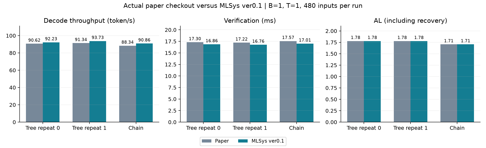
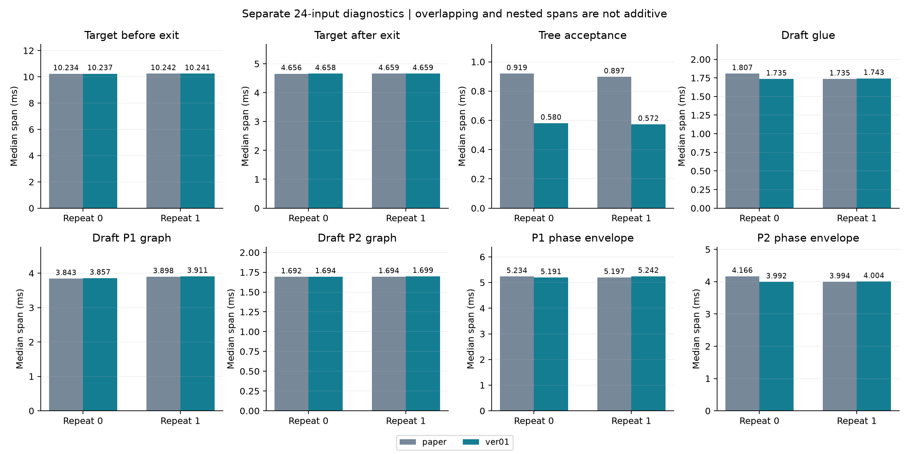
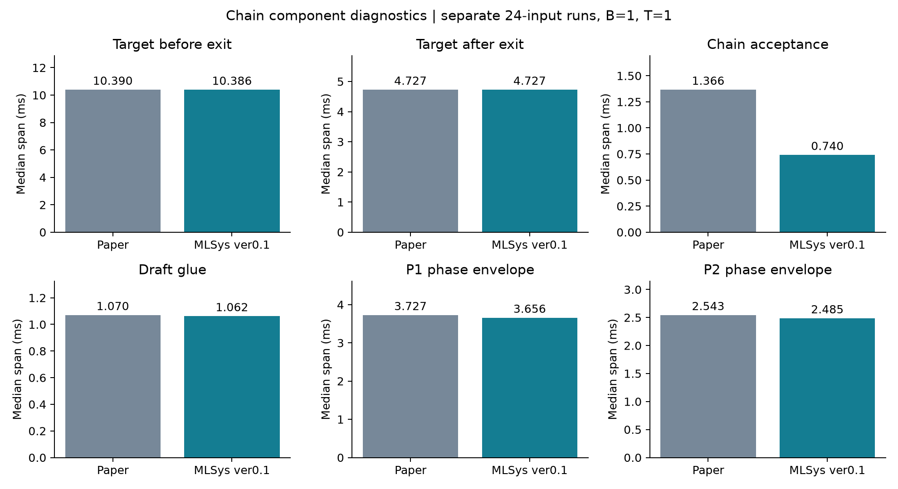

# MLSys-ver0.1 논문 브랜치 변경·공통 수정 리뷰

**최신 상태:** [공통 수정의 구현·성능·이식 자료](#common-fixes)까지 반영했다. 아래 앞부분은 최초 verification 변경(`be61186`)의 역사적 결과이고, 이후 독립 리뷰 수정(`3d51664`)과 공통 수정(`c1f96c1`), 대표 로그 모집단 정리(`e4b080e`)를 단계별로 보존한다. 과거 표를 최신 코드의 재측정 값으로 인용하지 않는다.

2026-10-13. `feat/duet-p2tree-g0@a82f7d24fb36827a9a81a3567f344dccb71f193e`에서 `MLSys-ver0.1`을 만들었다. 기준 revision은 작업 시작 시 원격 논문 브랜치와도 일치했다. 구현 commit은 `be61186`이다. 작업 폴더는 `/home/chokwans99/PSD-MLSys-ver0.1`이다.

**구현과 계획한 검증을 완료했다.** 실제 논문 원본과 동일한 480개 입력을 비교했을 때, tree TPS는 두 반복에서 각각 **+1.78%, +2.61%**, chain은 **+2.85%** 개선됐다. 각 대조의 출력·AL·cache hit는 같았다. Target forward 시간은 거의 유지됐고, 수락 처리 비용이 감소했다. T0의 AR 출력 차이26건도 실제 logits로 모두 추적했다. 아래 결과는 7B·FP16·RTX4090·B1·G=M 조건이며, 모든 장비와 설정에 대한 무결성 보증은 아니다.

**측정 버전과 후속 수정 구분:** 아래 기존 480개 성능표·그림·원시 archive는 `be61186` runtime의 결과다. 이후 독립 리뷰에서 발견한 T0 일반 경로의 recovery 위치, T0 fallback의 자식 선택, draft 온도 검사 동기화는 별도로 수정·검증했다. 이 후속 수정의 근거는 문서 마지막 절과 `review_followup/`에 구분해 보존한다. 기존 수치를 후속 수정까지 포함한 재측정 결과로 인용하지 않는다.

먼저 [전체 성능·구간 그림 PDF](figs/REVIEW.pdf), 아래 성능표와 구간표를 확인한 뒤 파일별 변경을 검토하면 된다. 수치 원본은 [PERFORMANCE.csv](PERFORMANCE.csv), 전체 파라미터는 [PARAMETERS.json](PARAMETERS.json)이다.

## 최초 verification 변경의 범위 (be61186)

기존 논문 실행기를 유지하면서 chain 간소화, tree CPU 정보 재사용, 온도별 계산 간소화, T=0 tree 지원을 적용했다. Tree의 수락 경로는 **CPU에서 선택하는 한 가지 구현**이다. Target·draft forward와 vocabulary 분포 연산은 GPU에서 실행한다. CPU/GPU 수락 경로 선택 옵션은 없다.

이전에 준비한 verification A+B+C 패치에 해당한다. 새로운 root·위치·tree 선정 정책, GPU tree 수락 graph, B>1 통합 tree 실행기, KV 관리 변경은 포함하지 않는다. G>M proposal 수정, 실제 온도를 이용한 root 후보 점수, 집계·scheduler·wire의 production 이식도 이번 verification 변경과는 별도다. 이번 tree 실험은 G=M으로 수행한다.

## 원본과 달라진 동작

| 변경 | 논문 원본의 처리 | MLSys-ver0.1의 처리 | 검토할 파일 |
|---|---|---|---|
| Chain 확률 검증 간소화 | 양의 온도 요청에도 greedy argmax 준비, GPU 조건 확인, 작은 결과의 여러 번 readback | CPU의 요청 온도로 확률 검증 경로를 결정. JIT proposal의 p/q 검증·residual recovery와 난수 순서는 유지하고 필요한 최종 결과를 묶어서 반환 | `ssd/ssd/utils/verify.py`, `verify_fast.py`, `engine/verifier.py` |
| Tree 정보 재사용 | Target 입력 준비 때 확인한 topology를 수락 때 다시 GPU에서 읽고 파싱. 온도도 GPU scalar에서 읽음 | 준비 시 확인한 CPU topology와 float32로 반올림한 요청 온도를 재사용 | `ssd/ssd/engine/verifier.py` |
| 불필요한 온도 tensor 생략 | CPU tree walk와 순수 greedy chain에도 수락용 GPU 온도 tensor 생성 | 해당 경로에서는 생성하지 않음. E0 진단처럼 실제 tensor를 사용하는 경우는 유지 | `ssd/ssd/engine/verifier.py` |
| Sampler 온도별 계산 | T>0에도 사용하지 않는 logits argmax, T=0에도 확률·난수 준비 | 양의 온도는 확률 샘플링만 수행. T=0은 argmax만 수행 | `ssd/ssd/layers/sampler.py`, `config.py`, `engine/model_runner.py`, `engine/llm_engine.py` |
| T=0 tree 생성과 검증 | Legacy tree가 T=0을 차단하거나 chain으로 처리 | Draft 첫 자식은 argmax, 추가 형제는 중복되지 않는 상위 후보. Target argmax와 일치하는 자식으로 이동하고 없으면 그 argmax를 반환 | `ssd/ssd/engine/helpers/p2_tree.py`, `p2_tree_executor.py`, `engine/draft_runner.py`, `verifier.py` |
| T=0 ragged chain recovery | 일반 경로에서 padding을 포함해 recovery 위치를 먼저 선택한 뒤 수락 길이만 실제 proposal 길이로 제한 | 실제 수락 길이를 제한한 **뒤** 그 위치의 target argmax를 recovery로 선택. 초기 이식의 `all_greedy` 경로에 들어 있던 정확성 수정을 후속 리뷰에서 일반 경로에도 적용 | `ssd/ssd/utils/verify.py` |
| 기존 benchmark 자동 연결 | Sampler의 온도 전용 경로를 선택하지 않음 | 기존 `--temp`, `--dtemp`로 capture 전에 자동 결정. 새 CLI 선택지는 없음 | `ssd/bench/bench.py` |

`greedy_only`와 `stochastic_only`는 CUDA graph를 만들기 전에 알려야 하는 내부 온도 계약이다. 기존 benchmark가 자동 설정한다. 일반 Python API에서는 초기화 시 계약을 지정할 수 있고, 계약에 맞지 않는 요청은 거부한다. 아무 계약도 지정하지 않는 API의 기존 호환 경로는 유지한다. 확률 샘플링에 필요한 random-score argmax는 제거 대상이 아니다.

### 확률적 tree에서 유지한 법칙

형제 후보는 순서가 있는 비복원 추출이다. 이전 형제를 제외한 proposal과 이전 거절을 반영한 target residual로 각 자식의 수락 확률을 계산한다. 이번 CPU 경로는 기존 `tree_verify_walk_tensor`를 그대로 사용한다. Tree의 방문 순서와 확률적 의미를 바꾸는 GPU 구현을 이식하지 않았다.

T=0에서는 p/q 수락 검증을 사용하지 않는다. 예산 배분·후보 순위에 사용하는 soft score와 target argmax 검증은 역할이 다르다. T=0의 soft score는 untempered draft 분포를 사용하며, 이를 확률 proposal이라고 간주하지 않는다.

## 실제 모델 대조 조건

| 항목 | 설정 |
|---|---|
| 데이터 | MT-Bench, translation, summarization, QA, math reasoning, RAG에서 저장한 각80개, 총480개 첫 turn 입력 전부. 원 데이터셋 전체나 새로운 holdout은 아님 |
| 모델 | LayerSkip-Llama2-7B + AMD-Llama-135M, full dense FP16 |
| 장비 | RTX4090 8개. 각 speculative job은 target TP1과 draft 1GPU 사용 |
| 주 비교 | B=1, T=1. Tree 2회 독립 process 대조, chain 1회 대조 |
| Greedy | B=1, T=0 tree 전체 480개와 원본 AR 대조. Chain T0 24개 추가 확인 |
| Batch 회귀 | B=4 chain 원본/변경본 24개 확인. B>1 tree 지원 실험은 아님 |
| DUET | Exit=21, K1=4, K2=2, speculate K=6, async fan-out=3, draft fan-out=2 |
| Tree | P1 G=M=8, P2 G=M=4, 형제 capacity=3, 위치별 P1 root=2 |
| 선정 정책 | 원본 residual·위치·tree 정책 유지 |
| 길이 | 입력 최대512, 출력 최대96, EOS 존중, model length=2048 |
| 메모리 | GPU memory utilization=0.45, KV block=256 |
| 전체 입력 워밍업 | 32개 입력 후 seed를 다시 설정하고 480개 측정 |
| 구간 진단 | 별도 24개 균등 선택 입력, 워밍업16개, 상세 프로파일 활성화 |

| 대조 | GPU | CPU affinity | 순서 | Target seed / draft seed |
|---|---|---|---|---|
| Tree 반복0 | 2,3 (PIX) | 8–15,40–47 | 원본 → 변경본 | 10801 / 231 |
| Tree 반복1 | 6,7 (PIX) | 24–31,56–63 | 변경본 → 원본 | 10802 / 232 |
| Chain | 4,5 (PIX) | 16–23,48–55 | 원본 → 변경본 | 10801 / 231 |
| Greedy | 0,1 (NODE) | 0–7,32–39 | Tree → AR | 10801 / 231 |

각 쌍은 같은 GPU·CPU affinity를 사용하며, 네 대조의 CPU 코어는 겹치지 않는다. 실행 전 GPU 점유를 확인하고 실행 중 외부 GPU process와 clock·온도·전력을 기록한다. Tree의 두 반복은 순서를 반대로 하여 순서에 따른 편향을 확인한다.

### 공통 benchmark 보정과 집계

실제 원본 checkout과 새 브랜치 코드를 실행한다. 새 통합 실행기의 graph OFF를 원본으로 대신하지 않는다. 두 방식에 동일한 AMD dtype 호환, 고유 shared-memory/port, 안전한 종료 adapter를 적용한다. Prefix lookup은 동일하게 끄고 decode의 기존 KV/glue 방식을 유지한다. 이 adapter를 verification의 성능 기여로 계산하지 않는다.

두 arm 모두 `PAPER_COLD_PREFIX=1`이다. 따라서 표의 절대 TPS는 prefix 재사용을 포함한 논문 운영 설정의 TPS를 재현한 값이 아니다. 여기서 유효한 비교는 **같은 cold-prefix 조건 안에서의 원본 대 변경본**이며, prefix 활성화 때의 상대 개선율까지 보장하지 않는다.

실제 반환 토큰을 측정한다. 출력 상한에 도달하거나 EOS 등으로 결과가 잘린 step, 활성 요청이 지정 B보다 적은 step은 토큰·시간 양쪽에서 제외한다. AL·hit도 같은 step 집합을 사용한다. AL은 recovery를 포함한 step당 반환 토큰 수다. TPS는 포함된 decode 토큰 합 / decode 시간 합이며 prefill을 포함한 전체 wall TPS와 구분한다.

프로파일 실행의 성능을 주 TPS 결과로 사용하지 않는다. Target exit 이전/이후 forward, 수락 처리, draft glue, P1/P2 graph, P1/P2 전체 구간을 따로 비교한다. CUDA event 구간에는 CPU launch gap이 들어갈 수 있으며, 서로 겹치거나 포함 관계인 구간의 평균·중앙값을 합산하지 않는다.

## 전체 입력에서 확인한 성능

각 행은 480개 입력 전체의 비계측 실행이다. Tree 두 반복은 seed와 GPU 쌍이 다르므로 **같은 반복 안에서** 원본과 변경본을 비교한다.

Tree와 chain도 서로 다른 GPU 쌍을 사용했다. 이 표의 목적은 각 구조에서 원본 대비 변경 효과를 확인하는 것이며, 구조 간 최종 우열을 확정하는 대조는 아니다.

| 구조와 반복 | 버전 | B | AL | Cache hit | Verification ms | TPS |
|---|---|---:|---:|---:|---:|---:|
| Tree 반복0 | 논문 원본 | 1 | 1.7780 | 64.35% | 17.3007 | 90.6187 |
| Tree 반복0 | MLSys-ver0.1 | 1 | 1.7780 | 64.35% | 16.8634 | 92.2345 |
| Tree 반복1 | 논문 원본 | 1 | 1.7776 | 64.26% | 17.2209 | 91.3444 |
| Tree 반복1 | MLSys-ver0.1 | 1 | 1.7776 | 64.26% | 16.7591 | 93.7290 |
| Chain | 논문 원본 | 1 | 1.7057 | 66.38% | 17.5661 | 88.3442 |
| Chain | MLSys-ver0.1 | 1 | 1.7057 | 66.38% | 17.0087 | 90.8610 |

**Tree의 TPS는 +1.78%, +2.61%, chain은 +2.85% 개선됐다.** 각 대조에서 480개 출력, AL, cache hit, 포함된 step 수가 모두 같았다. 이번 개선은 후보 선정 품질이나 더 긴 수락 길이로 얻은 것이 아니라, 같은 결과를 반환하는 실행 비용이 줄어든 결과다.

Verification은 tree 반복0에서0.4372ms, 반복1에서0.4618ms, chain에서0.5574ms 감소했다. 이 수치는 전체 verification 구간의 감소량이며 target 모델 forward 자체의 감소량과 동일시하지 않는다. 아래 구간 진단으로 실제 변화를 구분한다.

| 대조 | TPS 변화 | 입력 단위 paired bootstrap 95% 구간 | Verification 변화 |
|---|---:|---:|---:|
| Tree 반복0 | +1.78% | +1.60% ~ +1.99% | −2.53% |
| Tree 반복1 | +2.61% | +2.44% ~ +2.76% | −2.68% |
| Chain | +2.85% | +2.68% ~ +3.02% | −3.17% |

각 구간은 같은 process 대조 안에서 입력을 쌍으로 재표집한4000회 bootstrap이다. Process를4000번 독립 실행한 신뢰구간이 아니다. Tree는 실제 두 process 대조에서 모두 개선됐고 chain은 한 process 대조이므로, chain의 실행 간 변동까지 같은 강도로 검증했다고 하지 않는다.



## 어느 구간이 빨라졌는가

각 값은 별도24개 입력 프로파일의 유효 구간 중앙값(ms)이다. 앞19 step, cap/clip/tail, capture가 있는 step과 그 다음 step을 동일하게 제외했다. 단독 kernel 실행시간이나 비계측 TPS와 같지 않다.

| 구간 | Tree 반복0 원본 → 변경본 | Tree 반복1 원본 → 변경본 | 해석 |
|---|---:|---:|---|
| Target exit 이전 forward | 10.2339 → 10.2369 | 10.2420 → 10.2410 | 거의 동일 |
| Target exit 이후 forward | 4.6561 → 4.6582 | 4.6592 → 4.6592 | 거의 동일 |
| Tree 수락 경로 처리 | 0.9191 → 0.5802 | 0.8968 → 0.5724 | 약36~37% 감소 |
| Tree 실행 중 miss의 chain 수락 | 1.4600 → 0.7699 | 1.4138 → 0.7670 | Chain 간소화가 tree miss에도 적용 |
| Draft P1 graph replay | 3.8431 → 3.8574 | 3.8984 → 3.9107 | 감소하지 않음 |
| Draft P2 graph replay | 1.6916 → 1.6937 | 1.6937 → 1.6988 | 감소하지 않음 |
| Draft P1 전체 구간 | 5.2344 → 5.1914 | 5.1973 → 5.2422 | 반복별 방향이 다름 |
| Draft P2 전체 구간 | 4.1660 → 3.9922 | 3.9941 → 4.0039 | 일관된 개선으로 판단하지 않음 |

Chain 전용 대조에서도 target pre/post는10.3895→10.3864ms / 4.7268→4.7268ms로 거의 같고, 수락 처리만1.3658→0.7403ms로 감소했다. 고정 GPU tensor를 사용하는 별도 chain 함수 대조도 같은 방향이다. V=32000·B1·T1에서 **chain proposal 길이2**는1.0942→0.5173ms, **길이4**는1.0974→0.5117ms였다. 여기의 길이는 DUET phase 예산 K1/K2와 구분한다.

따라서 이번 묶음의 TPS 개선은 **동일한 모델 계산과 출력에서 수락 처리의 불필요한 작업·동기화를 줄인 효과**로 설명할 수 있다. Draft 모델 forward가 빨라졌다는 근거는 없다. 묶음 대조이므로 각 변경의 독립 TPS 기여를 더해서 주장하지 않는다.





[실제로 관측한 두 GPU timeline](figs/03_timelines.png)도 제공한다. 각 process에서 관측한 대표적인 P2-hit step이다. 이 그림 하나를 고정 tensor replay의 인과 증명으로 사용하지 않는다.

## 추가 기능과 회귀 결과

| 조건 | 버전 | 입력 수 | AL | Cache hit | TPS | 판정 |
|---|---|---:|---:|---:|---:|---|
| B4 chain, T1 | 논문 원본 | 24 | 1.6603 | 66.67% | 294.7446 | 회귀 대조 |
| B4 chain, T1 | MLSys-ver0.1 | 24 | 1.6603 | 66.67% | 310.1797 | 출력24개 모두 같음. 성능 우위 주장용 실험 아님 |
| B1 tree, T0 | MLSys-ver0.1 | 480 | 2.5447 | 86.40% | 136.9019 | Tree T0 실제 실행 완료 |
| B1 AR, T0 | 논문 원본 | 480 | — | — | 65.7473 | Greedy 정확성 대조 기준 |

B4는24개 입력의 단일 회귀 검사다. 관측값의 차이는 기록용으로 남기지만 **B>1의 TPS 개선율 근거로 인용하지 않는다.** 이 검사는 T=1이므로 T0 ragged 일반 경로의 정확성 검사를 대신하지 않는다. T0 AR은 원본 sampler를 사용하는 정확성 기준이다. 이 표를 별도로 최적화한 AR·SSD와의 공정한 최종 경쟁 실험으로 제시하지 않는다. Tree T0의 source별 포함 step은 miss2372, P1 hit7693, P2 hit7380으로 두 phase가 실제로 실행됐다.

### T0에서 AR과 달랐던26개 출력

480개 중454개는 AR과 같고26개는 달랐다. 26개 모두 첫 차이 직전의 **동일 token prefix**에서 실제 AR/tree logits를 저장해 다시 확인했다. 진단 실행은 원래 전체 실행의 토큰열도 모두 재현했다.

- 26개 모두 AR은 자기 target logits의 argmax, tree도 자기 target logits의 argmax를 반환했다.
- AR의 top1–top2 차이는 최대0.015625였고, 두 실행의 vocabulary 전체 최대 logit 차이는0.029296875였다.
- 24건은 tree-hit verification, 2건은 tree 실행 중 miss-chain에서 발생했다.
- 확인한 직접 원인은 FP16의 근접값·동점에서 query shape별 logits가 조금 달라지는 것이었다. 잘못된 자식을 수락하거나 argmax가 아닌 token을 반환한 사례는 없었다.

이로써 target argmax 규칙을 따르는 것은 확인했지만, AR과 비트 단위로 같은 토큰열을 보장한다고 표현하지 않는다. 원시 logits와 진단 결과는 `RAW_RESULTS.tar.gz` 및 [GREEDY_DIAGNOSIS.json](GREEDY_DIAGNOSIS.json)에 있다.

## 정확성 검사와 발견한 문제

- 원본 함수와 고정 입력 대조: chain 384건, tree 288건에서 반환 결과와 RNG 상태 일치. Tree의 terminal sampling 분포도 tensor 값이 일치했다.
- 온도 0.3/0.7/1과 FP16/BF16의 q 분포 12조건, sampler 12조건 대조 통과.
- T0 branching/tie/중복 형제, ragged chain의 실제 길이, 온도 계약, sampler RNG 검사 5개 통과.
- P1 기존 검사 28개 통과.
- P2 기존 검사108개를 GPU에서도 실행해 **skip 없이 모두 통과**했다. P1 검사28개도 GPU가 보이는 환경에서 통과했다.
- GPU chain 고정 tensor 대조: V=32000/128256, B=1/2/4/8, proposal 길이2/4, T=0.7/1의32조건×16 seed, **512개 출력 모두 원본과 일치**했다. 이는 함수 단위 검사이며 큰 vocabulary 모델의 통신·전체 serving 지원까지 검증한 것은 아니다.
- **발견한 실패는 기존 P2 warmup 테스트의 mock 누락이었다.** 가짜 executor에 `total_cells`가 없었고 page bucket의 기대 개수도 이전 값이었다. 수정 전 테스트를 원본 runtime에서도 실행해 동일 실패를 재현했다. Mock에 실제 footprint 30을 지정하고 기대 bucket을1–8로 바로잡았다. Production warmup 함수는 원본과 동일하다. 실패 기록도 보존했다.

고정 입력의 확률 검증 동등성과 end-to-end 토큰열 일치는 구분한다. 비동기 phase의 timing에 따라 hit 경로가 달라질 수 있다. T0도 FP16에서 query shape별 target logits의 미세 차이로 AR과 토큰열이 달라질 수 있으므로, 발생한 첫 차이는 동일 prefix의 실제 logits로 추적한다.

초기 검증의 모델 실행25개(전체480개 실행8개 포함)와 T0 추가 진단2개, 총27개 실행이 정상 종료했다. 각 실행의 GPU 점유 기록에 외부 process 간섭은 없었다. 당시 수행한 범위에서는 테스트 mock 오류 외에 실행 실패나 검증 불일치를 발견하지 못했다. 이후 독립 리뷰가 일반 T0 ragged 및 fallback 경로의 누락을 확인했으며, 아래 후속 검증에서 다룬다. 기존 prefix 재사용·G>M 등 범위 밖의 조건까지 오류가 없다고 주장하는 결과는 아니다.

## 리뷰와 재현

1. `git diff a82f7d2..MLSys-ver0.1 -- ssd/ssd`로 runtime 변경을 확인한다. `engine/verifier.py`와 `utils/verify_fast.py`, `helpers/p2_tree.py` 순서가 이해하기 쉽다.
2. `ssd/bench/bench.py`에서 기존 온도 인자로 sampler를 자동 연결한 부분을 확인한다.
3. `PLAN.json`, `*_plan.json`에서 기준 checkout, 모델·예산·GPU·seed를 확인한다.
4. `ANALYSIS.json`의 전체 입력 결과와 `COMPONENTS.json`의 구간별 결과를 함께 본다. 프로파일 수치를 비계측 TPS와 섞지 않는다.
5. `PAPER_PARITY.json`, 테스트 로그, `GREEDY_DIAGNOSIS.json`으로 정확성 근거를 확인한다.

환경은 기존 `/home/chokwans99/PSD/ssd/.venv/bin/python`을 사용한다. 다른 서버에서는 모델 경로와 baseline checkout 경로, GPU 번호와 CPU affinity를 해당 장비에 맞춘다. Runtime의 CPU/GPU 경로 선택 옵션을 추가할 필요는 없다.

원시 자료는 [RAW_RESULTS.tar.gz](RAW_RESULTS.tar.gz)에 보존한다. [RAW_MANIFEST.json](RAW_MANIFEST.json)에 파일별 SHA256과 전체 archive SHA256을 기록하며, archive를 다시 읽어 원본과 대조했다. 이 폴더에서 `tar -xzf RAW_RESULTS.tar.gz`로 풀고 `analyze.py`, `analyze_components.py`, `make_figures.py`를 실행하면 표와 그림을 재생성할 수 있다. [RUNTIME.patch](RUNTIME.patch)는 논문 원본 기준 runtime과 기존 benchmark 온도 연결 변경만 담고, 결과 archive나 진단 harness는 제외한다. 소스·모델 config·질문 집합 해시는 [SOURCE_MANIFEST.json](SOURCE_MANIFEST.json)을 따른다.

실행 예시는 다음과 같다. 결과가 이미 존재하는 폴더에 덮어쓰지 않도록 새 결과 폴더와 plan 경로를 사용한다.

```bash
python results/mlsys_ver01/run_pair.py \
  --plan results/mlsys_ver01/tree_r0_plan.json \
  --gpus 2,3 --port 30020 \
  --directory results/mlsys_ver01/tree_r0
```

여기서 검증하는 것은 원 논문 **코드 기준의 7B·4090 결과**다. 70B·다른 GPU·TP2·큰 tree에서의 개선율은 그 서버에서 같은 기준으로 재측정해야 한다. Prefix 재사용, G>M 및 B>1 tree까지 이번 결과가 검증한 것으로 확대 해석하지 않는다.

## 독립 리뷰 후속 검토와 수정 — 2026-10-13

독립 리뷰의 세 코드 지적은 유효했다. 해당 경로를 재현하고 runtime 세 파일에 수정했다. 새로운 선택 옵션은 추가하지 않았고, CPU tree 수락 방식도 유지했다. Root 점수 온도·G>M·scheduler·KV 수정은 포함하지 않는다. **주 성능 대조의 T>0·B1·G=M에서는 출력 보존 최적화지만, 브랜치 전체는 T0 지원과 아래 정확성 수정도 포함한다.** 모든 변경을 단순한 비용 절감이라고 묶지 않는다.

### 1. 일반 경로의 T0 recovery 위치

원 논문과 초기 ver0.1의 일반 `verify()`는 greedy mismatch 위치에서 recovery를 먼저 골랐다. 이후 수락 길이를 `valid_k`로 제한해도 recovery 위치는 그대로였다. 실제 proposal 길이가2이고 batch padding 길이가4일 때, padding까지 target argmax와 일치하면 길이4 이후 token을 잘못 선택할 수 있었다. 혼합 온도만의 문제는 아니며, **일반 경로로 실행하는 동질 T0 batch**도 해당한다.

초기 ver0.1의 `all_greedy` 전용 경로는 이미 길이를 제한한 뒤 recovery를 골랐다. 따라서 이 조건에서 원본과 달라질 수 있었으며, 이전 변경 표에서 그 정확성 수정을 빠뜨린 것이 맞다. 이번에는 일반 경로도 최종 `accept_until`에서 recovery를 고르도록 통일했다.

- 재현 입력: 두 행 모두 `[0,1,2,3,4]`, 실제 proposal 길이 `[4,2]`. 각 위치의 target argmax는 차례로1,2,3,4,5.
- 수정 전 recovery: `[5,5]`. 수정 후: **`[5,3]`**. 수락 suffix는 두 버전에서 동일.
- CPU/CUDA에서 동질 T0·혼합 온도, 실제 길이0/2/4, 실제 거절·padding 일치를 확인했다.
- 이전 B4 T1 실험은 이 문제를 검증하지 않았다. B1에서 tensor 폭이 실제 길이와 같은 기존 주 실험으로 이 문제를 확대하지 않는다.

### 2. T0 fallback에서도 첫 자식을 argmax로 선택

Captured executor는 T0 첫 자식을 argmax로 골랐지만, `SSD_TREE_EXEC=0` 또는 executor가 `None`을 반환한 뒤의 arena에는 T0 계약을 전달하지 않았다. CPU reference fallback에도 같은 누락이 있었다. 그 결과 T0에서 soft ranking score를 무작위 비복원 추출에 사용했다.

Target greedy 검증은 여전히 자기 argmax와 일치하는 자식만 수락하므로, 직접적인 오류는 **draft 후보 구성의 설명과 구현 불일치**다. AL/hit가 달라질 수 있으며, target의 잘못된 p/q 검증이라고 해석하지 않는다.

`DraftRunner`에서 GPU arena와 CPU rollout 모두에 기존 `greedy_only` 계약을 전달했다. 첫 자식은 logits argmax, 추가 자식은 서로 다른 상위 후보이며 RNG를 사용하지 않는다. Soft score는 계속 예산/순위 계산에 사용한다. T>0 호출은 기존 샘플링 및 RNG 순서를 유지했다.

- 고정 입력 재현: CPU/CUDA × arena/CPU rollout의 각32회 자식 선택에서 수정 전16회는 첫 자식이 argmax가 아니었고, 수정 후는 **0회**였다. 동점의 첫 인덱스와 RNG 불변도 검사했다. 이 비율은 의도적으로 만든 테스트 입력의 결과이며 실제 workload 발생률이 아니다.
- 양의 온도 fallback64조건에서 자식·topology·raw score·RNG가 수정 전과 같았다.
- 실제 7B T0 실행: executor OFF, executor `None`, CPU fallback을 각각8개 입력으로 검사했다. 각 실행에서 warmup 포함308회 호출·1,540행의 **첫 자식 argmax assertion이 모두 통과**했다. 실행 중 검사로 동기화가 추가되므로 이 세 실행의 TPS는 성능 근거로 사용하지 않는다.

### 3. P1과 P2의 중복 온도 확인 동기화 제거

리뷰가 지적한 P2뿐 아니라 P1 진입 조건에도 CUDA temperature tensor의 `.all()`을 CPU bool로 읽는 동기화가 남아 있었다. 요청 등록 때 `greedy_only`/`stochastic_only` 계약을 이미 확인하므로, 두 경우에는 CPU config만으로 tree 가능 여부를 판단하도록 공통화했다. 계약을 지정하지 않은 일반 API는 기존 tensor 검사를 유지한다.

- P2 dispatch10회 프로파일: `aten::_local_scalar_dense` **10회 → 0회**.
- 유휴 GPU의 dispatch 확인 비용 중앙값: **20.746μs → 0.180μs**. 300호출×9회, 실행 순서 교대.
- 이는 작은 조건 확인의 비용이다. 모델 forward의 개선율이나 전체 TPS 개선율로 환산하지 않는다. P1도 동일 helper를 사용하며, 계약이 있으면 temperature tensor에 접근하지 않는 검사를 통과했다.

실제 7B·T1·B1 tree에서도 수정 전 `4b0d208`과 수정 후를 같은 GPU2/3·CPU affinity·24입력·16 warmup으로 한 차례 대조했다. **출력24개, AL1.788782, cache hit62.576687%, 포함 step1,141개가 동일**했다. 아래는 별도 계측 실행에서 초기19step·cap/clip·capture와 다음 step을 제외한 구간 중앙값이다.

| 구간 | 수정 전 ms | 수정 후 ms | 해석 |
|---|---:|---:|---|
| Target exit 이전 forward | 10.2348 | 10.2308 | 거의 동일 |
| Target exit 이후 forward | 4.6572 | 4.6561 | 거의 동일 |
| Draft P1 graph replay | 3.8513 | 3.8451 | 거의 동일 |
| Draft P2 graph replay | 1.6886 | 1.6855 | 거의 동일 |
| Draft P1 전체 구간 | 5.1543 | 4.7031 | 준비·launch gap을 포함한 관측 감소 |
| Draft P2 전체 구간 | 3.9922 | 3.7930 | 준비·launch gap을 포함한 관측 감소 |
| Target tree walk | 0.5782 | 0.5274 | 이 후속 수정에서 tree walk 구현은 바꾸지 않음 |

Forward 자체는 거의 변하지 않았고 phase 전체 구간 감소가 관측됐다. 다만 **24입력 단일 계측 대조**이며, event span·CPU/GPU scheduling·비동기 overlap이 영향을 준다. 위 전체 구간 감소를 모두 제거한 조건문 한 개의 순수 실행 시간으로 해석하지 않는다. 계측 TPS89.7963→91.4315도 기록용이며 추가 TPS 개선율 주장에 사용하지 않는다. 동기화 제거 자체는 profiler와 동작 검사로 확인했고, 독립적인 반복 비계측 TPS 효과는 아직 확정하지 않았다.

### 4. 측정 범위와 C=3 제약

- Cold prefix를 양쪽에 동일하게 적용한 상대 비교는 유효하다. 절대 TPS가 prefix cache를 사용하는 원 논문 운영 설정의 재현이라는 뜻은 아니다. 본문에 이 범위를 명시했다.
- B4의24입력 단일 회귀검사를 B>1의 성능 우위 근거로 인용하지 않도록 수정했다. Raw 수치는 보존한다.
- `validate_tree_ints(..., sibling_capacity=3)`는 원본부터 있다. 더 확인하면 **`TreeProxyCUDAGraph`의 child buffer도 실제 폭3으로 생성**된다. Config는 C를1–8로 허용해 C>3과 충돌할 수 있다. 검증 한 줄만 config 값으로 바꾸면 GPU pack이 버퍼 범위를 벗어날 수 있어 그렇게 수정하지 않았다. 현재 C=3 실험에는 영향이 없고, C>3을 지원하려면 graph 생성·topology packing·모든 TP rank의 validation을 함께 바꾸고 검증해야 한다. 이는 다음 별도 지원 항목이며 이번에 해결했다고 표시하지 않는다.

### 후속 검증과 이식 자료

- 이번에 실행한 기존177개 + 추가5개, **총182개 검사 통과, skip0**. Suite별 개수는5+5+28+108+35+1이며 `CHECKS.json`과 로그에 기록했다. 추가 검사 내부에서 CPU와 CUDA 조건을 모두 실행했다. 중간 안내의186개는 합산 오류여서 실제 로그 기준으로 정정한다.
- 원 논문 CPU parity: chain384·tree288·sampler12·q분포12 통과.
- 원 논문 GPU chain: V32000/128256·B1/2/4/8·K2/4·T0.7/1, **512개 출력 일치**.
- 새 실제 모델 실행5개 모두 정상 종료. 외부 GPU process 간섭 없음. 수정 전후 비교의 두 runtime은 run JSON의 파일별 source hash로 구분한다.
- 첫 회귀 실행에서 기존 deterministic sampler mock이 새 `allow_greedy=False` 인자를 받지 못했다. T>0 호출에는 새 keyword를 보내지 않고 기존 호출 계약을 유지하도록 정리했으며, 기존 테스트를 바꾸지 않고 통과했다. 최초 실패 로그도 보존한다.

근거는 [CHECKS.json](review_followup/CHECKS.json), [SUMMARY.json](review_followup/SUMMARY.json), [구간 원시 통계](review_followup/COMPONENTS.json), [GPU chain 대조](review_followup/CHAIN_GPU_PARITY.json)에 있다. 새 원시 실행5개의 로그·프로파일·온도 fallback assertion 기록은 [후속 RAW_RESULTS.tar.gz](review_followup/RAW_RESULTS.tar.gz)에 보존하고, [manifest](review_followup/RAW_MANIFEST.json)의 SHA256을 archive 재독출로 확인했다.

다른 서버에서 최신 내용을 이식할 때에는 **[후속 누적 RUNTIME.patch](review_followup/RUNTIME.patch)**를 사용한다. 이는 논문 원본 `a82f7d2` 기준으로 기존 verification 변경과 이번 세 수정을 모두 포함한다. 이전 `RUNTIME.patch`와 중복 적용하지 않는다. 원본 파일만 별도 임시 폴더에 복원하여 patch 적용 후11개 파일이 현재 코드와 같은지 확인했다([PATCH_CHECK.json](review_followup/PATCH_CHECK.json)). 기존 상위 폴더의 `SOURCE_MANIFEST.json`, `VALIDATION.json`, `RUNTIME.patch`는 최초480입력 측정 버전의 증거로 그대로 보존한다.

재현은 `review_followup/check_review.py`, `fallback_plan.json`, `profile_plan.json`, `summarize.py`를 따른다. 구간 측정 전에 profile 출력 디렉터리를 만들고, 모델·baseline checkout 경로와 GPU/CPU 배치를 해당 서버에 맞춘다. 초기 profile 실행의 디렉터리 생성 전 proxy-send 통계 저장 경고는 최종 dump 전에 디렉터리를 만들어 해결했으며, 두 process의 최종 구간 파일·step 대응과 archive를 확인했다. 이 후속 작업에서 원격 push나 논문 브랜치 merge는 수행하지 않았다.

<a id="common-fixes"></a>

## 공통 수정 반영과 검증 결과 — 2026-10-13

논문 원본 `a82f7d2` 기반의 이 브랜치에서, 공통 수정 직전 `3d51664`를 별도 clean checkout으로 보존하고 비교한다. 이번 범위는 실제 요청 온도의 후보 점수 반영, G>M generation-prefix 전송, 실제 반환 token 집계, cap/clip·부분 batch step 제외, prefill의 resident B 제한, 동일 int64 크기의 uint32 token wire, 기존 KV·요청 상태 오류 수정이다. 기존 residual·위치 예산·tree 확장 정책과 CPU tree 수락 기본 경로를 유지한다. 새로운 연구 점수나 통합 B>1 tree 실행기는 포함하지 않는다.

원본과 출력이 같아야 하는 B1·T1·G=M 대조와, 동작이 의도적으로 바뀌는 T≠1·G>M·prefix/preemption 조건을 분리한다. 전체 480입력 실험은 target LayerSkip-Llama2-7B / draft AMD-135m, FP16, GPU pair 내 순차 실행, 입력 최대512·출력96, exit21·K1/K2=4/2·G=M=8/4·C3를 사용한다. Prefix cache OFF는 이전 상대 성능 비교와 동일한 조건이며, KV 정확성은 별도 cache ON 검사로 검증한다. 계획과 원시 기록은 `common/`에 보존한다. 전체 대조는 완료했으며 결과를 아래에 구분해 기록한다.

### 이번 공통 수정의 리뷰 목록

| ID | 논문 원본의 문제/제약 | 이번 처리 | 기존 논문 실험에 영향이 생기는 조건 |
|---|---|---|---|
| P01 후보 점수 온도 | Eager·CUDA graph의 root 점수에서 proxy/draft softmax가 T=1로 고정 | Target T와 draft T를 각 분포에 반영. Capture된 FP32 온도 buffer를 replay 전에 갱신 | T>0이면서 T≠1인 요청에서 root 후보·hit·AL이 달라질 수 있음. T=1은 기존 점수와 같음 |
| P02 G>M | 샘플링 완료 뒤 `raw_q`에 따라 tree를 재선정하면서 기존 q를 계속 verification에 사용 | P1/P2 모두 생성 순서의 앞 M개를 유지. 부모·형제 순서와 q context를 함께 보존. 예전 P1 재정렬 cache 비활성화 | G>M에서 선택되는 tree가 달라짐. G=M의 전송은 유지 |
| P03 반환 토큰 집계 | EOS/출력 상한 뒤로 잘린 accepted token까지 decode token에 포함 가능 | Scheduler가 실제 추가한 token 수를 반환·집계. SD/SSD/DUET 공통 | 잘림이 발생한 step. 종전 집계는 과소가 아니라 과대평가 가능 |
| P04 성능 모집단 | 전체 decode 시간·raw accepted 수에 cap/clip·B 미만 tail이 섞임 | 해당 **batch step 전체**의 token과 시간을 함께 제외. AL/hit도 같은 step의 event로 계산 | 성능표 정의가 달라짐. 생성 자체는 끝까지 실행. 긴 prompt/전체 요청을 삭제하는 방식과 다름 |
| P05 Scheduler B | Prefill 때 resident request 수가 B를 초과할 수 있음 | Running+새로 prefill할 request를 합쳐 B 이하로 제한 | 여러 요청을 한꺼번에 제출할 때. B1 요청을 하나씩 제출했던 주 대조는 동일 |
| P06 Token wire | Packed int64의 token 영역이15bit여서 큰 vocabulary 지원 불가 | Token32bit·score16bit·version bit로 재배치. 위치 wire와 token wire의 개수/자료형은 유지 | 새 vocabulary 지원. 작은 token도 wire encoding은 달라지므로 양단 동시 이식 필요 |
| K01 Cached prefill | 대체 FlashAttention 경로가 비연속 physical page를 flatten하여 잘못된 prefix를 읽음 | Page table과 요청별 KV 길이를 전달 | Cached prefill + 해당 backend. 주 성능 실험의 FlashInfer 경로에 같은 변경을 가한 것이 아님 |
| K02 완전 cached prompt | Block 경계까지 prompt가 모두 cached면 query 길이가0이 됨 | 마지막 query token을 다시 계산해 다음 logits를 만듦 | Block-aligned prompt의 완전 cache hit |
| K03 Preemption | Re-prefill을 위해 `num_prompt_tokens`를 이동하면 이미 생성한 출력과 남은 예산 계산까지 초기화 | 원래 prompt 경계를 별도 불변 필드로 유지. 직렬화·clone도 포함 | KV 부족 등으로 preemption/re-prefill 발생 시 |
| K04 Block hash | 예약된 마지막 page를 현재 완성된 block으로 오인할 수 있음 | 실제 `block_index`의 page와 이전 block hash 사용 | 생성 중 block 경계를 지나고 앞서 예약한 page가 더 있을 때 |

P01은 **사용자가 승인한 후보 점수 정책의 변경**이다. 원본 주석에도 과거 A/B에서 온도 반영 후 AL이 낮아져 T1 점수로 되돌렸다는 기록이 있다. 따라서 이를 target lossless 검증의 필수 오류 수정이나 자동적인 성능 개선으로 표현하지 않는다. Root 후보 점수와 최종 p/q 수락 검증은 별개다. P01은 기존 residual·top-k 내부 정규화·위치 예산 수식을 바꾸지 않는다. T=0은 분포를 0으로 나누지 않고 기존 T1 soft ranking을 쓰며, draft/target greedy 규칙과 분리한다. 드물게 사용하던 raw/top-M proxy 전송 옵션은 T1의 partition만 담고 있어 T≠1 분포를 복원할 수 없다. 이 옵션과 non-unit T 조합은 요청 등록 때 명시적으로 거부하며, 기본 full-vocabulary proxy 경로에서 실제 온도를 지원한다. 조용히 T1 점수로 실행하지 않는다.

P02는 **확률적 정확성을 위한 선택 규칙 수정**이다. 기존 점수를 유지한 채 비용만 줄인 최적화라고 표현하지 않는다. 작은 vocabulary의18개 proposal 상태와 모든 수락/거절 분기를 열거한 결과, target `[0.4,0.3,0.3]`에 대해 기존 score 재정렬은 첫 출력 `[0.4,0.31875,0.28125]`(TV0.01875), 생성 prefix는 target과 정확히 일치했다. 이는 알고리즘 반례이며 실제 LLM의 분포 편향 발생률 측정이 아니다. [PROPOSAL_AUDIT.json](common/PROPOSAL_AUDIT.json)에 유리수 계산·production walk 적분을 함께 보존했다.

K01–K04는 새 prefix 재사용 기능이나 tree KV 재구축 최적화를 추가한 것이 아니다. 기존 기능의 예외 상태를 고쳤으며 glue decode 정책은 유지한다. 이 네 파일은 논문 원본과 직전 `3d51664`가 byte 단위로 같았다([KV_PROVENANCE.json](common/KV_PROVENANCE.json)). 따라서 이번 verification 최적화에서 새로 유입된 오류가 아니다. 반대로 이 예외들이 발생하지 않았던 모든 기존 논문 실행을 잘못된 실험이라고 결론 내릴 근거도 아니다.

### 기능 검증 방식

- 같은 재현 테스트를 clean `3d51664`에 실행해 block hash·preemption·반환 token 수·완전 cached prompt·prefill B 초과·paged attention 실패를 확인하고, 수정본 통과와 대조한다.
- 비연속 page `[5,2]`와 별도의 uncached page7을 같은 prefill에 배치하고 FP16/BF16 GPU attention을 독립 dense reference와 대조한다. 분기 mock만 검사한 것이 아니다.
- 후보 온도는 chain/tree의 실제 CUDA graph를 1→0.7/0.3→0→0.3/1→1로 갱신해 eager 경로와 비교한다. FP16 기본 dtype 환경에서도 온도 buffer는 FP32다. 독립 scalar 분할 reference와는 FP32 반올림·wire 양자화 한 칸을 허용하고, token/위치는 같아야 한다. B4 eager 경로도 행별 reference와 대조한다.
- Token ID0·32767·32768·128255·151935·2^32−1의 wire roundtrip, 이전 version 거부, 전송 byte 수를 검사한다. 큰 vocabulary full model 실행까지 했다는 뜻은 아니다.
- `common/analyze.py`는 엔진이 저장한 `performance`와 benchmark가 sequence 길이를 직접 관찰한 독립 집계를 총2,283개 입력 group에서 대조했다. 포함 token·시간·AL·hit·step 수가 일치해야 한다. 원본 arm에도 같은 외부 필터를 적용하므로, 기존/신규 집계 기준을 섞어 TPS 개선율을 만들지 않는다.
- 기존 수락 함수에 대한 원 논문 parity는 chain384·tree288·sampler12·q분포12 조건에서 출력·recovery 분포·RNG를 함께 검사했다. P01은 root 후보 선택, P02는 G>M proposal 선택을 변경하며, 이 두 조건을 원본과 출력이 같아야 하는 검사에 혼합하지 않는다.

### 480입력 성능 대조 — T=1, G=M

같은 GPU pair 내에서 tree 반복0은 paper→before→after, 반복1은 after→before→paper 순서로 실행했다. Chain은 before→after→paper 순서다. `paper=a82f7d2`, `before=3d51664`, `after=c1f96c1`이다. 이번 full-run warmup은16입력으로 세 arm에 동일하다. 위의 과거 warmup32 실험과 수치를 섞지 않는다.

| 실행 | 버전 | B | AL (recovery 포함) | Cache hit | TPS | 평균 verification ms |
|---|---|---:|---:|---:|---:|---:|
| tree_r0 | paper | 1 | 1.7657 | 64.57% | 90.203 | 17.2770 |
| tree_r0 | before | 1 | 1.7657 | 64.57% | 93.095 | 16.7407 |
| tree_r0 | after | 1 | 1.7657 | 64.57% | 93.017 | 16.7592 |
| tree_r1 | paper | 1 | 1.7732 | 63.75% | 91.363 | 17.2092 |
| tree_r1 | before | 1 | 1.7732 | 63.75% | 93.742 | 16.7674 |
| tree_r1 | after | 1 | 1.7732 | 63.75% | 91.790 | 16.9372 |
| chain | paper | 1 | 1.7210 | 66.14% | 88.900 | 17.6067 |
| chain | before | 1 | 1.7210 | 66.14% | 91.149 | 17.0530 |
| chain | after | 1 | 1.7210 | 66.14% | 91.788 | 16.9906 |

각 대조의480개 출력·AL·cache hit는 모두 같았다. 논문 원본 대비 누적 TPS 차이는 tree +3.12%/+0.47%, chain +3.25%다. 그러나 **이번 공통 수정만의 차이**는 tree −0.08%/−2.08%, chain +0.70%다. 공통 수정 자체의 TPS 향상을 주장하지 않는다. Tree 반복 간 차이가 있으므로 하드웨어 clock만 보고 실행 변동이 없다고 판단하지도 않는다. 추가 ABBA 진단도 아래에 별도로 기록한다.

[성능 그림 PNG](common/figs/TPS.png) · [성능 그림 PDF](common/figs/TPS.pdf) · [기계 판독 표](common/PERFORMANCE.csv) · [전후 대조 및 bootstrap](common/ANALYSIS.json). Bootstrap은 prompt 재표집 구간이며 run-to-run 오차까지 포괄하는 신뢰구간이 아니다.

### Target/draft 구간과 추가 비용

다음은 비계측 TPS와 별도로 실행한24입력 profile의 중앙값이다. 첫19 step·cap/clip·capture 및 다음 step을 공통으로 제외한다. GPU event span에는 launch gap이 포함되고 P1/P2 전체 구간에는 준비 작업이 포함된다. 중첩 구간의 중앙값을 더하지 않는다.

| 구간 ms | 논문 원본 | 공통 수정 직전 | 공통 수정 후 |
|---|---:|---:|---:|
| Target exit 이전 forward | 10.2359 | 10.2339 | 10.2380 |
| Target exit 이후 forward | 4.6582 | 4.6582 | 4.6582 |
| Draft P1 graph replay | 3.8932 | 3.9014 | 3.9045 |
| Draft P2 graph replay | 1.6895 | 1.6927 | 1.6927 |
| Target tree 수락 보행 | 0.8160 | 0.5290 | 0.5396 |
| Target chain 수락 (miss 등) | 1.3011 | 0.6882 | 0.7185 |
| Draft P1 전체 | 5.0684 | 4.7500 | 4.7695 |
| Draft P2 전체 | 3.8184 | 3.7520 | 3.7910 |

Forward 자체는 거의 유지됐다. 원본 대비 수락 보행 감소는 앞서 반영한 verification 최적화의 효과다. 이번 공통 수정으로 forward가 빨라졌다고 표현하지 않는다.

동일 tensor·idle GPU·순서 교대15회로 proxy graph replay를 따로 비교하면 chain143.74→155.62μs(+11.88μs), tree266.25→273.88μs(+7.63μs)다. T1 점수/token/위치는 wire 해독 후 정확히 같았다. 실제 온도를 반영하는 추가 GPU 계산은 작지만 공짜는 아니다. 이 microbenchmark 차이를 전체 TPS 변화의 유일한 원인으로 단정하지 않는다. Wire의 위치+token payload는 N=15에서 양쪽 모두240byte이고 NCCL call site도 그대로다. **NCCL latency가 실측으로 완전히 같다는 뜻은 아니다.**

[구간 그림 PNG](common/figs/COMPONENTS.png) · [PDF](common/figs/COMPONENTS.pdf) · [구간 원시 통계](common/COMPONENTS.json) · [고정 입력 대조](common/MICRO.json).

### KV와 집계 검증의 실제 의미

기존 원본의480입력 tree 반복0에서 raw accepted count는39,856token, 실제 반환한 decode token은39,606token이었다. 차이250token으로, raw numerator를 그대로 사용하면 같은 decode 시간 기준0.631% 높아진다. 이것은 이번 저장 workload에서 재구성한 값이며 과거 논문 표 전체의 오차율이라고 일반화하지 않는다. 주 성능표는 모든 arm에 같은 cap/clip step 제외 규칙을 적용했으므로 이 집계 교정을 TPS 최적화 이득으로 세지 않았다.

반복되는 동일512-token prompt의 실제 모델 검사에서는 tree와 AR 모두 cache ON/OFF 출력8개가 같았다. 평균 prefill은 tree46.83→17.10ms, AR46.06→16.64ms였고 cached query의 prefix는511token이었다. **기존 prefix 재사용이 가능한 조건의 효과**이며, KV 오류 수정만으로 decode가 이만큼 빨라졌다는 뜻은 아니다. Decode TPS는 각각78.27→78.44, 65.02→65.14로 거의 같았고, 짧은 인위적 반복 workload이므로 일반 속도 향상 주장에 쓰지 않는다.

또한8개 요청을 한꺼번에 제출한 B1 tree/B4 chain/B4 AR에서 실제 prefill·decode batch의 최대값이 각각 지정한 B를 넘지 않았고 요청8개를 모두 반환했다. Tail은 생성하되 성능 집계에서 제외했다. [PREFIX_AND_BULK.json](common/PREFIX_AND_BULK.json)에 입력·출력·집계 근거를 보존한다.

### 온도 변경과 추가 교대 대조

T1에서는 P01의 선택 정책이 같으므로, T0.7에서도 직전 버전/변경본을 동일 GPU6/7에서 저장480입력 전부로 대조했다. 다른 파라미터는 그대로 두었다.

| T=0.7, B=1 tree | AL | Cache hit | TPS |
|---|---:|---:|---:|
| 후보 점수 T1 고정 (`3d51664`) | 2.07194 | 78.3698% | 109.9508 |
| 후보 점수에 실제 T 반영 (`c1f96c1`) | 2.06645 | 79.5085% | 110.1563 |

Hit는 **+1.1386%p**, AL은 **−0.00549**, TPS는 **+0.187%**였다. Prompt bootstrap의 TPS 차이95% 구간은 −1.674%~+2.099%로0을 포함하며, 한 쌍의 실행이므로 반복 실행 불확실성까지 검증한 구간은 아니다. **이 설정에서 큰 TPS 개선 또는 저하를 확인한 결과가 아니다.** P2 hit의 AL은1.7774→1.7417로 내려갔다. Cache hit 증가가 전체 AL/TPS 증가를 자동으로 의미하지 않는 사례다.

P01 때문에 후보와 이후 RNG 소비 순서가 달라져480개 중475개 출력이 달랐다. T1의 출력 보존 대조와 구분한다. Root 점수는 prefetch 후보용이며 최종 target p/q 수락 규칙은 그대로다. 함수 parity와 proposal-law 검증으로 확률적 검증 계약을 확인했으며, 이 확률적 두 실행의 token열 일치를 lossless의 정의로 사용하지 않는다.

T1 tree의 큰 반복 간 차이를 확인하기 위해 동일96입력(저장480개에서 균등 선택)을 **before→after→after→before** 순서로 추가 실행했다. TPS는94.56897→94.41374→94.62224→94.61604였고 출력·AL·hit는 모두 같았다. 두 전후 차이는 **−0.164%, +0.0066%**다. 큰 지속적 저하가 이 진단에서 재현되지는 않았지만, 전체480입력의 −2.08% 관측을 삭제하거나 설명 없이 outlier로 버리지 않는다. 당시 다른 독립 GPU pair의 모델 로딩/실험도 병행됐으며 host 자원은 공유한다. 그 변동의 단일 원인을 확정한 결과는 아니다. 원본 GPU clock은 서로 비슷했지만 그것만으로 모든 시스템 변동을 배제할 수 없다.

결론적으로 P02~P05와 K 항목은 기존 정확성/집계 계약을 고치는 이유로 반영한다. P06은 통신 범위 확장이다. P01은 사용자 승인한 실제 온도 정책으로 반영했지만 보편적인 cache hit·AL·TPS 개선 기법으로 주장하지 않는다. 이번 공통 수정 묶음에 대해 새로운 TPS 우위를 주장하지도 않는다. 기존 verification 최적화를 포함한 **누적** 효과와 분리한다.

### 최종 검증 범위와 다른 서버 이식

- 모델 실행34회(480입력 전체 실행11회)가 모두 정상 종료했다. 최종 회귀 검사205개, 실패0·skip0. 별도 원본 CPU parity는 chain384·tree288·sampler12·q분포12 조건 통과. [CHECKS.json](common/CHECKS.json), [PAPER_PARITY.json](common/PAPER_PARITY.json).
- 기능 실행은 T0/T0.7/G>M tree, B4 DUET chain·SSD·동기 SD·AR, prefix ON/OFF, bulk admission을 포함한다. 짧은 기능 실행들의 TPS를 최종 SSD 경쟁 결과로 인용하지 않는다. 별도 SSD parameter 최적화를 이번 작업에서 다시 수행한 것이 아니다.
- 원본/직전/현재 runtime SHA를 commit과 대조한 [SOURCE_AUDIT.json](common/SOURCE_AUDIT.json)을 제공한다. Git working tree에 문서·진단 파일 변경이 있어도 측정 runtime이 해당 commit과 같음을 파일별로 확인한다. 최초 구현 smoke는 commit 전 실행임을 표시하고 이 감사에서 제외한다.
- 전체 성능표와 profile은 `c1f96c1` runtime에서 측정했다. 이후 `e4b080e`의 runtime 차이는 `LLMEngine.log_metrics`의 대표 AL/hit 표시뿐이다. 기존 `METRICS["performance"]` 계산이나 model/draft/verify/step 실행은 바꾸지 않았다. 로그도 같은 모집단을 쓰는 회귀 검사를 추가하고 최종 실제 모델8입력 smoke에서 초기 공통 수정 smoke와 출력·AL·hit가 같음을 확인했다. 기존 raw list·histogram은 사후 분석용으로 보존하며, 대표 성능값은 `performance`를 사용한다.
- [COMMON_ONLY.patch](common/COMMON_ONLY.patch)는 `3d51664`에 이번 공통 수정만 적용할 때 사용한다. [RUNTIME.patch](common/RUNTIME.patch)는 논문 원본 `a82f7d2`에 기존 verification 변경부터 공통 수정까지 누적으로 적용할 때 사용한다. **둘 중 기준에 맞는 하나만 적용한다.** 서로 겹치는 patch를 연속 적용하지 않는다.
- 두 patch를 각각의 원본 파일에 적용한 뒤 현재 runtime과 byte 단위로 일치하는지 검사했다([PATCH_CHECK.json](common/PATCH_CHECK.json)). GPU target/draft 양단에 동일한 v2 wire 코드를 배포한다. 새 임의의 알고리즘 선택 옵션은 추가하지 않았고 CPU tree 수락 기본 경로는 한 가지다.
- 재현 계획은 `common/*_plan.json`, 실행기는 기존 `run_pair.py`다. 동일 pair 내 순차 실행·CPU affinity·온도·G/M·seed를 유지하고 다른 서버의 모델 경로와 장비 번호만 맞춘다. `common/analyze.py`, `components.py`, `make_figures.py`가 표·그림을 생성한다. `common/archive.py`가 원시 실행·실패 재현·profile을 보존하고 archive 재독출 hash를 확인한다.
- 이번 완료 범위는 full dense7B/AMD135M·FP16·4090·TP1, 주 성능 B1·C3·G=M이다. G>M·B4·prefix 등은 명시한 기능 검사 범위다. 70B·TP2·큰 vocabulary의 실제 모델 실행·C>3·B>1 통합 tree 실행기·새 root/위치/tree 연구 정책을 검증 완료했다고 확대하지 않는다. Prefix OFF 주 성능표는 원 논문 운영 설정의 절대 TPS 재현이 아니다.

원시 기록은 [공통 수정 RAW_RESULTS.tar.gz](common/RAW_RESULTS.tar.gz)와 [manifest](common/RAW_MANIFEST.json), 최신 소스 hash는 [SOURCE_MANIFEST.json](common/SOURCE_MANIFEST.json)에 있다. 이전 `RAW_RESULTS.tar.gz` 및 `review_followup/` 자료는 역사적 증거로 그대로 보존했다. `MLSys-ver0.1`에서 검토할 수 있으며 원본 논문 branch에 merge하거나 원격 push하지 않았다.

최종 완료 집계는 [FINAL_VALIDATION.json](common/FINAL_VALIDATION.json)에 있다. 34개 실행에서 외부 GPU process 간섭을 관측하지 않았고, 기록된 GPU 최고 온도는72°C였다. 다른 자체 실험과 host 자원을 공유한 점은 위 성능 해석의 제한으로 남긴다. GPU kernel 오류/모델 실행 실패는 없었으며, 종료 시 기존 NCCL·semaphore 정리 경고가 발생한 로그도 그대로 보존했다. 각 실행 종료 후 GPU worker가 남지 않았는지 controller가 확인했다.
