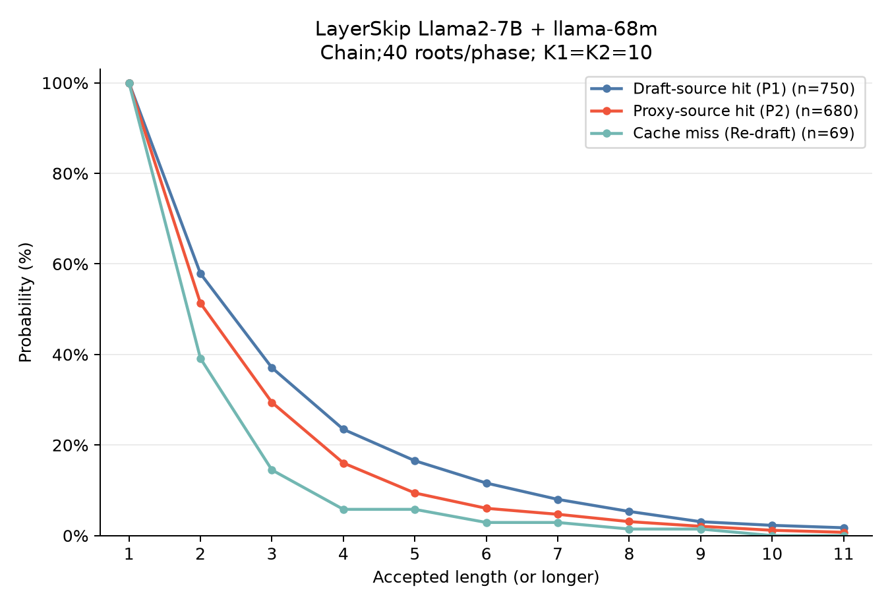
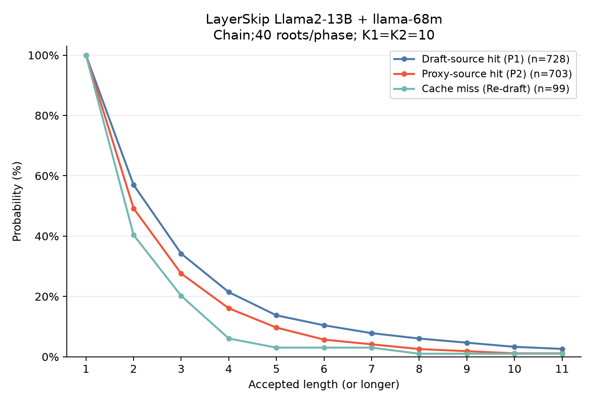

# Chain: phase별40후보, K1=K2=10 측정

같은 로컬 서버·모델·입력으로 chain 경로를 측정했다. 설정·집계·AL 정의는 [README.md](README.md). 모든 시간은 ms다.

[모든 timeline PDF](timelines/ALL_MODELS.pdf) · [HTML](timelines/index.html) · [AL 확률 PDF](AL_SURVIVAL_MODELS.pdf) · [확률·95% 구간 CSV](AL_SURVIVAL.csv)

추가 분석: [PS 초과와 다음 step의 response wait](RESPONSE_WAIT.md).

DS는11개 위치에4개×7+3개×4로 총40개, PS는 점수로 총40개를 선택한다. 각각40행×10회 forward로 후보당 길이10의 chain을 만든다. Target 실제 검증은10개 draft token이며 AL 최대는 correction/bonus 포함11이다.

## Llama2-7B + llama-68m

B1, BF16, T0.7, exit 21 (0-based), target GPU1장.12입력×2회. 유효 step 1499개.

| 현재 step | n | 비중/전체 hit (%) | AL | Profile TPS |
|---|---:|---:|---:|---:|
| P1 hit | 750 | 50.033 | 2.669 | 108.118 |
| P2 hit | 680 | 45.364 | 2.240 | 92.373 |
| Miss | 69 | 4.603 | 1.739 | 59.136 |
| Overall | 1499 | 95.397 | 2.432 | 98.424 |

| 현재 step | Step | DS forward1회 | DS 계산창 | DS 여유 | PS forward1회 | PS 계산창 | PS 여유 |
|---|---:|---:|---:|---:|---:|---:|---:|
| P1 hit | 24.689 | 0.214 | 3.912 | 1.773 | 0.214 | -0.057 | -2.198 |
| P2 hit | 24.246 | 0.214 | 3.304 | 1.163 | 0.214 | 0.106 | -2.037 |
| Miss | 29.409 | 0.215 | 3.558 | 1.411 | 0.216 | -0.140 | -2.296 |
| Overall | 24.706 | 0.214 | 3.620 | 1.479 | 0.214 | 0.013 | -2.130 |

계산창은 이미 사용한 forward 합을 포함한다. **음수 PS 여유는 다음 target 요청이 시작될 때 draft가 아직 준비를 마치지 못했음을 뜻한다.** 계산창도 음수라면 현재 고정된 비-forward 비용 아래 deadline 내 forward 여유가 없다는 뜻이다.

| 현재 step | DS 전체 | PS 전체 | DS deadline 초과 | PS deadline 초과 | DS 여유 하위5% | PS 여유 하위5% |
|---|---:|---:|---:|---:|---:|---:|
| P1 hit | 9.794 | 9.619 | 149/750 | 583/750 | -0.690 | -4.516 |
| P2 hit | 10.074 | 9.160 | 133/680 | 545/680 | -0.743 | -4.540 |
| Miss | 9.999 | 9.676 | 17/69 | 60/69 | -0.791 | -4.664 |
| Overall | 9.930 | 9.413 | 299/1499 | 1188/1499 | -0.738 | -4.530 |

PS 전체는 proxy 수신 완료→cache merge 완료다. PS 여유는 그 뒤의 정리까지 마친 수신 준비 시각을 사용한다. Forward1회는 model+LM head graph replay이며, 준비·샘플링을 포함한 전체 round 시간과 다르다.

| 현재 step | P(AL≥2) | P(AL≥4) | P(AL≥8) | P(AL≥10) | P(AL≥11) |
|---|---:|---:|---:|---:|---:|
| Draft-source hit (P1) | 57.87% | 23.47% | 5.33% | 2.27% | 1.73% |
| Proxy-source hit (P2) | 51.32% | 16.03% | 3.09% | 1.18% | 0.74% |
| Cache miss (Re-draft) | 39.13% | 5.80% | 1.45% | 0.00% | 0.00% |

각 선은 해당 source 안에서의 조건부 확률이다. x=1은100%이며 AL에는 correction/bonus가 포함된다. 두 반복을 묶은 UID bootstrap 구간과 초기 구간 포함 민감도 곡선은 AL_SURVIVAL.csv와 SUMMARY.json에 있다.

제외 내역: `{"warmup": 224, "initial10": 239, "terminal": 24}`.

## Llama2-13B + llama-68m

B1, BF16, T0.7, exit 26 (0-based), target GPU2장.12입력×2회. 유효 step 1530개.

| 현재 step | n | 비중/전체 hit (%) | AL | Profile TPS |
|---|---:|---:|---:|---:|
| P1 hit | 728 | 47.582 | 2.613 | 100.011 |
| P2 hit | 703 | 45.948 | 2.191 | 84.116 |
| Miss | 99 | 6.471 | 1.798 | 58.244 |
| Overall | 1530 | 93.529 | 2.366 | 89.644 |

| 현재 step | Step | DS forward1회 | DS 계산창 | DS 여유 | PS forward1회 | PS 계산창 | PS 여유 |
|---|---:|---:|---:|---:|---:|---:|---:|
| P1 hit | 26.124 | 0.214 | 4.868 | 2.733 | 0.213 | 0.769 | -1.364 |
| P2 hit | 26.043 | 0.214 | 5.015 | 2.875 | 0.214 | 1.304 | -0.836 |
| Miss | 30.870 | 0.215 | 5.204 | 3.052 | 0.216 | 1.133 | -1.022 |
| Overall | 26.394 | 0.214 | 4.957 | 2.819 | 0.214 | 1.039 | -1.099 |

계산창은 이미 사용한 forward 합을 포함한다. **음수 PS 여유는 다음 target 요청이 시작될 때 draft가 아직 준비를 마치지 못했음을 뜻한다.** 계산창도 음수라면 현재 고정된 비-forward 비용 아래 deadline 내 forward 여유가 없다는 뜻이다.

| 현재 step | DS 전체 | PS 전체 | DS deadline 초과 | PS deadline 초과 | DS 여유 하위5% | PS 여유 하위5% |
|---|---:|---:|---:|---:|---:|---:|
| P1 hit | 10.383 | 9.433 | 12/728 | 586/728 | 0.786 | -2.879 |
| P2 hit | 9.880 | 9.295 | 8/703 | 532/703 | 0.957 | -2.684 |
| Miss | 10.007 | 9.458 | 3/99 | 79/99 | 1.042 | -3.401 |
| Overall | 10.128 | 9.371 | 23/1530 | 1197/1530 | 0.853 | -2.789 |

PS 전체는 proxy 수신 완료→cache merge 완료다. PS 여유는 그 뒤의 정리까지 마친 수신 준비 시각을 사용한다. Forward1회는 model+LM head graph replay이며, 준비·샘플링을 포함한 전체 round 시간과 다르다.

| 현재 step | P(AL≥2) | P(AL≥4) | P(AL≥8) | P(AL≥10) | P(AL≥11) |
|---|---:|---:|---:|---:|---:|
| Draft-source hit (P1) | 57.01% | 21.43% | 6.04% | 3.30% | 2.61% |
| Proxy-source hit (P2) | 49.22% | 16.07% | 2.56% | 1.14% | 1.14% |
| Cache miss (Re-draft) | 40.40% | 6.06% | 1.01% | 1.01% | 1.01% |

각 선은 해당 source 안에서의 조건부 확률이다. x=1은100%이며 AL에는 correction/bonus가 포함된다. 두 반복을 묶은 UID bootstrap 구간과 초기 구간 포함 민감도 곡선은 AL_SURVIVAL.csv와 SUMMARY.json에 있다.

제외 내역: `{"warmup": 233, "initial10": 238, "terminal": 24}`.

## 비교 범위

이번 그래프는12개 입력의 진단 결과이며 전체 Spec-Bench의 AL 곡선이 아니다. 직전 tree 실험은 root 수·K·M이 달랐으므로 이번 결과와의 차이를 chain/tree 구조 하나의 효과로 해석하지 않는다.

P1/P2/miss는 서로 다른 step 집합이다. 따라서 P1 조건부 AL이 높다는 관측만으로 같은 prefix에서 P1 생성 방식이 더 우수하다는 인과 결론을 내리지 않는다. Miss는69/99개 step으로 표본이 작아 꼬리 확률을 특히 조심해서 해석한다.

이번 설정에서는 forward1회가 두 모델 모두 약0.214ms이고10회 합은 phase당 약2.14ms다. 그러나 준비·샘플링·계획·중간 대기를 포함한 DS/PS 전체는 약9~10ms다. PS 여유 평균은7B −2.130ms,13B −1.099ms이며 다음 target 요청 시점을 넘긴 비율은 각각79.25%,78.24%다. 따라서 K1=K2=10은 요청한 측정 조건이며, latency 관점의 최적 설정으로 확정하지 않는다.

기존 엔진의 native chain 경로를 그대로 사용했다. 계산 자체와 각 round의 CPU 준비/plan/샘플링을 timeline에서 구분한다. Proxy replica/별도 stream은 OFF이고 target/draft는 다른 GPU에서 병렬 실행한다.
