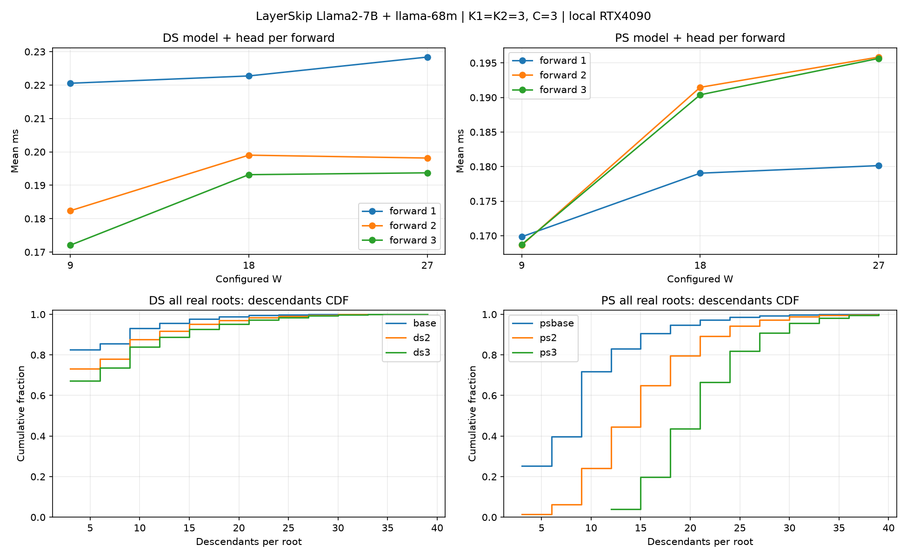
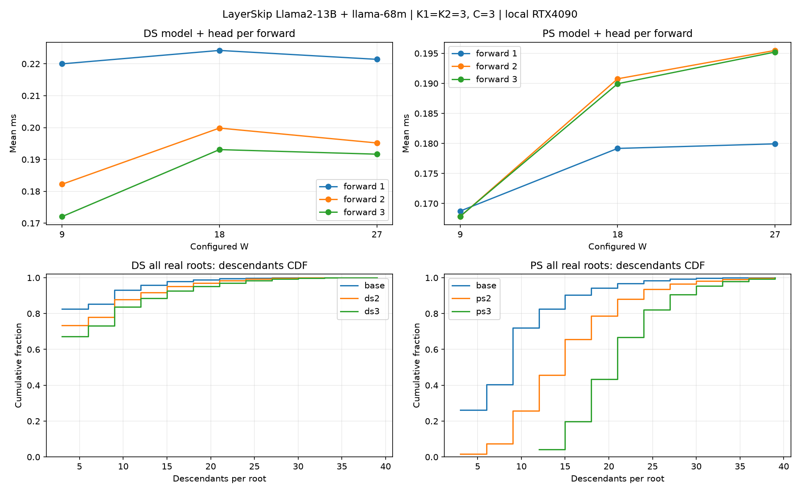

# 로컬 모델별 DS/PS 시간 예산과 입력 폭 진단

이 결과는 지정한 출발 설정의 짧은 중간 구간 진단이다. 전체 데이터셋 품질이나 최적 파라미터를 확정한 결과가 아니다.

조건·집계식·계측 한계: [README.md](README.md). 모든 시간은 ms이며 root 노드 자체는 자손 수에서 제외한다.

그림: [연속 두 step timeline PDF](timelines/ALL_MODELS.pdf), [HTML](timelines/index.html), [폭·노드 분포 PDF](DIAGNOSTICS.pdf).
전체 설정·source별 세 forward: [FORWARD_ROUNDS.csv](FORWARD_ROUNDS.csv). 전체 후보와 hit tree 노드 분포: [TREE_NODES.csv](TREE_NODES.csv).

## LayerSkip-Llama2-7B + llama-68m

Exit=21 (0-based), target GPU=1, K1/K2=3/3, DS 위치당 root=3, PS root=9, W1/W2=9/9, C=3, M1/M2=40.

| 현재 step | 표본 수 | Step | DS forward 1회 | DS 총 계산창 | DS 남은 여유 | PS forward 1회 | PS 총 계산창 | PS 남은 여유 |
|---|---:|---:|---:|---:|---:|---:|---:|---:|
| P1 hit | 698 | 25.929 | 0.191 | 7.580 | 7.008 | 0.168 | 2.153 | 1.648 |
| P2 hit | 712 | 25.819 | 0.200 | 6.266 | 5.666 | 0.168 | 2.488 | 1.983 |
| Miss | 239 | 25.083 | 0.169 | 7.864 | 7.359 | 0.169 | 2.478 | 1.972 |
| 전체 | 1649 | 25.759 | 0.192 | 7.054 | 6.479 | 0.168 | 2.345 | 1.840 |

계산창은 이미 사용한 forward 시간을 포함한다. DS 여유는 proxy **송신 종료** 기준이며 도착을 직접 측정한 값이 아니다. PS 여유는 정리 후 다음 명령 수신 준비까지 반영한다.

| 현재 step | 비중 (%) | AL | 진단 TPS | hit tree 자손 평균 | p95 | 최대 |
|---|---:|---:|---:|---:|---:|---:|
| P1 hit | 42.329 | 2.292 | 88.405 | 9.662 | 24.000 | 30.000 |
| P2 hit | 43.178 | 2.409 | 93.290 | 16.454 | 30.000 | 39.000 |
| Miss | 14.494 | 1.904 | 75.899 | N/A | N/A | N/A |
| 전체 | 100.000 | 2.286 | 88.754 | 13.091 | 27.000 | 39.000 |

| 현재 step | DS 여유 하위5% | DS 음수 step | PS 여유 하위5% | PS 음수 step |
|---|---:|---:|---:|---:|
| P1 hit | 4.554 | 1/698 | 0.861 | 6/698 |
| P2 hit | 3.556 | 0/712 | 1.188 | 0/712 |
| Miss | 6.724 | 0/239 | 1.263 | 0/239 |
| 전체 | 4.074 | 1/1649 | 0.978 | 6/1649 |

전체 hit rate: 85.506%. Miss는 hit tree 통계 대상이 아니다.

| 설정 W1/W2 | DS forward 평균 | PS forward 평균 | DS 전체 후보 자손 평균 / p95 / 최대 | PS 전체 후보 자손 평균 / p95 / 최대 |
|---|---:|---:|---|---|
| 9/9 (7b_base) | 0.192 | 0.168 | 4.425 / 12.000 / 39.000 | 9.000 / 21.000 / 39.000 |
| 18/9 (7b_ds2) | 0.205 | 0.170 | 5.404 / 15.000 / 39.000 | 9.000 / 21.000 / 39.000 |
| 27/9 (7b_ds3) | 0.207 | 0.171 | 6.117 / 18.000 / 39.000 | 9.000 / 21.000 / 39.000 |
| 9/9 (7b_psbase) | 0.193 | 0.169 | 4.425 / 12.000 / 39.000 | 9.000 / 21.000 / 39.000 |
| 9/18 (7b_ps2) | 0.193 | 0.187 | 4.231 / 12.000 / 39.000 | 15.000 / 27.000 / 39.000 |
| 9/27 (7b_ps3) | 0.193 | 0.191 | 4.068 / 12.000 / 39.000 | 21.000 / 30.000 / 39.000 |

각 후보의 자손 수는 0개인 유효 후보도 포함한다. 패딩 root는 제외한다. 아래 입력 폭 그래프는 첫 forward와 후속 forward를 분리한다.

7B의 DS 비교는 GPU4·5의 base를, PS 비교는 GPU6·7의 psbase를 기준으로 한다. 두 기준의 절대 latency 차이를 W 효과로 해석하지 않는다.

| W를 9→27로 변경 | 9의 forward 평균 | 27의 forward 평균 | 증감 |
|---|---:|---:|---:|
| DS | 0.192 | 0.207 | +7.88% |
| PS | 0.169 | 0.191 | +12.70% |

실제 모델 forward 평균이며, source·문맥의 구성은 생성 경로에 따라 달라진다. 동일 입력 tensor를 고정한 단일 커널 A/B가 아니다. 폭·round·prefix page별 분해는 AUDIT.json의 by_shape에서 확인한다.

| 현재 step | phase | 1회차 행 수 / latency | 2회차 행 수 / latency | 3회차 행 수 / latency |
|---|---|---:|---:|---:|
| P1 hit | DS | 85.63 / 0.219 | 9.00 / 0.182 | 9.00 / 0.172 |
| P1 hit | PS | 9.00 / 0.169 | 9.00 / 0.168 | 9.00 / 0.168 |
| P2 hit | DS | 117.39 / 0.241 | 9.00 / 0.186 | 9.00 / 0.173 |
| P2 hit | PS | 9.00 / 0.169 | 9.00 / 0.168 | 9.00 / 0.168 |
| Miss | DS | 12.00 / 0.164 | 9.00 / 0.172 | 9.00 / 0.170 |
| Miss | PS | 9.00 / 0.169 | 9.00 / 0.168 | 9.00 / 0.168 |
| 전체 | DS | 88.67 / 0.221 | 9.00 / 0.182 | 9.00 / 0.172 |
| 전체 | PS | 9.00 / 0.169 | 9.00 / 0.168 | 9.00 / 0.168 |

DS의 W는 첫 forward를 제한하지 않는다. 실제 첫 입력은 tree-hit context bucket×위치당 root3이고, 후속 입력은 min(bucket root 수,W)다. PS는 root9개를 유지하지만 graph의 물리적 폭은 W다. 따라서 W=27 설정이 모든 단계의 실제 계산량을 정확히3배로 만든다는 뜻은 아니다.

준비·선택·정리의 나머지 비용을 현재 K=3 값으로 고정한 계산창이다. K를 늘리면 round별 샘플링·선택 비용도 늘어나므로 계산창을 모델 forward 시간만으로 나눈 값을 새 K로 사용하면 안 된다.

| 현재 step | DS graph 1round | DS 비-forward 합 | PS graph 1round | PS 비-forward·정리 합 |
|---|---:|---:|---:|---:|
| P1 hit | 0.661 | 3.883 | 0.545 | 5.390 |
| P2 hit | 0.711 | 3.981 | 0.546 | 5.275 |
| Miss | 0.545 | 3.624 | 0.546 | 5.350 |
| 전체 | 0.665 | 3.888 | 0.546 | 5.334 |

실제 입력 폭 / 문맥 / 상태별 각 round의 model·head·forward 평균과 분위수는 SUMMARY.json에 모두 보존했다.

## LayerSkip-Llama2-13B + llama-68m

Exit=26 (0-based), target GPU=2, K1/K2=3/3, DS 위치당 root=3, PS root=9, W1/W2=9/9, C=3, M1/M2=40.

| 현재 step | 표본 수 | Step | DS forward 1회 | DS 총 계산창 | DS 남은 여유 | PS forward 1회 | PS 총 계산창 | PS 남은 여유 |
|---|---:|---:|---:|---:|---:|---:|---:|---:|
| P1 hit | 741 | 32.229 | 0.192 | 11.425 | 10.848 | 0.168 | 4.263 | 3.760 |
| P2 hit | 592 | 32.930 | 0.200 | 10.981 | 10.381 | 0.168 | 4.381 | 3.876 |
| Miss | 256 | 26.706 | 0.169 | 9.009 | 8.503 | 0.169 | 2.866 | 2.361 |
| 전체 | 1589 | 31.601 | 0.191 | 10.870 | 10.296 | 0.168 | 4.082 | 3.578 |

계산창은 이미 사용한 forward 시간을 포함한다. DS 여유는 proxy **송신 종료** 기준이며 도착을 직접 측정한 값이 아니다. PS 여유는 정리 후 다음 명령 수신 준비까지 반영한다.

| 현재 step | 비중 (%) | AL | 진단 TPS | hit tree 자손 평균 | p95 | 최대 |
|---|---:|---:|---:|---:|---:|---:|
| P1 hit | 46.633 | 2.509 | 77.841 | 10.425 | 24.000 | 33.000 |
| P2 hit | 37.256 | 2.336 | 70.942 | 17.285 | 33.000 | 36.000 |
| Miss | 16.111 | 1.828 | 68.454 | N/A | N/A | N/A |
| 전체 | 100.000 | 2.335 | 73.885 | 13.472 | 30.000 | 36.000 |

| 현재 step | DS 여유 하위5% | DS 음수 step | PS 여유 하위5% | PS 음수 step |
|---|---:|---:|---:|---:|
| P1 hit | 8.052 | 0/741 | 2.410 | 10/741 |
| P2 hit | 7.214 | 1/592 | 2.574 | 3/592 |
| Miss | 7.449 | 0/256 | 1.223 | 3/256 |
| 전체 | 7.489 | 1/1589 | 1.834 | 16/1589 |

전체 hit rate: 83.889%. Miss는 hit tree 통계 대상이 아니다.

| 설정 W1/W2 | DS forward 평균 | PS forward 평균 | DS 전체 후보 자손 평균 / p95 / 최대 | PS 전체 후보 자손 평균 / p95 / 최대 |
|---|---:|---:|---|---|
| 9/9 (13b_base) | 0.191 | 0.168 | 4.408 / 12.000 / 33.000 | 9.000 / 21.000 / 39.000 |
| 18/9 (13b_ds2) | 0.206 | 0.170 | 5.383 / 15.000 / 39.000 | 9.000 / 21.000 / 39.000 |
| 27/9 (13b_ds3) | 0.203 | 0.171 | 6.162 / 18.000 / 39.000 | 9.000 / 21.000 / 39.000 |
| 9/18 (13b_ps2) | 0.192 | 0.187 | 4.235 / 12.000 / 39.000 | 15.000 / 27.000 / 39.000 |
| 9/27 (13b_ps3) | 0.192 | 0.190 | 4.107 / 12.000 / 36.000 | 21.000 / 30.000 / 39.000 |

각 후보의 자손 수는 0개인 유효 후보도 포함한다. 패딩 root는 제외한다. 아래 입력 폭 그래프는 첫 forward와 후속 forward를 분리한다.

| W를 9→27로 변경 | 9의 forward 평균 | 27의 forward 평균 | 증감 |
|---|---:|---:|---:|
| DS | 0.191 | 0.203 | +5.92% |
| PS | 0.168 | 0.190 | +13.13% |

실제 모델 forward 평균이며, source·문맥의 구성은 생성 경로에 따라 달라진다. 동일 입력 tensor를 고정한 단일 커널 A/B가 아니다. 폭·round·prefix page별 분해는 AUDIT.json의 by_shape에서 확인한다.

| 현재 step | phase | 1회차 행 수 / latency | 2회차 행 수 / latency | 3회차 행 수 / latency |
|---|---|---:|---:|---:|
| P1 hit | DS | 91.39 / 0.222 | 9.00 / 0.183 | 9.00 / 0.172 |
| P1 hit | PS | 9.00 / 0.169 | 9.00 / 0.168 | 9.00 / 0.168 |
| P2 hit | DS | 117.56 / 0.241 | 9.00 / 0.186 | 9.00 / 0.173 |
| P2 hit | PS | 9.00 / 0.169 | 9.00 / 0.168 | 9.00 / 0.168 |
| Miss | DS | 12.00 / 0.164 | 9.00 / 0.172 | 9.00 / 0.170 |
| Miss | PS | 9.00 / 0.169 | 9.00 / 0.168 | 9.00 / 0.168 |
| 전체 | DS | 88.35 / 0.220 | 9.00 / 0.182 | 9.00 / 0.172 |
| 전체 | PS | 9.00 / 0.169 | 9.00 / 0.168 | 9.00 / 0.168 |

DS의 W는 첫 forward를 제한하지 않는다. 실제 첫 입력은 tree-hit context bucket×위치당 root3이고, 후속 입력은 min(bucket root 수,W)다. PS는 root9개를 유지하지만 graph의 물리적 폭은 W다. 따라서 W=27 설정이 모든 단계의 실제 계산량을 정확히3배로 만든다는 뜻은 아니다.

준비·선택·정리의 나머지 비용을 현재 K=3 값으로 고정한 계산창이다. K를 늘리면 round별 샘플링·선택 비용도 늘어나므로 계산창을 모델 forward 시간만으로 나눈 값을 새 K로 사용하면 안 된다.

| 현재 step | DS graph 1round | DS 비-forward 합 | PS graph 1round | PS 비-forward·정리 합 |
|---|---:|---:|---:|---:|
| P1 hit | 0.669 | 3.915 | 0.545 | 5.538 |
| P2 hit | 0.711 | 4.026 | 0.545 | 5.505 |
| Miss | 0.544 | 3.623 | 0.548 | 5.383 |
| 전체 | 0.664 | 3.909 | 0.546 | 5.501 |

실제 입력 폭 / 문맥 / 상태별 각 round의 model·head·forward 평균과 분위수는 SUMMARY.json에 모두 보존했다.

## 검증과 한계

| 모델 | 계측 OFF→ON 출력 | 공통 step | 평균 step 차이 (ms) | 문항 평균 차이의95% bootstrap 구간 |
|---|---|---:|---:|---|
| 7b | 24/24 동일 | 1649 | +0.019 | -0.355 ~ +0.393 |
| 13b | 24/24 동일 | 1589 | +0.293 | -0.234 ~ +0.665 |

Marker kernel을 포함한 실측이다. 독립 실행의 변동과 계측 비용을 완전히 분리한 수치는 아니며, 구간이0을 포함한다고 비용이0이라는 뜻은 아니다.12개 UID로 묶어 bootstrap했고 두 반복을24개 독립 문항으로 취급하지 않았다.

| 실행 | 유효 step | 준비 영향으로 추가 제외 | GPU 외부 작업 관측 | telemetry 최대 간격 (s) |
|---|---:|---:|---:|---:|
| 13b_base | 1589 | 3 | 0 | 2.51 |
| 13b_control | 1589 | 3 | 0 | 2.40 |
| 13b_ds2 | 1466 | 3 | 0 | 2.40 |
| 13b_ds3 | 1544 | 4 | 0 | 2.40 |
| 13b_ps2 | 1403 | 5 | 0 | 2.39 |
| 13b_ps3 | 1581 | 5 | 0 | 2.45 |
| 7b_base | 1649 | 5 | 0 | 35.95 |
| 7b_base_repeat | 1649 | 5 | 0 | 2.41 |
| 7b_control | 1649 | 5 | 0 | 2.35 |
| 7b_ds2 | 1580 | 5 | 0 | 2.53 |
| 7b_ds3 | 1392 | 3 | 0 | 2.49 |
| 7b_ps2 | 1351 | 7 | 0 | 2.46 |
| 7b_ps3 | 1499 | 7 | 0 | 2.45 |
| 7b_psbase | 1649 | 5 | 0 | 2.44 |

7B base의 worker 인계 중 telemetry에 약36초 공백이 있어 같은 설정을 별도 `base_repeat`로 다시 확인했다. 기존 base/반복 출력은 동일, 공통 step 평균 25.759→25.918ms. 기존 base를 삭제하거나 더 빠른 반복으로 교체하지 않았다.

13B 첫 실행에서는 두 번째 target GPU의 `_pack_verify_inputs_kernel` 최초 컴파일에 최대 약51초가 걸렸다. CPU 컴파일 구간과 겹치는 step을 직접 식별해 제외했고, latency 크기로 잘라내지 않았다. 모델·입력폭마다 제외 개수는 위 표와 AUDIT.json에 남았다.

7B target1장·13B target2장이라 두 target의 절대 latency 차이를 모델 크기 하나의 효과로 해석하지 않는다. proxy replica/별도 stream은 이 진단에서 OFF이며 target과 draft는 서로 다른 GPU에서 병렬 실행한다.

M=40이 생성 상한에는 걸리지 않아도 target graph는41 query, DS 첫 forward는 최대123행으로 패딩한다. 실제 hit tree는 그보다 작다. 이 결과는 후속 M 축소·K 조정의 근거이며, 지금 설정이 최적이라는 결론은 아니다.
