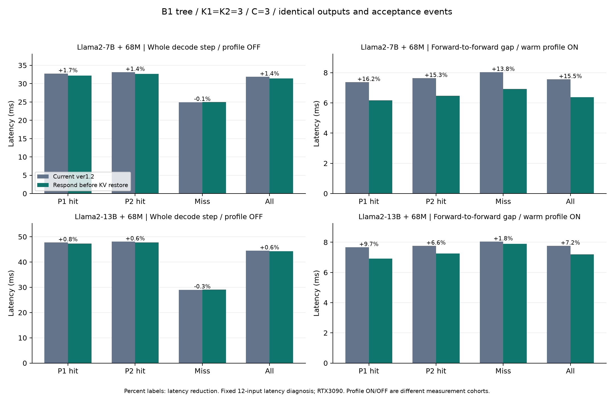

# Target forward 사이 공백 최적화 — 별도 실험 브랜치

상태: **모든 예약 비교 실행과 분석 완료. 원래 ver1.2에는 미반영.**

- 작업 브랜치: `exp/duet-target-gap-20261017`
- 보호 대상: `/home/chokwans99/PSD-MLSys-ver0.1`, `MLSys-ver1.2` @ `899e4eb1`
- 보호 기준: 기존 uncommitted 변경까지 포함한 git status 및 runtime 91파일 SHA256을 보존했다. [ORIGINAL_WORKTREE.json](ORIGINAL_WORKTREE.json), [ORIGINAL_UNCHANGED.json](ORIGINAL_UNCHANGED.json).
- 실행 서버: eslab18/nova의 RTX3090. [GPU topology](GPU_TOPOLOGY.txt)의 PIX 그룹을 사용하고 CPU affinity를 같은 NUMA0 안에서 분리했다. 7B는 GPU2 target/GPU3 draft, 13B는 GPU4·5 target/GPU6 draft. 로컬 서버와의 절대 latency 비교에는 사용하지 않는다.

## 무엇을 줄이는가

사용자가 말한 기다림은 특정 `target_recv_response_wait` 막대 하나보다 넓다. 여기서는 **이전 `final_logits` 종료 → 다음 `graph_pre` 시작**을 target forward 사이 공백으로 정의하고, 수락/KV·요청 준비·요청 전송·응답·다음 입력 준비로 분해한다. 최종 성능 판정은 별도로 **profile OFF 전체 decode-step 시간**을 사용한다.

## 비교 구현

| Arm | 기존 동작과 변경 | 정확성 조건 |
|---|---|---|
| before | 보호 대상 runtime의 정확한 현재 파일 내용. 승인된 집계 변경도 동일하게 포함 | 논문 원본 커밋 자체와의 비교가 아니라 현재 ver1.2 작업 내용과의 비교 |
| snapshot | 기존 response packet에서 token/valid/source/tree를 소비자마다 따로 GPU→CPU로 읽던 것을 한 번 읽어 immutable CPU snapshot으로 공유 | packet·q logits·후보 순서·수락 법칙·RNG 그대로 |
| inputs | snapshot + 기존 GPU token 입력 직접 사용, positions/slots/pages/context 버퍼 재사용. 새 pinned tensor를 매 step 만들지 않음 | 동일 query 행 수·dtype·position·fragmented page 주소. TP follower는 bounded pinned staging 사용 |
| restore | before와 동일한 코드에서 이전 draft tree KV 복원을 cache-hit 응답 전에서 응답 후로 이동 | hit는 cached tokens/logits만 읽음. miss는 JIT 전에 복원. 다음 glue/DS/PS forward 전에는 항상 복원. 이전 seq/실제 수락 prefix 보호 유지 |
| combined | snapshot + inputs + restore의 결합. 현재 실험 브랜치 HEAD | 모델별12입력1회로 출력·수락 기록 확인. 결합 반복 A/B는 미실시 |

`restore`는 기존 정확성 오류의 수정이 아니다. 동일한 KV를 같은 prefix에 복원한다. 일을 없애는 변경이 아니라 **target이 기다리지 않아도 되는 일을 응답 뒤로 옮기는 변경**이다. KV staging, parent-q, 이번 응답 topology는 서로 다른 데이터이며, 이전 state를 따로 보관하여 새 hit state가 덮어써도 안전하게 복원한다.

모델 forward/attention/확률·후보 수식·tree 알고리즘·파라미터는 바꾸지 않았다. 새 성능 옵션은 추가하지 않았다. 기존 graph/planless/mask 최적화를 새 구현이라고 주장하지 않는다.

## 실험 설계

- 두 모델: LayerSkip-Llama2-7B/13B + JackFram/llama-68m, BF16, B1, T0.7, seed9101.
- Tree, K1=K2=3, C3, G=M40, DS 위치당3 roots, PS9 roots, DS 후속 라운드 입력 상한9 / PS 입력9(DS 첫 라운드는 root 수에 따라 변동), 마지막 깊이 확장. Exit은 0-based21/26.
- 고정 Spec-Bench12턴(6과제), input cap512, output cap192. Warm3 prompts. **Full Spec-Bench 품질 평가/최적 파라미터 탐색은 아니다.**
- 첫 ablation은 profile-OFF `before → snapshot → inputs → inputs → snapshot → before`, process당12입력×2회.
- 후속 KV 순서 변경 단독은 warm-cache profile 한 쌍과 profile-OFF `before → restore → restore → before`로 다시 검증한다.
- 각 arm에서 출력 ID 배열, 순서별 source/cache-hit/valid-k/accepted-length를 정확히 비교한다. 달라지면 같은 workload의 latency 비교로 처리하지 않는다.
- 상한/cap·clip·partial batch 제외는 양쪽 동일. 사용자 승인한 **동일 request/batch/source 구성 내 median의 2배 초과** 정책과 제외 개수를 보존한다. Raw cap/clip-only 집합도 함께 비교하고, filtered 교집합에서 동일 step끼리 비교한다.
- Bootstrap은12 UID를 cluster로 사용한다. 같은 입력 반복은 독립 문항으로 세지 않는다. Process 반복별 결과도 따로 공개한다.
- 준비/컴파일은 inference 시간으로 빼서 개선했다고 하지 않는다. Warmup은 원래부터 측정 밖이다. 초기7B profile의 parent-q gather cold JIT 때문에 profile 평균이 크게 보이는 현상을 발견하여 최종 attribution용 warm-cache profile을 추가했다.

## KV 복원 순서 단독 변경의 전체 step 결과

**아래 표가 성능 판정의 주 근거다. Profile OFF, 같은 GPU, ABBA 순서, 동일 출력·수락 기록의 step끼리 비교했다.** 전체 step에는 target/draft 응답 대기, 수락, 스케줄링 비용이 모두 들어 있다.

| Target +68M | Step 전→후(ms) | 감소 | 감소율95% CI | 반복 a / b 감소율 | 동일 step 수 |
|---|---:|---:|---:|---:|---:|
| Llama2-7B | 31.882 → 31.451 | +1.35% | [+1.00, +1.72]% | +1.34% / +1.37% | 3526 |
| Llama2-13B | 44.513 → 44.255 | +0.58% | [+0.08, +1.00]% | +1.11% / +0.05% | 3839 |

| Target | Target 호출·수락 구간 전→후(ms) | 그 밖의 step 구간 전→후(ms) |
|---|---:|---:|
| 7B | 27.700 → 27.672 | 4.182 → 3.779 |
| 13B | 40.347 → 40.371 | 4.166 → 3.884 |

신뢰구간은 **12 UID cluster bootstrap**이다. Process가 반복될 때의 환경 변동까지 모두 포괄하는 신뢰구간은 아니다. 따라서 반복별 결과와 warmed profile의 변경 구간도 함께 판단한다. **13B는 반복 b가 약0.047%로 거의 중립이므로, 큰 전체 step 향상이 확정됐다고 표현하지 않는다.** 응답·verification 바깥 구간 감소와 전체 평균의 작은 이득을 구분한다.

| Target | 현재 step source | 동일 n | 전체 step 전→후(ms) | 감소 |
|---|---|---:|---:|---:|
| 7B | P1 hit | 1688 | 32.769 → 32.227 | +1.65% |
| 7B | P2 hit | 1372 | 33.150 → 32.699 | +1.36% |
| 7B | Miss | 466 | 24.938 → 24.962 | -0.10% |
| 13B | P1 hit | 1659 | 47.723 → 47.352 | +0.78% |
| 13B | P2 hit | 1496 | 48.066 → 47.770 | +0.61% |
| 13B | Miss | 684 | 28.957 → 29.053 | -0.33% |

엔진 내부 timer와 별도로 원래 `LLMEngine.step()` 호출 전체를 감싼 벽시계도 같은 감소율을 확인했다. [WALL_STEP_CHECK.json](WALL_STEP_CHECK.json).

## 변경 구간을 직접 본 warmed profile

전체 step과 별도로, 초기10 step 및 cap/clip을 동일하게 제외한 profile-ON 표본이다. 위의 비계측 성능과 섞어 평균내지 않는다.

| Target | 구간 | 전→후(ms) | 감소(ms) |
|---|---|---:|---:|
| 7B | 요청 전송 후 응답 완료 | 3.552 → 2.577 | +0.975 |
| 7B | 최종 logits 종료→다음 target forward | 7.559 → 6.385 | +1.174 |
| 7B | 응답 완료→다음 target forward | 1.734 → 1.657 | +0.077 |
| 7B | Target exit 이전 forward | 16.902 → 16.941 | -0.039 |
| 7B | Target exit 이후 forward | 7.784 → 7.722 | +0.062 |
| 13B | 요청 전송 후 응답 완료 | 3.206 → 2.692 | +0.514 |
| 13B | 최종 logits 종료→다음 target forward | 7.761 → 7.199 | +0.562 |
| 13B | 응답 완료→다음 target forward | 1.978 → 1.946 | +0.032 |
| 13B | Target exit 이전 forward | 25.434 → 24.949 | +0.486 |
| 13B | Target exit 이후 forward | 11.459 → 11.329 | +0.129 |

계측 marker가 CPU/GPU 실행 순서와 오버헤드 노출 위치에 영향을 줄 수 있으므로, profile에서 줄어든 공백 시간을 비계측 절감 시간으로 그대로 사용하지 않는다. 최종 효과 크기는 앞의 profile-OFF 전체 step 및 별도 벽시계 결과를 따른다.

`response_ms`는 요청 send 종료부터 응답 대기 종료까지의 관측된 경과 시간이다. CPU 준비·NCCL·경우에 따라 JIT를 포함하므로 순수 통신 latency라고 부르지 않는다. KV 복원은 target에서 수행하는 일이 아니라 **draft의 요청 서비스**다. Hit는 응답을 먼저 보내고 복원하므로, target forward와 겹칠 수 있다. Miss는 복원 이후에 JIT하므로 lossless 동작에 필요한 prefix를 항상 먼저 확보한다. Cache 판단 뒤에 metadata를 읽게 되는 실행 순서 변화도 있으므로, 모든 source의 감소분을 KV copy 하나의 순수 비용이라고 해석하지 않는다.



## 정보 재사용·입력 준비의 별도 비교

독립적으로 측정한 앞선 캠페인이다. 아래 변화와 KV 순서 변경의 효과를 더하지 않는다. **결합 코드는 마지막에 모델별12입력1회로 실행·정확성을 확인했다. 결합 코드의 반복 A/B 성능 검증은 하지 않았으므로 개별 효과를 합산하지 않는다.**

| Target | 비교 | 감소율 | UID95% CI | 반복 a / b |
|---|---|---:|---:|---:|
| 7B | before → snapshot | +0.81% | [+0.18, +1.41]% | -0.00% / +1.60% |
| 7B | before → inputs | +1.29% | [+0.55, +1.96]% | +0.44% / +2.13% |
| 7B | snapshot → inputs | +0.49% | [-0.36, +1.30]% | +0.44% / +0.53% |
| 13B | before → snapshot | +0.26% | [-0.21, +0.71]% | -0.38% / +0.91% |
| 13B | before → inputs | +1.50% | [+1.20, +1.81]% | +1.97% / +1.02% |
| 13B | snapshot → inputs | +1.24% | [+0.91, +1.59]% | +2.35% / +0.11% |
| 7B_CHAIN | before → inputs | +2.91% | [+2.70, +3.14]% | +3.08% / +2.73% |

`snapshot`은 추가 동기화를 줄이는 방향이지만 반복별 효과를 확인해야 한다. `inputs`는 GPU 입력·geometry 버퍼 재사용까지 포함한 조합이다. Incremental 비교(snapshot→inputs)와 코드 변경량도 함께 봐야 한다. 이 결과만으로 임의의 모델/B/길이에서 개선을 보장하지 않는다. 구현은 해당 실험 커밋과 서버 variant에 보존했다.

## 2배 step 제외 내역과 raw 민감도

| Target | 반복 | before 제외 | restore 제외 | Raw 감소율 | Filtered 감소율 |
|---|---|---:|---:|---:|---:|
| 7B | a | 0 | 0 | +1.34% | +1.34% |
| 7B | b | 0 | 0 | +1.37% | +1.37% |
| 13B | a | 1 | 0 | +1.22% | +1.11% |
| 13B | b | 0 | 0 | +0.05% | +0.05% |

2배 기준은 같은 request-group·batch·source 구성의 median을 사용한다. Step의 시간과 토큰을 함께 제외하고 raw를 보존했다. 각 arm에서 제외된 step이 다를 수 있으므로 filtered 결과는 **양쪽에 남은 step 교집합**이다. Raw 출력·수락 기록은 정확히 일치하지만, 각 arm의 native filtered AL/hit 평균은 제외 집합 차이 때문에 소폭 달라질 수 있다. 모든 arm의 제외 개수는 [EXCLUSIONS.json](EXCLUSIONS.json)에 있다. 준비 시간을 retained step에서 임의로 차감하지 않았다.

## 정확성·환경·브랜치 보호

- KV 순서 변경 최종 runtime: 46개 회귀 검사, failure/error/skip 모두0. [CHECKS.json](raw/checks_restore_only/CHECKS.json). 단편화 page, 이전 state 보존, seq 교체, EOS/output 절단을 검사했다.
- `restore_7b_profile_warm`: 12개 출력·918개 수락 event 모두 기준과 동일.
- `restore_7b_final_a`: 24개 출력·1783개 수락 event 모두 기준과 동일.
- `restore_7b_final_b`: 24개 출력·1783개 수락 event 모두 기준과 동일.
- `restore_13b_profile_warm`: 12개 출력·979개 수락 event 모두 기준과 동일.
- `restore_13b_final_a`: 24개 출력·1941개 수락 event 모두 기준과 동일.
- `restore_13b_final_b`: 24개 출력·1941개 수락 event 모두 기준과 동일.
- 최종 결합 코드: GPU 기능 검사 52개 모두 통과. [combined CHECKS](raw/checks_combined/CHECKS.json).
- 최종 결합 7B: 12개 출력·918개 event 정확히 일치. 단일 process/profile OFF 평균 step 31.038ms는 실행 확인용이며 반복 A/B 효과 크기로 인용하지 않는다.
- 최종 결합 13B: 12개 출력·979개 event 정확히 일치. 단일 process/profile OFF 평균 step 43.745ms는 실행 확인용이며 반복 A/B 효과 크기로 인용하지 않는다.
- Cache routing CPU13개는 동일 fixture로 기존/변경 runtime 각각 통과했다. 오래된 fixture의 `tree_cache_is_tree` 누락을 테스트만 보완했다. 최초에는 baseline에서도12건이 실패했고, fixture 보완 후 양쪽13건 모두 통과했다. 중간 wrapper의 import 순서 오류 로그도 별도 보존했다. Serving 수정으로 테스트를 우회하지 않았다. [BEFORE](raw/CACHE_CONTRACTS_BEFORE.json), [AFTER](raw/CACHE_CONTRACTS_AFTER.json).
- 모든 완료 run은 source hash가 실행 전후 동일해야 한다. GPU 초기 점유·동시 PID·clock·온도를 [TELEMETRY.json](TELEMETRY.json)에 보존했다. 동시 GPU residency 검사는 모든 호스트/하드웨어 잡음을 제거했다는 뜻은 아니다.
- 원래 브랜치·커밋·91개 runtime 파일·기존 git status는 [ORIGINAL_UNCHANGED.json](ORIGINAL_UNCHANGED.json)에서 확인한다. 기존 uncommitted 작업을 지우거나 덮어쓰지 않았다.
- 초기 cold-start 진단을 위해 중단한4개 실행은 `aborted`이며 성능/정확성 완료 수에 넣지 않았다. 컴파일/JIT 준비 차이를 inference 개선으로 주장하지 않는다.

## 최종 판단과 적용 범위

- 7B: 이번 B1 tree 설정에서 KV 복원 순서 단독 변경을 적용 후보로 추천한다.
- 13B: 이번 B1 tree 설정에서 KV 복원 순서 단독 변경을 적용 후보로 추천한다.

**기존 ver1.2에 자동 병합하지 않았다.** 독립 패치는 [KV_RESTORE_ORDER.patch](KV_RESTORE_ORDER.patch)이며 runtime 변경은 `ssd/ssd/engine/draft_runner.py` 한 파일이다. 현재 보호 대상에 `git apply --check`만 수행해 적용 가능함을 확인했다. 실험 브랜치 HEAD는 결합 코드이며 [COMBINED_RUNTIME.patch](COMBINED_RUNTIME.patch)에 해당한다. 개별 채택 판단과 결합 실행 검사를 구분해서 검토한다. 다른 서버에서 검토할 때는 원래 baseline의 pending 집계 변경까지 포함한 `BASELINE_WORKING_CHANGES.patch`와 혼동하지 않는다.

검증 범위는 RTX3090·B1·현재 두 모델·K3 tree·고정12입력이다. **B>1, T=0 전체 모델 실행, 13B chain, 다른 서버로의 성능 일반화는 검증하지 않았다.** 7B chain은 별도 K10/40 roots 조건에서 before↔inputs만 검증했다. Chain에는 tree KV 복원 구간 자체가 없으므로 이 단독 변경으로 chain response wait까지 줄였다고 주장하지 않는다. 다음 검토는 필요할 때 input 재사용과 KV 순서 변경의 결합 효과 또는 chain의 별도 큰 구간을 같은 방식으로 비교하는 것이다.

## 재검토·재생성

- [STEP_COMPARISONS.json](STEP_COMPARISONS.json): profile OFF, raw/filtered, source별 latency, 반복·UID bootstrap.
- [PROFILE_COMPONENTS.json](PROFILE_COMPONENTS.json): warmed before/after 및 초기 ablation traces. 초기 cold 7B baseline은 최종 개선 판단에 사용하지 않는다.
- [raw/VARIANTS.json](raw/VARIANTS.json): 서버 variant별 모든 runtime SHA256과 baseline 대비 변경 파일.
- `raw/runs/`: 모든 완료 run의 JSON·native profile·PROVENANCE·telemetry·parity. 서버 원본은 `/data2/chokwans99/target-gap-20261017/`.
- `analyze_steps.py`, `analyze_profiles.py`, `audit_telemetry.py`, `plot_results.py`: 저장된 결과만으로 재분석. 모델/GPU가 필요 없다.

```bash
python analyze_steps.py --raw raw --output STEP_COMPARISONS.json
python analyze_profiles.py --raw raw --output PROFILE_COMPONENTS.json
python audit_telemetry.py --raw raw --output TELEMETRY.json
python plot_results.py
```

## 다른 작업자가 확인할 순서

1. [LOCAL_VARIANTS.json](LOCAL_VARIANTS.json)에서 frozen runtime이 local git blob과 정확히 일치하는지 확인한다. `before=1a2e349`, `snapshot=4d8c732`, `inputs=b2c1456`, `combined=51030a0`이다. KV 단독은 before에 독립 패치를 적용한 상태다. 현재 HEAD의 문서 commit이 추가되어도 runtime은 `combined`와 같다.
2. [SOURCE_LATENCIES.csv](SOURCE_LATENCIES.csv), step JSON, wall-step JSON으로 동일 step의 P1/P2/Miss/Overall 전후를 확인한다. 13B KV 단독의 거의 중립인 두 번째 반복과 결합 코드의 반복 A/B 미검증을 함께 읽는다.
3. 원시 데이터를 다시 보려면 아래 archive를 해제한다. 기존 `raw/`가 없는 새 작업 디렉터리에서 실행한다. **원래 ver1.2에 branch 전체를 그대로 병합하지 않는다.** Baseline pending 변경과 이번 optimization 패치를 구분하여 검토한다.

```bash
tar -xJf RAW_RESULTS.tar.xz
```

[RAW_RESULTS.tar.xz](RAW_RESULTS.tar.xz)는36개 완료 실행의 원시 결과·profile·telemetry·정확성 검사·fixture 진단을 포함한다. [ARTIFACTS.json](ARTIFACTS.json)에 크기와 SHA256을 저장했다. [CAMPAIGN_STATUS](raw/CAMPAIGN_STATUS.json)는4개 준비 중단과36개 완료를 구분하고, 마지막 시점에 이 실험의 GPU 프로세스가 남지 않았음을 기록한다. 최대 관측 온도는66°C였고, 측정 GPU당 동시 프로세스는1개 이하였다.
